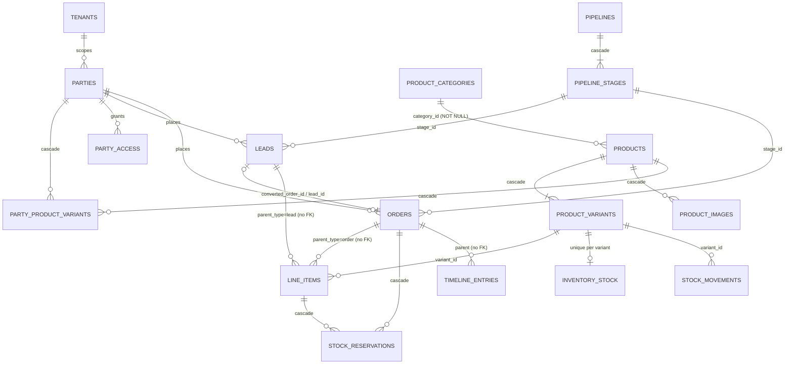

# OrderBook — software and code structure

**What this is.** OrderBook is an offline, LAN-only order and inventory management
application for a ceramic company. It is two cooperating web apps, each wrapped in
one Electron desktop shell:

- **Master Panel.** Runs on one PC. It owns the PostgreSQL database and every file.
  Every durable write goes through it.
- **Office Panel.** Runs on any number of other PCs on the same LAN. Each one is a
  small local server plus a browser UI. It creates leads, manages parties and
  products, and converts leads to orders. It has no database. It keeps a snapshot
  and an outbox on disk so that staff can keep working while the Master is off.

It is order management, not billing. **The software carries no money at all**: no
rates, amounts or totals anywhere. Pricing was removed on 2026-09-21 (migration
`20260324000000_product_master_trim`). There is no AI assistant; the one that
existed was removed, and only its database leftovers remain (§6.14).

**As of:** 2026-09-25, version **1.2.0** (every `package.json` in the repo carries
it). Counts were first taken at `43fd5b0`; the defects marked **fixed 2026-09-22**
were fixed in the commit that added this file. The 2026-09-25 audit round
(`e1ac5ce..7d6ae68`: eleven merged fix branches, then a test reconciliation, the
command-palette change, and a fix making the shell tests wait until the panel is
listening) was walked file by file and every part of this document it touched was
re-checked at `ffb69fe`, and the shell tests again at `7d6ae68`, which changes only
them; what it fixed is marked **fixed 2026-09-25**, and what it found and left open
is listed where the owed work lives (§5.11, §7.5, §8.9, §9.7, §10.10). §14's graph
is still the `43fd5b0` snapshot.

**Catalogue v2 (2026-09-29, `docs/catalogue/CATALOGUE_MODEL.md`)** added the files
and changed the entries marked *catalogue v2* in §3–§13. Only the counts those
entries state were re-taken; the workspace-wide file, line and test counts in §2,
§4's header table and §12's headings still describe `7d6ae68`.

**How to use this file.**

- It is the single structure reference. It replaced `docs/CODE_MAP.md` on
  2026-09-22 and carries everything that file held: the workspace table, "where a
  change goes" (§15) and which tests guard what (§12, §15).
- **Current state, decisions, traps and owed work are in `HANDOFF.md`.** Read that
  first; this file is the layout, which changes more slowly.
- §1–§2 give the big picture and the toolchain. §3–§10 go workspace by workspace,
  down to each file. §11 walks the main flows end to end, naming files and
  functions. §12 is the test map, §13 the documentation map, §14 the dependency
  hubs from a graphify code graph, and §15 the "you want to… → touch → guarded by"
  table.
- Every path in backticks is repo-relative and exists in `git ls-files`, with three
  kinds of exception: paths written with a `<placeholder>` (runtime paths such as
  `<dataDir>/postgres`); untracked build output and local runtime state (any
  `dist/`, `master/staging/`, `office/staging/`, `master/vendor/`, `master/data/`,
  `office/data`, `master/.env`, `office/.env` — see §2.1); and files named
  explicitly as deleted or non-existent (e.g. `ui/src/Drawer.tsx`).
- Counts come from `git ls-files`, `wc -l` and `grep` at `43fd5b0`, re-taken at
  `ffb69fe` wherever the 2026-09-25 round changed them (`7d6ae68` adds no file and
  changes only the two shell tests and their harness); §14's import counts were
  re-taken at `7d6ae68`. Test counts marked "passed" come from running that suite;
  others are file or `it(` counts.
- Each section ends with **"Where the code and its comments or docs disagree"**.
  Those items describe what the code does now. Items listed as defects were
  confirmed by reading the code; none has been reproduced in a running app unless
  stated.

---

## Contents

1. [The system at a glance](#1-the-system-at-a-glance)
2. [Repository layout and toolchain](#2-repository-layout-and-toolchain)
3. [`shared/` — the contract](#3-shared--the-contract)
4. [`ui/` — the shared React kit](#4-ui--the-shared-react-kit)
5. [Master server](#5-master-server)
6. [Database schema](#6-database-schema)
7. [Master web app](#7-master-web-app-masterweb)
8. [Office server](#8-office-server-officesrc)
9. [Office web app](#9-office-web-app-officeweb)
10. [Desktop shell, clean-install tool, packaging, release, CI](#10-desktop-shell-clean-install-tool-packaging-release-ci)
11. [How the main flows work end to end](#11-how-the-main-flows-work-end-to-end)
12. [Tests](#12-tests)
13. [Documentation map](#13-documentation-map)
14. [Dependency hubs (graphify)](#14-dependency-hubs-graphify)
15. [Where a change goes](#15-where-a-change-goes)

---

## 1. The system at a glance

### 1.1 The shape of the thing in one paragraph

Two Node servers, each serving its own React frontend, talk to each other over a
LAN. **The Master owns the PostgreSQL database and every file.** An Office Panel
owns nothing durable except a queue and a cached copy of what it may see. A staff
member saves a lead on an Office Panel: it lands in that panel's outbox and the
screen updates at once. The outbox drains to the Master over Socket.IO whenever
the link is up, and the Master answers with permanent ids and pushes the result
to every connected screen. Both panels are wrapped in one Electron shell for the
desktop build. At runtime nothing loads from a CDN. The Master has **two outbound
HTTP paths, both off by default**: (1) the GitHub release poll
(`master/src/services/github-releases.ts`, §10.8), inert unless
`ORDERBOOK_RELEASES_GITHUB_REPO` is set; (2) outbound connectors
(`master/src/services/connector-run.service.ts`,
`master/src/services/connector-scheduler.ts`, §5.6), which `fetch()` whatever
http(s) `baseUrl` an administrator configures on a connector — nothing limits it to
the LAN. Scheduled connector runs need the `externalApi.enabled` setting (fallback
`false`); a manual test or run from the Integrations screen needs only `api.manage`.

### 1.2 Processes and machines

| Machine | Process | Code | Listens on | Owns |
|---|---|---|---|---|
| Master PC | Electron shell (main process) | `electron/master.main.ts` → `electron/shell.ts` | — | the window, the server child, the menu, and the shell IPC: `orderbook:applyUpdate`, `orderbook:getDataDir`, `orderbook:setDataDir`, `orderbook:chooseDirectory`, `orderbook:chooseFile`, `orderbook:getShellSettings`, `orderbook:setShellSettings`, `orderbook:openLogFolder`, `orderbook:uninstall` |
| Master PC | Preload bridge (renderer side of that IPC) | `electron/preload.cts` → `window.orderbook` (the reason `electron/tsconfig.json` includes `**/*.cts`) | — | nothing |
| Master PC | Master server (a Node child of the shell, `ELECTRON_RUN_AS_NODE=1`) | `master/src/index.ts` | TCP `0.0.0.0:4100` (HTTP + Socket.IO), UDP `45789` | everything durable; also runs the in-process connector scheduler (`master/src/services/connector-scheduler.ts`, 60 s tick) and the release poller |
| Master PC | PostgreSQL cluster (started by the server with `pg_ctl`) | `master/src/db/postgres-server.ts` | TCP `127.0.0.1:55432` only | the database |
| Master PC | Master web UI (renderer or any LAN browser) | `master/web/src/` | — | nothing; talks HTTP + Socket.IO to its own server |
| Office PC | Electron shell + preload | `electron/office.main.ts` → `electron/shell.ts`; `electron/preload.cts` | — | as above |
| Office PC | Office server (Node child) | `office/src/index.ts` | TCP `127.0.0.1:4200` (loopback by default; `OFFICE_HOST` can change it) | JSON files in its data folder |
| Office PC | Office web UI | `office/web/src/` | — | nothing; talks HTTP + server-sent events to its own server |
| Any PC | OrderBook Clean Install tool (separate app) | `electron/cleaner.main.ts`, `electron/cleaner.preload.cts` (→ `window.cleaner`), `cleaner/web/index.html` | — | nothing; detects installs, backs up data folders, runs the uninstall sweep, re-verifies, then verifies and launches a setup file |

**Background work inside the Master server** (no process of its own):
`startConnectorScheduler()` (started from `master/src/index.ts`) first fails runs
left `running` for more than 30 min by a previous process, then wakes every 60 s,
flushes queued API-key `last_used_at` touches, and runs each due connector through
`master/src/services/connector-run.service.ts` — an outbound HTTP pull from a remote
system, skipped for a tenant whose `externalApi.enabled` is off.
`startReleasePolling()` polls GitHub only when configured (§10.8).

### 1.3 How the pieces connect

```
                               SHOP LAN (no internet by default)

  +------------------------------- Master PC ----------------------------------+
  |  Electron shell  (electron/master.main.ts -> electron/shell.ts)            |
  |    BrowserWindow --HTTP + Socket.IO--> http://localhost:4100               |
  |    polls GET /api/health every 400 ms; spawns the server as a child        |
  |                           |                                                |
  |                           v                                                |
  |  Master server  (master/src/index.ts)                                      |
  |    Express + Socket.IO on 0.0.0.0:4100     <------------------+----+----+  |
  |    UDP discovery responder on :45789       <---------+        |    |    |  |
  |    pg_ctl -> PostgreSQL on 127.0.0.1:55432           |        |    |    |  |
  |    <dataDir>/postgres, uploads/, secrets/, backups/  |        |    |    |  |
  +------------------------------------------------------|--------|----|----|--+
                                                         |        |    |    |
   (1) UDP broadcast DISCOVER -> unicast HELLO ----------+        |    |    |
   (2) HTTP POST /api/pairing/request (once, to pair) ------------+    |    |
   (3) Socket.IO, kind 'office-panel': 79 commands incl. sync:push,    |    |
       and 9 of the 11 declared pushes (listed below) -----------------+    |
   (4) HTTP with panel headers: /api/panel/* (images, import),              |
       /api/updates/office/* (installer download) --------------------------+
                                                         |
  +-------------------------- Office PC (one of many) ---|---------------------+
  |  Office server  (office/src/index.ts) on 127.0.0.1:4200                    |
  |    master-connection.ts (socket.io-client) ; discovery/client.ts (UDP)     |
  |    <dataDir>: pairing.json, outbox.json, snapshot.json, users.json, ...    |
  |           ^  HTTP /api/*   +   SSE GET /api/events                         |
  |           |                                                                |
  |  Office web UI (office/web) in the Electron window                         |
  +----------------------------------------------------------------------------+

  Another LAN PC's browser --HTTP (cookie session) + Socket.IO kind 'master-admin'--> Master :4100
  Other software (off by default) --HTTP /api/v1 with an API key--> Master :4100

  Outbound from the Master server (both off by default):
  Master --HTTP(S) fetch, connector test/run/schedule--> any http(s) baseUrl an admin sets
  Master --HTTPS release poll, only with ORDERBOOK_RELEASES_GITHUB_REPO--> GitHub
```

- **Pushes an Office server receives (9):** `sync:snapshot`, `sync:delta`,
  `sync:conflict`, `data:changed`, `session:rejected`, `panel:describe`,
  `panel:credentials`, `panel:setStoragePath`, `panel:revoked` — exactly the
  `socket.on` handlers in `office/src/realtime/master-connection.ts`. The other 2 of
  the 11 declared in `ServerToClientEvents`, `panels:changed` and
  `dashboard:changed`, go to master-admin sockets only (`hub.ts` emits them to
  `ROOM_MASTER_ADMINS` or to an admin socket on connect, and deliberately does not
  fan `dashboard:changed` out to panels).
- **The Office web UI never talks to the Master.** It talks only to its own panel
  server, which forwards, queues or answers from cache (§8.4).
- **Master browser sockets are push-only.** The Master web UI writes over HTTP; its
  socket (`kind: 'master-admin'`) only receives `panels:changed`,
  `dashboard:changed`, `data:changed` and `sync:conflict`.
- **Every socket handshake passes an `Origin` check first**, before either kind
  authenticates: no `Origin` (an Office server, in Node) or a page served from
  exactly the host it connected to (`master/src/realtime/socket-origin.ts`, §5.9).
- **No secret travels over UDP.** Discovery says which Master is here (HELLO carries
  `masterUniqueId`, `companyName`, `lanIp`, `httpPort`) and whether it is accepting
  pairing; DISCOVER carries the Office's `hostname` and a nonce. None of that is a
  secret. Pairing is an HTTP request (§11.1).

### 1.4 Ports

| Port | Protocol / bind | Set by | Used for |
|---|---|---|---|
| **4100** | TCP, `0.0.0.0` | `PORT`, `HOST` (`master/src/config/index.ts`) | Master HTTP API, the built Master UI, Socket.IO (same HTTP server) |
| **55432** | TCP, `127.0.0.1` | `ORDERBOOK_PG_PORT` | the managed PostgreSQL cluster (`-h 127.0.0.1`) |
| **45789** | UDP broadcast/unicast | `DISCOVERY_PORT` in `shared/src/protocol/discovery.ts` | discovery (`master/src/discovery/responder.ts`, `office/src/discovery/client.ts`) |
| **4200** | TCP, `127.0.0.1` | `OFFICE_PORT`, `OFFICE_HOST` (`office/src/config/index.ts`) | Office HTTP API + built Office UI + SSE |
| 5100 | TCP (development only) | `master/web/vite.config.ts` | Vite dev server; proxies `/api`, `/uploads`, `/socket.io` to 4100 |
| 5200 | TCP (development only) | `office/web/vite.config.ts` | Vite dev server; proxies `/api`, `/uploads` to 4200 |
| 55433 | TCP (tests only) | `ORDERBOOK_TEST_PG_PORT` (`master/tests/helpers/db.ts`) | the throwaway integration-test cluster |

`master/installer/installer.nsh` opens Windows firewall rules for TCP 4100 and
UDP 45789. The Office installer opens none, because the Office server binds
loopback only.

### 1.5 Where data lives

**Master** (`config.dataDir` = `ORDERBOOK_DATA_DIR`, else `<master package root>/data`;
under the shell, `<Electron appData>/OrderBook/master`, relocatable via
`<appData>/OrderBook/master-location.json`):

```
<dataDir>/
  postgres/                      managed cluster; PG_VERSION marks "exists"
  pg-superuser-password          random 24-byte base64url password, mode 0600
  pg-initdb-password.tmp         transient pwfile for initdb, deleted in a finally block
  pg-socket/                     unix socket dir (-k), non-Windows only
  postgres.log                   pg_ctl --log target
  booted-version                 last app version that booted and migrated
  backups/before-<ver>-<stamp>/  pre-upgrade cluster copies + README.txt; newest 2 kept
  backups/pre-restore-<stamp>.zip  1.3 Phase 8: data-only safety copy a Settings restore
                                 writes before replacing everything; newest 2 kept
  auto-backup.json               1.3 Phase 8: this PC's automatic backup {enabled, folder,
                                 time, keepLast, lastRun, …} (backup-scheduler.ts)
  tmp/restore-<jobId>/           1.3 Phase 8: a restore's staged photos; removed when it ends
  secrets/vault.key              AES-256-GCM key for master/src/lib/secret-box.ts (dir 0700, file 0600)
  uploads/                       config.uploadsDir
    images/<tenantId>/<imageId>/{master,large,thumb,micro}.webp   product photos
    images/<tenantId>/avatars/<avatarId>/...                       user avatars
  logs/master.log                written by the Electron shell (ORDERBOOK_LOG_FILE); rotates at
                                 5 MB, live file + 3 rotated copies (.1-.3), checked only
                                 at shell start; opened once per launch, so after a
                                 data-folder move it stays in the old folder until the
                                 app is started again
  shell.json                     {autoStartDefaultApplied}: whether the first-run auto-start
                                 default has been applied (the login item itself is OS state)
  documents/                     legacy PDF Designer output; nothing reads it
```

Outside `dataDir`: the **releases drop folder** `config.releasesDir`
(`ORDERBOOK_RELEASES_DIR`, else `<filesystem root of cwd>/OrderBook-Releases`, with
`master-panel/` and `office-panel/` subfolders), and the **PDF fonts** in
`master/assets/fonts/`.

**Office** (`paths()` in `office/src/config/paths.ts`; `ORDERBOOK_OFFICE_DATA_DIR`,
else `office/data`; under the shell `<appData>/OrderBook/office`):

| File / dir | Owner module | Contents |
|---|---|---|
| `pairing.json` | `office/src/services/credentials.store.ts` | panel id, panel secret, Master id/host/port, company, pairedAt (0600) |
| `device.json` | `office/src/sync/device.ts` | `{deviceCode, counter}` for temporary ids |
| `clock.json` | `office/src/sync/clock.ts` | HLC state |
| `outbox.json` | `office/src/sync/outbox.store.ts` | queued `Mutation[]` |
| `outbox.json.unreadable-<time>` | `office/src/sync/outbox.store.ts` (`setAside`) | a queue file that was read but is not a list of changes, renamed aside (and named in the log) before the panel starts an empty queue; nothing reads it back — recovering it is a person's job |
| `refusals.json` | `office/src/sync/outbox.store.ts` | up to 200 writes the Master rejected |
| `snapshot.json` | `office/src/sync/local-store.ts` | `{version:2, snapshot, cursor}` |
| `users.json` | `office/src/services/user-store.ts` | offline sign-in records |
| `sign-in-attempts.json` | `office/src/services/sign-in-attempts.store.ts` | per-username lockout |
| `images/`, `avatars/` | `office/src/http/app.ts`, `office/src/services/avatar-cache.ts` | cached image variants and avatar thumbs |
| `updates/` | `office/src/services/update.service.ts` | downloaded installer (and its `.part` while downloading) |
| `logs/office.log` | `electron/lib/log-file.ts` (via `logPath()` in `electron/shell.ts`) | the shell's and the server child's output; 5 MB, live file + 3 rotated copies |
| `shell.json` | `electron/lib/settings.ts` (via `settingsPath()` in `electron/shell.ts`) | `{autoStartDefaultApplied}` |
| `outbox.json.tmp`, `refusals.json.tmp`, `shell.json.tmp` | `outbox.store.ts`, `electron/lib/settings.ts` | transient: written, then renamed over the real file (temp-then-rename); a crash can leave one behind |

`logPath()` and `settingsPath()` in `electron/shell.ts` both use `dataDir()`, so the
shell writes `logs/<panel>.log` and `shell.json` inside the data folder of either
panel, not only the Master's. The log is opened once, at launch; everything that
later says where it is (the crash dialog, Help › Open log folder,
`getShellSettings`, `openLogFolder`, the `ORDERBOOK_LOG_FILE` a restarted server is
given) uses `openLogPath()`, the file actually being written, so after a storage
move the log stays in the old folder until the next launch — known, not changed.

**Where the Office data folder is recorded** (fixed 2026-09-25). Under the packaged
shell the pointer is `<appData>/OrderBook/office-location.json` (`{"dataDir": …}`).
The shell reads it before every start of the server and passes the answer in as
`ORDERBOOK_OFFICE_DATA_DIR` in the real environment, where no settings file can
override it (`loadEnvFiles()` skips any key already in `process.env`). It also passes
the pointer's own path as `ORDERBOOK_OFFICE_LOCATION_FILE` (`officeServerEnv` in
`electron/lib/office-env.ts`), so a storage move — from the Master
(`panel:setStoragePath` → `moveStorage()` → `relocateDataDir()`) or from the panel's
own `POST /api/storage/path` — rewrites that pointer (temp-then-rename, the shell's
format) and the next start follows it. Run from source, with no pointer, the move is
written into the settings file (`office/.env`) instead. The settings file the shell
passes (`ORDERBOOK_OFFICE_SETTINGS_FILE`) now sits at one fixed path per machine,
`<appData>/OrderBook/office-settings.env` beside the pointer, never inside a data
folder — the same path the uninstall scripts look for. Before this fix a move under
the shell reverted at the next restart, so a panel that moved its storage before the
fix may have work saved between the move and that restart stranded in the folder it
moved to; nothing finds or recovers it (known, §8.9).

A move only goes somewhere the panel can own outright: `relocateDataDir()` refuses
the top of a drive, the home folder of whoever runs the panel, and a folder that
already holds anything that is not an Office Panel's own (§8.3), because "Uninstall,
delete data" deletes the folder the pointer names, whole.

The Master has no settings file of its own, deliberately: its folder is moved only
by the shell (`orderbook:setDataDir`, the first-run chooser), which records it in
`<appData>/OrderBook/master-location.json` and passes the result as
`ORDERBOOK_DATA_DIR`. The unread `ORDERBOOK_MASTER_SETTINGS_FILE` the shell used to
pass is gone (fixed 2026-09-25; `electron/tests/server-env.test.ts` fails on any
variable an entrypoint hands a server that never reads it); the uninstall scripts
still sweep a `master-settings.env` if one exists. The shell also copies an approved
installer into `userData/pending-update` before running it.

### 1.6 The runtime rules that shape everything

- **Single writer.** Only the Master writes durable state. Office panels forward
  writes (live commands) or queue them (outbox) — they never keep a database.
- **Offline first on the Office side.** Core entity reads come from the snapshot
  (`GET /api/snapshot`); `GET /api/products` and `GET /api/pick/:kind` ask the Master
  first and fall back to the snapshot when it is unreachable. `GET /api/search` and
  the admin reads (conflicts, Recycle Bin and its counts, Party Access, `fields/*`,
  logs and their facets/export, reports and their export) are forwarded live and
  need the Master (503 offline). Offline-able writes are queued and answered `202`
  at once (§11.3).
- **Offline only at runtime.** Fonts are bundled (`ui/src/fonts/`,
  `master/assets/fonts/`); Vite is configured so no asset comes from a CDN. There
  are **two** internet-capable code paths, both off by default:
  `master/src/services/github-releases.ts`, inert unless
  `ORDERBOOK_RELEASES_GITHUB_REPO` is set; and the outbound connectors
  (`master/src/services/connector-run.service.ts` `testConnection()`/`runConnector()`,
  run on a 60 s tick by `master/src/services/connector-scheduler.ts`), which fetch
  any http(s) `baseUrl` an administrator configures. `assertReachableUrl()` in
  `master/src/services/connector.service.ts` refuses only non-http(s) schemes and
  the Master's own loopback port, so an internet URL passes; before each request
  `assertNotSelf()` resolves the name and refuses any loopback address on the
  Master's port, redirects are followed by hand (at most 5 hops, each checked the
  same way, `authorization` and `cookie` dropped on a change of origin), and the
  `x-master-key-token` header cannot carry a credential. What gates them is the
  DB setting `externalApi.enabled` (fallback `false`; checked per tick by the
  scheduler) and `api.manage` (every Integrations route and both run functions); no
  environment variable controls them.
- **Desktop only.** Design floor 1024×768, laptop to 4K at 79–157 % scale. No phone
  layout.
- **Customer data survives updates.** Migrations after 1.2.0 may only add (§6.1).
- **Runtime floors (the Windows 7 Office build, `docs/WINDOWS7.md`).** The Office
  Panel also ships on Electron 22.3.27 (Node 16.17.1, Chromium 108), so `office/src`,
  `shared/src` and the shell files it runs (`electron/shell.ts`, `office.main.ts`,
  `preload.cts`, `electron/lib/*.ts`) must run on Node 16.17, the shell also as
  CommonJS, and `ui/src` and both `web/src` trees on Chromium 108. Held by the
  ESLint floor blocks (§2.7 item 8), tsconfig `lib` ES2022, `tsc -p
  electron/tsconfig.legacy.json --noEmit` in `npm run typecheck`, the Vite
  `build.target` (`chrome108` for the Office UI; Vite's default list with `chrome108`
  added for the Master UI), `master/tests/legacy-floor.test.ts` and, at runtime,
  `npm run smoke:legacy` (§10.5). The Master stays Windows 10+ (PostgreSQL 17).

---

## 2. Repository layout and toolchain

### 2.1 Top-level tree

Untracked on-disk folders (`build/`, `master/staging/`, `office/staging/`,
`master/vendor/`, `*/dist/`, `electron/dist/`, `master/electron/dist`,
`office/electron/dist`, `node_modules/`) are build or install output; `master/data/`,
`office/data` and any `.env` are local runtime state. All are gitignored and are
not counted here.

| Path | Tracked files | Purpose |
|---|---|---|
| `.agents/` | 1 | `.agents/skills/ui-consistency/SKILL.md` — a byte-identical copy of the Command Code skill, for Muse Code discovery. |
| `.commandcode/` | 6 | Team-shared Command Code skills in `skills/*/SKILL.md` (§2.12). Only `skills/` is tracked. |
| `.github/` | 2 | `.github/workflows/ci.yml` (the verify gate on every push and PR, and the `legacy-runtime` job) and `.github/workflows/release.yml` (installers for three operating systems plus the Windows 7 Office build). §10.7. |
| `cleaner/` | 5 | Packaging for the **OrderBook Clean Install** tool (`cleaner/electron-builder.yml`, `cleaner/package.json`, `cleaner/web/index.html`, `cleaner/installer/` 2). An npm workspace with no scripts. Its logic is in `electron/lib/cleaner/`. §10.3. |
| `docs/` | 50 | All prose: 13 files at the root (this file and `docs/WINDOWS7.md` among them), `docs/ai-handoffs/` 5, `docs/backend-modules/` 12, `docs/overhaul/` 12, `docs/schema/` 8. §13. |
| `electron/` | 37 | The desktop shell: 8 root files (incl. the two preload bridges `electron/preload.cts` → `window.orderbook` and `electron/cleaner.preload.cts` → `window.cleaner`, which is why `electron/tsconfig.json` includes `**/*.cts`, and `electron/tsconfig.legacy.json`, the CommonJS compile for the Windows 7 build), `electron/lib/` 14 (incl. `electron/lib/cleaner/` 4), `electron/tests/` 15 (13 tests + 2 fixtures in `electron/tests/fixtures/`). **Not an npm workspace.** §10.1. |
| `master/` | 348 | Master server and frontend: `master/src/` 199, `master/tests/` 107, `master/web/` 30, `master/assets/fonts/` 5, `master/installer/` 3, plus `master/package.json`, `master/tsconfig.json`, `master/electron-builder.yml` and `master/Launch Master Panel.bat`. |
| `office/` | 87 | Office server and frontend: `office/src/` 33, `office/tests/` 14, `office/web/` 31, `office/installer/` 4, plus `office/package.json`, `office/tsconfig.json`, `office/electron-builder.yml`, `office/electron-builder.legacy.yml` (the Windows 7 build) and `office/Launch Office Panel.bat`. |
| `shared/` | 71 | Types, protocol, sync and i18n: `shared/src/` 47, `shared/tests/` 22, `shared/package.json`, `shared/tsconfig.json`. §3. |
| `tools/` | 13 | Node scripts (`tools/build-web.mjs`, `tools/copy-shell.mjs`, `tools/i18n-sync.mjs`, `tools/legacy-electron.mjs`, `tools/legacy-smoke.mjs`, `tools/make-icons.mjs`, `tools/make-release-key.mjs`, `tools/release.mjs`), `tools/eslint-rules/` (2), `tools/uninstall/` (3). **Not a workspace.** |
| `ui/` | 95 | The shared React kit and screens: `ui/src/` 73 (67 modules/CSS + 6 fonts), `ui/tests/` 20 (18 tests, the `ui/tests/panel-harness.ts` helper, `ui/tests/tsconfig.json`), `ui/package.json`, `ui/tsconfig.json`. §4. |
| `.editorconfig` | 1 | UTF-8, LF, 2-space indent, final newline, trim trailing whitespace (except `*.md`). |
| `.env.example` | 1 | Documents the optional runtime environment variables (§2.10). |
| `.gitignore` | 1 | §2.9. |
| `.prettierignore` | 1 | `node_modules/`, `dist/`, `build/`, `package-lock.json`. |
| `.prettierrc.json` | 1 | `semi: true`, `singleQuote: true`, `trailingComma: "all"`, `printWidth: 100`, `arrowParens: "always"`. |
| `AGENTS.md` | 1 | Canonical project memory for agents. |
| `HANDOFF.md` | 1 | Current state, decisions, traps and owed work. |
| `README.md` | 1 | Overview, layout and how to run. |
| `opencode.md` | 1 | A lean OpenCode companion to `AGENTS.md`. |
| `eslint.config.js` | 1 | ESLint 9 flat config (§2.7). |
| `vitest.config.ts` | 1 | The single Vitest config for every suite (§2.8). |
| `tsconfig.base.json` | 1 | Shared compiler options (§2.6). |
| `tsconfig.test.json` | 1 | Typecheck for the non-UI test suites. |
| `package.json` | 1 | Root manifest, workspaces and scripts (§2.5). |
| `package-lock.json` | 1 | lockfileVersion 3. |

### 2.2 Workspaces and how they reference each other

npm workspaces symlink each package into `node_modules/@orderbook/<name>`. Every
internal dependency is declared `"@orderbook/…": "*"`.

| Folder | npm name | Build output | Consumed as | Internal deps |
|---|---|---|---|---|
| `shared/` | `@orderbook/shared` | `tsc -p tsconfig.json` → `shared/dist` (untracked) | `exports["."]` = `dist/index.js` + `.d.ts`; `sideEffects: false` | none — imports nothing of ours |
| `ui/` | `@orderbook/ui` | **none** (only a `typecheck` script) | **source**: `"."` → `./src/index.ts`, `"./styles.css"` → `./src/styles.css`; `sideEffects: ["*.css"]` (so a bundler may tree-shake unused modules but never drops a CSS import); peer deps `react`/`react-dom` ^19.2.8 | shared (14 `src` files) |
| `master/` | `@orderbook/master` | `tsc` `src/` → `dist/`, then the master-web build | `main: electron/dist/master.main.js` | shared (108 `src` files) |
| `master/web/` | `@orderbook/master-web` | `node ../../tools/build-web.mjs` (`tsc -b`, `vite build`) → `master/web/dist` | served by `master/src/http/app.ts` from `web/dist` | shared (21), ui (24) |
| `office/` | `@orderbook/office` | `tsc` → `dist/`, then the office-web build | `main: electron/dist/office.main.js` | shared (23 `src` files) |
| `office/web/` | `@orderbook/office-web` | as master-web → `office/web/dist` | served by `office/src/http/app.ts` | shared (23), ui (24) |
| `cleaner/` | `@orderbook/cleaner` | none (`"scripts": {}`) | `main: electron/dist/cleaner.main.js` | none |
| `electron/` | — (not a workspace) | `tsc -p electron/tsconfig.json` → `electron/dist` | copied into `<panel>/electron/dist` | shared, via the root `node_modules` symlink (type imports in `electron/lib/health.ts`, `electron/lib/cleaner/setup-file.ts`, 1 test) |

Third-party runtime dependencies:

- **master:** `bcryptjs`, `blurhash`, `cookie-parser`, `exceljs`, `express`,
  `fontkit`, `knex`, `multer`, `pdfkit`, `pg`, `sharp`, `socket.io`, `uuid`. Five
  `@embedded-postgres/*` platform packages (`windows-x64`, `darwin-x64`,
  `darwin-arm64`, `linux-x64`, `linux-arm64`, all ^17.10.0-beta.17) are
  `optionalDependencies`. `tsx` is a devDependency.
- **office:** `express`, `multer`, `socket.io-client`, and `undici` pinned at exactly 5.29.0 (the last 5.x, which still runs on Node 16; loaded only by `office/src/lib/legacy-globals.ts`, and only on the Windows 7 build). `tsx` is a devDependency.
- **master-web:** `socket.io-client` in addition to react/shared/ui. office-web does
  not have it (it uses `EventSource`).
- **ui:** `blurhash`.
- **Root:** Electron and electron-builder are root devDependencies, one copy for all
  apps. `tools/release.mjs` passes `--config.electronVersion` because the panels'
  `package.json` files do not list Electron.

### 2.3 Build dependency order

```
shared  (tsc -> shared/dist)             everything imports its dist/, so it is built first
  +- ui  (no build; its source is compiled by each web app's Vite + tsc -b)
  +- master  (tsc -> master/dist)  ->  master/web  (tsc -b, vite build -> master/web/dist)
  +- office  (tsc -> office/dist)  ->  office/web  (tsc -b, vite build -> office/web/dist)
  +- electron (tsc -> electron/dist) -> tools/copy-shell.mjs -> master/electron/dist, office/electron/dist
```

- **Who builds `shared` automatically:** root `prepare` (after `npm install`/`npm ci`),
  the `predev:*`, `prestart:*`, `premigrate` and `pretest` hooks, every `seed:*`
  script, and `main()` in `tools/release.mjs`. **`lint` and `typecheck` have no
  pre-hook**; `typecheck` relies on an existing `shared/dist` (lint is syntax-only:
  `eslint.config.js` uses the non-type-checked `tseslint.configs.recommended`, sets
  no `parserOptions.project`/`projectService` and has no import-resolution plugin, so
  `eslint .` never resolves `@orderbook/shared`). Inside `verify`, `pretest`
  rebuilds `shared` only after typecheck has run. A change to `shared/src` is
  invisible to other workspaces until `shared` is rebuilt (`npm run build:shared`).
- **How `ui` is compiled:** both `vite.config.ts` files set
  `optimizeDeps: { exclude: ['@orderbook/ui'] }` and `build.assetsInlineLimit: 0`,
  so `ui`'s `.tsx`, `.css` and `.woff2` files are transpiled and emitted locally.
  Both also name Chromium 108 in `build.target`: the Win7 Office build runs Electron 22
  (Chromium 108), and a Win7 PC opens the Master UI in Chrome 109. The Office UI's
  target is `'chrome108'` alone, since it only ever runs in Electron; the Master UI's
  keeps Vite's default list (`es2020`, `edge88`, `firefox78`, `safari14`) beside
  `chrome108`, so a Safari or Firefox on the LAN keeps its down-levelling and
  `-webkit-` prefixes. The target lowers syntax only; a newer built-in is kept out by the ESLint floors (§2.7).
  Each web app's `tsc -b` typechecks `ui/src` under its own compiler options — which
  lack `noUncheckedIndexedAccess` and the other base-only flags (§2.6), so `ui/src`
  gets that check only from the ui workspace's own `typecheck`.
- **Dev servers:** master-web on 5100 proxies `/api`, `/uploads` and `/socket.io`
  (ws) to `localhost:4100`; office-web on 5200 proxies `/api` and `/uploads` to
  `localhost:4200`. Both inject `__APP_VERSION__` from their own `package.json`
  (declared in `master/web/src/vite-env.d.ts` and `office/web/src/vite-env.d.ts`).
- **Why `tools/build-web.mjs` exists:** it points `TEMP`/`TMP` at `<workspace>/.tmp`
  so esbuild's temp binary is not locked by Windows Defender, runs the repo's own
  `node_modules/.bin/tsc` and `vite` by absolute path (not a newer global `tsc`),
  and uses `shell: true` only on win32.
- **Release build:** §10.6.

### 2.4 The verification gate

- `npm run verify` = `npm run lint && npm run typecheck && npm run test`. **A change
  is not done until all three exit 0.** The suite is 193 test files / 2593
  tests.
- `npm run build` builds shared, both servers and both frontends (not the shell).
- Integration tests need PostgreSQL and **skip silently** when it is unavailable or
  when running as root (§12.6). A skipped suite prints like a green one.
- `master/web` and `office/web` have no test files of their own, but since
  2026-09-25 `ui/tests/master-shell.test.tsx` and `ui/tests/office-shell.test.tsx`
  boot each panel's whole `App.tsx` in jsdom (`ui/tests/panel-harness.ts` answers
  `fetch` from a route table, so each screen runs its real `api.ts`). That covers
  shell behaviour — which screen a key, a toast action or a link lands on, what a
  session end resets, what the splash says, which change events refresh which
  screen — alongside the source-reading guards (§12.3). Real layout and CSS,
  anything jsdom lacks, the desktop shell and packaged apps still need a browser or
  Electron pass (§12.7).

### 2.5 Root `package.json`

`name: orderbook`, `private`, `type: module`, `license: UNLICENSED`. **`engines.node`
is `>=20`**; both CI workflows use Node 22. **Workspaces:** `shared`, `ui`,
`master`, `master/web`, `office`, `office/web`, `cleaner`.

**All 32 root scripts:**

| Script | Runs |
|---|---|
| `prepare` | `npm run build:shared` (automatic after install) |
| `build` | builds shared, then `@orderbook/master` (tsc + master-web), then `@orderbook/office` (tsc + office-web). Not `ui` (nothing to build) and not the shell. |
| `build:shared` | `npm run build --workspace @orderbook/shared` |
| `build:shell` | `tsc -p electron/tsconfig.json && node tools/copy-shell.mjs` — copies to `master/` and `office/` only, not `cleaner/` |
| `build:shell:legacy` | `tsc -p electron/tsconfig.legacy.json && node tools/copy-shell.mjs --legacy` — the CommonJS shell for the Windows 7 build, from `build/shell-legacy` into `office/electron/dist` only, with `office/electron/dist/package.json` = `{"type":"commonjs"}` beside it (the panel is `"type": "module"`). `build:shell` puts the ESM shell back |
| `dev:shared` | `tsc --watch` in shared |
| `predev:master` / `dev:master` | build shared and master-web, then `tsx watch src/index.ts` in master |
| `predev:office` / `dev:office` | build shared and office-web, then `tsx watch src/index.ts` in office |
| `prestart:master` / `start:master` | build shared and all of master, then `node dist/index.js` |
| `prestart:office` / `start:office` | build shared and all of office, then `node dist/index.js` |
| `premigrate` / `migrate` | build shared, then `tsx src/db/migrate-cli.ts` in master. The root script ends in `--` so its arguments reach the CLI: `npm run migrate -- --status` lists instead of applying (it used to apply, because `--status` stopped at the inner `npm run`; fixed 2026-09-25, pinned by `master/tests/operator-scripts.test.ts`) |
| `seed:dummy` | build shared, then `tsx src/db/seed-dummy-users-cli.ts` |
| `seed:sample` | build shared, then `tsx src/db/seed-sample-data-cli.ts` |
| `seed:catalogue` | build shared, then `tsx src/db/seed-catalogue-cli.ts` |
| `typecheck` | (1) `npm run typecheck --workspaces --if-present` — shared, ui, master, office run `tsc --noEmit`; master-web, office-web run `tsc -b`; cleaner has none; (2) `tsc -p tsconfig.test.json`; (3) `tsc -p ui/tests/tsconfig.json`; (4) `tsc -p electron/tsconfig.json --noEmit`; (5) `tsc -p electron/tsconfig.legacy.json --noEmit` (the shell as CommonJS, §2.6) |
| `lint` | `eslint .` |
| `i18n:sync` | `node tools/i18n-sync.mjs` — appends every `EN_MESSAGES` key missing from `HI_MESSAGES` with the English text and `// TODO(i18n-hi)`. `shared/src/i18n/hi.ts` has 1245 such lines. |
| `format` | `prettier --write .` — not part of `verify`; no check-only variant |
| `pretest` / `test` | build shared, then `vitest run` |
| `test:watch` | `vitest` |
| `test:coverage` | `vitest run --coverage` (v8 provider, `@vitest/coverage-v8` 2.1.9, a root devDependency since 2026-09-25 — before that the script failed on its first line). Writes `coverage/`, which is gitignored and ignored by ESLint. `master/tests/tooling-config.test.ts` holds the provider's version to Vitest's. |
| `verify` | `npm run lint && npm run typecheck && npm run test` |
| `release` | `node tools/release.mjs [x.y.z] [--panel master\|office\|cleaner] [--os win\|mac\|linux\|win7]` |
| `smoke:legacy` | `node tools/legacy-smoke.mjs` — the Windows 7 build's runtime check (§10.5); downloads Node 16.17.1 and Electron 22.3.27 into `.tmp/legacy-runtime`. Not part of `verify`; CI runs it in the `legacy-runtime` job |
| `release:keygen` | `node tools/make-release-key.mjs` — Ed25519 private PEM outside the repo; public half appended to `TRUSTED_RELEASE_KEYS` in `shared/src/domain/release-keys.ts` |
| `icons` | `node tools/make-icons.mjs` — renders `{master,office,cleaner}/installer/icon.png` with `sharp` from `ui/src/logoCells.ts` and `--glaze-50` in `ui/src/tokens.css` |

**Workspace-only scripts** (not surfaced at the root):

- **master:** `build:server` (`tsc` only), `reload:catalog`, `wipe:business`,
  `seed:parties`, `seed:demo-parties` — all four run
  `tsx src/services/catalog-reload-cli.ts`: `wipe:business` with no flag (wipe only;
  `-- --with-catalog` also loads the catalogue into the emptied master),
  `seed:parties` with `--with-parties` (wipe, then three sample parties),
  `reload:catalog` with `--catalogue` (catalogue v2, 2026-09-29: **not a wipe** —
  it replaces the catalogue and what quotes it and keeps parties and the activity
  log; until catalogue v2 it was wipe-then-load, and until 2026-09-25 the same
  command as `wipe:business`), and `seed:demo-parties` with `--demo-parties` (13
  demo dealers, no wipe, a name already on the books skipped). Each wipe empties
  the whole activity log and says so, with counts, before it starts (§5.3). Run
  them with the Master stopped; `reload:catalog` refuses while anything else is
  connected.
- **office:** `build:server`.
- **both web apps:** `dev` (`vite`), `preview`.

**devDependencies** (16, lockfile versions): `@eslint/js` 9.39.5,
`@testing-library/react` 16.3.3, `@types/node` 22.20.1, `@types/supertest` 6.0.3,
`@vitest/coverage-v8` 2.1.9,
`electron` 33.4.11 (declared `^33.2.1`), `electron-builder` 25.1.8, `eslint` 9.39.5,
`eslint-plugin-react-hooks` 7.1.1, `globals` 14.0.0, `jsdom` 25.0.1, `prettier`
3.9.6, `supertest` 7.2.2, `typescript` 5.9.3 (declared `^5.6.3`), `typescript-eslint`
8.67.0, `vitest` 2.1.9.

**Web toolchain** (declared in the workspaces, not the root): both
`master/web/package.json` and `office/web/package.json` declare `vite ^5.4.11`
(lockfile 5.4.21), `@vitejs/plugin-react ^4.3.3` (lockfile 4.7.0), their own
`typescript ^5.6.3`, `@types/react ^19.2.2` and `@types/react-dom ^19.2.1`
(lockfile 19.2.18 / 19.2.5); `ui/package.json` declares the same `typescript` and
`@types/react*`. React itself is 19.2.8.

**`allowScripts`** — npm's install-script approval list, 7 exact `name@version: true`
entries: `sharp@0.33.5`, `electron@33.4.11`, and
`@embedded-postgres/{windows-x64,darwin-x64,darwin-arm64,linux-x64,linux-arm64}@17.10.0-beta.17`.
The `@embedded-postgres` postinstall recreates the SONAME symlinks in `native/lib/`
that PostgreSQL needs on macOS and Linux. The repo reads the list in two places:
`ensureUniversalPackages()` in `tools/release.mjs` (runs a fetched package's
postinstall if approved, and throws, failing the release, if it is not — "refused
rather than skipped") and `master/tests/packaging-invariants.test.ts`
(every package named in `TARGETS[*].postgres` must be listed). Lockfile packages
with install scripts that are not listed: `esbuild` 0.28.2, the nested
`vite/node_modules/esbuild` 0.21.5, and `fsevents` 2.3.3 (optional).

### 2.6 TypeScript configs

- **`tsconfig.base.json`:** `target`/`lib` ES2022 (no DOM), `module`/`moduleResolution`
  `NodeNext`; `strict`, `noUncheckedIndexedAccess`, `noImplicitOverride`,
  `noFallthroughCasesInSwitch`, `exactOptionalPropertyTypes: false`,
  `forceConsistentCasingInFileNames`; `esModuleInterop`, `skipLibCheck`,
  `declaration`, `declarationMap`, `sourceMap`, `resolveJsonModule`,
  `isolatedModules`.
- **Extending it:** `shared/tsconfig.json`, `master/tsconfig.json`,
  `office/tsconfig.json` (`rootDir ./src`, `outDir ./dist`); `electron/tsconfig.json`
  (`outDir dist`, `rootDir .`, `types: ["node"]`, includes `**/*.ts` and `**/*.cts`,
  excludes `tests` and `dist`); `electron/tsconfig.legacy.json` (extends
  `electron/tsconfig.json`: `module CommonJS`, `moduleResolution Node10`,
  `outDir ../build/shell-legacy`, no declarations; includes only `shell.ts`,
  `office.main.ts`, `preload.cts` and `lib/*.ts`, excludes `lib/cleaner/**` — the
  Windows 7 Office shell, §10.6); `ui/tsconfig.json` (DOM libs, `ESNext`/`bundler`,
  `jsx: react-jsx`, `noEmit`, `noUnusedLocals`/`Parameters`,
  `allowImportingTsExtensions`); `ui/tests/tsconfig.json` (DOM, `react-jsx`,
  `types: ["vitest/globals","node"]`, bundler resolution).
- **Standalone** (do not extend base): `master/web/tsconfig.json` and
  `office/web/tsconfig.json` repeat `ui/tsconfig.json`'s explicit `compilerOptions`
  word for word (`include: ["src"]`), but do **not** extend base. They therefore lack
  `noUncheckedIndexedAccess`, `noImplicitOverride`,
  `forceConsistentCasingInFileNames`, `esModuleInterop`, `declaration` and the other
  base-only flags that `ui/tsconfig.json` inherits (`tsc --showConfig` shows them for
  ui and not for either web app). Web-app code is never checked with
  `noUncheckedIndexedAccess`.
- **`tsconfig.test.json`:** extends base with `noEmit`,
  `types: ["vitest/globals","node"]`, `module ESNext` + `moduleResolution bundler` +
  `allowImportingTsExtensions`, so tests' `.js` specifiers resolve the way Vitest
  resolves them. Includes `shared/tests`, `master/tests`, `office/tests` and
  `electron/tests`.

### 2.7 ESLint (`eslint.config.js`)

`tseslint.config(...)` with these blocks, in order:

1. `ignores: ['**/dist/**','**/node_modules/**','**/data/**','coverage/**','build/**','.tmp/**']`
   — a flat config does not read `.gitignore`, so these are the only exclusions.
   `build/` (packaging and the `build/shell-legacy` CommonJS compile) and `.tmp/`
   (the runtimes `npm run smoke:legacy` downloads) joined in Phase 0.
2. `js.configs.recommended` and `tseslint.configs.recommended`.
3. `@typescript-eslint/no-unused-vars` (error, `^_` ignored) and
   `@typescript-eslint/consistent-type-imports` (error).
4. Node globals for `tools/**/*.{js,mjs}`.
5. `react-hooks/rules-of-hooks` (**error**) and `react-hooks/exhaustive-deps` (warn)
   for `{master,office}/web/src/**/*.{ts,tsx}` and `ui/src/**/*.{ts,tsx}`.
6. `orderbook-i18n/no-untranslated-jsx-text` **off** for `{master,office}/web/src/**/*.tsx`
   and `ui/src/**/*.tsx`.
7. The same rule as **error** for a "swept files" list: `ui/src/BasicHome.tsx`,
   `ui/src/StatTile.tsx` and `ui/src/TopProgress.tsx` (1.3 Phase 1),
   `ui/src/ImageCropModal.tsx`, `ui/src/ProductImages.tsx` and
   `office/web/src/components/ProductImages.tsx`. A path that matches nothing is
   not an ESLint error, so `master/tests/tooling-config.test.ts` fails on an entry
   naming no file.
8. The **runtime floors** (Phase 0 of the 1.3 batch, docs/WINDOWS7.md), four named
   blocks built by `floor(name, ...lists)` from the `NODE16`, `SHELL` and `CHROMIUM108`
   lists at the top of the file. Each block sets `no-restricted-properties`,
   `no-restricted-globals`, `no-restricted-imports` and `no-restricted-syntax`, every
   message naming the floor and the replacement. A file set gets exactly one block,
   because a later flat-config block replaces a rule's options rather than merging
   them. `floor/office-server` (`office/src/**/*.ts`) gets NODE16; `floor/shared`
   (`shared/src/**/*.ts`) gets NODE16 + CHROMIUM108, since shared runs in the Office
   server and in both UIs; `floor/web` (`ui/src`, both `web/src` trees) gets
   CHROMIUM108; `floor/shell` (`electron/shell.ts`, `electron/office.main.ts`,
   `electron/preload.cts`, `electron/lib/*.ts`, not `lib/cleaner/`) gets NODE16 +
   SHELL (no web globals such as `fetch`, no `import.meta`, no Electron 25+ APIs).
   `master/src`, `master.main.ts` and the cleaner run on Node 22 and are not held.
   ES2023+ builtins are not listed: every tsconfig's `lib` stops at ES2022.
   A feature-detected use carries `// eslint-disable-next-line <rule> -- <why>`
   (`office/src/config/paths.ts` `statfs`, `ui/src/useEnterToAdvance.ts` `showPicker`).
   `master/tests/legacy-floor.test.ts` lints a snippet per covered path to prove the
   blocks fire.

Lint is **not type-aware**: no `parserOptions.project`/`projectService`, only the
non-type-checked `tseslint.configs.recommended`, and no import-resolution plugin.

The custom rule (`tools/eslint-rules/index.js`, plugin `orderbook-i18n`, rule
`tools/eslint-rules/no-untranslated-jsx-text.js`) has a single `JSXText` visitor: it
reports a JSX text node containing a Unicode letter (`\p{L}`) that is not inside an
element whose JSX name is `Untranslated`. A string in an expression container
(`{'Primary'}`) or an attribute is never inspected. There is no import-restriction
rule outside the runtime floors (item 8), so the Master's layering (§5.1) is not
enforced by lint.

### 2.8 Vitest (`vitest.config.ts`)

- **`include`:** `{shared,master,office,electron}/tests/**/*.test.ts` and
  `ui/tests/**/*.test.{ts,tsx}`.
- **Environments:** `node`, with `environmentMatchGlobs: [['ui/tests/**','jsdom']]`.
  No `projects` (Vitest 2.1 lacks them), no `setupFiles`, no `globals`: all 193 test
  files import from `'vitest'` explicitly.
- **`env.ORDERBOOK_DATA_DIR`** is `<os.tmpdir()>/orderbook-test-data`, so suites stay
  out of `master/data/` (`master/src/config/index.ts` resolves `dataDir` at module
  load).
- **Timing:** `fileParallelism: false` (the integration suites share one database),
  `testTimeout: 30_000`, `hookTimeout: 180_000` (the first `initdb` is slow).
- **Coverage:** v8 over `{shared,master,office}/src/**/*.ts` and `electron/lib/**/*.ts`,
  excluding `**/migrations/**` and `**/migrate-cli.ts`. `ui/src` is not included.

### 2.9 Hygiene files

- `.gitignore`: build output (`node_modules/`, `dist/`, `build/`, `*.tsbuildinfo`,
  `*/staging/`, `master/vendor/`); runtime data (`data/`, `*/data/`); local env
  (`.env`, `.env.local`, `*.local`); logs (`*.log`, `npm-debug.log*`, `logs/`);
  editor/OS files (`.DS_Store`, `Thumbs.db`, `.idea/`, `.vscode/*` except
  `.vscode/extensions.json`); agent state (`.commandcode/*` except
  `.commandcode/skills/**`, plus `.claude/launch.json`); operator inputs
  (`CATA.pdf`, `dummy-data/`); strays (`vitest-out.txt`, `.tmp/`); the
  `npm run test:coverage` report (`coverage/`).
- `.editorconfig`, `.prettierrc.json`, `.prettierignore`: see §2.1.

### 2.10 Environment variables

**How `.env` files are loaded.** `loadEnvFiles()` is duplicated in
`master/src/lib/env-file.ts` and `office/src/lib/env-file.ts`: `KEY=value` lines,
CRLF- and quote-safe. **A variable already in the real environment always wins**;
among files, the first read wins. The Master reads `master/.env`, then `<repo>/.env`.
The Office reads its settings file (`ORDERBOOK_OFFICE_SETTINGS_FILE`, default
`office/.env`), then `office/.env`, then `<repo>/.env`.

**Under the desktop shell**, the shell puts `PORT`/`OFFICE_PORT`,
`ORDERBOOK_DATA_DIR`/`ORDERBOOK_OFFICE_DATA_DIR`, `ORDERBOOK_LOG_FILE` and, for the
Office, the pointer and settings-file paths in the child's real environment, so the
same keys in a `.env` have no effect there. A packaged shell also **deletes an
inherited `DATABASE_URL`** (`electron/shell.ts`), so a terminal's value cannot
redirect an installed app.

**In `.env.example` (17 variables, all read by the code):**

| Variable | Default | Read in | Meaning |
|---|---|---|---|
| `DATABASE_URL` | none (managed cluster) | `master/src/config/index.ts` | use an external PostgreSQL instead of the bundled cluster |
| `ORDERBOOK_PG_BIN` | auto | `master/src/config/index.ts`, `master/tests/helpers/db.ts` | folder containing `initdb`/`pg_ctl` |
| `ORDERBOOK_PG_PORT` | 55432 | `master/src/config/index.ts` | managed cluster port |
| `PORT` | 4100 | `master/src/config/index.ts`, `electron/master.main.ts` | Master HTTP port |
| `ORDERBOOK_DEVELOPER_PASSWORD` | built-in hash | `master/src/http/routes/developer.routes.ts`, `master/src/services/developer.service.ts`, `office/src/services/developer.service.ts` | replaces the developer-mode password; on the Master a non-empty value also keeps the developer routes open when `security.developerModeEnabled` is off |
| `ORDERBOOK_DATA_DIR` | `master/data` | `master/src/config/index.ts` | root of the cluster, uploads and secrets |
| `ORDERBOOK_RELEASES_DIR` | `<drive root>/OrderBook-Releases` | `master/src/config/index.ts`, `tools/release.mjs` | releases drop folder, and `release.mjs`'s output folder |
| `ORDERBOOK_RELEASES_GITHUB_REPO` | null | `master/src/config/index.ts` | `owner/repo` to poll for releases — one of two outbound paths; the other, outbound connectors, is gated by the `externalApi.enabled` setting and `api.manage`, not by any variable (§1.6) |
| `ORDERBOOK_RELEASES_GITHUB_TOKEN` | null | `master/src/config/index.ts` | token for a private releases repo |
| `ORDERBOOK_RELEASES_POLL_MINUTES` | 180 | `master/src/config/index.ts` | GitHub poll interval; 0 turns polling off |
| `ORDERBOOK_ALLOW_UNSIGNED_RELEASES` | off | `allowUnsignedReleases()` in `shared/src/domain/release-keys.ts` (`=== '1'`), called from `master/src/lib/release-signature.ts` and `office/src/lib/release-signature.ts` | accept unsigned manifests; set per machine |
| `ORDERBOOK_UPGRADE_SNAPSHOT` | on | `master/src/db/cluster-snapshot.ts` | `0` skips the pre-upgrade database copy |
| `ORDERBOOK_TIMEZONE` | `Asia/Kolkata` (empty also falls back) | `master/src/config/index.ts` | business timezone for reports and month buckets (Master only) |
| `ORDERBOOK_DEFAULT_LOCALE` | `DEFAULT_LOCALE` (`en`) | `master/src/config/index.ts`, `office/src/config/index.ts` | starting language; values failing `isLocale()` are ignored |
| `OFFICE_PORT` | 4200 | `office/src/config/index.ts`, `electron/office.main.ts` | Office HTTP port |
| `OFFICE_PANEL_NAME` | `` `${hostname()} Office Panel` `` | `office/src/config/index.ts` | panel display name |
| `LOG_LEVEL` | `info` | `master/src/lib/logger.ts`, `office/src/lib/logger.ts` | `debug`, `info`, `warn`, `error` |

**Read by runtime code but missing from `.env.example`:** `HOST` (Master bind,
default `0.0.0.0`); `OFFICE_HOST` (default `127.0.0.1` — a default, not an enforced rule: any value moves the Office bind off loopback); `OFFICE_DISCOVERY_TIMEOUT_MS`
(8000), `OFFICE_SYNC_RETRY_MS` (5000), `OFFICE_SYNC_BATCH_SIZE` (100),
`OFFICE_SAVE_NUMBER_WAIT_MS` (5000, 1.3 Phase 4: how long a new pending order's save waits for its PO number while connected);
`ORDERBOOK_OFFICE_DATA_DIR` (default `office/data`; after a storage move
`office/src/config/paths.ts` records the new folder in the shell's pointer, or with
`writeEnvValue()` in the settings file when run from source — §1.5);
`ORDERBOOK_OFFICE_SETTINGS_FILE`; `ORDERBOOK_OFFICE_LOCATION_FILE` (the shell's
`office-location.json`, `config.locationFile`; null from a terminal);
`ORDERBOOK_LOG_FILE` (echoed by
`master/src/http/health.ts` and `office/src/http/app.ts`); `NODE_ENV` (query counting
is off only when `production`, `master/src/db/query-counter.ts`); `NODE_OPTIONS`
(`--max-old-space-size` parsed in `master/src/lib/memory-monitor.ts`);
`PORTABLE_EXECUTABLE_FILE` / `PORTABLE_EXECUTABLE_DIR` (`detectStandaloneBuild()` in
`electron/lib/standalone.ts`, honoured only when packaged); `APPIMAGE`, `APPDIR` and
`APPIMAGE_EXTRACT_AND_RUN`, set by the AppImage runtime (`detectAppImage()` and
`relaunchArguments()` in `electron/lib/appimage.ts`; the Master's release sweep
reads `APPIMAGE` to spare the file it is running from, §10.8).

**Set by the shell for the server child** (`electron/shell.ts` plus the `serverEnv`
in each `*.main.ts`): `ELECTRON_RUN_AS_NODE=1`; `NODE_OPTIONS=--max-old-space-size=N`
(N = 70 % of the RAM cap, clamped 2048–4096 MB; the RAM cap is 60 % of total RAM on
the Master, 40 % on the Office); `ORDERBOOK_PANEL` and `ORDERBOOK_RAM_CAP_MB`
(**nothing reads either**); Master: `ORDERBOOK_DATA_DIR`, `PORT`,
`ORDERBOOK_LOG_FILE` (`ORDERBOOK_MASTER_SETTINGS_FILE`, which nothing read, was
dropped 2026-09-25, §1.5); Office (`officeServerEnv` in `electron/lib/office-env.ts`):
`ORDERBOOK_OFFICE_DATA_DIR`, `OFFICE_PORT`, `ORDERBOOK_LOG_FILE`,
`ORDERBOOK_OFFICE_LOCATION_FILE` (the pointer the folder was read from) and
`ORDERBOOK_OFFICE_SETTINGS_FILE` (`office-settings.env` beside that pointer).
`ORDERBOOK_LOG_FILE` is the log the shell has open (`openLogPath()`), which after a
storage move is still the one in the old folder.

**Tools, tests and CI only:** `ORDERBOOK_RELEASE_KEY` (signing PEM path; without it
the manifest is published unsigned with a warning), `ORDERBOOK_RELEASE_KEY_ID`
(required with a key), `ORDERBOOK_RELEASE_NOTES` (all `tools/release.mjs`);
`ORDERBOOK_RELEASE_KEY_DIR` (default `~/.orderbook`, `tools/make-release-key.mjs`,
refuses a path inside the repo); `ORDERBOOK_TEST_PG_PORT` (default 55433);
`TEMP`/`TMP` (set by `tools/build-web.mjs`); CI sets
`ORDERBOOK_PG_BIN=/usr/lib/postgresql/16/bin`.

### 2.11 CI in one paragraph

`.github/workflows/ci.yml` runs on every push and PR (ubuntu, Node 22): install
`postgresql-16`, `npm ci`, `build:shared`, `lint`, `typecheck`, `test`, `build`. A
second job, `legacy-runtime` (windows-latest), runs `npm run smoke:legacy` with
`.tmp/legacy-runtime` cached. `.github/workflows/release.yml` builds installers on
Windows, macOS and Linux, plus the Windows 7 Office build, and publishes a real
release only from `main`. Both are described in §10.7.

### 2.12 Agent skills (tracked)

| File | Skill |
|---|---|
| `.commandcode/skills/domain-flows/SKILL.md` | where entities, the Master/Office contract and the schema live |
| `.commandcode/skills/handoff-protocol/SKILL.md` | passing work between the three agents (Command Code, Claude Code, Qwen via OpenCode); optional `[task-slug]` |
| `.commandcode/skills/repo-conventions/SKILL.md` | non-negotiable repo rules: offline-only, where files belong, what may be edited or deleted |
| `.commandcode/skills/test-guardrails/SKILL.md` | where tests live and what `npm run verify` cannot see; optional `[area]` |
| `.commandcode/skills/ui-consistency/SKILL.md` | one UI kit for both panels |
| `.commandcode/skills/verify-gate/SKILL.md` | run `npm run verify` before declaring done; optional `[target]` |
| `.agents/skills/ui-consistency/SKILL.md` | identical copy of ui-consistency, for Muse Code |

### 2.13 Where the code and its comments or docs disagree

- **Fixed 2026-09-25 — ESLint swept-files list.** It named three files deleted with
  the PDF Designer (`ui/src/DocumentsScreen.tsx`, `ui/src/PageDesigner.tsx`,
  `ui/src/PageDesignerInspector.tsx`); they are dropped, and
  `master/tests/tooling-config.test.ts` fails on an entry naming no file.
- **No `Untranslated` component exists.** The rule inspects `JSXText` nodes only, so
  `t()` is the intended fix, but a `{'literal'}` expression or an attribute string
  bypasses it, and any element named `Untranslated` (a locally declared one
  included) satisfies it — easy to bypass by accident.
  `master/tests/web-catalogue-text.test.ts` catches the string-argument and ternary
  forms the rule cannot see for the two web apps' error fallbacks.
- **Fixed 2026-09-25 — `npm run test:coverage`** named a provider that was not
  installed; `@vitest/coverage-v8` is now a devDependency.
- **Fixed 2026-09-25 — `vitest.config.ts`**'s comment about "the designer's
  geometry" in `ui/tests` is gone.

---

## 3. `shared/` — the contract

`@orderbook/shared` holds the types, constants and pure functions that the Master
server, the Office server, both React frontends, the `ui/` kit and the Electron
shell import. **Nothing in it does I/O** (the one exception: `protocol/discovery.ts`
uses Node's `Buffer`). If a rule must mean the same thing on both sides of the LAN —
a permission key, a setting's fallback, a column name, how two offline edits
merge, a socket event's payload — it is declared here once.

Tracked: **79 files** — 51 in `shared/src/` (`domain/` 28, `i18n/` 9, `keys/` 3,
`protocol/` 5, `sync/` 5, `shared/src/index.ts`), 26 in `shared/tests/` (25 suites +
`shared/tests/activity-tokens.lock.json`), `shared/package.json`,
`shared/tsconfig.json`.

### 3.1 Build and packaging

- `shared/package.json`: `@orderbook/shared` 1.2.0, `private`, `"type": "module"`,
  `"sideEffects": false`, **no dependencies**; `main`/`types`/`exports` point at
  `./dist/index.js` and `./dist/index.d.ts`. Scripts: `build`
  (`tsc -p tsconfig.json`), `dev` (`--watch`), `typecheck` (`--noEmit`).
- `shared/tsconfig.json` extends `tsconfig.base.json` (ES2022, no DOM lib), with
  `rootDir: ./src`, `outDir: ./dist`. The tests are typechecked by the root
  `tsconfig.test.json` and import `../src/*` directly, so they need no build.
- Every other workspace reads the **compiled `dist/`**.
- `shared/src/index.ts` is the barrel: 35 `export *` lines (every `domain/*`,
  `i18n/index.js`, every `keys/*`, `protocol/*` and `sync/*`).

### 3.2 `domain/` — records, inputs and business rules (24 files)

| File | Purpose | Main exports |
|---|---|---|
| `shared/src/domain/entities.ts` | Every record shape on the wire (61 exports). No money fields. `PartyProductVariant` holds only `productName`, `alias`, `size`, `weightKg`, `packaging`. `LineItem` snapshots `productName`, `categoryName`, `categoryCode`, `brandName` (the last two since catalogue v2, 2026-09-29), `alias`, `code`, `variantLabel`, `colour`, `size` and `weightKg` at add time; `ProductCategory` carries `code`, `brand`, `sortOrder`, `updatedAt`, `deletedAt` and `ProductCategoryListRow` adds `subProductCount`; `Product` carries `categoryCode`, `brand` (read through the category) and `sortOrder`; `InventoryStockLevel` carries `categoryId`, `categoryCode`, `brand`, `multiColour`; `packaging` and `grade` (restored 2026-09-22 as a line-only attribute) sit outside the snapshot block and are chosen by hand on each line. | `Uuid`, `RecordId`, `IsoTimestamp`, `IsoDate`, `SyncMeta` (`version`, `hlc`, `fieldHlc`, `temporaryId`), `Tenant`, `Role`, `RoleTierName`, `User`, `UserAvatar`, `AVATAR_VARIANTS`, `CompanyFeatures`, `SignedInUser`, `OfficePanel*`, `Pipeline`, `PipelineStage`, `OptionListItem`, `CustomFieldDefinition`, `CUSTOM_FIELD_ENTITIES`, `isCustomFieldEntity`, `Party`, `ProductCategory`, `ProductVariant`, `Product`, `ProductImage`, `IMAGE_VARIANTS`, `IMAGE_VARIANT_LONG_EDGES`, `variantForSlot`, `MAX_IMAGE_SOURCE_BYTES`, `PartyProductVariant`, `LineItem`, `TimelineEntry`, `Lead`, `Order`, `WeightSource`, `StockReservation`, `InventoryStockLevel`, `StockMovement`, `SyncConflict`, `IdMapping`, `SearchHit`, `MasterIdentity`, `StorageUsage`, `DashboardSummary` |
| `shared/src/domain/inputs.ts` | Every write payload and list query (60 exports). If a form sends it, its type is here. | `PartyInput`, `ProductInput` (catalogue v2 adds `categoryCode` — resolves a live category, never creates one — `categoryBrand` and `sortOrder`), `CategoryInput`/`CategoryUpdateInput` (catalogue v2: `name`, `code`, `brand?`, `sortOrder?`), `ProductVariantInput`, `ImageCropInput`, `ProductImageUpdateInput`, `ProductImageReorderInput`, `PartyProductVariantInput`, `LineItemInput`, `LeadInput`, `LeadUpdateInput`, `StageChangeInput`, `RemarkInput`, `LeadConvertInput`, `OrderUpdateInput`, `OrderDispatchInput`, `StockInboundInput`, `StockAdjustmentInput`, `StockLevelsInput`, `ReorderLevelInput`, `ListQuery` (+ Lead/Order/Stock/Product/PartyAccess/RecycleBin variants), `SearchQuery`, `RoleInput`, `UserInput`, `UserUpdateInput`, `PasswordResetInput`, `ChangeOwnPasswordInput`, `OneTimeSecret`, `VaultStatus`, `ConflictResolutionInput`, `Paginated<T>`, `ProductListPage`, `CursorQuery`, `CursorPage<T>`, `RestoreInput`, `OptionListItem*Input`, `CustomFieldDefinition*Input`, `PipelineStageInput`, `StageReorderInput`, `OfficePanelReportInput`, `OfficePanelUpdateInput`, `PanelStoragePathInput`/`Result`, `PanelSecretRotation`, `PartyAccessLevel` (`'view' \| 'manage'`), `PartyAccessEntry`/`Assignee`/`Row`/`Input`, `AssignablePerson`, `PartyScopeFilter` |
| `shared/src/domain/columns.ts` | **The one wire-field → database-column map** (§3.3). | `JSON_COLUMNS`, `PARTY_COLUMNS`, `PRODUCT_COLUMNS`, `LEAD_COLUMNS`, `ORDER_COLUMNS`, `USER_COLUMNS`, `MERGEABLE_PRODUCT_COLUMNS`, `MERGEABLE_COLUMNS`, `MergeableEntity`, `columnPatch()`, `fieldFor()` |
| `shared/src/domain/settings.ts` | The company settings catalogue (§3.4). | `SETTING_GROUPS`, `SettingGroup`, `SettingControl`, `SettingDefinition`, `SETTINGS`, `SettingKey`, `SettingValue<K>`, `SETTING_KEYS`, `isSettingKey()`, `isSecretSetting()`, `SettingView` |
| `shared/src/domain/company-features.ts` | Fills every missing `CompanyFeatures` field from the setting's declared fallback, so no screen writes its own `?? true`. | `ResolvedCompanyFeatures`, `resolveCompanyFeatures()` |
| `shared/src/domain/permissions.ts` | Permission catalogue, tier ceiling, role templates, the grid catalogue (§3.6). | `ROLE_TIERS`, `RoleTier`, `isRoleTier`, `tierRank`, `MODULES`, `ACTIONS`, `MODULE_ACTIONS`, `CAPABILITY_GROUPS`, `CAPABILITIES`, `PERMISSIONS`, `isPermission`, `minimumTierFor`, `isPermittedForTier`, `keysAboveTier`, `effectivePermissions`, `allPermissions`, `ROLE_TEMPLATES`, `PermissionSet`, `hasPermission`, `PermissionCatalogue`, `moduleActionLabelToken`, `actionLabelToken`, `buildPermissionCatalogue`; since 1.3 Phase 2 `SERVER_MASTER_TIER`, `isServerMasterTier` |
| `shared/src/domain/fields.ts` | Wire vocabulary for the Fields screen. **5** managed option-list sets: `lead.sourcePlatform`, `stock.colour` (the only one with `hasHex`), `product.brand` (catalogue v2: the brands a category is sold under), `line.packaging`, `line.grade`. | `FIELD_LIST_KEYS`, `FieldListKey`, `isFieldListKey`, `FieldSetDefinition`, `FieldCatalogue`, `buildFieldCatalogue()`, `FieldUsage`, `FieldUsageBreakdown` |
| `shared/src/domain/order-note.ts` | The Filling and Dispatch notes as pure data (2026-09-30, `docs/ORDER_NOTES_PLAN.md`). `buildOrderNote(order)` merges lines of one variant/colour/grade/packaging, splits named from coded with `isNumericSubProduct` (the only test), sorts, groups the coded side by product; `paginateOrderNote(model, kind)` cuts it into A4 `NotePage`s by arithmetic on `NOTE_LAYOUT`'s fixed heights (no DOM), gives a product of three or more codes one header with its codes below, three to a row (repeated as `continued` when it runs into the next column), and prints the product on each code of a smaller one; the coded half is one column beside the named half, two when it has the page, reserves the signature row on the last page. | `NOTE_LAYOUT`, `buildOrderNote`, `paginateOrderNote`, `clampNoteColumns`, `NoteKind`, `NoteLine`, `NotePage` |
| `shared/src/domain/inventory-view.ts` | Two pure transforms the Master applies to every stock figure it sends. `withoutReservations` (free-to-sell off): reserved → 0, available → on-hand. `withDefaultReorderLevel`: judges low stock against the company default only for lines with no level of their own, never writing it onto the row. | `withoutReservations()`, `withDefaultReorderLevel()` |
| `shared/src/domain/product-validation.ts` | Variant and stock-level rules that run on the service path and the offline merge path, before Postgres. Refuses blank or duplicate codes/labels (case-insensitive), a missing label on a variant product, weight ≤ 0. Validates only keys the input contains. | `CATEGORY_CODE_PATTERN` (`/^[A-Za-z0-9]+$/`, catalogue v2), `ProductValidationError` (carries `messageKey`), `validateProductInput`, `validateProductVariants`, `validateStockLevels`, `isBlankNote` |
| `shared/src/domain/product-import.ts` | Wire shape and limits for bulk product import (the parser is on the Master). | `MAX_PRODUCT_IMPORT_BYTES` (50 MiB), `MAX_PRODUCT_IMPORT_ISSUES` (1000), `ProductImportMode` (`create`/`upsert`), `ProductImportFormat` (`csv`/`xlsx`), `ProductImportIssue`, `ProductImportResult` |
| `shared/src/domain/party-import.ts` | Wire shape, columns and limits for bulk party import and export (1.3 H1; format: `docs/PARTY_IMPORT_FORMAT.md`; the parser is on the Master). | `MAX_PARTY_IMPORT_BYTES` (5 MiB), `MAX_PARTY_IMPORT_ROWS` (5000), `MAX_PARTY_IMPORT_ISSUES` (1000), `PARTY_BULK_MIN_PROTOCOL` (2), `PartyImportMode` (`create`/`updateByCode`), `PARTY_IMPORT_COLUMNS` / `PARTY_IMPORT_HEADERS` (12 columns, template order), `PartyImportIssue`, `PartyImportResult` |
| `shared/src/domain/pick.ts` | Contract for the searchable picker; kinds `category`, `product`, `party`. | `PickKind`, `PickQuery`, `PickPage<T>`, `ProductPickPage`, `PartyPickPage`, `CategoryPickPage`, `PICK_DEFAULT_LIMIT` (20), `PICK_MAX_LIMIT` (1000 since catalogue v2, was 50: the sub-product bar lists a whole category), `isPickKind` |
| `shared/src/domain/pick-score.ts` | One ranking rule for picker rows: exact > prefix > word-start > substring, then shorter label, then `localeCompare`. Imported by `office/src/services/offline-pick.ts`. | `PICK_SCORE` (`none 0 … exact 4`), `PickScore`, `pickScore()`, `comparePicked()` |
| `shared/src/domain/colour-rule.ts` | Catalogue v2 (2026-09-29): the owner's colour rule, derived from a model and its variant rather than stored, and the lead PDF's Model/Code split and colour text. Pure; used by the lead screen, inventory and the lead PDF. | `ColourRule` (`fixed`/`dedicated`/`selectable`), `colourRuleOf` (`multiColour` wins, then a non-blank first label is `fixed`, else `dedicated`), `colourRepeatsName`, `shownColour`, `isNumericSubProduct`, `subProductCells` (numeric → `code`, else `model`), `lineColourText` (sums same colours case-insensitively; several print as `White ×10, Ivory ×5`) |
| `shared/src/domain/recycle-bin.ts` | Recycle Bin vocabulary: 8 entity types; a restore needs the same key as deleting that entity. | `RECYCLE_BIN_ENTITIES` (`lead`, `order`, `party`, `product`, `role`, `user`, `option_list_item`, `custom_field_definition`), `isRecycleBinEntityType`, `RESTORE_PERMISSION` (e.g. `lead→leads.delete`, `user→users.manage`, both field types → `fields.manage`), `BinEntry`, `BinBlocker`, `BinRestoreResult`, `BinCounts` |
| `shared/src/domain/reports.ts` | Report types and the catalogue of fifteen kinds — counts, pieces and kilograms; no amounts. The three legacy kinds keep their typed shapes; every kind is also a `ReportTable` (1.3 H2). | `ReportPeriod` (adds `thisFinancialYear`, `customDates`), `ReportRangeInput`, `ReportRange`, `DispatchesReport`, `LeadOutcomesReport`, `TopPartiesReport`, `ReportKind` x15, `REPORT_KINDS`, `LEGACY_REPORT_KINDS`, `REPORT_COLUMNS` (with units), `REPORT_META` (title, icon, range or snapshot), `ReportTable`, `ReportRow`, `ReportSection`, `ReportOptions`, `ReportQuery`, `parseReportQuery`, `reportQueryParams`, `REPORT_TABLE_ROW_CAP` (2,000), `REPORT_EXPORT_CAPS` (100,000 / 100,000 / 10,000), `ReportFormat` (`csv`/`xlsx`/`pdf`), `ReportExportOptions` (adds `lang`), `isReportKind`, `isReportFormat`, `SUMMABLE_UNITS` |
| `shared/src/domain/report-access.ts` | **The one rule for who sees Reports and whose figures** (the server enforces it; the screens read it). | `mayReportOnOthers(tier)` (admin and above, by rank), `reportsVisibleForTier(tier, features)` (the two company switches; an administrator is never off), `reportsOffered(tier, features, permissions)`, `offeredReportKinds` |
| `shared/src/domain/activity.ts` | Read-side types for the Logs screen. Ids and sequences are strings (BIGINT arrives as a string). Since 1.3 Phase 2 `ActivityActor.tier?` (read at list time, for the Server Master highlight) and `ActivityLogQuery.locale?` (the CSV's sentence column). | `ActivityActorType` (`user`, `office_panel`, `system`, `api_key`, `connector`), `ActivityActor`, `ActivityLogEntry`, `ActivityLogQuery`, `ActivityLogFacets`, `ChainBreakKind`, `ChainBreak`, `ChainVerification`, `ChainVerifyInput` |
| `shared/src/domain/api-keys.ts` | LAN API key shape; the token and its hash are deliberately not on the type. | `ApiKey`, `ApiKeyInput`, `API_KEY_TOKEN_PREFIX` (`'obk'`), `API_KEY_RATE_LIMIT_DEFAULT`/`MIN`/`MAX` (120/1/6000), `ApiKeyIdentity` |
| `shared/src/domain/connectors.ts` | Outbound connectors to other systems, described as data. Conflicts resolve by a per-field rule, not by HLC. Entities: `party` and `product`. | `Connector`, `ConnectorInput`, `ConnectorResource(Input)`, `ConnectorFieldMap(Input)`, `ConnectorTransform`, `CONNECTOR_TRANSFORMS`, `ConnectorRun`, `ConnectorRowResult`, `ConnectorTestResult`, `ConnectorProfile`, `ConnectorConflictRule`, `CONNECTOR_MIN_INTERVAL_MIN` (5), `CONNECTOR_FLAGGABLE_FIELDS` |
| `shared/src/domain/developer.ts` | Developer-mode constants. The password hash is `scrypt$…`; the plaintext is only in `docs/DEVELOPER_MODE.md`. | `DEVELOPER_TOKEN_TTL_MS` (15 min), `DEVELOPER_TOKEN_HEADER` (`x-developer-token`), `DEVELOPER_UNLOCK_MAX_FAILURES` (5), `DEVELOPER_UNLOCK_LOCKOUT_MS`, `DEVELOPER_PASSWORD_HASH`, `DEVELOPER_RESET_CONFIRMATION` (`'RESET'`), `DUMMY_USERS` (admin, management, office), `DUMMY_SERVER_MASTERS` (1.3 Phase 2: `master`, `master-backup`, used only when seeding runs setup itself), `SeedDummyUsersResult`, `ResetAllResult`, `SeedSampleDataResult`, `LoadCatalogueResult`, `SampleDataCounts` |
| `shared/src/domain/master-key.ts` | 1.3 Phase 2. The master key (`docs/MASTER_KEY.md`, the only place the plaintext appears): its scrypt hash, the token header and lifetime, and the Server Master account shapes. No `.env` override. | `MASTER_KEY_HASH`, `MASTER_KEY_TOKEN_HEADER` (`x-master-key-token`), `MASTER_KEY_TOKEN_TTL_MS` (5 min), `SERVER_MASTER_MIN_ACTIVE` (2), `SUGGESTED_SERVER_MASTER_USERNAMES` (`master`, `master-backup`), `MasterKeyUnlock`, `ServerMasterAccountInput`, `ServerMasterAccount` |
| `shared/src/domain/notifications.ts` | 1.3 Phase 3. The notification bell's vocabulary and the one-hour offline rule both panels and the Master share. Kinds grow phase by phase; each has one `notification.<kind>` message key. | `NOTIFICATION_KINDS` (`panel.offlineLong`, and `lead.numbered` since Phase 4), `NotificationKind`, `isNotificationKind`, `NotificationLink` (`{kind:'panel' | 'lead', id}`), `UserNotification`, `LONG_OFFLINE_MS` (3 600 000), `isLongOffline(panel, nowMs)` (an active, unconnected panel last seen an hour or more ago; never-seen and revoked panels do not count) |
| `shared/src/domain/pending-order-number.ts` | 1.3 Phase 4. Pending order numbers, `PO/2026-27/00042`: one series per Indian financial year in the company's time zone, minted only by the Master. | `PO_NUMBER_PATTERN` (`^PO/[0-9]{4}-[0-9]{2}/[0-9]{5,}$`), `financialYearLabel(at, timeZone = 'Asia/Kolkata')` (through `Intl` `formatToParts`, so it runs on Node 16), `formatPendingOrderNumber(fy, seq)` (padded to five, never truncated), `recordNumber({id, poNumber?})` (the number, else the id). Test: `shared/tests/pending-order-number.test.ts` |
| `shared/src/domain/version.ts` | Version comparison and the release manifest. | `parseVersion`, `compareVersions`, `isNewer`, `standing`, `VersionStanding`, `PanelKind`, `ReleasePlatform` (`win32`/`darwin`/`linux`, plus `win7` for the Electron 22 Office line), `releasePlatformFor(platform, electronVersion)` (`win7` for Windows on an Electron major below `LEGACY_ELECTRON_CEILING` = 23), `LEGACY_RELEASE_PLATFORM` (`'win32'`: a manifest with no `platform` is a Windows build), `ReleaseManifest`, `UpdateAvailability` |
| `shared/src/domain/release-signature.ts` | Exactly which bytes an Ed25519 release signature covers. Browser-safe (no `node:crypto`). | `SIGNED_MANIFEST_FIELDS` (`panel`, `platform`, `version`, `file`, `sizeBytes`, `sha256`, `releasedAt`), `canonicalManifestPayload()` (`field=value` lines joined by newlines, `sha256` lower-cased), `ManifestSignature`, `isManifestSigned` |
| `shared/src/domain/release-keys.ts` | The public keys a build trusts; rewritten by `tools/make-release-key.mjs`. **`TRUSTED_RELEASE_KEYS` is currently empty.** | `TrustedReleaseKey`, `TRUSTED_RELEASE_KEYS`, `trustedKeyById`, `allowUnsignedReleases(env)` |

### 3.3 The column map (`shared/src/domain/columns.ts`)

This replaced five hand-maintained copies; **never add a second one.** The contract
is: **`undefined` = not asserted, `null` = clear it.**

- `columnPatch(input, columns)` emits a column only for keys the caller set. A
  value in a `custom_fields` column (the only `JSON_COLUMNS` entry) is
  `JSON.stringify`'d, with `null` becoming `{}`. `fieldFor(columns, column)` is the
  reverse lookup.
- `PARTY_COLUMNS` (12 fields: name, phones, email, address, city, state, pincode,
  `gstNumber`, notes, customFields); `PRODUCT_COLUMNS` (name, alias, categoryId,
  hasVariants, size, multiColour, customFields — `categoryName` and `variants`
  deliberately absent); `LEAD_COLUMNS` (partyId, ownerId, stageId, sourcePlatform,
  followUpDate, partyWiseMode, notes, customFields); `ORDER_COLUMNS`
  (dispatchAddressLabel, expectedDispatchDate, totalWeightKgOverride, notes,
  customFields); `USER_COLUMNS` (no merge path).
- `MERGEABLE_COLUMNS` (`lead`, `order`, `party`, `product`) is what the offline merge
  may write. Products use `MERGEABLE_PRODUCT_COLUMNS`, which leaves out
  `categoryId`: **assigning a category is online-only.**
- Consumers: `master/src/services/sync.service.ts`,
  `master/src/services/conflict.service.ts`, `master/src/services/catalog.service.ts`,
  `master/src/services/product-import.service.ts`,
  `master/src/services/lead.service.ts` (`fieldFor`, `LEAD_COLUMNS`),
  `master/src/services/order.service.ts` (`fieldFor`, `ORDER_COLUMNS`),
  `master/src/services/user.service.ts` (`fieldFor`, `USER_COLUMNS`),
  `master/src/repositories/party.repository.ts`,
  `master/src/repositories/product.repository.ts`. (`master/src/repositories/user.repository.ts`
  has its own unrelated local `USER_COLUMNS` select list.)

### 3.4 Settings catalogue (`SETTINGS` in `shared/src/domain/settings.ts`)

Each setting is one row per key in the Master's `settings` table. **An absent row
means the declared `fallback`, so adding a key needs no migration.** Each entry
declares `labelToken`, `descriptionToken`, a `group` (one of
`SETTING_GROUPS = ['access','stock','leads','integrations']`), a `control`
(`boolean`, or `number` with min/max/step, optional `nullable` and a `unitToken`),
a `fallback`, and one `parse(raw)` validator used on both write and read (a stored
value that no longer parses reads back as the fallback). Every setting is stored on
the Master and every write is gated on `settings.manage`; since catalogue v2 an
Office panel may forward a save of `leads.followUpDefaultDays` only, as the
signed-in user (`settings:save`). A `secret?: boolean`
flag exists (sealed with AES-256-GCM, read back only as `{configured}`), but **no
current key sets it**.

The 13 keys, in declaration order:

| Key | Group | Control | Fallback |
|---|---|---|---|
| `security.passwordRevealEnabled` | access | boolean | `false` |
| `inventory.freeToSell` | stock | boolean | `false` |
| `externalApi.enabled` | integrations | boolean | `false` |
| `panels.autoPairingEnabled` | access | boolean | `true` |
| `security.developerModeEnabled` | access | boolean | `true` (ignored while `ORDERBOOK_DEVELOPER_PASSWORD` is set) |
| `security.sessionHours` | access | number 1–24, hours | `12` |
| `inventory.defaultReorderLevel` | stock | number 0–100000, nullable, boxes, 2 dp | `null` |
| `security.offlineSignInEnabled` | access | boolean | `true` |
| `inventory.adjustmentNoteRequired` | stock | boolean | `false` |
| `catalog.importCreatesCategories` | stock | boolean | `true` |
| `leads.followUpDefaultDays` | leads | number 0–90, days | `3` (catalogue v2; was `0`, today) |
| `leads.packagingRequiredOnConvert` | leads | boolean | `false` (catalogue v2; was `true`) |
| `leads.quietAfterDays` | leads | number 1–365, days | `30` |

Group headings: `settingGroup.access` "Who can get in", `settingGroup.stock` "Stock"
(Hindi `'स्टॉक'`; "Stock and prices" until 2026-09-25), `settingGroup.leads` "Leads
and follow-up", `settingGroup.integrations` "Other software".

### 3.5 Company features

`CompanyFeatures` (in `entities.ts`) is the subset of settings the panels' screens
and an offline Office panel need. It travels in `SyncSnapshot.features` and
`SignedInUser.features`: `freeToSell` (required), `offlineSignInEnabled?`,
`adjustmentNoteRequired?`, `followUpDefaultDays?`, `packagingRequiredOnConvert?`.
**Every field added after the 1.0.2 core must be optional**, because a Master and a
panel on different versions is normal mid-update; `shared/tests/wire-optionality.test.ts`
enforces it. The Master builds the object in
`master/src/services/company-features.ts`. `resolveCompanyFeatures()` fills absent
fields from `SETTINGS[key].fallback`. Call sites: `master/web/src/App.tsx`, and on
the Office four screens — `office/web/src/screens/AddLeadScreen.tsx`,
`office/web/src/screens/LeadBoardScreen.tsx`, `office/web/src/screens/LeadDetail.tsx`,
`office/web/src/screens/OrderBoardScreen.tsx`.

### 3.6 Permissions and tiers (`shared/src/domain/permissions.ts`)

- **Tiers:** `ROLE_TIERS = ['office','management','admin','server_master']`, ranked by
  index; `tierRank` is the one rank source (since 1.3 Phase 2 no screen keeps its
  own table). `server_master` (`SERVER_MASTER_TIER`, `isServerMasterTier`) is the
  owner's tier above admin; it belongs to one frozen system role holding every key,
  and the role editor never offers it (`docs/ROLES_AND_USERS.md` §3.2). On screen
  tiers are named through `tier.*` (`ui/src/TierPill.tsx`): Office, Management,
  **Normal Admin**, Server Master.
- **Module actions:** 8 `MODULES` × 6 `ACTIONS`, filtered by `MODULE_ACTIONS`:
  leads, parties, products — all 6; orders — 5 (no `create`); inventory — view,
  edit, export; reports — view, export; roles — view, create, edit, delete; logs —
  view, export. **34 module-action keys.**
- **Capabilities:** 20 in 3 groups — workflow: `lead.convert`, `orders.dispatch`,
  `record.reassignOwner`; stock: `stock.adjust`; admin (16): `users.manage`,
  `users.viewPassword`, `roles.assign`, `panels.manage`, `settings.manage`,
  `storage.manage`, `storage.backupAll` (1.3 Phase 8: back up everything to a
  drive, restore it, schedule it), `fields.manage`, `api.manage`, `logs.verifyChain`,
  `sync.resolveConflicts`, `recycleBin.view`, `recycleBin.viewAll`, `fields.view`,
  `party.accessAll`, `party.assign`.
- **`PERMISSIONS` holds 54 keys**, derived from the two lists, never typed by hand.
  The four rate keys went with pricing.
- **Tier ceiling:** the private `MINIMUM_TIER` map gives each key its lowest tier; a
  key not in the map is open to every tier. 26 keys are above office. **Server
  Master (1):** `storage.backupAll`, granted to the Server Master role by migration
  `20261007000000_backup_all_permission_grant`, which also takes it off every other
  role, since the `20260303000000` live-catalogue seed gives it to Administrator
  (v1 `.obbackup` export and restore keep `storage.manage`). **Admin (13):**
  `users.manage`, `users.viewPassword`, `roles.assign`, `panels.manage`,
  `settings.manage`, `storage.manage`, `api.manage`, `sync.resolveConflicts`,
  `roles.view`/`create`/`edit`/`delete`, `party.assign`. **Management (12):**
  `leads`/`orders`/`parties`/`products` `.delete` and `.bulk`,
  `record.reassignOwner`, `recycleBin.viewAll`, `fields.manage`, `party.accessAll`.
  The other 28 are open to office tier.
- **`effectivePermissions(held, tier)`** intersects what a role holds with its tier,
  de-duplicates and sorts, and drops unknown keys. It runs at save and again at
  sign-in; it is also imported by several migrations and by
  `master/src/http/middleware/require-api-key.ts`.
- **Seeds and templates:** `allPermissions()` is the Administrator grant (explicit
  list, no wildcard). `ROLE_TEMPLATES` offers `roleTemplate.sales` (management, 15
  keys) and `roleTemplate.dispatch` (office, 7 keys) as starting points — templates,
  not seeded rows.
- `buildPermissionCatalogue()` is served by `master/src/services/role.service.ts`
  to the `PermissionGrid`.

### 3.7 `i18n/` — the message catalogue (9 files)

| File | Purpose / exports |
|---|---|
| `shared/src/i18n/en.ts` | `EN_MESSAGES`, **the source of truth**: one flat `as const` object, **2088 keys**. Flat dotted keys; named `{placeholders}` only; no pre-formatted numbers or currency symbols; plurals as `.one`/`.other`. Largest families: `lead.` 173, `access.` 158, `validation.` 146, `fields.` 115, `developer.` 84, `integrations.` 83, `activity.` 79, `error.` 68. |
| `shared/src/i18n/hi.ts` | `HI_MESSAGES: Record<MessageKey, string>`, a **total** record: a new English key turns the build red until Hindi has it. 2088 keys; 1245 `// TODO(i18n-hi)` markers; 1349 values byte-identical to English. |
| `shared/src/i18n/keys.ts` | Type machinery. `MessageKey = keyof typeof EN_MESSAGES`; `Placeholders<S>`; `ParamsFor<K>` (`[]` with no placeholders, else a required record — a missing, extra or invented param is a compile error); `CountKey` (stems with `.one` and `.other`: `error.unauthorized.signInFailedRemaining`, `validation.permissions.unknown`, `count.leads`, `count.rows`, `sync.changesRefused`); `MessageParams`; `LocaleCatalogue`. |
| `shared/src/i18n/translate.ts` | `t(locale, key, params?)` fills placeholders with `String(value)` only (no number formatting). Fallback: requested locale → English → the raw key. `tCount(locale, stem, count)` uses `Intl.PluralRules` and injects `{count}`. Also `createTranslator(locale)` → `Translator`, `resolveCatalogue`. |
| `shared/src/i18n/locales.ts` | `LOCALES = ['en','hi']`, `Locale`, `DEFAULT_LOCALE = 'en'`, `isLocale`, `LOCALE_LABELS`. The locale is per machine, never synced. |
| `shared/src/i18n/panel-scoped.ts` | `PANEL_SCOPED_KEYS`: 12 keys (`app.panel`, `backup.export.title`, `backup.restore.confirmWipe`, `settings.storage.title`, `settings.subtitle`, `sync.conflictReview`, `sync.offline`, `sync.offlinePending`, `sync.pendingChanges`, `sync.popoverTitle.offline`/`offlinePending`/`synced`). Each is stored twice in `en.ts` as `master.<key>` and `office.<key>`; the bare key does not exist. `ui/src/i18n.ts` rewrites a bare key to `${uiConfig().panel}.${key}`; `master/tests/i18n-call-sites.test.ts` reads the same list. |
| `shared/src/i18n/errors.ts` | `ErrorPayload` (`error`, `message`, `messageKey?`, `params?`, `details?`) describes the HTTP error envelope (`error` = stable code, `message` = English). **Nothing imports it**, and the file header's "one shape for HTTP errors and socket acks" is not what the code does: socket acks use `CommandResult` from `socket.ts`, where `error` is the English message and `code` is the stable code (`hub.ts#respond`), so the two shapes put the code in different fields. `errorMessageKey(code)` looks the code up in the private `CODE_TOKENS` map — 22 stable codes (`validation_error`, `forbidden` → `error.generic.forbidden`, `not_found`, `locked_out`, `offline_disabled`, …) — and returns `error.unknown` for any other code; it does not build `error.<code>`. Consumed by `ui/src/errorText.ts`. |
| `shared/src/i18n/activity.ts` | `ACTIVITY_TOKENS`, derived from every `activity.<entityType>.<action>` key (79 pairs; the 2026-09-25 audit round added `activity.stock.levels_changed`, `activity.party.variant_saved` and `activity.order.stage_changed`). **Append-only**, because `activity_log` rows can never be updated; `activity.ai_run.*` and `activity.document_template.*` are kept for old rows. `activityMessageKey()` (null for an unknown pair) and `renderActivity(t, input)` (falls back to `"<entityType> · <action>"`, and to `logs.actor.unknown` — en "Somebody", hi `'किसी'`, the oblique form every Hindi `{actor} ने …` template needs — when there is no actor name). |
| `shared/src/i18n/index.ts` | Sub-barrel re-exporting the other 8. |

`tools/i18n-sync.mjs` has no dependencies: it finds each object literal by scanning
braces (skipping strings and comments), evaluates it with `new Function`, and
appends every missing key just before the final `};` with its English text and a
`// TODO(i18n-hi)` marker. It never removes extra keys;
`shared/tests/i18n-coverage.test.ts` catches those. The locale lives in
`localStorage['ob.locale']` (§4.8). Flow: §11.9.

### 3.8 `keys/` — keyboard commands (3 files)

| File | Purpose / exports |
|---|---|
| `shared/src/keys/commands.ts` | `COMMANDS`, **38** entries: 9 chrome commands (`palette.open` Ctrl+K, `palette.search` `/`, `record.save` Ctrl+S, `record.new` Ctrl+Shift+N (both panels: New pending order; on the Master only for `leads.create`), `view.reset` Ctrl+Shift+R, `view.refresh` F5, `keys.help` Ctrl+/, `view.toggleSidebar` Ctrl+\\, `view.find` Ctrl+F), 17 Master nav and 12 Office nav commands (`nav.<panel>.<tab>`). Since 1.3 Phase 1 each nav row is a `NavEntry` tuple `[id, token, chord?]` and `navCommands(panel, entries)` (exported for `keys.test.ts`) builds them: a row that leaves the chord out takes the next free `Alt+N` (only such rows count, up to 9) with a `platformDefaultChord.darwin` `Meta+N`; a string is an explicit chord with **no** darwin twin (so no command binds `Meta+C`/`V`/`X`/`P`); `null` means no chord. `navOrder` stays the sidebar index. `MASTER_NAV` and `OFFICE_NAV` are declared lists in each sidebar's order, held to the two `App.tsx` `const groups: NavGroup[] = [ … ].map((group)` literals by `shared/tests/keys-nav-order.test.ts`. The digits are the same on both panels: Basic Home Alt+1, Dashboard 2, Pending Orders 3, Final Orders 4, Conflicts 5, Products 6, Parties 7, Party access 8, Settings 9. On the Master, Reports (now in Work), Office panels, Roles & users, Fields, Logs, Recycle Bin, Integrations and Updates have no chord and are reached from the palette; Inventory has no row (1.3 Phase 1). The Office's Updates has no chord either, nor its Logs row (1.3 Phase 2, System group between Settings and App update, with `logs.view`) or its Reports row (1.3 H2, Work group after Conflicts). Earlier history: Parties joined `MASTER_NAV` on 2026-09-25 and Products on 2026-10-01 (P4). Most chrome commands also carry a `Meta+…` Mac default. `CommandScope` (`global`/`screen`), `CommandDef`, `NavEntry`, `COMMANDS_BY_ID`, `commandsFor(panel)`. |
| `shared/src/keys/chord.ts` | DOM-free chord parsing and matching. Digits, function keys and named keys match on `code`; letters on `key` unless Alt is held; an Alt-only chord requires Ctrl up (so AltGr does not fire it). Escape and Tab are reserved. `KeyEventLike`, `Chord`, `isReservedChord`, `parseChord`, `formatChord`, `formatChordMac` (⌃⌥⇧⌘), `chordFromEvent`, `matchesChord`. |
| `shared/src/keys/bindings.ts` | Exports `BINDINGS_STORAGE_KEY = 'ob.keys.v1'`; does no I/O itself. `ui/src/KeyboardProvider.tsx` stores remaps in `localStorage` under `ob.keys.v1:<userId>` (both panels pass `userId`), or bare `ob.keys.v1` with nobody signed in. `BindingMap`: absent = default, `null` = unbound. `chordFor()` picks the `darwin` default when `navigator` reports a Mac (false on the server). `findConflicts(panel, overrides)`, `parseBindings(raw)` (drops anything unrecognised). |

### 3.9 `sync/` — the offline envelope (5 files)

| File | Purpose / exports |
|---|---|
| `shared/src/sync/hlc.ts` | Hybrid logical clock, fixed-width so string order is causal order: `PPPPPPPPPPPPPPPP-CCCCC-DDDDDD` (16-digit ms, 5-digit counter, 6-char device code). Never runs backwards; the counter throws above 99 999. `HlcParts`, `Hlc`, `formatHlc`, `parseHlc`, `compareHlc`, `HlcState`, `initialHlcState(deviceCode)`, `tickHlc(state, nowMs)`, `observeHlc(state, remote, nowMs)`. The caller passes the time in. |
| `shared/src/sync/ids.ts` | Record identity across the offline boundary. **Temporary id:** 15 chars (`TEMP_ID_LENGTH`) = 6-char device code + 9-digit counter, minted by `office/src/sync/device.ts`. **Permanent id:** 12 chars (`PERMANENT_ID_LENGTH`) = 2-letter prefix + 10 digits, minted only by the Master (formatted by `master/src/repositories/identity.repository.ts`), in `compareForIdAssignment` order (HLC, then device code) — the sort is applied in `master/src/services/sync.service.ts#applyPush` (`[...request.mutations].sort(compareForIdAssignment)`, line 92), not in the repository. Device alphabet `23456789ABCDEFGHJKMNPQRSTVWXYZ` (no 0/O/1/I/L/U). `SYNCABLE_ENTITIES` (12) and `ENTITY_PREFIX`: lead LD, order OD, line_item LI, party PT, product PR, product_category PC, product_variant VR, party_variant PV, timeline_entry TL, reservation RS, role RL, user US. Also `isSyncableEntity`, `isValidDeviceCode`, `deviceCodeFromSeed` (FNV-1a), `formatTemporaryId`, `formatPermanentId`, `isTemporaryId`, `isPermanentId`, `DEVICE_CODE_LENGTH`. |
| `shared/src/sync/mutations.ts` | The outbox record. `Mutation`: `mutationId` (client-generated; replay is a no-op), `kind`, `entity`, `entityId`, `hlc`, `deviceCode`, `payload`, `fields` (exactly the fields this edit asserts), `baseFieldHlc` (per-field HLC the editor saw), `actorUserId`, `createdAt`. **`MUTATION_KINDS` (16):** `lead.create`, `lead.update`, `lead.setStage`, `lead.addRemark`, `lead.convert`, `order.update`, `order.setStage`, `order.dispatch`, `party.create`, `party.update`, `product.create`, `product.update`, `partyVariant.upsert`, `stock.inbound`, `stock.adjust`, `stock.setReorderLevel`. `MUTATION_PERMISSIONS` maps each kind to its key (e.g. `lead.convert→lead.convert`, `order.dispatch→orders.dispatch`, `partyVariant.upsert→parties.edit`, `stock.inbound`/`setReorderLevel→inventory.edit`); the panel checks it locally and the Master again. `MutationStatus` (`applied`/`merged`/`duplicate`/`rejected`), `MutationFieldConflict`, `MutationResult`, `SyncPushRequest`, `SyncPushResponse` (`results`, `idMappings`, `serverHlc`). **Deletes and restores are never mutations**; they need the Master online. |
| `shared/src/sync/merge.ts` | `mergeFields(target, incoming)` per asserted field (below). Fields in the private `NON_CONFLICTING_FIELDS` set (`updatedAt`, `version`, `hlc`, `searchVector`; not exported — exposed only through `isConflictWorthy`) are never reported. Values are compared with `===`, or with `JSON.stringify` only when both are objects. Outcome: `accepted`, `fieldHlc`, `conflicts`, `status` (`merged`/`applied`). Also `isConflictWorthy`, `MergeCandidate`, `MergeTarget`, `MergeOutcome`. **Used only by `master/src/services/sync.service.ts`** (`mergeFields(` at line 503); `order.service.ts` and `catalog.service.ts` only stamp the per-field HLCs the merge later reads (they name `mergeFields` in comments). Nothing in `office/src` uses it. Since 1.3 Phase 4 it also holds `lineKey` and `sameLines(stored, incoming)`, moved here from `master/src/services/sync.service.ts`: whether two line sets say the same thing in the same order, used by the Master's merge and by both lead forms to leave unchanged lines out of an edit. |
| `shared/src/sync/apply-change.ts` | `applyChangeToSnapshot(snapshot, event)` → `ApplyOutcome` `applied` / `refresh` / `ignored`. Any entity in `SNAPSHOT_FORCING_ENTITIES` gives `refresh`. `deleted` removes the row (lead, party, product, order). Otherwise upsert (new rows first) for lead, party, product, product_category, order, and stock keyed by `variantId`. Unknown entities → `ignored`. One implementation shared by `office/src/realtime/master-connection.ts` and `office/web/src/App.tsx`. |

**How a merge decides**, for each field the incoming edit asserts:

1. If the stored field HLC equals the editor's base HLC, it is an ordinary
   sequential edit: accept, report nothing.
2. Otherwise, if the incoming HLC is newer than the stored one (or nothing is
   stored), the incoming value wins; the shadowed stored value is recorded as a
   conflict if it differs.
3. Otherwise the stored value wins; the incoming value is not written and is
   recorded as the loser if it differs.

### 3.10 `protocol/` — wire contracts (6 files)

**`shared/src/protocol/socket.ts` — the Socket.IO contract.**

- Rooms: `ROOM_OFFICE_PANELS` (`'office-panels'`), `ROOM_MASTER_ADMINS` (`'master-admins'`).
- Handshake: `PanelAuthPayload` (`kind:'office-panel'`, `panelId`, `panelSecret`,
  optional `syncCursor {bootId,lastSeq}` for a delta) and `AdminAuthPayload`
  (`kind:'master-admin'`, `sessionToken`; Master browsers only listen).
- Sessions: `PanelSignInInput`, `PanelUserSession` (token, user,
  `credentialFingerprint`), `SessionRejection` (`revoked`/`expired`),
  `PanelSessionResolution`, `KnownPanelUser`.
- Acks: `CommandResult<T>` — `{ok:true,data}` or
  `{ok:false,error,code?,missingPermission?,details?,messageKey?,params?}`.
- `DataChangedEvent`: `entity`, `action` (`created`/`updated`/`deleted`/`restored`),
  `id`, `payload`, optional `seq`. `ChangedEntity` has 17 values in three disjoint
  lists: **`REPLAYABLE_ENTITIES`** (6: lead, order, party, product, product_category,
  stock), **`SNAPSHOT_FORCING_ENTITIES`** (8: party_variant, sync_conflict,
  reservation, pipeline, option_list, custom_field, catalog, setting),
  **`PANEL_IRRELEVANT_ENTITIES`** (3: office_panel, role, user).
  `master/src/services/delta.service.ts` reads two of the three lists: it drops
  `PANEL_IRRELEVANT` events and refuses the delta (→ full snapshot) if any remaining
  event is not `REPLAYABLE`. `SNAPSHOT_FORCING_ENTITIES` is read only by
  `applyChangeToSnapshot` (`shared/src/sync/apply-change.ts`, the panel's live
  path), which returns `refresh`; it forces a delta refusal only indirectly, by being
  absent from `REPLAYABLE`.
- `SyncSnapshot`: the panel's offline working set — parties, products, categories,
  partyVariants, leads, orders, stock, pipelines, optionLists, customFields,
  conflicts, dashboard, permissions, serverHlc, serverTime; optional `partyGrants`,
  `builtForUserId`, `bootId`, `seq`, `serverVersion`, `productsComplete`,
  `features`. `SyncDelta` replaces it when the Master's change ring covers the
  panel's cursor. `SocketData` holds per-connection state.
- **`ClientToServerEvents`: 84 events** declared Office → Master (79 before
  catalogue v2 added five; the interface declares a direction, not that each is
  sent). The Office server emits 62 of them; the other 22 (listed in §3.12) have
  Master handlers but no Office caller. Every
  one has a `socket.on` handler in `master/src/realtime/hub.ts` (checked by diff):
  - auth: `auth:signIn`, `auth:assume`, `auth:signOut`, `auth:reconcile`
  - parties: `party:list`/`create`/`update`/`delete`
  - products: `product:list`/`create`/`update`/`delete`, `product:image:update`/`reorder`/`delete` (image bytes go over HTTP)
  - lookups: `pick`, `category:list` (takes `{ search?, brand? }` since catalogue v2), `partyVariant:list`/`upsert`
  - categories — the owner's Products (catalogue v2, online only): `category:create`/`update`/`delete`
  - `settings:save` (catalogue v2: `leads.followUpDefaultDays` only, as the signed-in person — `assertPanelSettingWrite` in `hub.ts`)
  - `lead:pdf` (catalogue v2: the fixed-layout lead PDF's bytes, `leads.export`)
  - leads: `lead:list`/`get`/`create`/`update`/`setStage`/`addRemark`/`convert`/`delete`
  - orders: `order:list`/`get`/`update`/`setStage`/`dispatch`/`delete`
  - stock: `stock:list`/`movements`/`inbound`/`adjust`/`setReorderLevel`
  - `search:query`, `pipeline:list`, `conflict:list`/`resolve`
  - sync: `sync:request`, `sync:push` (the outbox drain; the only write path that can conflict)
  - recycle bin: `recycleBin:list`/`counts`/`restore`
  - party access: `partyAccess:list`/`forParty`/`people`/`export`/`replace`
  - fields (17): `fields:catalogue`/`values`/`usage`/`createValue`/`updateValue`/`deleteValue`/`reorderValues`/`definitions`/`createDefinition`/`updateDefinition`/`deleteDefinition`/`reorderDefinitions`/`stages`/`updateStage`/`reorderStages`/`archiveStage`/`restoreStage`
  - logs: `log:list`/`facets`/`verifyChain`/`export`
  - reports: `report:dispatches`/`leadOutcomes`/`topParties`/`export` (CSV text or PDF bytes)
  - `dashboard:get`, `panel:report`
- **`ServerToClientEvents`: 11:** `sync:snapshot`, `sync:delta`, `data:changed`,
  `panels:changed`, `dashboard:changed`, `sync:conflict`, `panel:revoked`,
  `session:rejected`, and three that expect an ack: `panel:describe`,
  `panel:credentials` (secret rotation), `panel:setStoragePath`. Only 9 reach an
  office-panel socket; `panels:changed` and `dashboard:changed` go to master-admin
  sockets only (§1.3).

**1.3 Phase 3 on the socket contract.** `PANEL_PROTOCOL_VERSION` is 3.
`PanelAuthPayload` gains `actingUserToken?` (the Master resolves it before building
the delta, so a reconnect sends one snapshot, not two) and `SocketData` gains
`actingUserId?`. New commands `notification:list` and `notification:markRead`
(`COMMAND_MIN_PROTOCOL` 3; `report:table` and `report:options` are listed at 2) and
the push `notification:new` (`UserNotification & {forUserId}`; an Office drops it
unless it names the person signed in there). A refused handshake's `connect_error`
carries `err.data {code, messageKey}`: `panelNotPaired`, `panelRevoked` (with the
Master's `masterUniqueId`), `panelCredentialsInvalid`, `unauthorized`, or
`maintenance` for anything that is not an `AppError`. The hub pings every 4 s and
drops a socket silent for 6 s more.

**1.3 Phase 4 on the socket contract.** `PANEL_PROTOCOL_VERSION` is 4. One new
command, `presence:beat` (`COMMAND_MIN_PROTOCOL` 4; `PresenceBeat` →
`RecordPresence | null`), and one new push, `presence:changed`
(`RecordPresence & {forUserId}`); `socket.ts` now declares 89 commands and 13
pushes (the counts in the list above predate the 1.3 additions).
`AdminAuthPayload` gains `tabId?` and `SocketData` `tabId?` (a Master browser tab's
presence id, so closing the tab drops it at once). `DataChangedEvent` gains
`actorUserId?` / `actorName?` (who saved, for "Ravi saved this at 10:42").
`MutationResult.number?` carries the PO number an applied `lead.create` got.

**`shared/src/protocol/presence.ts` — live presence (1.3 Phase 4).**
`PresenceRecordKind` (`lead`/`order`), `PresenceBeat {tabId, recordKind?, recordId?,
editing?}` (no record = the tab left), `PresenceEntry {userId, displayName, avatar,
tier, editing, since}` (one per person, tabs merged), `PresenceLastWrite`,
`RecordPresence {recordKind, recordId, entries, lastWrite?}`, `PRESENCE_BEAT_MS`
(10 000) and `PRESENCE_TTL_MS` (30 000). Held in the Master's memory only.

**`shared/src/protocol/discovery.ts` — custom UDP discovery (not mDNS).**
`DISCOVERY_PORT = 45789`, `DISCOVERY_MAGIC = 'ORDERBOOK'`,
`DISCOVERY_PROTOCOL_VERSION = 1`, `DISCOVERY_BROADCAST_INTERVAL_MS = 1500`. The
Office broadcasts a `DiscoverMessage` (`nonce`, `hostname`); the Master replies
unicast with a `HelloMessage` (`nonce`, `masterUniqueId`, `companyName`, `lanIp`,
`httpPort`, `acceptingPairing`). Helpers: `createDiscoverMessage`,
`createHelloMessage`, `encodeDiscoveryMessage` (JSON → `Buffer`),
`decodeDiscoveryMessage` (null for anything that is not a well-formed packet of this
protocol and version). Since 1.3 Phase 3 also the rediscovery proof:
`MASTER_PROOF_CONTEXT = 'orderbook/master-proof/v1'`, `MasterProofRequest`
(`panelId`, hex `nonce`) and `MasterProofResponse` (`proof`). The Master's proof key is
HMAC-SHA256(panelSecret, context); the proof is HMAC-SHA256(key bytes,
`masterProofMessage(nonce, host, port)`), that is `nonce|host:port` for the address and
port the request reached, so a panel can check an address is its own Master without
sending the secret there, and a proof relayed from another address does not verify.

**`shared/src/protocol/pairing.ts` — the HTTP pairing step.**
`PAIRING_ENDPOINT = '/api/pairing/request'`, `PairingMode` (`auto`/`manual`).
`PairingRequest`: `panelName`, `hostname`, `nonce?` (auto), `pairingPassword?` and
`masterUniqueId?` (manual). `PairingSuccess`: `panelId`, a `panelSecret` shown once,
`masterUniqueId`, `companyName`.

**`shared/src/protocol/backup.ts` — the export/restore file format.**
`BACKUP_FORMAT_VERSION = 1`, `BACKUP_PASSPHRASE_MIN_LENGTH = 10`, `BackupPanelType`,
`BackupScope` (`whole`/`selected`), `BackupManifest` (unencrypted header incl.
`contentHash`), `BackupExportRequest`, `BackupRestorePreview`,
`BackupRestoreRequest` (`confirmWipe?`), `BackupFailureReason` (5 values).

**`shared/src/protocol/desktop.ts` — shell/web and health contracts.**
`DesktopBridge` (`window.orderbook`) requires `applyUpdate()` and `shellVersion`;
eight methods are optional because older shells lack them: `chooseDirectory`
(since 1.3 Phase 8 with an optional `{title}`), `chooseFile({title, extensions})`
(1.3 Phase 8, a backup zip for Magic restore),
`getDataDir`, `setDataDir`, `getShellSettings` (incl. `standalone?` and, since
2026-09-25, `systemPackage?` — a Linux copy not started from an AppImage, in a
shipped build the `.deb`, which `applyUpdate` refuses), `setShellSettings`,
`openLogFolder`, `uninstall({keepData})`, `onMenuCommand`, and later `listPrinters`,
`printPage` (2026-09-30) and `notify({title, body})` (1.3 Phase 3: a system
notification plus a taskbar flash, `false` when the shell could not show it).
`PanelHealth` is the `GET /api/health` shape the shell polls; its `dataDir`,
`logFile`, `installerDir`, `installer` and `runtime` fields go to loopback callers
only. Also `PanelBootState`, `PanelBootStatus`, `PanelHealthInterface`,
`PreparedInstaller` (path, sha256, version), `PanelRuntimeHealth`.

### 3.11 `shared/tests/` (21 suites, no database)

Counts are tests passed at `43fd5b0`. The three files the 2026-09-25 round changed
and the one it added show their `it(` count instead, marked `it(`.

| File | Tests | Pins |
|---|---|---|
| `shared/tests/settings.test.ts` | 14 `it(` | every setting has label and help in both languages; every parser accepts its fallback and rejects wrong shapes; controls fit fallbacks; groups declared; its own table of wrong shapes names only real settings (a dead `pricing.enabled` entry sat there unread until 2026-09-25) |
| `shared/tests/keys.test.ts` | 26 | chord parsing and the three matching rules |
| `shared/tests/sync.test.ts` | 18 | HLC tick/observe, id formats and assignment order, field-level merge |
| `shared/tests/discovery.test.ts` | 16 | DISCOVER/HELLO round trip; foreign traffic rejected |
| `shared/tests/i18n-coverage.test.ts` | 17 `it(` | every permission/module/action/group/template has a token; `hi.ts` has no missing or extra keys and identical placeholders; no English string has a 3+ digit run or `₹`; no price word in either catalogue (Hindi stems with their vowel signs, matched on letter boundaries so `'गोदाम'` passes); every Hindi activity template has a postposition after `{actor}`; the activity lock holds; plural stems complete |
| `shared/tests/i18n.test.ts` | 16 `it(` | `t`, `tCount`, `createTranslator`, `renderActivity`'s `logs.actor.unknown` stand-in |
| `shared/tests/keys-nav-order.test.ts` | 2 `it(` | reads both `App.tsx` sidebars and holds `MASTER_NAV` and `OFFICE_NAV` to their order (added 2026-09-25) |
| `shared/tests/pick-score.test.ts` | 8 | picker tiers and tie-breaks |
| `shared/tests/inventory-view.test.ts` | 7 | `withDefaultReorderLevel`, `withoutReservations` |
| `shared/tests/order-note.test.ts` | 39 | `buildOrderNote` (merge, named/coded, sort, weight) and `paginateOrderNote` for both notes: every line once, quantities add up, last-page-only signature, wide halves, group headers |
| `shared/tests/wire-optionality.test.ts` | 7 | reads the source: `SyncSnapshot` fields beyond the 1.0.2 core and `CompanyFeatures` fields other than `freeToSell` are optional |
| `shared/tests/version.test.ts` | 6 | `compareVersions` etc.; 7 `package.json` versions equal (`cleaner/package.json` is not in its list) |
| `shared/tests/company-features-resolve.test.ts` | 5 | `resolveCompanyFeatures` fills from fallbacks |
| `shared/tests/apply-setting-change.test.ts` | 4 | a `setting` change forces a refresh on a connected panel |
| `shared/tests/keys-implemented.test.ts` | 4 | every `COMMANDS` id is handled by `useCommand(…)`, a `command.id ===` switch or a `shellCommands` key under `ui/src`, `master/web/src` or `office/web/src` (walks the disk) |
| `shared/tests/stock-note.test.ts` | 3 | `isBlankNote` |
| `shared/tests/colour-rule.test.ts` | 12 `it(` | catalogue v2: `colourRuleOf` precedence (`multiColour` wins even with a label), blank labels, `shownColour`/`colourRepeatsName`, the numeric Model/Code split, `lineColourText` summing and grouping |
| `shared/tests/fields.test.ts` | 3 `it(` | catalogue v2: `product.brand` is a managed set with no hex, in `FIELD_LIST_KEYS` and the catalogue |
| `shared/tests/apply-category-change.test.ts` | 1 `it(` | a `deleted` category change takes the category out of a connected panel's snapshot, and a restore puts it back |
| `shared/tests/record-search.test.ts` | 4 `it(` | `matchesRecordSearch`: an empty term matches everything; finds by id, party, owner, notes, product, code and packaging, ignoring case; needs every word, in any order; finds by PO number, whole or in part, and by id when there is none |
| `shared/tests/release-platform.test.ts` | 4 `it(` | `releasePlatformFor`: Windows on Electron 22 gets `win7`; Windows on Electron 23 or 33 gets `win32`; Windows with no Electron version, or an empty one, gets `win32`; Linux and macOS on Electron 22 keep their own platform |
| `shared/tests/activity-tokens.lock.json` | — | 59 committed `activity.*` tokens that must never disappear from `en.ts` (the catalogue has 79) |

### 3.12 Where the code and its comments or docs disagree

- `domain/fields.ts` has **five** option-list sets since catalogue v2 added
  `product.brand` back (four before; the retired `docs/CODE_MAP.md` said six).
- **Fixed 2026-09-25 — stale pricing wording** in the comments of `socket.ts`,
  `apply-change.ts`, `merge.ts`, `product-import.ts` and `settings.ts`, and in the
  "quoted at" idioms of `entities.ts` and `inputs.ts`.
- **Fixed 2026-09-25 — user-visible:** `settingGroup.stock` read "Stock and prices"
  (Hindi `'स्टॉक और दाम'`); it is "Stock" / `'स्टॉक'`, and
  `shared/tests/i18n-coverage.test.ts` now keeps price words out of both catalogues.
- **Fixed 2026-09-25 — wrong counts in comments** (`permissions.ts` tokens,
  `commands.ts` "Thirteen screens", `settings.ts` "fifteen settings") and the
  **misplaced doc comments** in `SETTINGS` (`catalog.importCreatesCategories`,
  `leads.quietAfterDays`) and on `PanelHealth`.
- **Fixed 2026-09-25 — `desktop.ts` header** ("exactly one method") and
  **`company-features.ts`** ("resolve once at the edge") now say what the code does.
- **Fixed 2026-09-25 — `MASTER_NAV` had no Parties entry**, so the palette could not
  open Parties by name and Alt+3…9 each opened the screen one below the one the
  sidebar showed there (§3.8).
- **Internet releases:** `release-signature.ts`, `release-keys.ts` and `version.ts`
  describe fetching builds over the internet, and
  `master/src/services/github-releases.ts` does so when configured — one of two
  exceptions to `AGENTS.md`'s "no internet access at any point". The other is the
  outbound connectors typed in `shared/src/domain/connectors.ts`:
  `master/src/services/connector-run.service.ts` (`fetch(url` at line 162) can call
  any http(s) host configured as a connector's `baseUrl`, and nothing limits it to
  the LAN (`assertReachableUrl` refuses only non-http(s) schemes and the Master's own
  port on localhost). `TRUSTED_RELEASE_KEYS` is empty, so no signed manifest verifies
  until `npm run release:keygen` has run.
- **Fixed 2026-09-25 — hard-coded English:** `renderActivity` filled `{actor}` with
  `'Somebody'`; it reads `logs.actor.unknown`, and the 11 Hindi `activity.*`
  templates that were still English are translated.
- **Hindi** is complete by type only: 1245 `TODO(i18n-hi)` placeholders.
- **22 of the 84 client→server events have no caller in `office/src`** (a grep for
  each literal event name finds none; `category:list` gained one with catalogue v2):
  `party:list`/`create`/`update`, `product:create`/`update`, `partyVariant:list`/`upsert`,
  `lead:list`/`get`/`create`/`update`/`setStage`/`addRemark`/`convert`,
  `order:list`/`get`/`update`/`setStage`/`dispatch`, `stock:list`/`movements`,
  `pipeline:list`. The Office writes those through the `sync:push` outbox and reads
  them from the snapshot; the Master still registers handlers for them.

---

## 4. `ui/` — the shared React kit

`@orderbook/ui` holds the component kit, the shell machinery and a handful of whole
screens used by both web apps. It is a workspace package **consumed as TypeScript
and CSS source, never built**. Neither panel keeps its own copy.

| What | Count (`git ls-files ui`) |
|---|---|
| Tracked files | **95** |
| `ui/src/*.tsx` | 43 |
| `ui/src/*.ts` (incl. the `ui/src/index.ts` barrel) | 19 (62 modules, 8,864 lines) |
| `ui/src/*.css` | 5 (3,777 lines; `ui/src/base.css` alone is 3,230) |
| `ui/src/fonts/*.woff2` | 6 (223,072 bytes) |
| `ui/tests/` | 18 test files + the `ui/tests/panel-harness.ts` helper + `ui/tests/tsconfig.json` |

**External imports in `ui/src`:** only `react`, `@orderbook/shared` and `blurhash`.
No `fetch(`, no `socket.io`, no `react-dom`, no `../` out of the package. **The kit
never talks to a server** (§4.10). (`ui/tests/panel-harness.ts` is the one place under
`ui/` that loads panel code, and only at run time — see §4.11.)

### 4.1 How the panels consume it

- `ui/package.json`: `@orderbook/ui` 1.2.0, `"type": "module"`,
  `"sideEffects": ["*.css"]`; `exports` `"."` → `./src/index.ts`, `"./styles.css"` →
  `./src/styles.css`; only script `typecheck`; deps `@orderbook/shared`, `blurhash`;
  peer deps `react`/`react-dom` ^19.2.8.
- `ui/tsconfig.json`: extends base; DOM libs, `jsx: react-jsx`,
  `moduleResolution: bundler`, `noEmit`, `include: ["src"]`.
- `ui/tests/tsconfig.json`: extends `../../tsconfig.base.json` with `noEmit`, DOM
  libs, `jsx: react-jsx`, `types: ["vitest/globals","node"]`, `ESNext`/`bundler`,
  `allowImportingTsExtensions`; includes `**/*.ts` and `**/*.tsx`. It is separate
  from the root `tsconfig.test.json`, which does not include `ui/tests`; the root
  `typecheck` runs it as its own step.
- **Boot order** (same in `master/web/src/main.tsx` and `office/web/src/main.tsx`):
  1. `import { App } from './App'` — first, so under ESM evaluation order `App` and
     the `@orderbook/ui` barrel evaluate before `configureUi` runs (why §4.8 forbids
     reading `uiConfig()` at module top level);
  2. `import '@orderbook/ui/styles.css'`;
  3. the panel's own `./styles.css` (a legacy compatibility layer — 152 lines in
     master, 159 in office);
  4. `configureUi({...})` — master `{ panel: 'master', defaultTheme: 'light',
     themeStorageKey: 'ob.theme.v3' }` (dark and `ob.theme.v2` until 1.3 Phase 1),
     office `{ panel: 'office', defaultTheme: 'light', themeStorageKey: 'ob.theme' }`;
  5. `initAppearance()`;
  6. `createRoot(...).render(<StrictMode><ErrorBoundary><App/></ErrorBoundary></StrictMode>)`.
- **Provider nesting:** Master `ToastProvider > ConfirmProvider > SubNavProvider >
  TopbarActionsProvider > ResetProvider > MasterPanel`, then `KeyboardProvider >
  FilterBarProvider > AppShell` (with `ScreenHost` as content and
  `KeyboardOverlays` in `overlays`). Office is the same **without
  `TopbarActionsProvider`** (only the Master uses `useTopbarActions`).
- **Adding a module:** add one `export * from './Name.js'` line to `ui/src/index.ts`.
  `master/tests/no-duplicate-ui.test.ts` fails if any `ui/src` module is missing
  from the barrel. Imports use `'./X.js'` or `'./X'`; both resolve under bundler
  resolution. `ui/src/index.ts` has 60 `export *` lines.

### 4.2 Shell and layout machinery

| File | Exports | What it does |
|---|---|---|
| `ui/src/AppShell.tsx` | `NavItem`, `NavGroup`, `flattenNav`, `AppShell`, `TopbarTitle` | The window frame for both panels: `PresenceRail`, a collapsible sidebar (brand button → `onNavigate(homeId)`; `homeId` defaults to `'dashboard'` and each panel passes the person's `landingScreen`), nav groups, collapse toggle), then `.ob-main` with `<TopProgress/>` as its first child, the topbar, an optional `banner` (between the topbar and the filter bar; unused until 1.3 Phase 3), optional `filterbar`, `<main class="ob-content">`, footer and `overlays`. `TopbarTitle({groups, activeId, fallback})` (1.3 Phase 1) is what both topbars render: the active module's icon, its group's name as an eyebrow, and an `h1.ob-title` with the active page's label (`fallback` when the id is in no group, e.g. the gallery). An item with `children` gets a fold chevron and unfolds while the active page is inside it; a collapsed sidebar shows top-level modules only. Registers `useCommand('view.toggleSidebar', onToggleCollapsed)`, so Ctrl+\\ and the palette row fold the sidebar the panel actually draws. Its labels (`nav.modules`, `nav.home`, `nav.collapse`, …) go through `t()`. |
| `ui/src/ScreenHost.tsx` | `ScreenSpec`, `ScreenHost`, `lazyScreen` | Keep-alive tabs. Each screen mounts on first visit inside React 19.2's `<Activity mode="visible\|hidden">`: hidden screens keep state and DOM, but their effect cleanups run. The visited set updates during render (no blank first frame). The `key` is `${id}:${resetNonce[id]}`, so bumping a nonce remounts that screen. A private `ScreenPane` (`.ob-pane`) saves/restores `scrollTop`. Since 1.3 Phase 1 the visited set is an **LRU**: `liveBudget()` keeps 4 screens alive when `navigator.deviceMemory` is 4 or less **or undefined** (a plain-HTTP LAN tab has none), else 8, and evicts the least recently shown. The active screen, `addLead`, `settings` (its rows hold unsaved drafts inline and publish no sub-nav entry) and every screen holding a sub-nav entry (`useSubNavHeld()`) are pinned and never evicted. Each pane sits in `Suspense` with `LoadingMark` as the fallback, and a private `Frozen` memo skips re-rendering hidden screens. `lazyScreen(load, name)` wraps `React.lazy` for a named export; a chunk-load failure reloads the page once (`sessionStorage['ob.chunkReload']`, cleared on the next success), which is what a LAN tab left open across an update needs, and a second failure reaches the `ErrorBoundary`. |
| `ui/src/BasicHome.tsx` | `BasicHome`, `landingScreen` | 1.3 Phase 1. The launcher: one `.ob-launcher-section` per sidebar group (a `region` named after the group), one `.ob-tile` per top-level item, the `basicHome` item itself skipped. Tiles are built from the panel's own permission-filtered `groups`, so a module a role cannot use has no tile and a later module gets one with no change here. A **New pending order** tile comes first in the first group when `onNewLead` is passed. Each module has a face colour (`data-hue`) and a 120-unit glyph (the mockup's ten; any other module shows its sidebar icon in white), a count badge from the nav item, and a chord chip from `chordFor('nav.<panel>.<id>')` (`record.new` for the New tile) through `displayChord`, hidden when unbound; `aria-keyshortcuts` carries the same chord. No modules at all → `EmptyState` `shell.noModules`. `landingScreen(tier)` sends `office` and `management` to `'basicHome'` and anything else (admin, and later the Server Master) to `'dashboard'`. |
| `ui/src/TopProgress.tsx` | `trackLoad`, `TopProgress`, `LoadingMark`, `ProgressBar` | 1.3 Phase 1. `trackLoad(promise)` counts a load in a module-level counter until it settles; both panels' `api.ts` wrap every JSON `request()` in it. `TopProgress` (rendered by `AppShell`) reads the counter through `useSyncExternalStore` and shows the 2px indeterminate `.ob-topprogress` strip only after 300 ms, as `role="progressbar"`. `LoadingMark` counts while mounted (`ScreenHost`'s Suspense fallback). `ProgressBar({value, label?})` is **the only** progress bar: a number 0–1 is determinate, `null` indeterminate; it shares the splash bar's CSS. |
| `ui/src/KeyboardProvider.tsx` | `KeyboardProvider`, `useKeyboard`, `useCommand` | One `document` keydown listener (bubble phase). Props: `panel`, `userId`, `onNavigate`, `canNavigate` (whether `onNavigate` would go to a screen — each panel passes the same sidebar test its navigation applies; absent means every screen) and `shellCommands`. Bindings keyed per user (`ob.keys.v1:<userId>`; corrupt → `{}`). Skips events already `defaultPrevented`; ignores unmodified chords while typing in `input`/`textarea`/`select`/contenteditable; ignores `scope:'screen'` commands while typing or while a *visible* `[role="dialog"]` exists (`checkVisibility()`). The listener answers `view.find` itself (focuses the visible `input[data-screen-search]`, else opens the palette) — chord only. Everything else goes to `runCommand`, which a palette row and a menu item reach the same way: `palette.open`/`palette.search`/`keys.help` (the provider's own state), then the `useCommand` registration stack, then `command.tab` → `onNavigate`, then `shellCommands[id]`. **`offers(commandId)`** answers, in the same order and without running anything, whether a command would do something — what the palette lists: no `view.find`, no nav row for a screen `canNavigate` refuses, no shell command the panel left `null` (fixed 2026-09-25: the palette used to list all of them, and each did nothing). **`useCommand` ranks registrations by mount order, fixed at first render** (a dialog inside a screen always outranks it), and depends on the provider's stable `push`/`pop`, not its api object — before 2026-09-25 every palette or help-sheet open re-pushed registrations children first, so Ctrl+S in an open `PartyFormModal` saved the lead behind it. |
| `ui/src/CommandPalette.tsx` | `PaletteRecords`, `KeyboardOverlays`, `PaletteButton`, `displayChord` | `KeyboardOverlays` mounts the private `CommandPalette` (a `Modal` listing the commands `keyboard.offers()` accepts, plus record hits from the panel's debounced `searchRecords(term)`, terms ≥ 2 chars; `offline: true` shows a note) and the private `KeyboardHelp` sheet (a `<dl class="ob-kv">` with conflicts flagged via `findConflicts`). Subscribes once to the desktop menu via `subscribeMenu`. The bridge maps the shell's short ids **before** checking the `COMMANDS_BY_ID` whitelist — `help.shortcuts` → `keys.help` (opens the help sheet), `nav.<tab>` → `nav.<panel>.<tab>` — and then drops anything not in `COMMANDS_BY_ID` (`settings.developer` is intercepted by each `App.tsx` before it gets here). `PaletteButton` is the topbar entry. Chords shown with `formatChordMac` on a Mac (`navigator.userAgent` contains `Mac` or `userAgentData.platform === 'macOS'`), else `formatChord`; `displayChord` is that choice, exported in 1.3 Phase 1 for Basic Home's chord chips. |
| `ui/src/FilterBarSlot.tsx` | `FilterBarProvider`, `FilterBarOutlet`, `useFilterBar` | Lets a screen publish the strip under the topbar. Separate setter and value contexts prevent a publish/re-render loop; `release(node)` clears only if this screen still owns the strip. |
| `ui/src/TopbarSlot.tsx` | `TopbarActionsProvider`, `TopbarActionsOutlet`, `useTopbarActions` | The same pattern for a control in the topbar's trailing cluster; clears on unmount without an ownership check. |
| `ui/src/SubNavSlot.tsx` | `SubNavState`, `SubNavProvider`, `graftSubNav`, `useSubNavState`, `useClearSubNav`, `useSubNav`, `useSubNavHeld` | Per-screen registry (ref-held `Map` + version counter) of "open operation" entries grafted under a module in the sidebar. `useSubNav` publishes only when a content signature changes. Entries are **not** cleared on teardown (hiding a screen must not remove its entry); only `useClearSubNav` or `useSubNav(id, null)` remove them. `useSubNavHeld()` (1.3 Phase 1) returns the set of screen ids that hold an entry, which `ScreenHost` pins so an open record is never evicted. |
| `ui/src/ResetSlot.tsx` | `ResetProvider`, `useResetGuard`, `useResetGate` | "Start this screen over": a screen registers a guard returning `boolean \| Promise<boolean>`; the shell calls `useResetGate()()` and, if allowed, bumps that screen's `resetNonce`. |
| `ui/src/subPages.ts` | `SubPage`, `subPageItems`, `splitSubPage`, `withSubPages` | Sidebar children for a module's sub-pages; child ids are `<module>.<key>`. |
| `ui/src/EditorScreen.tsx` | `EditorScreenProps`, `EditorScreen` | Frame for a record or large operation opened as its own screen: title, meta, back button (`onBack(): boolean`), trailing actions. Used by the Master's Access screen and Office detail screens. |
| `ui/src/PresenceRail.tsx` | `RailState`, `PresenceRail` | The 3px connection strip; `RailState` = `synced \| syncing \| offline \| offlinePending \| conflict`. Rendered only by `AppShell`. |
| `ui/src/Clock.tsx` | `Clock` | Footer clock, ticks every 500 ms. |
| `ui/src/Splash.tsx` | `Splash` | Cold-start screen: lattice mark, wordmark, determinate bar (`progress` 0–1, `label`); `error` replaces the bar with Retry. Minimum hold `SPLASH_MS = 1100`, dropped when `motionDisabled()`. |
| `ui/src/ErrorBoundary.tsx` | `ErrorBoundary` | App-wide render-error screen (`.ob-crash`): message, first 6 lines of the component stack, Reload / Copy (`copyText`, §4.8). |

### 4.3 Foundation components

| File | Exports | Notes |
|---|---|---|
| `ui/src/Button.tsx` | `ButtonVariant`, `ButtonSize`, `Button`, `IconButton`, `ButtonLink` | only combines `.ob-btn*` classes; `busy` disables and sets `aria-busy` |
| `ui/src/Card.tsx` | `Card`, `Section` | `.ob-card` (hairline, no shadow) |
| `ui/src/Tabs.tsx` | `TabItem`, `Tabs`, `Segmented` | underline tabs with roving focus; `Segmented<T>` pill switcher |
| `ui/src/icons.tsx` | `IconName`, `Icon` | inline 16×16 stroke icons; `bell` added in 1.3 Phase 3 |
| `ui/src/Logo.tsx` | `Logo`, `LogoLockup` | the 4×3 lattice mark ("The Fill"); wordmark literal `OrderBook` |
| `ui/src/logoCells.ts` | `CELLS` | the 10 lattice cells shared by `Logo`, `Splash`, `BusyMark` and `tools/make-icons.mjs` |
| `ui/src/BusyMark.tsx` | `BusyMark` | the only spinner |
| `ui/src/Avatar.tsx` | `AvatarSize`, `Avatar` | photo from `/uploads/avatars/:id/:variant` or initials in one of 6 tints; sizes `xs` 16 … `xl` 160; tolerates `avatar` `undefined` (older Master); `highlight` (1.3 Phase 2) sets `data-highlight`, an accent ring for a Server Master |
| `ui/src/TierPill.tsx` | `TierPill`, `ServerMasterBadge`, `tierLabel` | 1.3 Phase 2. A tier as a `StatusPill` (server_master → tone `master`, admin → `conflict`, management → `accent`, office → default), labelled from an explicit `tier.*` map so the i18n call-site check sees every key; an unknown tier shows raw. `ServerMasterBadge` (shield icon + "Server Master", wrapped in `data-server-master`) goes beside a Server Master's name wherever users appear. In the strict-i18n lint list |

### 4.4 Forms and inputs

| File | Exports | Notes |
|---|---|---|
| `ui/src/Form.tsx` | `Label`, `HelperText`, `FieldError`, `FormField`, `Input` (forwardRef), `NumberInput`, `Textarea`, `DateField`, `Checkbox`, `Switch`, `Slider` | `FormField` takes `children(id)` and wires the label with `useId()`. `NumberInput` is `type="text" inputMode="decimal"`. `Switch` is `role="switch"`. |
| `ui/src/FieldGrid.tsx` | `FieldGrid`, `FieldGroup`, `Field` | dense multi-column form grid, `span` 1–3 |
| `ui/src/SuggestInput.tsx` | `SuggestInput`, `Select` (forwardRef) | `SuggestInput`: type or pick, off-list values accepted. `Select`: pick-only with the `<select>` API (reads `<option>` children, emits `{ target: { value } }`). Neither calls `preventDefault` on Enter, so `useEnterToAdvance` moves on in the same keypress; Escape is claimed only when the list was "summoned". |
| `ui/src/Combobox.tsx` | `ComboboxOption<T>`, `Combobox` | typeahead that adds a row; renders ≤ 200 matches (`RENDER_CAP`) |
| `ui/src/FilterBar.tsx` | `FilterChip`, `FilterDivider` | pieces a list screen publishes via `useFilterBar` |

`ui/src/Picker.tsx` (a server-backed picker neither panel imported) and its CSS were
removed on 2026-09-25.

### 4.5 Data display

| File | Exports | Notes |
|---|---|---|
| `ui/src/DataTable.tsx` | `DataTableColumn<T>`, `DataTableSort`, `DataTable` | rows open on single click (`onRowOpen`); `rowHighlight(row)` (1.3 Phase 2) sets `data-highlight` on a row (a Server Master's), tinted unless selected; controlled sort (`sortValue`, missing last); **virtualized above 100 rows** (`OVERSCAN = 8`, measures the `.ob-pane` scroller); columns fitted via `fitColumns`/`gridTemplateFor`; cells can be redacted (`redactedReason`); no pager |
| `ui/src/fitColumns.ts` | `FittableColumn`, `columnWidthPx`, `fitColumns`, `gridTemplateFor` | pure: drops `priority: 3`, then `2`, never `1`; flexible tracks count as 120px; filler `minmax(0, 1fr)` when none is flexible |
| `ui/src/DataDisplay.tsx` | `useColourHex`, `ColourChip`, `ColourName`, `PillTone`, `StatusPill`, `TimelineEntry`, `Timeline`, `KeyValueList`, `IdField` | `PillTone` gained `master` (solid accent, 1.3 Phase 2); `useColourHex` resolves `stock.colour` hex values; `IdField`'s Copy goes through `copyText` and says Copied only when the copy happened |
| `ui/src/States.tsx` | `EmptyState`, `ErrorState`, `ConflictBanner`, `OfflineBanner`, `Skeleton`, `SkeletonRows`, `SkeletonTable` | `SkeletonTable` builds the same grid template as `DataTable` (`gridTemplateFor`: same widths and filler track) but never drops a column, because it calls `fitColumns(columns, 0, 0)` and zero width means "not measured" |
| `ui/src/KanbanBoard.tsx` | `BoardStage`, `BoardItem`, `KanbanBoard` | native HTML5 drag; every card is a `role="button"` `div` (so it can nest its own menu) that opens (`onOpen`) on **double-click** or Enter — not on a single click, unlike `DataTable` rows. Since 1.3 Phase 1 a column draws at most `COLUMN_CAP = 60` cards, then a ghost "Show {count} more" button (per-column state, `kanban.showMore`); the header count is still the whole column. Office only. |
| `ui/src/StatTile.tsx` | `StatTile`, `StatTileSkeleton` | 1.3 Phase 1. One dashboard figure: eyebrow label (optional icon), big number, note; `tone` `conflict`/`offline`/`ok` colours the figure; `onClick` makes the whole tile a button. Counts only. Used by both panels' Dashboards, which each kept a private copy before; `StatTileSkeleton` is its static loading shape. |
| `ui/src/RecordNumber.tsx` | `RecordNumber`, `recordNumberText` | 1.3 Phase 4. A pending or final order's number the way every screen shows it: the PO number in mono, a **Provisional** pill (`tone="offline"`, title `lead.number.provisionalHint`) beside the temporary id while an Office save waits for the Master, else the id. `recordNumberText` is the same as text for toasts and dialog titles. In the strict-i18n lint list. Test: `ui/tests/record-number.test.tsx` |
| `ui/src/AvatarStack.tsx` | `AvatarStack` | 1.3 Phase 4. Who else has a record open, top right of its header: up to four overlapping `Avatar`s then a `+N` chip, an accent ring (`data-editing`) for anyone editing, a small shield (`data-server-master`) for a Server Master, titles `presence.viewing` / `presence.editing`; `selfUserId` is left out and nothing renders when nobody else is there. There is no board-card variant: the Master pushes presence only to people on the record, so a board has nothing to show. In the strict-i18n lint list. Test: `ui/tests/avatar-stack.test.tsx` |
| `ui/src/CursorPager.tsx` | `LoadMorePager`, `NewerOlderPager` | keyset paging, no page numbers |
| `ui/src/ProgressiveImage.tsx` | `ProgressiveImage` | blurhash placeholder (module-wide decode cache) under ``; variant chosen from `slotPx` via `variantForSlot`; no fade-in |
| `ui/src/PermissionGrid.tsx` | `PermissionGrid` | module × action matrix from the server's `PermissionCatalogue`; cells checkbox / dash / blocked-for-tier (the reason names the tier through `tierLabel`, so admin reads "Normal Admin") |
| `ui/src/PermissionSummary.tsx` | `PermissionSummary` | read-only view of what a role grants, including what it does not |
| `ui/src/permissionLabels.ts` | `moduleLabel`, `actionLabel`, `capabilityLabel`, `groupLabel` | reads each key's catalogue token through `t()` — `module.<key>`, `action.<action>`, `permission.<key>`, `capabilityGroup.<key>` — and falls back to a sentence-case name built from the key only for a key the catalogue does not know (a newer Master's permission). Used by `PermissionGrid.tsx`, `PermissionSummary.tsx` and the Master's Integrations key scopes |

### 4.6 Overlays

| File | Exports | Notes |
|---|---|---|
| `ui/src/useOverlay.ts` | `FOCUSABLE`, `useOverlay` | called only by `Modal.tsx` (`useOverlay(` appears once); `ConfirmDialog`, the `CommandPalette` palette and help sheet, `ImageCropModal`, `PartyFormModal` and the settings dialogs get it by rendering `Modal`, while `Popover` and the `SuggestInput`/`Select` lists handle their keys themselves. Traps Tab (capture), closes on Escape (bubble, only if not prevented). Only the **last visible** `[role="dialog"]` reacts to Escape (`checkVisibility()`), so a dialog on a hidden pane cannot steal it. Focus returns to the trigger only if still connected and visible. |
| `ui/src/Modal.tsx` | `ModalSize`, `Modal` | centred `aria-modal` dialog, `sm`/`md`/`lg`/`xl`, `expanded` + `onToggleExpand` |
| `ui/src/Popover.tsx` | `Popover` | anchored surface; closes on outside `mousedown` or Escape; does **not** use `useOverlay` |
| `ui/src/ConfirmDialog.tsx` | `ConfirmRequest`, `ConfirmDialog`, `ConfirmProvider`, `useConfirm` | the single confirmation dialog; outside a provider `useConfirm()` resolves `false`; a second request resolves the first `false` |
| `ui/src/Toast.tsx` | `ToastTone`, `useToast`, `ToastProvider` | bottom-left, ≤ 3, 4000 ms each; `push(message, { tone, action })`; API object memoised on purpose; the dismiss label is `toast.dismiss` (Hindi `बंद करें`) |
| `ui/src/ImageCropModal.tsx` | `CropResult`, `ImageCropModal` | non-destructive crop/rotate on a canvas; `onSave` gets numbers only — the server does the real crop. Office only. |

### 4.7 Screens shared by both panels (each takes a narrow transport prop)

| File | Exports | Used by |
|---|---|---|
| `ui/src/PartyFormModal.tsx` | `CreatedParty`, `PartyFormTransport`, `PartyFormModal` | Full party create/edit form (11 text fields); registers `useEnterToAdvance` and `useCommand('record.save')`. Transport `{ createParty(input) → {id}, updateParty(id, input & { baseFieldHlc? }) }` implemented by `master/web/src/partyFormTransport.ts` and `office/web/src/partyFormTransport.ts`. Mounted by `master/web/src/screens/PartiesScreen.tsx`, `office/web/src/screens/AddLeadScreen.tsx`, `office/web/src/screens/CatalogScreen.tsx`. |
| `ui/src/SettingsLayout.tsx` | `SettingsTab`, `SettingsPage`, `requestSettingsTab`, `useSettingsTab`, `SettingsSection`, `SettingRow`, `NumberSetting` (moved here from the Master's Settings screen for catalogue v2, so the Office Leads tab can use it: `{ control, value, label, saving, onSave(value) }`), `AppearanceSettings`, `DeveloperTransport`, `useDeveloperSession`, `DeveloperTool`, `DeveloperPanel`, `useUninstallTool`, `UninstallBridge` | Both panels' `screens/SettingsScreen.tsx`. `useSettingsTab` stores the tab under `ob.settings.tab.master`/`.office`. `AppearanceSettings`: language (`setLocale` then `window.location.reload()`), theme, scale slider, density, motion. Developer tab: password unlock, token only in React state; `confirmWord` gates destructive tools; `useUninstallTool(bridge)` shows "unavailable" in a plain browser. |
| `ui/src/OrderNoteScreen.tsx`, `ui/src/OrderNote.tsx`, `ui/src/order-note.css` | 2026-09-30: the order's Filling / Dispatch note. `OrderNoteScreen` is the preview sub-screen (`EditorScreen`): note switch (also Alt+F / Alt+D), Dispatch-only Vehicle no. field saved on blur/Enter via `onSaveVehicle`, printer picker (desktop only, remembered in `localStorage['ob.note.printer']`), Print (also Ctrl+P) → `desktop.printPage` else `window.print()`. `OrderNote` draws the sheets (794 × 1123 px, heights from `NOTE_LAYOUT` as CSS custom properties); a second copy is portalled to `<body>` and is all `@media print` shows. Paper colours are the sheet's own, not theme tokens. | `OrderBoardScreen` (Office), `LeadsOrdersScreen` (Master) |
| `ui/src/LeadEntryScreen.tsx` | 2026-10-01 (P3): the New / Edit pending order form, a port of `office/web/src/screens/AddLeadScreen.tsx` — keep in step; the Office still has its own copy (HANDOFF owed work). `LeadEntryView` (`optionLists`, `partyVariants`, `stock`, `partyGrants`, `features`, optional `products`), `LeadEntryTransport extends PartyFormTransport { pick, createLead, updateLead }` read through `transportRef`. Differences: Master wording keys (`lead.add.savingHintOnline`, `…draft.packagingEmptyFields`/`gradeEmptyFields`), `canCreateParty` hides Create party, `onSaved(id, saved?)`, errors through `apiErrorText`, edit seeds the picker with the lead's own party. Since 1.3 Phase 4 (both copies): an edit sends only what changed plus `baseFieldHlc` and shows `StaleEditNotice` (`remoteChange` prop); Reload theirs remounts the form from the newest lead (the exported component is a thin wrapper keyed on it). This copy only: an **Owner** picker when `view.owners` is present (`record.reassignOwner`; a Server Master is marked in the list), `ownerId` sent on create, or on edit when changed; `createLead` answers `{id, poNumber?}`, and `onSaved(id, created)` hands the created lead on when it has a number. | `LeadEntry` (Master) |
| `ui/src/LeadStaleEdit.tsx` | 1.3 Phase 4: stale-edit protection shared by both lead forms. `changedLeadFields(opened, values, base)` (only what changed since the form opened, `items` only when `sameLines` says they differ, plus `baseFieldHlc`; null when nothing changed), `useLeadEditBase(lead)` (the opened lead, the clocks the next save is checked against, `conflicted` when somebody else's save reached the open form or a save came back 409 `error.conflict.staleEdit`, `refused(error)`, `keepMine()`), and `StaleEditNotice` ("Ravi saved this at 10:42" from the presence push's `lastWrite`, else `error.conflict.staleEdit`, with Reload theirs / Keep mine through `ConflictNotice`'s new `overwriteLabel`). In the strict-i18n lint list. Tests: `ui/tests/lead-entry-screen.test.tsx`, `ui/tests/office-shell.test.tsx` | `LeadEntryScreen`, `office/web/src/screens/AddLeadScreen.tsx` |
| `ui/src/catalogueSummary.ts` | 2026-10-01 (P4): `productLabel`, `byCatalogueOrder`, `shownColours`, `codesOf`, `weightLabel` (verbatim from `office/web/src/productSummary.ts` — keep in step) and the two types the catalogue ports share: `CatalogueView` (`permissions`, `optionLists`, `categories`, `products`, and `stock`, optional since 1.3 Phase 1 because the Master no longer passes it) and `CatalogueTransport` (list/paging, category and product writes, photos, import) | the six catalogue ports below |
| `ui/src/SubProductsScreen.tsx` | 2026-10-01 (P4): Products → Sub products, the products half of `office/web/src/screens/CatalogScreen.tsx` — keep in step. Brand chips, the Product picker above the table, search, `LoadMorePager`; refetch on the host's `revision` and after its own writes. Dropped from the Office copy: parties, not-synced rows, snapshot overlay, "cached page". New / Import / Edit / photo controls absent without `products.create` / `products.bulk` / `products.edit`. The free-stock column is left out when `view.stock` is undefined, which on the Master it always is since 1.3 Phase 1. | `ProductsScreen` (Master) |
| `ui/src/MainProductsScreen.tsx` | 2026-10-01 (P4): `MainProductsScreen` (Products page: list, detail with sub products from `view.products` in catalogue order, `MainProductForm`; a brand retired since it was set is not re-sent) and `BrandsScreen({ permissions, transport, revision })` (the shared `OptionListEditor` on `product.brand`; no-access message without `fields.view`). Port of `office/web/src/screens/MainProductsScreen.tsx`. | `ProductsScreen` (Master) |
| `ui/src/ProductDetail.tsx`, `ui/src/ProductDrawer.tsx`, `ui/src/ProductImages.tsx`, `ui/src/ProductImportModal.tsx` | 2026-10-01 (P4): ports of the Office's `ProductDetail`, `ProductDrawer`, `ProductImages`, `ProductImportModal` — keep in step. Every one reads the `CatalogueTransport` through `transportRef`; `ProductDetail` and `ProductImages` take `canEdit`; the import shows `apiErrorText`. `ProductImages` is in the strict-i18n lint list. Photos load through `ProgressiveImage` → `/uploads/images/:id/:variant`, which the Master now serves. | `SubProductsScreen`, `MainProductsScreen` |
| `ui/src/ImportDialog.tsx`, `ui/src/PartyImportModal.tsx` | 1.3 H1: `ImportDialog` is the three-step import dialog (pick → preview → done) extracted from `ProductImportModal` with its DOM and behaviour unchanged; `ProductImportModal` and `PartyImportModal` are the words, modes, calls and sample columns of each. `PartyImportControls` is the Export CSV and Import buttons with their dialog, mounted on the Master's Parties screen and the Office's Catalog Parties tab; each button is absent without `parties.view` / `parties.bulk`. Takes a `PartyImportTransport`, never an api client. | `PartiesScreen` (Master), `CatalogScreen` (Office) |
| `ui/src/LeadRecordView.tsx`, `ui/src/OrderRecordView.tsx` | 2026-10-01: the Master's record bodies, ports of `office/web/src/screens/LeadDetail.tsx` and `OrderDetailBody` (`OrderBoardScreen.tsx`) — keep in step; the Office still has its own copies (HANDOFF owed work). Props plus a transport read through `transportRef` (`LeadRecordTransport { addLeadRemark, setLeadStage, convertLead }`, `OrderRecordTransport { updateOrder, setOrderStage, dispatchOrder }`). Unlike the Office copies, the stage select, Add note, weight override, Convert card and Dispatch card are **absent** without `canEdit` / `canConvert` / `canDispatch`. | `LeadsScreen`, `OrdersScreen` (Master) |
| `ui/src/OptionListEditor.tsx` | `OptionListEditor`, `OptionListEditorProps`, `OptionListTransport`, `FieldDifference`, `ConflictNotice`, `HexField`, `HEX_PATTERN`, `HEX_EXAMPLE` | Catalogue v2 (2026-09-29): one option list's values — add, relabel, hex, reorder, remove to the Recycle Bin, "used by" counts, the stale-save conflict with Overwrite — lifted out of the Master's Fields screen so a Settings tab can edit the lead sources and the brands. Props `{ listKey, canManage, transport, revision?, compact? }`; it reads its list descriptors from `buildFieldCatalogue()`, as the server does. Transport `{ fieldValues, fieldUsage, createFieldValue, updateFieldValue, deleteFieldValue, reorderFieldValues, conflictOf(error) }`; the Master's is `optionListTransport` in `master/web/src/screens/FieldsScreen.tsx`. Test: `ui/tests/option-list-editor.test.tsx`. |
| `ui/src/LogsScreen.tsx` | `LogsScreen`, `LogsTransport` | 1.3 Phase 2, moved from `master/web/src/screens/LogsScreen.tsx` so both panels mount it. The activity log: text/actor/entity/action/date filters (entity and action names through `logsEntityLabelKey`/`logsActionLabelKey`, raw for a token this build does not know; the search `Input` carries `data-screen-search`), `NewerOlderPager`, rows rendered with `renderActivity(createTranslator(locale()), …)`, entry detail as an `EditorScreen` sub-screen (sub-nav `logs.entry`), "Verify chain" (`VerificationVerdict`), CSV export with `?locale=`. A Server Master's rows are highlighted (`rowHighlight` on `actor.tier`) and badged. Transport `{ logs, logFacets, verifyLogChain, logsExportUrl }`, read through `transportRef`; each panel's `screens/LogsScreen.tsx` is a thin mount building it from its own `api`. Test: `ui/tests/logs-screen.test.tsx`. | `logs` on both panels |
| `ui/src/NotificationBell.tsx` | `NotificationBell`, `NotificationTransport`, `LocalNotice`, `notificationText` | 1.3 Phase 3. The topbar bell on both panels: an icon with the unread count (stored unread plus the panel's own `local` notices), a list popover anchored under it (newest first, unread in bold, Mark all as read, an empty state, a "may be out of date" note when the read fails), closed by Escape or a click elsewhere. Opening a notice marks it read and hands its link to `onOpen(link)`. It re-reads when `revision` moves and each time it is opened. `notificationText` renders a notice from an explicit kind → key map. Transport `{ list(), markRead({ids} \| {all:true}) }` read through a ref; each panel builds it from its own `api`. In the strict-i18n lint list. Test: `ui/tests/notification-bell.test.tsx`. | the topbar of both `App.tsx` |
| `ui/src/ShortcutSettings.tsx` | `ShortcutSettings` | rebinding by capture (`chordFromEvent`, `isReservedChord`), stored via `keyboard.setBinding(id, formatChord(chord))` |
| `ui/src/GalleryScreen.tsx` | `GalleryScreen` | token and component gallery, reached only at `#/gallery` (footer link), rendered outside `ScreenHost` |
| `ui/src/AvatarPicker.tsx` | `AvatarPicker` | upload/replace/clear a profile picture, checks type and `MAX_AVATAR_SOURCE_BYTES`. Master only. |

### 4.8 Hooks, helpers, config, theme and i18n

| File | Exports | Notes |
|---|---|---|
| `ui/src/useDebounced.ts` | `DEBOUNCE_MS` (150), `useDebounced` | |
| `ui/src/useMediaQuery.ts` | `useMediaQuery` | `useSyncExternalStore`, correct on first render |
| `ui/src/useRecordPresence.ts` | `PresenceTransport`, `PresenceChannel`, `createPresenceChannel(transport)`, `PRESENCE_TAB_ID`, `RecordPresenceState`, `useRecordPresence(channel, target, editing)` | 1.3 Phase 4. Each panel makes one channel (`master/web/src/presence.ts`, `office/web/src/presence.ts`) and pushes the Master's presence frames into it (`push`, `reset` on a lost link). The hook beats every `PRESENCE_BEAT_MS` while the record's screen is showing (a screen `ScreenHost` hides runs its cleanup) and the browser tab is visible, never for a temporary id; it leaves with a beat naming no record, deferred one tick so a screen taking over the same tab cancels it, and with a `keepalive` beat on `pagehide`. Returns `{entries, lastWrite}`. `PRESENCE_TAB_ID` is 24 hex digits from `crypto.getRandomValues` (`randomUUID` is undefined over plain LAN http). The channel is held in a ref |
| `ui/src/useEnterToAdvance.ts` | `useEnterToAdvance`, `useEscapeToPrevious` | Enter walks fields (`input`, `select`, `textarea`, `[data-field]`) in a container ref, skipping `[data-keys-grid]`, leaving textareas alone; on the last field calls `onSubmit`. On a native `<select>` the first Enter opens its picker (`showPicker()`) and only the next Enter advances (Chromium 121+; on the Win7 build's Chromium 108 the call throws, is caught, and Enter just advances); Enter on a `button` or an element with `role="button"` is left alone (it is a click). Escape walks back. |
| `ui/src/breakpoints.ts` | `BP_NARROW` (`max-width: 1180px`) | physical px; `base.css` repeats it and also steps at 1080px wide and 800px tall (the unused `BP_TIGHT`/`BP_SHORT` constants were removed 2026-09-25) |
| `ui/src/rem.ts` | `rem` | `rem(px)` = `px/14` rem for inline styles |
| `ui/src/format.ts` | `formatKg`, `formatBytes`, `formatDateTime`, `formatElapsed` | `formatKg` uses `en-IN`, ≤ 3 decimals; `null` → `—`. `formatElapsed(ms)` (1.3 Phase 3) reads "42 m", "1 h", "1 h 5 m" with the unit words from `time.hours.short` / `time.minutes.short`; a negative or broken span reads "0 m" |
| `ui/src/errorText.ts` | `apiErrorText` | if the error is an `Error` with a string `code`: `t(messageKey)`, else `t(errorMessageKey(code))` (a `CODE_TOKENS` entry or `error.unknown` — so a coded error never falls through to its English message); otherwise an `Error`'s `.message`, else `t(fallback)`. Checks shape rather than importing a panel's `ApiError` |
| `ui/src/sessionEnded.ts` | `SessionEndedReason`, `publishSessionEnded`, `onSessionEnded` | module-level emitter the api clients call on a 401 |
| `ui/src/abort.ts` | `anySignal` | added in 1.3 Phase 0: `AbortSignal.any` for Chromium 108 (which has it only from 116). Aborts with the first input's reason, returns an already-aborted signal for an already-aborted input, and removes its listeners once settled. Used by both panels' `api.ts` to join a caller's signal to the request timeout. Test: `ui/tests/abort.test.ts` |
| `ui/src/clipboard.ts` | `copyText` | added 2026-09-25: `navigator.clipboard.writeText` where the browser offers and allows it, else a selected off-screen textarea and `document.execCommand('copy')`; resolves to whether the text was copied, never throws. `navigator.clipboard` is `undefined` outside a secure context, so the Master opened by LAN address over plain HTTP could not copy before. Used by `IdField`, the crash screen, and the Master's one-time password (`AccessScreen`) and API token (`IntegrationsScreen`) dialogs |
| `ui/src/config.ts` | `PanelKind`, `Theme`, `UiConfig`, `configureUi`, `uiConfig` | default is the Master's config. **No module may read `uiConfig()` at top level** (the barrel evaluates before `configureUi`); only `i18n.ts` and `theme.ts` read it, inside functions. |
| `ui/src/theme.ts` | `Theme`, `Density`, `SidebarMode`, `SCALE_MIN` (11), `SCALE_MAX` (22), `SCALE_STEP` (0.5), `SCALE_DEFAULT` (14), `read`, `store`, `loadTheme`, `loadDensity`, `loadScale`, `applyScale`, `loadSidebarMode`, `storeSidebarMode`, `motionDisabled`, `applyTheme`, `applyDensity`, `applyMotion`, `initAppearance` | appearance lives on `<html>`: `data-theme`, `data-density`, `data-motion`, `style="--root-size: Npx"`, and `color-scheme` |
| `ui/src/i18n.ts` | `locale`, `setLocale`, `adoptDefaultLocale`, `translator`, `t` | `t(key, params?)` reads `ob.locale` on **every call** (no provider — changing language reloads the page); rewrites `PANEL_SCOPED_KEYS` to `${panel}.${key}`; `adoptDefaultLocale` writes the deployment default only if nothing was stored. 166 literal `t('…')` call sites in 22 `ui/src` files. |

Per-machine `localStorage` keys owned by the kit (every access wrapped in
try/catch): `ob.locale` (`i18n.ts`); `ob.theme.v3` / `ob.theme` (`theme.ts` via
`configureUi`); `ob.density`, `ob.motion`, `ob.scale`, `ob.sidebar`;
`ob.keys.v1[:userId]` (`KeyboardProvider.tsx`); `ob.settings.tab.<panel>`
(`useSettingsTab`).

### 4.9 CSS, tokens and fonts

`ui/src/styles.css` only `@import`s, in order: `ui/src/fonts.css` →
`ui/src/tokens.css` → `ui/src/reset.css` → `ui/src/base.css`.

- **`fonts.css`:** six `@font-face` rules, all `font-display: block`, loading from
  `./fonts/`: Inter variable (latin + symbols), IBM Plex Mono 400/500/600, Noto Sans
  Devanagari variable.
- **`tokens.css`:** 108 custom properties on `:root` — colour ramps
  (`--porcelain-*`, `--glaze-*`, `--kiln-*`); semantic colours (`--bg-*`, `--fg-*`,
  `--line*`, `--accent*`, `--scrollbar-*`, `--state-*`); elevation and scrims; font
  stacks (`--font-ui`, `--font-mono`, `--font-deva`) and type roles; space
  `--s-2`…`--s-56` in rem; radius `--r-sm`/`--r-md`/`--r-lg`/`--r-xl` (12px, added
  for Basic Home's tiles) in px; the `--tile-*` set (1.3 Phase 1): the face's sheen,
  gloss, shade and rim layers, the glyph inks, and an `a`/`b` gradient pair for each
  of 13 hues (the mockup's green, orange, blue, teal, red, purple, pink, indigo, slate
  and cyan, plus amber, violet and brown for Reports, Chatroom and Printroom), with
  deeper variants under `[data-theme='dark']`; motion `--d-*`,
  `--e-*`; shell dimensions; layering `--z-popover` 40 … `--z-splash` 100;
  `--root-size: 14px`, `--row-h`, `--ctl-h-*`. `[data-theme='dark']` overrides the
  ramps; `[data-density='compact'|'large']` only row and control heights;
  `:lang(hi)` switches to the Devanagari stack. **The one place for colours and
  sizes.**
- **`reset.css`:** box-sizing/margins, full-height roots, form controls inherit the
  font, a `:focus-visible` outline never removed, both motion kill switches
  (`prefers-reduced-motion`, `html[data-motion='off']`), `.sr-only`, the custom
  reserved-gutter scrollbar (WebKit + a Firefox fallback).
- **`base.css`:** every component rule, 215 distinct `.ob-*` classes (BEM `__`
  element classes included; the Picker's went with it on 2026-09-25), no runtime
  style engine. Screen-specific sections too (gallery, record detail, Office sign-in
  profile list, entrance animations, the new-lead `.ob-suggest`, `.ob-chip`,
  `.ob-lead-*`). Media queries at 1180px, 1080px, `max-height` 800px and one 560px.
  Looping animations pause under `html[data-window-blur='true']`, which each
  `App.tsx` sets. Added in 1.3 Phase 1: `.ob-topbar-title`/`.ob-topbar-eyebrow`;
  `.ob-topprogress` and its bar (a 2px indeterminate strip, keyframe
  `ob-topprogress-slide`) and `.ob-progress-fill--indeterminate`, both in the blur
  pause rule and stopped under `data-motion=off` and `prefers-reduced-motion`;
  `.ob-progress`/`.ob-progress-fill` added to the splash bar's selector lists rather
  than copied; the launcher (`.ob-launcher`, `-section`, `-tiles`, `.ob-tile` 128px
  wide, `.ob-tile-face` 104px at `--r-xl` with three background layers,
  `-art`, `-shadow` through `-webkit-mask-image`, `-icon`, `-count`, `-label`
  12.5/550, `-chord` in IBM Plex Mono, the `[data-hue]` map, a 2px hover lift and the
  `--line-focus` ring); and `.ob-stattile*`. No `color-mix` or `oklch` (the Chromium
  108 floor).

| Font file | Bytes |
|---|---|
| `ui/src/fonts/InterVariable-latin.woff2` | 48,256 |
| `ui/src/fonts/InterVariable-symbols.woff2` | 8,408 |
| `ui/src/fonts/IBMPlexMono-400-latin.woff2` | 14,708 |
| `ui/src/fonts/IBMPlexMono-500-latin.woff2` | 14,888 |
| `ui/src/fonts/IBMPlexMono-600-latin.woff2` | 15,620 |
| `ui/src/fonts/NotoSansDevanagari-var-devanagari.woff2` | 121,192 |

No other binary assets: icons, logo and busy mark are inline SVG.

### 4.10 The transports rule

`ui/` must not import a panel's `api` or socket client: the Office's writes return a
queued id, the Master's return the saved record. Anything in the kit that needs data
takes a small interface: `PartyFormModal` (`transport: PartyFormTransport`),
`useDeveloperSession` (`DeveloperTransport`: `status`, `unlock`, `lock`),
`useUninstallTool` (`UninstallBridge`), `KeyboardOverlays` (`searchRecords`,
`onOpenRecord`, `subscribeMenu`), `AvatarPicker` (`onUpload`, `onRemove`),
`ImageCropModal` (`onSave`). The kit keeps the latest
transport in a ref (`transportRef`, `latest`) because callers may build it inline;
`ui/tests/no-transport-dep.test.ts` fails if the bare word `transport` appears in any
hook dependency array in `ui/src`, `master/web/src` or `office/web/src`.

A screen that imports `{ api }` cannot move into `ui/`. **`PartyAccessScreen.tsx`
is therefore kept as two byte-identical copies** (`master/web/src/screens/PartyAccessScreen.tsx`,
`office/web/src/screens/PartyAccessScreen.tsx`), held equal by
`master/tests/party-access-screen-parity.test.ts`. Edit one, copy it over.

### 4.11 Tests that guard the kit

`ui/tests/` (jsdom; the counts in brackets are tests passed at `43fd5b0`; 1.3 Phase 3
added `ui/tests/notification-bell.test.tsx` and the link and bell cases in both shell
tests, below; 1.3 Phase 4 added `ui/tests/avatar-stack.test.tsx` (4) and
`ui/tests/record-number.test.tsx` (5), the stale-edit cases in
`ui/tests/lead-entry-screen.test.tsx`, the save toast (number or Provisional), presence
and numbered cases in `ui/tests/office-shell.test.tsx` and the Owner picker cases in
`ui/tests/master-shell.test.tsx`):
`ui/tests/activity-spike.test.tsx` (3, `<Activity>` semantics),
`ui/tests/screen-host.test.tsx` (5), `ui/tests/app-shell-nav.test.tsx` (4),
`ui/tests/settings-layout.test.tsx` (9), `ui/tests/developer-panel.test.tsx` (6),
`ui/tests/enter-to-advance.test.tsx` (4), `ui/tests/suggest-input.test.tsx` (9, with
the real Enter walk, LEAD-31), `ui/tests/select.test.tsx` (2),
`ui/tests/locale.test.ts` (6), `ui/tests/no-transport-dep.test.ts` (4),
`ui/tests/packaging-switch-reach.test.ts` (4 — reads
`office/web/src/screens/AddLeadScreen.tsx` and checks every packaging check reads
`leads.packagingRequiredOnConvert`).

Added 2026-09-25:

- `ui/tests/keyboard-provider.test.tsx` — a dialog mounted inside a screen answers
  Ctrl+S however often the tree re-renders; `view.toggleSidebar`, `keys.help` and
  the palette rows reach a handler; the palette lists only what `offers()` accepts.
- `ui/tests/abort.test.ts` (4, added in 1.3 Phase 0) — `anySignal` aborts with
  either input's reason, returns an already-aborted signal for an aborted input,
  ignores a second abort once settled, and carries a timeout's `TimeoutError`.
- `ui/tests/clipboard.test.tsx` — `copyText` with and without `navigator.clipboard`
  (jsdom has none, like a plain-HTTP tab).
- `ui/tests/kit-i18n.test.tsx` — the kit's chrome renders its Hindi from the
  catalogue; its `hi()` helper fails on a key whose Hindi is still English.
- `ui/tests/permission-labels.test.tsx` — the grid's names come from the
  catalogue's tokens.
- `ui/tests/master-shell.test.tsx` and `ui/tests/office-shell.test.tsx` — each boots
  a panel's whole `App.tsx` through `ui/tests/panel-harness.ts` (`fetch` answered from
  a route table so the real `api.ts` runs; stand-ins for `matchMedia`,
  `document.fonts`, `EventSource`; motion off; jsdom has no `AbortSignal.any`, so
  both clients' `anySignal` runs for real; `configureUi` with
  the panel's name). The app is imported through a variable path so the web apps do
  not enter `ui/tests/tsconfig.json`'s stricter program. Both failed against the old
  shells. They pin the gallery link, Alt+N reaching only what the sidebar offers,
  the screen reset at a session end, the splash text for an unreachable server, the
  Master's refresh wiring (`catalog`, `pipeline`, `user`/`role`, Bin field events),
  and on the Office the refusal toast landing on Conflicts, the New lead form
  remounting after a save, the packaging marker following its switch, Reset asking
  through `ConfirmDialog`, and the order weight override. The palette's filtering
  is pinned by `ui/tests/keyboard-provider.test.tsx` with a stub `canNavigate`. No
  test checks that each `App.tsx` passes its `offered` test. The panel opens its
  event stream, socket, menu subscription and key listener in effects, so the tests
  wait for each before sending anything (`sendSnapshot()` for the stream,
  `changed()` for a live socket), and `pressAltDigitUntil()` presses Alt+N until the
  screen opens; each refusal test opens a screen that way first, so a chord pressed
  before the panel was listening cannot pass for a refusal (`7d6ae68`).

Added 2026-09-29 for catalogue v2 (`it(` counts):

- `ui/tests/option-list-editor.test.tsx` (4) — the shared `OptionListEditor` over a
  fake transport: add, a stale save read through `conflictOf` and overwritten with
  the stored version, read-only mode.
- `ui/tests/office-settings-leads.test.tsx` (3) — the Office's Settings → Leads tab,
  booted whole: the sources editor and the follow-up default, which saves through
  `PUT /api/settings/:key`.
- `ui/tests/add-lead-flow.test.tsx` (10) — the Office New lead form, booted whole and
  driven the way the counter drives it: the party list only after typing; follow-up
  at today + 3 and following the company default; every sub product of a product in
  catalogue order; Enter kept out of the optional grade and adding on the last
  quantity; two colours as two lines on one variant; Shift+Q finishing the product
  and a capital Q elsewhere; the Ctrl+Enter review and its single save.
- `ui/tests/main-products-screen.test.tsx` (6) — Products → Products and Brands
  (`MainProductsScreen`, `BrandsScreen`) against a mocked api.
- `ui/tests/catalog-product-filter.test.tsx` (3) — the Office sub-product list's
  filters.
- `ui/tests/inventory-movement-form.test.tsx` and `ui/tests/inventory-stock-race.test.tsx`
  were deleted with the Master's Inventory screen in 1.3 Phase 1.

Added in 1.3 Phase 1:

- `ui/tests/basic-home.test.tsx` — tiles follow the groups and skip `basicHome`, the
  New pending order tile only with `onNewLead`, chord chips and their absence when
  unbound, `shell.noModules`, and `landingScreen` per tier.
- `ui/tests/top-progress.test.tsx` — `trackLoad` counts until settle, the 300 ms
  delay, `LoadingMark`, and `ProgressBar` determinate and not.
- `ui/tests/kanban-cap.test.tsx` — 60 cards per column, then "Show more".
- Extended: `ui/tests/screen-host.test.tsx` (eviction, pins, freeze, lazy, an
  undefined `deviceMemory` giving a budget of 4), `ui/tests/app-shell-nav.test.tsx`
  (`homeId`, `TopbarTitle`), and both shell tests: each panel's office fixture lands
  on Basic Home, Alt digits moved up one, screens that are now lazy are awaited with
  `findBy`, and the Office's sign-in screen shows the device code. The Office's
  one-stream SSE test is unchanged.

Elsewhere: `master/tests/no-duplicate-ui.test.ts` (4), `master/tests/ui-conventions.test.ts`
(8: rem tokens, px hairlines/radii/breakpoints, no raw px > 3 in JSX style objects,
`ui/src/Drawer.tsx` stays deleted, only row-opening tables may set `priority: 2|3`),
`master/tests/datatable-fit.test.ts` (9, imports `ui/src/fitColumns.ts`),
`master/tests/i18n-call-sites.test.ts` (5), `master/tests/party-access-screen-parity.test.ts`
(2), `shared/tests/version.test.ts`. Lint: `rules-of-hooks` error, `exhaustive-deps`
warn, and `orderbook-i18n/no-untranslated-jsx-text` at **error** for the "swept
files" list in `eslint.config.js` — `ui/src/ImageCropModal.tsx` and
`office/web/src/components/ProductImages.tsx` since the three deleted PDF Designer
entries were dropped on 2026-09-25 (§2.13). For every other `ui/src/*.tsx` the rule
is off.

### 4.12 Where the code and its comments or docs disagree

- There is no `Tooltip` component (removed 2026-09-22 as unused).
- **Fixed 2026-09-25 — stale comments** in the kit: record detail "in a centred
  modal" (`Modal.tsx`, `fitColumns.ts`), a "Drawer" (`useOverlay.ts`), the Picker,
  "product rate overrides" (`PartyFormModal.tsx`), the "planned shared `ui/`
  workspace" (`permissionLabels.ts`), `SaveShortcutSlot` (`ResetSlot.tsx`), "Office
  Panel shell" (`AppShell.tsx`), `Form.tsx`'s `Select`, "no Electron process"
  (`ImageCropModal.tsx`), the 1366×768 design floor in `base.css` (every floor
  comment now says 1024×768, as `AGENTS.md` and `breakpoints.ts` do), and
  `theme.ts`'s claim that each `index.html` sets `color-scheme` inline.
- **`raw colours`:** `tokens.css` says it is the only place for raw colours, but
  `base.css` has one `rgba(16, 22, 26, 0.3)`, `ImageCropModal.tsx` draws with
  literal colours and `GalleryScreen.tsx` uses `hsl()` swatches.
- **Fixed 2026-09-25 — `view.toggleSidebar` had no visible effect:**
  `KeyboardProvider` flipped a `data-sidebar-collapsed` attribute nothing read.
  `AppShell` now registers the command with the toggle each `App.tsx` passes it.
- **Fixed 2026-09-25 — keyboard priority:** `useCommand` re-pushed its registration
  whenever the provider's api object changed (every palette or help-sheet open), so
  the screen behind an open `PartyFormModal` took Ctrl+S; and palette rows that did
  nothing — `keys.help` and the sidebar toggle (now answered), screens the sidebar
  does not offer, "New record" for a role that cannot create one, and "Find", which
  only the chord answers (now left out, through `offers()`) (§4.2).
- **Fixed 2026-09-25 — Copy over plain HTTP:** `IdField`, the crash screen and the
  Master's secret dialogs called `navigator.clipboard` directly, which is
  `undefined` on a Master opened by LAN address; they use `copyText` (§4.8).
- **macOS chords:** the palette, help sheet and `PaletteButton` show Mac glyphs, but
  `ShortcutSettings` always uses `formatChord` (`Ctrl`/`Alt`/`Meta` text). The Mac
  defaults are chosen in `shared/src/keys/bindings.ts`, not in `ui/`.
- **Fixed 2026-09-25 — hard-coded English in the kit's chrome** (sidebar name and
  collapse control, `Modal`'s Close/Shrink/expand, the toast's Dismiss, the pagers,
  the busy mark, Copy, the redacted cell, the empty combobox, the sync rail,
  `ErrorState`'s retry) goes through `t()`, with Hindi. What is left: the
  `OrderBook` wordmark in `Logo.tsx` and most of `GalleryScreen.tsx`.
- **Fixed 2026-09-25 — the permission grid stayed English in Hindi:**
  `permissionLabels.ts` now reads the `module.*`, `action.*`, `permission.*` and
  `capabilityGroup.*` tokens (§4.5).
- **Exports no panel imports** (`git grep -lw <name> -- master/web/src office/web/src`
  finds 0 files): `HelperText`, `Label`, `Slider`, `PresenceRail`,
  `useKeyboard`, `uiConfig`, `setLocale`, `motionDisabled`,
  `store`, `loadTheme`, `loadDensity`, `loadScale`, `applyScale`, `applyTheme`,
  `applyDensity`, `applyMotion`, `SCALE_MIN`/`SCALE_MAX`/`SCALE_STEP`/`SCALE_DEFAULT`,
  `columnWidthPx` (used only by `master/tests/datatable-fit.test.ts`),
  `gridTemplateFor`, `CELLS`, `moduleLabel`, `groupLabel`, `subPageItems`,
  `FOCUSABLE`, `DEBOUNCE_MS`. Most are used inside the kit; the two breakpoints are
  not. (`Picker`, the one unused component, was removed on 2026-09-25.)

---

## 5. Master server

### 5.1 At a glance and the layering rule

| Scope | Tracked files |
|---|---|
| `master/` (everything) | 347 |
| `master/src/` | 199 |
| `master/src/db/migrations/` | 35 (34 migrations + `master/src/db/migrations/index.ts`; catalogue v2 added two on 2026-09-29, the `option_lists` repair one the same day, the packaging defaults one on 2026-09-30) |
| `master/src/db/` other than migrations | 9 |
| `master/src/domain/` | 23 (3,653 lines) |
| `master/src/services/` | 43 (14,595 lines) |
| `master/src/repositories/` | 36 (34 `*.repository.ts` + `mappers.ts` + `transaction.ts`) |
| `master/src/http/` | 30 (6 top-level, 5 `middleware/`, 19 `routes/`) |
| `master/src/realtime/` | 5 |
| `master/src/lib/` | 14 |
| `master/src/pdf/` | 4 |
| `master/src/config/`, `master/src/discovery/` | 1 each |
| `master/src/index.ts`, `master/src/boot-status.ts` | 2 |
| `master/tests/` | 106 (104 tests + `master/tests/helpers/db.ts`, `master/tests/helpers/fixtures.ts`) |
| `master/web/` | 30 (§7) |
| `master/assets/` | 5 |

```
http/routes + realtime/hub.ts   transport: parse, authenticate, build an ActorContext, call a service
        |
services/                       orchestration: permission, party access, validation, transaction, audit, publishChange
        |
repositories/                   SQL (Knex). TransactionContext = Knex.Transaction, passed down from the service
        |
db/knex.ts                      the pool: initDatabase(), db(), runMigrations()
domain/   (beside all of it)    pure rules and data, no I/O
```

HTTP routes and socket commands call the **same** service functions, so the Master
browser and an Office Panel get the same validation and permission checks.

**Domain is pure.** A `domain/` file imports only `@orderbook/shared`,
`master/src/lib/errors.ts`, `node:crypto` (only `connector-mapping.ts#hashInput`) and
sibling domain files. When a rule needs a lookup, the lookup is passed in as a
callback (e.g. `recycle-bin.ts#suggestRestoredName(name, isTaken)`). **A new
invariant goes in `domain/`.**

**The service body order** (typical: `lead.service.ts#createLead`,
`order.service.ts#convertLead`):

1. **Permission** — `requirePermission(actor, '<key>')` (`master/src/domain/actor.ts`)
   throws `ForbiddenError(permission)` naming the key. ~116 calls in 21 service files.
2. **Row-level party access** — `await requirePartyAccess(partyId, 'view'|'manage',
   actor)` (`master/src/services/party-access.service.ts`), applying
   `domain/party-scope.ts#assertPartyAccess`. List reads pass
   `resolvePartyScope(actor)` to the repository, so out-of-scope rows are simply not
   returned (404, not 403).
3. **Validation through domain rules** — `assertConvertible`, `assertStageMove`,
   `normalizeCustomFields`, `buildLineSnapshot`, `assertTierWithinActor`, …
4. **One transaction** — `db().transaction(async (trx) => …)` (90 call sites).
   **Clock first:** the create/update/stage/convert/dispatch/delete/restore paths
   that stamp an HLC call `nextHlc(trx)`
   (`master/src/repositories/identity.repository.ts`) before any entity row lock, so
   they lock `master_clock` then the row (no deadlocks between them).
   `order.service.ts#dispatchOrder` joined them on 2026-09-25 (it had stamped
   nothing), and `party-access.service.ts#replaceAssignments` was put in the same
   order (it locked the party first and deadlocked, `40P01`, against `updateParty`
   and the merge). `inventory.service.ts`, `fields.service.ts` and
   `image.service.ts` still never call `nextHlc`. **Re-check under the row lock**
   (`lockLead`, `lockOrder` — which returns the order's `dispatched_at`, `stage_id`
   and `field_hlc`, so a dispatch reads the stage it leaves from the locked row).
   **Guard G4 (last administrator):** `user.service.ts` and `role.service.ts` take
   `accessGuard.lockTenantAccessGuards(tenantId, trx)` and read
   `readAdministrativeCapability` inside the transaction; the pure rule
   `assertAdministrativeCapabilityRetained` decides.
5. **Audit** — `recordActivity(entry, actor, trx)` in
   `master/src/repositories/activity-log.repository.ts` writes the audit row as the
   **last statement of the change's own transaction**, after every row lock, so the
   chain trigger's per-tenant advisory lock is taken last and a holder only ever
   waits to commit (70 call sites in `master/src/services/`; 71 across `master/src`
   counting the call inside `recordDetachedActivity`).
   `master/tests/audit-atomicity.integration.test.ts` fails a write whose entry
   fails, and fails a path that writes its entry before its row locks.
   `recordDetachedActivity(entry, actor, db())` runs after the commit in its own
   transaction and only warns on failure; since 2026-09-25 it has 3 call sites, the
   entries with no Master transaction to join: sign-in attempts (`auth.service.ts` —
   an accepted sign-in's own writes commit first, deliberately, so a trail that
   cannot be written never blocks signing in), connector runs
   (`connector-run.service.ts`, one entry summarising many transactions) and a
   panel's reissued secret or moved storage folder (`panel.service.ts`, already done
   on the panel's machine).
6. **Publish** — `publishChange({ entity, action, id, payload })`
   (`master/src/services/change-bus.ts`), always after the commit (63 call sites). It
   records into `master/src/realtime/change-ring.ts` and emits on an in-process
   `EventEmitter`; `master/src/realtime/hub.ts` subscribes with `onChange` and
   `onConflict`.

**Why permissions live in services, not routes:** an Office Panel reaches services
over Socket.IO with no Express route in front, so a route-only guard would be one
transport away from bypass (`party-access.service.ts#exportRows` records that
`partyAccess:export` was once ungated over the socket). Route guards exist too, to
refuse early (§5.8.1).

**`ActorContext`** (`master/src/domain/actor.ts`): `tenantId`, `actorType` (`user |
office_panel | system | api_key | connector`), `actorId`, `userId`,
`permissions: PermissionSet | null`, `deviceCode`, `actorName`. The tenant always
comes from the session, never a request body. Helpers `actorCan`,
`requirePermission`, `actorUserId`, `systemActor`. **`systemActor()` has
`permissions: null`, so `requirePermission` refuses everything for it**:
`panel.service.ts#pairPanel` and `setup.service.ts` avoid gated calls;
`catalog-reload-cli.ts` builds an admin-tier actor holding `PERMISSIONS`;
`sample-data.service.ts` acts as the three dummy users; `connector-run.service.ts`
acts as the connector's configured user.

**Services without their own `requirePermission`:** gated at the route by
`requirePermissionMiddleware` — `panel.service.ts` (`panels.manage` in
`master/src/http/routes/panel.routes.ts`), `backup-*.service.ts` (`storage.manage` in
`master/src/http/routes/data.routes.ts`), `storage.service.ts#getStorageUsage`
(`GET /api/storage`, `settings.manage` in `data.routes.ts` — until 2026-09-25 it
checked only the session), the update install route (`settings.manage` in
`master/src/http/routes/update.routes.ts`); gated by the developer gate —
`developer.service.ts`, `sample-data.service.ts`; filtered per collection with
`actorCan` — `snapshot.service.ts`, `dashboard.service.ts`, `search.service.ts#search`;
per mutation with `actorCan` — `sync.service.ts` (no `requirePermission` call; each
mutation is checked against `REQUIRED_PERMISSION` = `MUTATION_PERMISSIONS[kind]`
before `route()` delegates to the owning service, which checks again).

**Where the layering bends** (not enforced by lint or tests):

- Knex/SQL inside services: `developer.service.ts` (`DROP SCHEMA public CASCADE`,
  direct `trx('users')`), `sample-data.service.ts` (backdating `UPDATE`s; disables
  and re-enables the `activity_log_no_update` trigger), `backup-restore.service.ts`
  (`trx('tenants')`), `catalogue-seed.service.ts` (a users lookup),
  `sync.service.ts` (`pg_advisory_xact_lock`), `catalog-reload-cli.ts` (`TRUNCATE`).
- Services importing transport modules: `change-bus.ts`, `snapshot.service.ts`,
  `delta.service.ts` → `realtime/change-ring.ts` (and `delta.service.ts` →
  `realtime/fan-out.ts#mayReceive`); `panel.service.ts` → `realtime/panel-link.ts`;
  `developer.service.ts` → `realtime/hub.ts`, `realtime/change-ring.ts`
  (`resetChangeRing`), `http/middleware/api-key-rate-limit.ts`,
  `http/middleware/require-api-key.ts`, `http/routes/public-api.routes.ts`;
  `connector-scheduler.ts` → `api-key-rate-limit.ts#drainTouches`;
  `report.service.ts` → `pdf/table-renderer.ts#renderReportPdf`.
- Transport modules importing repositories directly (skipping the service layer):
  `http/routes/integration.routes.ts` → `connector.repository.ts`;
  `http/routes/public-api.routes.ts` → `party.repository.ts` and
  `product.repository.ts` (PATCH reads the row through the repository before calling
  the full-replace service) and `tenant.repository.ts#findDefaultTenantId` for
  `onlyTenantId` (a read that never creates a tenant; until 2026-09-25 it queried
  `tenants` itself through a dynamic `import()` of `db/knex.ts`);
  `http/middleware/require-api-key.ts` → `api-key.repository.ts` and
  `role.repository.ts`; `realtime/hub.ts` → `party-access.repository.ts`,
  `pipeline.repository.ts` and `panel-credential.repository.ts`.
- `db/` CLIs import services (§5.3); `lib/tile-swatch.ts` imports `createRandom` from
  `domain/sample-data.ts`.

### 5.2 Boot, shutdown and configuration

**`master/src/index.ts` (324 lines).** At module load it registers the shutdown
handlers (`SIGINT`, `SIGTERM`, an IPC `{type:'orderbook:shutdown'}` message — the one
Windows can deliver — and `disconnect`, meaning the shell died). Since 1.3 Phase 1 it
also logs an `unhandledRejection` and keeps running (`office/src/index.ts` does the
same); an `uncaughtException` still ends the process. Importing
`master/src/config/index.ts` runs `loadEnvFiles()` before any variable is read.

`main()`, in order:

1. **Open the port first.** One `http` server whose handler starts as
   `createBootApp()` (`master/src/http/boot-app.ts`) listens on
   `config.http.host:port`. From here `/api/health` answers; every other `/api/*`
   returns 503 with `bootStatus()`; the built UI is served.
2. `bootStep('Preparing folders')` — `mkdir -p config.uploadsDir`.
3. `bootStep('Preparing secure storage')` — `loadOrCreateKey()` (pre-flight;
   `seal`/`open` also create the key lazily).
4. `bootStep('Checking PDF fonts')` — `assertFontsPresent()` throws
   `AppError('error.pdf.fontMissing')` if any of the four TTFs is missing.
5. **Pre-upgrade snapshot** (only without `DATABASE_URL`) —
   `snapshotClusterBeforeUpgrade()` copies the *stopped* `postgres/` folder to
   `backups/before-<version>-<stamp>/` if `booted-version` differs from
   `appVersion()`. Fails soft.
6. `bootStep('Starting the database')` — `startPostgres()` then
   `initDatabase(connectionUrl)`.
7. `bootStep('Updating the database')` — `runMigrations()`;
   `assertTimeZoneValid()` (`SELECT now() AT TIME ZONE ?`, so a bad
   `ORDERBOOK_TIMEZONE` fails boot); `recordBootedVersion()` only after migrations
   succeed.
8. If `isSetupComplete()`, `refreshStoredLanIp()` updates `master_config.lan_ip`;
   otherwise it logs that first-run setup will appear.
9. `sweepOrphanImageVariants()` (errors logged); it skips the `avatars/` folder
   (`AVATARS_DIR`) — see defect 1 in §5.11, fixed.
10. `bootStep('Starting the panel')` — `handler = createApp()` swaps the real
    Express app onto the open port; `hub = createRealtimeHub(server)`;
    `discovery = await startDiscoveryResponder()`; `setInterval(purgeExpiredSessions,
    15 min)` (unref'd; sessions are in memory, so a restart signs everyone out);
    three `disposables`: `startConnectorScheduler()` (60 s tick),
    `startReleasePolling()` (no-op unless `ORDERBOOK_RELEASES_GITHUB_REPO`; first poll
    after 2 min, then every `ORDERBOOK_RELEASES_POLL_MINUTES`) and
    `startMemoryMonitor()` (every 30 s; warns at 75 %/90 % of the heap limit).
11. `bootReady()`, `bootSucceeded = true`, then logs `http://<each LAN IP>:4100`.

On any exception in steps 2–11, `bootFailed(error)` runs and there is deliberately
**no `process.exit`**: the port stays open so the failure appears on the operator's
screen. A failure before step 10 leaves the boot app serving; a failure after
`createApp()` (e.g. the UDP bind) leaves the real app serving while `bootStatus()`
reads `failed`. If `main()` rejects (the port could not be opened), the top-level
`.catch` exits 1.

**`shutdown(reason)`** (idempotent): clear the session sweep → run each
`disposables` entry → `httpServer.closeAllConnections()` (before `hub.stop()`,
because `io.close()` otherwise hangs on keep-alive sockets) → `discovery.stop()`,
`hub.stop()` → `server.close()` → `closeDatabase()`, `postgres.stop()` →
`process.exit(bootSucceeded ? 0 : 1)`. `export const disposables` is where a
subsystem registers its own cleanup.

**`master/src/boot-status.ts` (84 lines)** — `BootStatus {state:
'starting'|'ready'|'failed', step, message, detail}`; `bootStatus()`, `bootStep()`
(ignored unless starting), `bootReady()`, `bootFailed()`, `resetBootStatus()` (test
seam). The private `explain()` turns three failures into operator instructions
(running as root/administrator; `EADDRINUSE`; a PostgreSQL major-version or
data-directory mismatch). Read by `http/boot-app.ts` and by `bootHealth()`/
`liveHealth()` in `master/src/http/health.ts` (`bootHealth` reports
`status: 'starting'` for both starting and failed; `boot.state` tells them apart).

**`master/src/config/index.ts` (140 lines)** — the single `config` object.
`packageRoot` is two levels up from the compiled file.

| Key | Default | Env override |
|---|---|---|
| `dataDir` | `<packageRoot>/data` | `ORDERBOOK_DATA_DIR` |
| `uploadsDir` / `imagesDir` | `<dataDir>/uploads` / `<dataDir>/uploads/images` | — |
| `http.host` / `http.port` | `0.0.0.0` / `4100` | `HOST` / `PORT` |
| `database.url` | `null` (managed cluster) | `DATABASE_URL` |
| `database.clusterDir` | `<dataDir>/postgres` | — |
| `database.port` | `55432` | `ORDERBOOK_PG_PORT` |
| `database.user` / `.database` | `orderbook` / `orderbook` | — |
| `database.binDir` | `null` (auto) | `ORDERBOOK_PG_BIN` |
| `releasesDir` | `<root of cwd>/OrderBook-Releases` | `ORDERBOOK_RELEASES_DIR` |
| `releases.githubRepo` / `.githubToken` / `.pollMinutes` | `null` / `null` / `180` | `ORDERBOOK_RELEASES_GITHUB_REPO` / `ORDERBOOK_RELEASES_GITHUB_TOKEN` / `ORDERBOOK_RELEASES_POLL_MINUTES` |
| `pdf.fontsDir` | `<packageRoot>/assets/fonts` | — |
| `catalogueFile` | `<packageRoot>/assets/catalogue/swisware-plus-2026.md` (catalogue v2: what the loader parses) | — |
| `session.cookieName` / `.ttlMs` | `orderbook_session` / 12 h | — |
| `locale.timeZone` | `Asia/Kolkata` | `ORDERBOOK_TIMEZONE` |
| `locale.defaultLocale` | `DEFAULT_LOCALE` | `ORDERBOOK_DEFAULT_LOCALE` |

### 5.3 `db/` — connection, embedded PostgreSQL, snapshot, CLIs

| File | Lines | Purpose |
|---|---|---|
| `master/src/db/knex.ts` | 69 | `initDatabase(url)` creates the single Knex instance (`client:'pg'`, pool min 2 / max 10, acquire 10 s, idle 30 s, reap 5 s) and attaches the query counter; `db()` (throws before init); `runMigrations()` (`migrate.latest()` with `RegistryMigrationSource`, recorded in `knex_migrations`); `closeDatabase()`. No connection timezone. |
| `master/src/db/postgres-server.ts` | 418 | the managed PostgreSQL lifecycle (below) |
| `master/src/db/cluster-snapshot.ts` | 287 | the pre-upgrade copy (below) |
| `master/src/db/query-counter.ts` | 85 | `attachQueryCounter(knex)` counts queries per request via `AsyncLocalStorage`; `queryCountMiddleware` sets `X-Query-Count` / `X-Duration-Ms`; off when `NODE_ENV=production` |
| `master/src/db/migrate-cli.ts` | 40 | `npm run migrate`: start Postgres, apply pending, stop; `--status` lists applied and pending instead, by name and in run order (fixed 2026-09-25, defect 2 in §5.11) |
| `master/src/db/migration-status.ts` | 29 | `formatMigrationStatus(list)` and `MigrationList` — what `--status` prints, as a pure function of Knex's `migrate.list()` answer (pending entries are the registry's own `{name, up, down}` objects, not `{file}`); kept out of `migrate-cli.ts` because importing that starts the database; `master/tests/migration-status.test.ts` |
| `master/src/db/seed-catalogue-cli.ts` | 42 | `seed:catalogue`: start, migrate, `seedCatalogue()` (the SWISWARE catalogue file, loaded additively), stop; idempotent |
| `master/src/db/seed-dummy-users-cli.ts` | 42 | `seed:dummy`: `seedDummyUsers()` from `developer.service.ts`; prints credentials (and the pairing password if it ran first-time setup); re-running resets passwords |
| `master/src/db/seed-sample-data-cli.ts` | 59 | `seed:sample`: `seedSampleData()`; refuses to run twice |

**`startPostgres()`, step by step:**

1. If `DATABASE_URL` is set, return `{connectionUrl, stop: no-op}`.
2. `assertNotRoot()` refuses uid 0 on non-Windows.
3. `resolveBinDir()`: `ORDERBOOK_PG_BIN` (must contain an executable `pg_ctl`), else
   the first executable `pg_ctl` in `candidateBinDirs()`:
   `<packageRoot>/vendor/postgres/<process.arch>/bin` (universal macOS layout) →
   `<packageRoot>/vendor/postgres/bin` (flat layout; both written by
   `vendorPostgres()` in `tools/release.mjs`) →
   `node_modules/@embedded-postgres/<embeddedPostgresPackageDir()>/native/bin` in
   every ancestor → system installs of 17, 16, 15, 14 (`/usr/lib/postgresql/N/bin`,
   `/usr/pgsql-N/bin`, `C:\Program Files\PostgreSQL\N\bin`), `/usr/local/pgsql/bin`,
   `/opt/homebrew/opt/postgresql/bin`. `embeddedPostgresPackageDir()` maps `win32` to
   `windows` (`windows-x64`, `darwin-arm64`, …); also imported by
   `master/tests/helpers/db.ts`.
4. `mkdir <dataDir>/pg-socket`.
5. `assertClusterVersionMatches()` — `PG_VERSION` vs `postgres --version`; on a
   mismatch it throws with recovery steps and deletes nothing.
6. `ensureCluster()` — reuse `pg-superuser-password`, or generate it (0600) and run
   `initdb --username orderbook --pwfile … --encoding UTF8 --auth-local trust
   --auth-host scram-sha-256`.
7. `startCluster()` — adopt a running cluster if `pg_ctl status` succeeds; else
   `rotatePostgresLog()` (1.3 Phase 1: past 5 MB `postgres.log` becomes
   `postgres.log.1`; never throws), then `spawn(pg_ctl … --log <dataDir>/postgres.log
   --options "-p 55432 -h 127.0.0.1 [-k pg-socket] <memory options>" --wait start)`
   with `stdio:'ignore'` (not `execFile`, which hangs when stdout is a pipe; pinned
   by `master/tests/postgres-launcher.test.ts`). The memory options come from
   `pgMemoryOptions(os.totalmem())` (1.3 Phase 1): at 4.5 GB or less
   `shared_buffers=64MB`, `work_mem=2MB`, `maintenance_work_mem=32MB`,
   `effective_cache_size=512MB`, `max_connections=30`; above that only
   `max_connections=40`. `max_connections` always stays at least the Knex pool's
   `POOL_MAX` (10, `master/src/db/knex.ts`) plus 10, which
   `master/tests/postgres-memory.test.ts` holds.
8. `ensureApplicationDatabase()` — connect to database `postgres` with `pg.Client`
   and `CREATE DATABASE "orderbook"` if missing.
9. Return `postgres://orderbook:<pw>@127.0.0.1:55432/orderbook`; `stop()` runs
   `pg_ctl --mode fast --wait stop`.

**`snapshotClusterBeforeUpgrade()`** skips with a `reason` — `disabled`
(`ORDERBOOK_UPGRADE_SNAPSHOT=0`), `noCluster`, `sameVersion`, `clusterRunning`
(`postmaster.pid` alive), `noSpace` (free < cluster + 256 MB), `failed`. Otherwise it
copies `postgres/` to `backups/before-<ver>-<YYYYMMDD-HHMMSS>.partial/postgres`
(without `postmaster.pid`), writes a `README.txt` with restore steps, renames away
`.partial`, and `pruneSnapshots()` keeps the newest `SNAPSHOTS_KEPT` (2). Other
exports: `readBootedVersion`, `recordBootedVersion`, `SNAPSHOT_DIR_NAME`,
`SNAPSHOT_PREFIX`, `BOOTED_VERSION_FILE`.

**Seeds.** There is no Knex seeds directory. Baseline rows come from migration
`20260301000000_tenancy_access_and_sync` (tenant, roles, pipelines, stages, option
lists, `master_clock`) and from first-run setup (`runFirstTimeSetup` in
`master/src/services/setup.service.ts`: `master_config` and the `admin` user).
Optional data: the three CLIs above, and `master/src/services/catalog-reload-cli.ts`.
With no flag, `--with-catalog` or `--with-parties` it is the business wipe: it
`TRUNCATE … RESTART IDENTITY CASCADE`s 19 business tables **including
`activity_log`** and (since 2026-09-25) `api_connector_links` — whose `local_id`
names a record by a permanent id the restarted counters hand out again — resets
`party_code_seq`, `id_sequences` and `master_clock`, then runs `--with-catalog`
(`seedCatalogue()`) or `--with-parties` (3 parties, `seed:parties`). It prints the
live-product and activity-entry counts it is about to erase first. Since catalogue
v2 (2026-09-29) two flags are not a wipe: `--catalogue` (`reload:catalog`) parses
the catalogue file before starting the database, refuses while any other client is
connected (`otherDatabaseClients`, over `pg_stat_activity`), warns that Office
outboxes must be drained, and runs `loadCatalogue({ replace: true })` — which
deletes the catalogue and what quotes it and keeps parties, party access, people,
settings, option lists, `id_map`, the id counters and the activity log, adding one
`catalog.reloaded` row; `--demo-parties` (`seed:demo-parties`) adds 13 demo dealers
through `createParty`, skipping a name already on the books. It starts and stops
the database itself, so it must run with the Master stopped (§5.11).
`master/tests/operator-cli.integration.test.ts` runs it as a process against the
test database. Catalogue data: `master/assets/catalogue/swisware-plus-2026.md`
(`config.catalogueFile`), parsed by `master/src/domain/catalogue-markdown.ts`;
`master/src/domain/swisware-catalogue.ts`, the TypeScript transcription it
replaces, was deleted.

Migrations and the schema they leave: §6.

### 5.4 `discovery/`, `pdf/` and `lib/`

**`master/src/discovery/responder.ts` (94 lines).** `startDiscoveryResponder()`
binds a `udp4` socket (`reuseAddr`) to 45789 with broadcast on. For each packet that
decodes as `DISCOVER`: silent until setup is complete (`getIdentity()` null), else a
unicast `createHelloMessage({nonce, masterUniqueId, companyName, lanIp:
primaryLanAddress() ?? '127.0.0.1', httpPort: config.http.port, acceptingPairing})`
(`PORT`, default 4100), where
`acceptingPairing` = `isAutoPairingOpen(tenantId)` (the pairing window is open **and**
`panels.autoPairingEnabled` is on). Returns `{stop()}`.

**`master/src/pdf/`** (used only by report export: `report.service.ts` →
`renderReportPdf`):

| File | Lines | Purpose |
|---|---|---|
| `master/src/pdf/fonts.ts` | 98 | `FACE_FILES` maps `body`, `bodyBold`, `devanagari`, `mono` to the four TTFs in `master/assets/fonts/`; `assertFontsPresent()`, `registerFonts(doc)`, `faceFor(script, bold)`. `mono` is Source Code Pro. |
| `master/src/pdf/text.ts` | 78 | `splitByScript()` — Devanagari/body/mono runs (PDFKit binds one font per `text()` call) |
| `master/src/pdf/primitives.ts` | 117 | `MM_TO_PT`, `mm()`, `measureRuns`, `runText`, `truncateToWidth`, `runTextRight`, `horizontalRule` |
| `master/src/pdf/table-renderer.ts` | 165 | `renderReportPdf(table: ReportTablePdf)` — paginated header, rows, optional totals, A4 or Letter |

**`master/src/lib/` (14 files):**

| File | Lines | Purpose | Importers |
|---|---|---|---|
| `master/src/lib/app-version.ts` | 33 | `appVersion()` from `<packageRoot>/package.json`, falls back to `0.0.0` | 8 |
| `master/src/lib/backup-crypto.ts` | 137 | `.obbackup` envelope `[u32 manifest length][manifest JSON][salt16][iv12][tag16][ciphertext]`, AES-256-GCM with a scrypt key; `encryptBackup`, `readManifest`, `verifyContentHash`, `decryptBackup`, `BackupFileError`. Near-duplicated in `office/src/lib/backup-crypto.ts`. | 2 |
| `master/src/lib/archive-zip.ts` | 251 | 1.3 Phase 8. `createZipWriter` (archiver, zip64, entries strictly in sequence, each resolving `{bytes, sha256}`; EFBIG becomes `fat32TooLarge`) and `openZipReader` (yauzl with `decodeStrings`, `validateEntrySizes`, `strictFileNames`; a zip listing more than `MAX_ARCHIVE_ENTRIES` is refused before its entries are read; duplicates kept so the domain refuses them; encrypted entries refused). Each entry stream goes through a `PassThrough`, because a stored entry's raw stream never ends under `for await` | 3 |
| `master/src/lib/csv.ts` | 37 | `toCsv()` — CRLF, quoting, leading apostrophe against formula injection for `= + - @` | 4 |
| `master/src/lib/durable-file.ts` | 42 | `writeDurable()` — temp, fsync, rename | 1 |
| `master/src/lib/env-file.ts` | 53 | `loadEnvFiles(...files)` | 1 |
| `master/src/lib/errors.ts` | 157 | `AppError(messageKey, params, statusCode, code, details)` and `ValidationError` 400, `UnauthorizedError` 401, `ForbiddenError` 403, `TenantViolationError` 403, `NotFoundError` 404, `ConflictError` 409, `TooManyRequestsError` 429, `BackupError`; `toErrorMessage()`. The message is generated from the English catalogue. | 66 non-test files |
| `master/src/lib/logger.ts` | 40 | `createLogger(scope)` — ISO time, level, `[scope]`; warn/error to stderr; `LOG_LEVEL` | 29 |
| `master/src/lib/memory-monitor.ts` | 66 | `startMemoryMonitor({onWarn,onCritical})` — logs only | 1 |
| `master/src/lib/network.ts` | 97 | `listLanInterfaces()` ranks real LAN adapters ahead of Docker/VPN/VM; `listLanAddresses()`, `primaryLanAddress()`, `hasNetworkLink()`, broadcast addresses; `isLoopbackAddress(addr)`; `isOnMasterPc(addr, headers)` (loopback address **and** a `Host`, and any `Origin`, naming localhost/127.0.0.1/[::1], so a DNS-rebound or cross-site page on the Master PC does not count), with `isLoopback(req)` and `masterPcAddress(addr, headers)` built on it — the one "on the Master PC" check (`health.ts`, `require-loopback.ts`, `require-auth.ts`, `auth.routes.ts`, `hub.ts` use it) | 4 |
| `master/src/lib/password.ts` | 134 | `hashPassword()` (`scrypt$16384$8$1$salt$hash`); `verifyPassword()` also accepts legacy bcrypt and flags `needsUpgrade`; `generateTemporaryPassword()`; `PASSWORD_MIN_LENGTH` 8; `assertPasswordLongEnough()` | 4 |
| `master/src/lib/release-signature.ts` | 75 | `verifyManifest()` — Ed25519 against `trustedKeyById`; unsigned passes only with `ORDERBOOK_ALLOW_UNSIGNED_RELEASES=1`. Duplicated in `office/src/lib/release-signature.ts`. | 2 |
| `master/src/lib/secret-box.ts` | 178 | `loadOrCreateKey()` (`<dataDir>/secrets/vault.key`), `seal(plaintext, aad)`, `open(sealed, aad)`, `isSealedValue`, `resetSecretBox`, `CURRENT_KEY_VERSION`, `SecretBoxError`; AES-256-GCM with AAD; the key is never in a backup | 6 |
| `master/src/lib/spreadsheet.ts` | 149 | exceljs: `sheetKindOf()` (zip magic ⇒ xlsx), `readSheetRows()` (every cell a string), `buildXlsxTemplate()`, `buildCsvTemplate()`, `XLSX_CONTENT_TYPE` | 1 |
| `master/src/lib/tile-swatch.ts` | 203 | `tileSwatchSvg()` / `renderTileSwatch()` (sharp) — placeholder photos for sample data | 1 |

### 5.5 `domain/` — all 24 files (catalogue v2 added two and deleted one)

"Direct test" names the unit test that imports the module; "none" means it is
exercised only through service integration tests.

| File (lines) | Purpose | Key exports | Direct test |
|---|---|---|---|
| `master/src/domain/actor.ts` (70) | who is acting; the permission check | `ActorContext`, `actorCan`, `requirePermission`, `actorUserId`, `systemActor` | via 31 files |
| `master/src/domain/access.ts` (218) | role/user guards G1–G8 (the G4 *rule*; its locked read is `access-guard.repository.ts`) | `assertAdminTier`, `assertTierWithinActor`, `assertPermissionsWithinTier`, `assertSystemRoleEditable`, `assertAdministrativeCapabilityRetained`, `assertRoleUnused`, `assertNameAvailable`, `assertVersionMatches`, `fieldDiff` | none |
| `master/src/domain/party-scope.ts` (101) | Party Access semantics: no grants = open; grants = only named users; `party.accessAll` bypasses | `PartyScope`, `UNSCOPED_PARTY_ACCESS`, `resolvePartyScope`, `levelFor`, `assertPartyAccess` | `master/tests/party-access.integration.test.ts` |
| `master/src/domain/line-items.ts` (178) | the line snapshot rule: one line = one variant, frozen name, category (name, code and brand), variant code, colour and weight; since catalogue v2 a colour on a product that is not multi-colour is dropped, not refused (`LineColourError` removed) | `buildLineSnapshot`, `LineSnapshot`, `LineDraft`, `normaliseQuantity`, `lineWeightKg`, `computeTotalWeightKg`, `linesWithoutWeight` | `master/tests/line-items-domain.test.ts` |
| `master/src/domain/conversion.ts` (144) | lead → order: lines copied unchanged, packaging never auto-filled, reservations per variant | `copyLinesForOrder`, `planReservations`, `planDispatchMovements`, `assertConvertible`, `ConversionRules` | `master/tests/line-items-domain.test.ts` |
| `master/src/domain/pipeline.ts` (97) | stage rules | `defaultStage`, `findStage`, `assertStageMove`, `stageChangeMessage` | none |
| `master/src/domain/lead-outcome.ts` (78) | "went quiet" classifier; only `converted_order_id` counts as converted. **No runtime code calls it**: the report classifies in SQL (`report.repository.ts#leadOutcomesByMonth`); this is the tested pure mirror of that CASE | `classifyLeadOutcome`, `daysBetween`, `QUIET_AFTER_DAYS` (30) | `master/tests/report-range.test.ts` (and compared with the SQL in `master/tests/reports.integration.test.ts`) |
| `master/src/domain/custom-fields.ts` (88) | a required custom field flags the record incomplete, never rejects the save; `evaluateCompleteness` runs at read time in the lead and order repository mappers, `normalizeCustomFields` on the write path | `evaluateCompleteness`, `normalizeCustomFields` | `master/tests/custom-fields-domain.test.ts` |
| `master/src/domain/field-values.ts` (99) | option values (trim, never case-fold), hex colour, reorder | `normaliseOptionValue`, `assertHexColour`, `assertOptionValueChange`, `assertCompleteReorder`, `resequence` | `master/tests/field-values-domain.test.ts` |
| `master/src/domain/product-import.ts` (414) | spreadsheet → products and variants; one row = one variant, grouped by category and model | `IMPORT_COLUMNS`, `IMPORT_HEADERS`, `normalizeHeader`, `matchHeaders`, `parseImportRow`, `isBlankRow`, `findDuplicatesInFile`, `groupKey`, `groupImportRows`, `templateGuideRows` | `master/tests/product-import-domain.test.ts` |
| `master/src/domain/party-import.ts` | spreadsheet → parties (1.3 H1); one row = one party; only filled cells are asserted, so a blank cell never clears a field | `matchPartyHeaders`, `requiredFields`, `parsePartyRow`, `checkPartyFields` (pincode / GSTIN / email, skipped when equal to what the party holds), `findDuplicatesInFile`, `partyKey`, `templateGuideRows` | `master/tests/party-import-domain.test.ts` |
| `master/src/domain/images.ts` (114) | image variant sizes, crop and rotation maths (no `sharp`) | `IMAGE_VARIANT_SPECS`, `MAX_SOURCE_BYTES`, `variantDimensions`, `assertCropRect`, `assertRotation` | `master/tests/image-domain.test.ts` |
| ~~`master/src/domain/swisware-catalogue.ts`~~ (deleted by catalogue v2, 2026-09-29) | was the Swisware 2026 catalogue as TypeScript data (12 categories → 251 models → 549 variants); replaced by `master/assets/catalogue/swisware-plus-2026.md` and `catalogue-markdown.ts` | — | — |
| `master/src/domain/catalogue-markdown.ts` (392) | catalogue v2 (2026-09-29): the strict parser of `master/assets/catalogue/swisware-plus-2026.md` — the brands table, the colour range with hex, `### CODE — Name` product blocks with `- Brand:` and `\| # \| Sub product \| Size \| Colour rule \| Colour \|` tables. Refuses malformed input with a line number; maps the file's `multicolour` to the shared `selectable` in one place; `colour` is set only on a `fixed` sub product | `parseCatalogueMarkdown`, `ParsedCatalogue`, `CatalogueColour`, `CatalogueProduct`, `CatalogueSubProduct`, `CatalogueParseError` (`line`) | `master/tests/catalogue-markdown.test.ts` (29 tests passed, including the real file: 1 brand, 21 colours, 41 products, 549 sub products) |
| `master/src/domain/lead-pdf.ts` (107) | catalogue v2 (2026-09-29): the lead PDF's table — `# \| [Brand] \| Main product \| Model \| Size \| Colour \| Code \| Qty`; the lines of one variant grouped into one row with the quantity summed; Model or Code by `subProductCells`, colour text by `lineColourText`; Brand only when the lines span two brands; English headings; the party block (name, address, phone, GST). Pure — no PDFKit, no database, no clock; `lead.service.ts#leadPdf` renders it through `renderReportPdf` | `leadPdfTable` | `master/tests/lead-pdf.test.ts` |
| `master/src/domain/sample-data.ts` (809) | the demo dataset + a seeded RNG | `SAMPLE_WINDOW_DAYS` (170), `SAMPLE_PRODUCTS`, `SAMPLE_PARTIES`, `SAMPLE_LEADS`, `SAMPLE_OPENING_STOCK`, `SAMPLE_DELETIONS`, `createRandom` | `master/tests/sample-data.integration.test.ts` |
| `master/src/domain/cursor.ts` (60) | the one base64url cursor codec | `encodeCursor`, `decodeCursor`, `clampCursorLimit` | `master/tests/cursor.test.ts` |
| `master/src/domain/log-cursor.ts` (36) | Logs keyset cursor | `clampLogPage`, `encodeLogCursor`, `decodeLogCursor` | none |
| `master/src/domain/paging.ts` (23) | page-size clamp | `clampPaging`, `clampLimit` | none |
| `master/src/domain/search-terms.ts` (63) | safe prefix `tsquery` and LIKE patterns | `prefixTsQuery`, `likePrefix`, `likeContains` | none |
| `master/src/domain/report-range.ts` (134) | report ranges from `{year, month, day}` without `Date` (the day-early fix) | `resolveReportRange`, `monthLabels`, `MAX_RANGE_MONTHS` (12) | `master/tests/report-range.test.ts` |
| `master/src/domain/recycle-bin.ts` (128) | upward-only restore graph, rename-on-collision, Bin cursor | `PARENT_LINKS`, `assertParentsLive`, `suggestRestoredName`, `visibleBinScopes`, `encodeBinCursor`, `decodeBinCursor` | `master/tests/recycle-bin-domain.test.ts` |
| `master/src/domain/json-pointer.ts` (72) | RFC 6901 pointers, so a field map is never an expression | `readPointer`, `flattenPointers` | `master/tests/connector-mapping.test.ts` |
| `master/src/domain/connector-mapping.ts` (110) | one remote row → one local input via closed transforms | `mapRow`, `applyTransform`, `hashInput`, `changedFields` | `master/tests/connector-mapping.test.ts` |
| `master/src/domain/panel-report.ts` (106) | validates and clamps the five-minute `panel:report` | `normalisePanelReport` | `master/tests/panel-report-domain.test.ts` |
| `master/src/domain/backup.ts` (49) | backup format rules | `assertImportableFormatVersion`, `assertPassphraseStrong`, `summarizeManifest` | `master/tests/backup-domain.test.ts` |
| `master/src/domain/archive.ts` (342) | 1.3 Phase 8: the backup-everything zip's rules, no I/O | `classifyArchiveEntry` (the entry allowlist), `safeUploadTarget`, `parseArchiveManifest`, `assertArchiveRestorable`, `checkArchiveEntries` (sizes, duplicates, caps, missing files), `estimateArchiveBytes`, `assertArchiveFits` (free space × 1.1, FAT32 over 4 GiB − 64 MiB), `companySlug`, `archiveFileName` | `master/tests/archive-domain.test.ts` |

### 5.6 `services/` — all 43 files, by feature

**Auth, users, roles**

- `master/src/services/auth.service.ts` (666) — sign-in and in-memory sessions:
  `signIn`, `resolveSession`, `resolveSessionWithPermissions`,
  `resolveSessionDetailed(WithPermissions)`, `sessionPermissions`,
  `changeOwnPassword`, `signOut`, `invalidateSessionsForUser`,
  `purgeExpiredSessions`, `resetAuthState`, `decorate`, `sessionCount`. 3 failures
  (`MAX_FAILURES`) lock the account for 60 s (`LOCKOUT_MS`); lifetime from
  `security.sessionHours`; every resolution re-reads the role `version`, so a revoked
  permission applies on the next call; attempts (including unknown usernames) are
  audited detached — deliberately, an accepted one included (§5.1).
  Since 1.3 Phase 2: `signIn(…, {onMasterPc})` refuses a Server Master off the
  Master PC (after the password verifies; logged with reason `masterPcOnly`); a
  `Session` carries username, display name, tier and source; every
  `resolveSession*` takes the caller's `remoteAddress` and refuses a Server Master
  session from anywhere but loopback (without deleting it); `signOut` and expiry
  are logged detached (`user.signed_out`, `user.session_expired`);
  `changeOwnPassword` needs a master-key token for a Server Master;
  `recordOfflineAuthEvents` files an Office's offline sign-ins (≤ 500 per call, one
  transaction, an event `id` already logged for that panel skipped);
  `clearSignInFailures`.
- `master/src/services/master-key.service.ts` (1.3 Phase 2) — `createMasterKeyGate`
  (a second `createDeveloperGate`: master-key hash, no `.env` override, 5 wrong
  keys → 60 s, 5-minute tokens), the lazily built `masterKeyGate`, `masterPcActor`,
  `verifyMasterKey(key, actor|null)` (logs `master_key.verified` / `failed`
  detached). `docs/MASTER_KEY.md`.
- `master/src/services/server-master.service.ts` (1.3 Phase 2) —
  `ensureServerMasterRole`, `prepareServerMasters` (count, distinct usernames,
  password length, hashing before the transaction), `createServerMasters`,
  `rememberServerMasters`, `serverMastersNeeded`, `listServerMasters(token)`,
  `setUpMissingServerMasters` (the upgrade flow, re-counted under the G4 lock),
  `recoverServerMasterPassword` (password only; ends that user's sessions and lifts
  the sign-in lockout), `changePairingPassword` (Server Master tier + key).
- `master/src/services/reauth-cache.ts` (61) — "re-typed their password recently" for
  the password reveal: `noteRecentReauth`, `hasRecentReauth`, `sweepRecentReauth`,
  `clearRecentReauth`.
- `master/src/services/password-vault.service.ts` (227) — opt-in recoverable vault
  (`security.passwordRevealEnabled`): `rememberPassword` (called from auth, user,
  setup, developer), `revealPassword` (`users.viewPassword` + a recent re-auth),
  `vaultStatus`.
- `master/src/services/user.service.ts` (467) — `listUsers`, `listDeletedUsers`,
  `getUser`, `createUser`, `updateUser`, `deleteUser`, `restoreUser`,
  `resetPassword`. `users.manage`, plus `roles.assign` to change a role; G4 inside
  the transaction; access changes call `invalidateSessionsForUser`.
- `master/src/services/role.service.ts` (307) — `permissionCatalogue`, `listRoles`,
  `listDeletedRoles`, `getRole`, `createRole`, `updateRole`, `deleteRole`,
  `restoreRole`. `roles.*` **and** the admin tier (`assertAdminTier`); row, version
  bump and audit in one transaction.
- `master/src/services/avatar.service.ts` (279) — `uploadAvatar`, `removeAvatar`,
  `avatarFilePath`; a new id per upload under
  `<imagesDir>/<tenantId>/avatars/<avatarId>`; your own needs no permission, anyone
  else's needs `users.manage`.

**Parties, access and catalogue**

- `master/src/services/catalog.service.ts` (724) — parties: `listParties`,
  `getParty`, `createParty`, `updateParty`, `deleteParty`, `restoreParty`,
  `countParties` (`parties.*` + `requirePartyAccess`); party variants:
  `listVariantsForParty`, `upsertVariant` (audited since 2026-09-25 as
  `party.variant_saved`, filed under the party so the Logs party scope hides it);
  products: `listProducts`, `getProduct`,
  `listCategories`, `findProductByCode`, `createProduct`, `updateProduct`,
  `deleteProduct`, `restoreProduct` (never renames; a code clash is refused;
  since catalogue v2 refused while its category is in the Bin),
  `countProducts` (`products.*`). Catalogue v2 (2026-09-29) adds the categories'
  own CRUD — `createCategory` (`products.create`), `updateCategory`
  (`products.edit`, logs `{field:{from,to}}` and publishes a `catalog` change
  when name, code or brand moves), `deleteCategory` (`products.delete`, refused
  while a live sub product remains, naming each) and `restoreCategory` (the Bin;
  a code taken meanwhile is refused, a name offered a rename) — plus, on sub
  products, a blank variant code filled with the next `CODE-####`
  (`fillBlankCodes`), a live name unique inside its category
  (`validation.product.nameTaken`; exported `assertSubProductNameFree`, which the
  offline merge in `sync.service.ts` also runs on a rename), activity naming the category and logging
  `changes`, and `PRODUCT_PAGING` (ceiling 2000) for product lists. The most-imported service (44 importers, 11
  non-test).
- `master/src/services/party-access.service.ts` (368) — `listAssignments`,
  `assignmentsForParty`, `replaceAssignments` (`party.assign`), `exportRows`
  (`parties.export`, CSV), `assignablePeople`, and **`requirePartyAccess`, the
  write-side gate every other service calls**.
- `master/src/services/image.service.ts` (489) — product gallery pipeline (decode,
  auto-orient, rotate, crop, WebP variants, blurhash with `sharp`): `uploadImage`,
  `updateImageCaption`, `reorderImages`, `deleteImage` (all `products.edit`),
  `resolveImageFile`, `sweepOrphanImageVariants`, `throughRasterGate` (serialises
  decoding to bound memory). Publishes as `entity: 'product'`.
- `master/src/services/product-import.service.ts` (611) — `productImportTemplate`,
  `importProducts({dryRun, mode})`; `products.bulk` + `products.create` (+
  `products.edit` for upsert); writes through repositories in chunks of
  `BATCH = 500`, bypassing `createProduct`, and publishes one `catalog` change event.
  Catalogue v2: each group's product is settled above the dry-run boundary by the
  single-product rule — a `categoryCode` must name a live product (refused per row
  with `validation.product.categoryCodeUnknown`, never created), a name is read with
  its `categoryBrand` — and `ensureCategories` only creates the unmatched names, keyed
  by (brand, name) through `categorySeedKey`.
- `master/src/services/party-import.service.ts` — `partyImportTemplate`, `exportParties`, `importParties({dryRun, mode})` (1.3 H1). `parties.bulk` + `parties.create` (add) or `parties.edit` (update); export `parties.view` **and** `parties.export` through `resolvePartyScope`. Party Access holds: a code the caller cannot view is "unknown", one they cannot manage is `validation.import.partyOutOfScope`, and a bulk add skips a name and city held by a party outside their view (`party.repository#listLivePartyNameCities` ignores scope on purpose, returning only the two strings). Chunks of 200, a failed chunk replayed row by row; one `party_list` activity row and one `party_bulk` change event (snapshot-forcing; `hub.ts#emitGatedChange` sends a panel whose `socket.data.protocol` is below `PARTY_BULK_MIN_PROTOCOL` a snapshot instead). Routes: `partyImportRoutes` in `panel-catalog.routes.ts`, on `dataRoutes` before `/parties/:id` and on `/api/panel`; the Office proxies them (`proxyDownload` / `proxyImport` in `office/src/http/app.ts`).
- `master/src/services/catalogue-seed.service.ts` (398) — catalogue v2 (2026-09-29):
  `readCatalogueFile` (parse `config.catalogueFile` before anything is touched),
  `loadCatalogue(parsed, actor, { replace })` — **one transaction**, bulk inserts:
  brand and colour option values (added, restored from the Bin, hex written),
  categories through `ensureCategories` (code, brand, catalogue order), one-variant
  sub products coded `CODE-0001…` with `hasVariants = rule === 'fixed'`,
  `multiColour = rule === 'selectable'` and the fixed colour as the label, weights
  blank; `replace` first runs `clearCatalogueData` (stock, movements, reservations,
  lines, timelines, leads, orders, their sync conflicts, party-wise records, photo
  rows, product connector links, variants, sub products, categories). One
  `catalog.reloaded` or `catalog.imported` activity row and one `catalog` change
  event per load. `seedCatalogue` (additive, as the first administrator unless an
  actor is given — the Developer tab, `seed:catalogue`, the sample data);
  `otherDatabaseClients` (the reload's refusal). Returns `LoadCatalogueResult`
  (`brands`, `colours`, `products`, `subProducts`, `skipped`, `removedLeads`,
  `removedOrders`).
- `master/src/services/catalog-reload-cli.ts` (272) — the operator CLI behind
  `reload:catalog` (`--catalogue`), `seed:demo-parties` (`--demo-parties`),
  `wipe:business` (no flag; `--with-catalog` also loads) and `seed:parties`
  (`--with-parties`) (§5.3).

**Leads, orders, stock**

- `master/src/services/lead.service.ts` (680) — `listLeads`, `getLead`, `leadPdf`
  (catalogue v2: `leads.export`; `getLead` after `resolveId`, then `leadPdfTable` →
  `renderReportPdf`), `createLead`,
  `updateLead`, `setStage`, `addRemark`, `deleteLead`, `restoreLead`,
  `getDashboardCounts`. `leads.*`; reassigning the owner needs
  `record.reassignOwner`; temporary ids resolved with `resolveId`; a converted lead
  cannot be deleted (409 `blockedByLiveReferences`).
- `master/src/services/order.service.ts` (654) — `listOrders`, `getOrder`,
  `convertLead`, `updateOrder`, `setStage`, `dispatchOrder`, `countOrders`,
  `deleteOrder`, `restoreOrder`. **`convertLead` is the only way an order is
  created**; `dispatchOrder` writes outbound movements, consumes reservations and
  marks the order dispatched in one transaction (§11.4). Since 2026-09-25 a
  dispatch stamps the clock like every other order write — `nextHlc` before
  `lockOrder`, and `order.repository.ts#markDispatched` writes `hlc`, `field_hlc`
  (`dispatchedAt`, and `stageId` when the stage moves) and `version + 1` — and
  takes the stage it leaves from the locked row; `updateOrder` (`order.updated`) and
  order `setStage` (`order.stage_changed`) are now audited. It still picks the stage
  literally named `'Dispatched'` (§5.11 item 7).
- `master/src/services/inventory.service.ts` (386) — `listStock`, `listMovements`
  (`inventory.view`), `recordInbound` (`inventory.edit`), `recordAdjustment`
  (`stock.adjust`; note required when `inventory.adjustmentNoteRequired`),
  `setReorderLevel` (`inventory.edit`; audited since 2026-09-25 as
  `stock.levels_changed`), `publishStockFor`, `countLowStock`. An order
  is never blocked by a shortage.

**Sync, snapshot, delta, conflicts**

- `master/src/services/sync.service.ts` (781) — `applyPush`: sorts by
  `compareForIdAssignment`; idempotent via `applied_mutations` under a per-mutation
  `pg_advisory_xact_lock` (namespace 4712); permission from `MUTATION_PERMISSIONS`;
  creates and actions delegate to services, `*.update` goes through `mergeUpdate`
  (`mergeFields` against the repositories under `FOR UPDATE`, explicit party-access
  check, and since 2026-09-25 an audit entry for the merged update; a lead/order edit
  with an empty `baseFieldHlc` takes each stored field clock older than the edit as
  its base, so only an older edit records a conflict); an `office_panel` push whose
  mutation carries an `actorUserId` the panel role cannot perform throws a retryable
  503 (`error.unavailable.signInToSync`) before anything is recorded; transient
  errors (`40001`, `40P01`, pool timeout) are rethrown, not recorded. Only
  `lead.create`, `party.create` and `product.create` record a temporary-id mapping
  (`mapTemporaryId`).
  **Since 1.3 Phase 3** fresh mutations go through the push gate
  (`runPush(actor, fresh, applyOne)`); the sort, the 503 pre-check and the
  `alreadyApplied` pre-read stay here. `applyOne`, `route` and `mergeUpdate` take an
  `afterCommit` list, so `publishConflict` runs after `applied_mutations` commits.
  `lead.setStage` / `order.setStage` go through `stageChange()`, which passes the
  mutation's `{hlc, deviceCode}` to `setStage`; a `StaleEditError` becomes a
  `stageId` row in `sync_conflicts` and the result `merged`.
- `master/src/services/push-gate.ts` — 1.3 Phase 3 (rule 6). `runPush`,
  `configurePushGate({windowMs, backlogMs, bootMs})`, `__resetGateForTests`. One
  module FIFO, one entry per push; the gather deadline is measured from the oldest
  queued push: 100 ms for a live `*.create`, 6 s for a `*.create` whose HLC is over
  10 s old, and at least 5 s after boot; anything else drains on the next tick. The
  6 s window is given once per connection (`connectedAt`, the socket's
  `handshake.issued`, passed in through `applyPush`) and only in its first minute,
  so later backlog batches and a slow-clock PC's live creates do not wait 6 s. A
  queued push from the same panel and person is merged with the newer one (union by
  `mutationId`). The group is sorted with `compareForIdAssignment` and applied one
  mutation at a time, so at most one pooled connection holds the advisory lock (the
  pool stays 10). A throw from `applyOne` fails only that entry: its later mutations
  are skipped unrecorded and only its callers reject. Post-commit hooks run after
  each mutation. Two `ponytail:` notes: one gate for every tenant, and no slicing of
  a large backlog. `master/tests/helpers/fixtures.ts` sets every window to 0.
- `master/src/services/notification.service.ts` — 1.3 Phase 3. `notify(tenantId,
  userIds, {kind, params, link?, dedupeKey?})`: checks the kind, removes duplicate
  ids, inserts on the pool (never inside a caller's transaction, so callers notify
  after commit) and calls `publishNotification` once per row actually added (a
  notice held back by the dedupe index is not pushed). `listNotifications` (limit
  1–100, default 50; a `before` that is not a date → 400
  `validation.cursor.malformed`), `markRead({all:true} | {ids})` (at most 500 uuid
  ids, returns `unreadCount`), `startNotificationPruner()` (at start, then every 6 h:
  read notices over 60 days old and anything past a person's newest 500). Both reads
  return nothing when the actor has no `userId`.
- `master/src/services/presence.service.ts` — 1.3 Phase 4. `beat(actor, connPrefix,
  body)`: checks the shape (`validation.presence.invalid`), takes who is beating from
  the actor only (401 with nobody signed in), and re-reads the record through
  `leadService.getLead` / `orderService.getOrder` on every beat, so the view
  permission and party scope apply; a refusal takes the tab off before it is
  rethrown. The user row (name, avatar, tier) is read once per join. Also
  `dropConnections`, `leaveConnection`, `noteWrite(DataChangedEvent)`,
  `onPresenceChange`, `resetPresence`, `isPresenceTabId`. Never logs and never goes
  through `publishChange`.
- `master/src/services/snapshot.service.ts` (147) — `buildSnapshot(actor)`: parties,
  products, categories, leads, orders, stock (500 each, except products and stock
  rows at `PRODUCT_PAGING.maxLimit`, 2000, since catalogue v2 — 549 sub products
  no longer lose their tail), party variants, pipelines,
  option lists, custom fields, 100 conflicts, dashboard, features, permissions,
  grants. Only six collections are gated with `actorCan` (resolving to empty rather
  than failing the whole snapshot): parties (`parties.view`), products and categories
  (`products.view`), leads (`leads.view`), orders (`orders.view`) and stock
  (`inventory.view`). Party variants and
  conflicts are filtered only by `resolvePartyScope` (read straight from
  `party-variant.repository.ts` and `sync.repository.ts`); pipelines, option lists
  and custom fields (read from `pipeline.repository.ts` and
  `custom-field.repository.ts`), the dashboard and the features are returned
  whatever the actor's permissions.
- `master/src/services/delta.service.ts` (102) — `buildDelta`: replays the change
  ring since a cursor; drops `PANEL_IRRELEVANT_ENTITIES` events, then returns `null`
  (→ full snapshot) when the boot id differs, the ring evicted entries, or any
  remaining event is not in `REPLAYABLE_ENTITIES`; each event filtered through
  `mayReceive`.
- `master/src/services/conflict.service.ts` (148) — `listConflicts`,
  `resolveConflict` (`keepWinner` / `restoreLoser`), `countOpen`;
  `sync.resolveConflicts`.
- `master/src/services/change-bus.ts` (57) — `publishChange`, `onChange`,
  `publishConflict`, `onConflict`; since 1.3 Phase 3 `publishNotification` /
  `onNotification` (`AddressedNotification`, on a channel of its own: no change
  ring, no activity chain). `conflict.service.ts#restoreLoser` on a lead or order
  `stageId` conflict calls `setStage` first, so the move rules, timeline and
  activity apply.

**Settings, panels, setup**

- `master/src/services/settings.service.ts` (244) — `getSetting` (internal, ungated,
  per-tenant cache emptied on write), `readSettings`/`writeSetting`
  (`settings.manage`; secrets sealed, never returned; turning
  `security.passwordRevealEnabled` off purges the vault in the same transaction),
  `invalidateSettingsCache`.
- `master/src/services/company-features.ts` (67) — `companyFeatures(tenantId)`
  resolves the five `CompanyFeatures` settings for `/me` and the snapshot; also
  `freeToSell`.
- `master/src/services/panel.service.ts` (734) — pairing (`openPairingWindow` 5 min,
  `closePairingWindow`, `isAcceptingPairing`, `isAutoPairingOpen`, `pairPanel`),
  credentials (`authenticatePanel`, `permissionsForPanel` — falls back to the
  office-tier role), administration (`revokePanel`, `renamePanel`, `updatePanel`,
  `rotatePanelSecret`, `setPanelStoragePath`), presence and reports
  (`markPanelConnected`/`Disconnected`, `isPanelConnected`, `recordPanelReport`,
  `refreshPanelReport`, `listPanelsWithPresence`, `getPanelDetail`,
  `listPanelActivity`, `disconnectPanel`, `nextPanelName`). Pairing, revocation and
  editing write their audit entry in their own transaction (`recordPanelActivity`);
  `updatePanel` now commits every field and the entry together, so a refused role
  no longer leaves the panel renamed; only a reissued secret or a moved storage
  folder is recorded detached (`recordRemotePanelActivity`). Since 1.3 Phase 3:
  `authenticatePanel` answers `panelNotPaired` for an unknown or malformed id and
  `panelRevoked` for a revoked row, and fills `master_proof_key` when it is null;
  `masterProofKey(secret)` is written at pairing and at secret rotation too;
  `proveMaster(panelId, nonce)` answers `POST /api/panel/prove` (hex nonce of 32–128
  characters, else 400; 404 for an unknown, inactive or keyless panel). Per-panel
  unref'd one-hour timers are armed in `markPanelDisconnected` and cleared in
  `markPanelConnected`; when one fires it re-reads the panel and notifies every
  `panels.manage` holder (`panel.offlineLong`, dedupe key
  `panel.offlineLong:<id>`). `scheduleLongOfflineNoticesAtBoot` arms them for
  panels already away when the Master starts (due at the later of last seen + 1 h
  and now + 5 min); `cancelLongOfflineNotices` on stop.
- `master/src/services/panel-actor.service.ts` (152) — `resolvePanelActor`,
  `resolvePanelActorAllowingRefusal`, `RefusedActingTokenError`: a panel presents a
  session token, re-validated on every command.
- `master/src/services/setup.service.ts` (148) — `isSetupComplete`,
  `runFirstTimeSetup(companyName, accounts)` (since 1.3 Phase 2 creates the two
  Server Masters the owner typed and **no `admin`**; mints the pairing password, shown
  once; `master_config.set_up` is its last statement), `serverMasterSetupNeeded`, `getIdentity`, `verifyPairingPassword`, `refreshStoredLanIp`,
  `generateReadableSecret`.

**Reports, logs, Bin, search, dashboard, fields**

- `master/src/services/report.service.ts` — **1.3 H2: fifteen kinds, one table.** The
  three legacy typed reports (`dispatchReport`, `leadOutcomeReport`, `topPartiesReport`) stay;
  `reportTable(kind, query, actor)` answers any kind as a `ReportTable` (columns with units,
  rows cut at 2,000 for the screen, totals over every row, extra `sections` for the legacy
  colours and cities), `reportOptions(actor)` the kinds on offer, whom the person may pick and
  whether to offer a file, and `exportReport` writes CSV (the column keys, byte-identical for
  the legacy three), Excel (`lib/spreadsheet.ts#streamXlsxTable`, row by row) or PDF
  (`pdf/table-renderer.ts`, yielding between pages), in `en` or `hi`, capped at 100,000 / 100,000
  / 10,000 rows. **Who may ask is decided only here** (`contextFor`): the permission, then
  `assertReportsVisible` (the company switch for the caller's tier; an administrator is never
  switched off), then `resolveSubject` — the Office and Management tiers are always themselves
  and a different `subjectId` is refused, a caller with no signed-in user is refused, an
  administrator may name any live user or nobody. Every query carries that owner and Party Access
  (`report.repository.ts#DateRange.ownerId`). Counts, pieces and kilograms only.
- `master/src/services/log.service.ts` (254) — `listLogs`, `listLogFacets`
  (`logs.view`), `verifyLogChain` (`logs.verifyChain`), `exportLogs` (`logs.export`);
  party-scoped.
- `master/src/services/recycle-bin.service.ts` (212) — `listBin`, `binCounts`,
  `binDeleters` (`recycleBin.view`), `restoreEntity` (delegates to the owning service).
- `master/src/services/search.service.ts` (135) — `search` (product, category, party,
  lead lines, order lines; drops kinds the caller may not view) and `pick`.
- `master/src/services/dashboard.service.ts` (73) — `getDashboardSummary`; each
  counter present only with its module key (there is no `dashboard.view`). Since 1.3
  Phase 1, under `orders.view`, `convertedTodayCount` and `dispatchedTodayCount`
  (counts since local midnight, from `convertedToday` and `dispatchedSince(..., 'day')`
  in `dashboard.repository.ts`, which also gives `dispatchedThisWeekCount` through
  `dispatchedSince(..., 'week')`; the day and week boundaries are taken in SQL in the
  business timezone).
- `master/src/services/fields.service.ts` (839) — option lists, custom-field
  definitions and pipeline stages. Ungated readers (`listPipelinesUnguarded`,
  `listOptionListsUnguarded`) behind `GET
  /api/pipelines` and `/api/option-lists` in `data.routes.ts`,
  also used by `catalogue-seed.service.ts` (`buildSnapshot` does not call them; it
  reads the repositories directly);
  gated reads (`fieldsCatalogue`, `listValues`, `fieldUsage`, `listDefinitions`,
  `listStages` — `fields.view`); writes (`createValue`, `updateValue`, `deleteValue`,
  `restoreValue`, `reorderValues`, `createDefinition`, `updateDefinition`,
  `deleteDefinition`, `restoreDefinition`, `reorderDefinitions`, `updateStage`,
  `reorderStages`, `archiveStage`, `restoreStage` — `fields.manage`). **No
  create-stage or create-pipeline function**; stages come from migrations.

**Integrations** (all `api.manage`)

- `master/src/services/api-key.service.ts` (140) — `listKeys`, `issueKey` (plaintext
  token returned once), `revokeKey` (sets a timestamp). A key's authority at request
  time = its scopes ∩ its owner's role.
- `master/src/services/connector.service.ts` (335) — `listConnectors`,
  `getConnector`, `createConnector`, `updateConnector`, `deleteConnector`,
  `setMapping` (bumps `mapping_version`), `listProfiles`, `createFromProfile`,
  `assertReachableUrl` (rejects only this Master's own origin).
- `master/src/services/connector-run.service.ts` (670) — `testConnection`,
  `runConnector(mode: 'dry_run'|'import')`; an import needs a successful dry run at
  the current mapping version; writes go through `catalogService` as `actorType:
  'connector'`, one transaction per row; entities `party` and `product`.
- `master/src/services/connector-scheduler.ts` (137) — `startConnectorScheduler`:
  at start fails runs stale > 30 min; then a 60 s tick flushes API-key
  `last_used_at` and runs due connectors, skipping tenants with `externalApi.enabled`
  off (checked per tick).
- `master/src/services/connector-profiles.ts` (71) — `CONNECTOR_PROFILES` as data.

**Backup, storage, updates, developer**

- `master/src/services/backup-export.service.ts` (79) — `exportBackup` (table rows via
  `backup.repository.ts`, scope `whole` or `selected` tenants — `BackupScope`). **Uploaded image files
  are not included.**
- `master/src/services/backup-restore.service.ts` (127) — `previewRestore`,
  `restoreBackup` (§11.8).
- `master/src/services/storage.service.ts` (92) — `getStorageUsage`: cluster dir,
  uploads dir, free disk; `freeDiskBytes`; since 1.3 Phase 8 `volumeFileSystem(dir)`
  (PowerShell `Get-Volume`, the path passed in an environment variable; null off
  Windows or on failure).
- **Back up everything (1.3 Phase 8, `docs/7-STORAGE-BACKUP-RESTORE.md`):**
  - `backup-job.ts` (128) — the one job slot (`startJob` refuses a second with
    `error.conflict.backupBusy`, `currentJob`) and the maintenance flag:
    `enterMaintenance` signs everyone out, disconnects every socket, rejects queued
    pushes and waits for the push gate before the schema is touched.
  - `process-caches.ts` (47) — `resetProcessCaches()`: everything `resetAllData`
    resets plus the public-API tenant cache, queued pushes, presence, the
    long-offline timers and a new `BOOT_ID`. Used by `resetAllData`, the v1 restore
    and the archive restore.
  - `archive-export.service.ts` (435) — `exportArchive`: pre-flight, one
    `REPEATABLE READ READ ONLY` snapshot, keyset pages of 2,000 rows, photos stored
    after the snapshot ends,
    `.partial` re-hashed then renamed; `backup.created` or `backup.failed`.
  - `archive-restore.service.ts` (594) — `previewArchive` (no side effects) and
    `restoreArchive(path, {mode: 'first-run' | 'replace'})`, in the order of
    `docs/7-STORAGE-BACKUP-RESTORE.md` §5.3; pairing is kept; `backup.restored` or
    `backup.restore_failed`, never the latter once the load has committed.
  - `backup-scheduler.ts` (321) — the daily automatic backup: `<dataDir>/auto-backup.json`,
    a 60 s tick, the once-a-day missing-drive notice, pruning that only touches this
    company's archive names, `updateAutoBackupConfig` (`backup.schedule_updated`),
    `listArchives`.
- `master/src/services/update.service.ts` (509) — `releaseDirFor`, `releaseFileFor`,
  `readManifest`, `availability` (waits on a GitHub sync for `GITHUB_WAIT_MS` = 5 s
  at most, then answers from the folder), `masterAvailability`, `verifyRelease`,
  `preparedInstaller`, `prepareMasterUpdate` (pins the build the moment the
  manifest names it, before hashing), `startReleasePolling`. Never runs an
  installer; the shell does (§10.8).
- `master/src/services/github-releases.ts` (664) — `syncFromGitHub`, `isConfigured`;
  off unless `ORDERBOOK_RELEASES_GITHUB_REPO` is set. Writes the manifest names
  `release.mjs` writes and sweeps per OS (§10.8).
- `master/src/services/developer-gate.ts` — `createDeveloperGate` (password, lockout,
  short-lived tokens); kept free of first-run setup so `master-key.service.ts` can
  build on it without an import cycle.
- `master/src/services/developer.service.ts` — `developerGate` (the live gate); `resetAllData` (drops the
  schema, re-runs migrations, wipes uploads, `<dataDir>/documents` (the removed PDF
  Designer's folder), secrets and tmp, resets every cache);
  `seedDummyUsers`.
- `master/src/services/sample-data.service.ts` (825) — `seedSampleData`: about six
  months of demo data through the real services as the dummy users, then backdated.

**Sync mutation routing** (`sync.service.ts#route`, 16 kinds):

| Kind | Handled by |
|---|---|
| `lead.create`, `party.create`, `product.create` | `leadService.createLead`, `catalogService.createParty` / `createProduct`, then a temp-id mapping (`identityRepo.recordIdMapping`) |
| `lead.update`, `order.update`, `party.update`, `product.update` | `mergeUpdate` — field-level HLC merge; conflicts stored and published |
| `lead.setStage`, `lead.addRemark`, `lead.convert` | `leadService.setStage`, `leadService.addRemark`, `orderService.convertLead` |
| `order.setStage`, `order.dispatch` | `orderService.setStage`, `orderService.dispatchOrder` |
| `partyVariant.upsert` | `catalogService.upsertVariant` |
| `stock.inbound`, `stock.adjust`, `stock.setReorderLevel` | `inventoryService.recordInbound`, `recordAdjustment`, `setReorderLevel` |

### 5.7 `repositories/` — all SQL (36 files)

**Conventions:** every query leads with `tenant_id`; rows are mapped in
`master/src/repositories/mappers.ts` (`NUMERIC`/`BIGINT` arrive as strings;
`password_hash` stripped); some repositories keep a per-tenant cache each write must
invalidate (`invalidateFieldCache`, `invalidatePipelineCache`,
`invalidateRoleCache`); syncable entities carry text ids from
`identity.repository.ts#allocatePermanentId` (gap-free, from a row locked `FOR
UPDATE`, not a SEQUENCE); row-level party visibility is always
`party-access.repository.ts#applyPartyScope`.

**`TransactionContext`** (`master/src/repositories/transaction.ts`) is
`export type TransactionContext = Knex.Transaction`, a named alias marking
functions that **must** run inside the caller's transaction so several repositories
commit together. 21 repository files import it; read functions take
`runner: Runner = db()` (32 files declare a local `type Runner = Knex |
Knex.Transaction`). In practice services open transactions themselves with
`db().transaction(...)` (30 of 43 service files import `db`) and pass `trx` down.

| Group | Files |
|---|---|
| Core plumbing | `master/src/repositories/transaction.ts`; `master/src/repositories/mappers.ts` (`mapUser`, `mapParty`, `mapProduct`, `mapProductVariant`, `mapLead`, `mapOrder`, `mapLineItem`, `mapStockLevel`, `mapSyncConflict`, `toNumber`, `toIso`, …); `master/src/repositories/identity.repository.ts` (permanent id allocation `allocatePermanentId(s)`, `recordIdMapping`, `resolveId`, `listIdMappings`, the Master's HLC `nextHlc`, `observeAndNextHlc`, `peekHlc`; device code `'MASTER'`); `master/src/repositories/tenant.repository.ts` (`findDefaultTenantId`, a read that never creates a tenant; `resolveDefaultTenantId`, which creates one if none exists; one tenant per install); `master/src/repositories/master-config.repository.ts` (the single `master_config` row); `master/src/repositories/settings.repository.ts` (raw `settings` rows) |
| Identity & access | `master/src/repositories/user.repository.ts` (`readCredentialForVerification` is the only path returning `password_hash`; `role_id` is not a foreign key; `panel-credential.repository.ts` also selects the column, to compute fingerprints); `master/src/repositories/role.repository.ts` (permissions as one JSONB array; `permissionSetForRole`, `permissionSetFromRow`, `roleVersion`); `master/src/repositories/access-guard.repository.ts` (`lockTenantAccessGuards`, `readAdministrativeCapability`); `master/src/repositories/party-access.repository.ts` (grants, `applyPartyScope`, `partyScopeSql`, `partyScopeLogSql`); `master/src/repositories/password-vault.repository.ts`; `master/src/repositories/panel-credential.repository.ts` (`fingerprintForUser`, `findRevokedOfflineCredentials`); `master/src/repositories/office-panel.repository.ts` (paired panels; secret hash returned separately); `master/src/repositories/api-key.repository.ts` (`mintToken`, `parseToken`, `secretMatches`, `findByPrefix`, `listKeys`, `insertKey`, `revokeKey`, `touchKeys`) |
| Catalogue | `master/src/repositories/party.repository.ts` (reference checks before delete; `P-0001` codes from `party_code_seq`); `master/src/repositories/party-variant.repository.ts` (per-party alias/size/weight/packaging: `listForParty`, `listAll`, `upsertVariant`); `master/src/repositories/product.repository.ts` (models with variants, `ensureCategories`, `listCategories`); `master/src/repositories/product-variant.repository.ts` (every code and weight: `replaceVariants`, `findVariantByCode`, `codesTakenElsewhere`); `master/src/repositories/product-image.repository.ts` (UUID ids, online-only); `master/src/repositories/custom-field.repository.ts` (option lists + definitions); `master/src/repositories/field-usage.repository.ts` (`usageForListKey`); `master/src/repositories/pipeline.repository.ts` (stages updated/reordered/archived/restored, never created or deleted) |
| Leads, orders, stock | `master/src/repositories/lead.repository.ts` (`scope` is required; `markConverted`, `lockLead`, soft delete/restore); `master/src/repositories/order.repository.ts` (`markDispatched` — stage, `dispatched_at`, `hlc`, `field_hlc`, `version + 1`; `lockOrder` — `FOR UPDATE`, returns `dispatched_at`, `stage_id`, `field_hlc`); `master/src/repositories/line-item.repository.ts` (one `line_items` table for both parents; `replaceLines`); `master/src/repositories/timeline.repository.ts` (append-only system and remark entries); `master/src/repositories/inventory.repository.ts` (`stock_movements` ledger + `inventory_stock` snapshot, both written by `applyMovement`); `master/src/repositories/reservation.repository.ts` (`reservedTotals`, consume/release/reactivate) |
| Read models | `master/src/repositories/search.repository.ts` (`tsvector` + GIN: `search`, `pickProducts`, `pickCategories`, `pickParties`); `master/src/repositories/dashboard.repository.ts`; `master/src/repositories/report.repository.ts` (month buckets in SQL in the business timezone); `master/src/repositories/recycle-bin.repository.ts` (`listBinEntries`: a `UNION ALL` over the 8 soft-deletable tables; `binCounts`: one count query per branch, summed) |
| Notifications | `master/src/repositories/notification.repository.ts` (1.3 Phase 3): `insertNotifications` (multi-row insert, `ON CONFLICT … WHERE dedupe_key IS NOT NULL AND read_at IS NULL DO NOTHING RETURNING *`, so only rows added come back), `listForUser` (newest first; `before` compared at millisecond precision), `countUnread`, `markRead(ids \| 'all')` (unread rows of that person only), `prune()`. `office-panel.repository.ts` gains `findPanelProofKey`, `fillPanelProofKey` (fills a null key only) and `listActivePanels`; `user.repository.ts` gains `findActiveUserIdsWithPermission` (through the tier ceiling) |
| Sync, audit, backup, integrations | `master/src/repositories/sync.repository.ts` (`applied_mutations`, conflict log); `master/src/repositories/activity-log.repository.ts` (`recordActivity`, `recordDetachedActivity` — its header states when detached is right, §5.1 — `listEntries`, `verifyChain`, `chainBounds`, `listFacets`, `listPanelActivity`); `master/src/repositories/backup.repository.ts` (generic dump/load via `information_schema`, `session_replication_role='replica'` during a load, `EXCLUDED_TABLES`, `TRANSITIVELY_SCOPED`); `master/src/repositories/connector.repository.ts` (credential sealed; `openCredential` is the only unsealer) |

### 5.8 HTTP (`master/src/http/`)

#### 5.8.1 Three HTTP credentials plus the socket handshake

| Credential | Presented as | Middleware | Used by | Actor |
|---|---|---|---|---|
| **Session cookie** | cookie `orderbook_session`; the token also comes back in the body of `/sign-in` and `/me` for Socket.IO | `attachSession` (global) + `requireAuth` (per router) | the Master browser UI | `actorFromRequest(req)`: `actorType:'user'`, tenant from the user row |
| **Panel credential** | headers `x-orderbook-panel-id`, `x-orderbook-panel-secret`, optional `x-orderbook-acting-token` | `requirePanel` | an Office **server** on `/api/panel/*` and `/api/updates/office/*` | `panelActorFromRequest(req)`: the signed-in person when an acting token is given, else the panel's own role (`office_panel`) |
| **API key** | `Authorization: Bearer obk_<prefix>_<secret>` or `X-OrderBook-Key` | `requireApiKey` | other software on `/api/v1/*` | `apiActorFromRequest(req)`: `api_key`, `actorId` = key id, `userId` = owner, `deviceCode` = `API:<prefix>` |

- **Cookie:** `attachSession` runs on **every** request (one DB query: user + role +
  role version) and sets `req.user`, `req.permissions`, `req.sessionToken`; a
  missing cookie just leaves `req.user` unset and `requireAuth` throws 401.
  `requirePermissionMiddleware(permission)` is the route gate, aliased `needs` in
  12 of the 19 route files. `update.routes.ts` calls
  `requirePermissionMiddleware('settings.manage')` directly; `auth`, `avatar`,
  `developer`, `panel-catalog`, `panel-image` and `public-api` use no permission
  middleware at all (their services, the developer gate or the public-API contract
  check instead).
- **Panel:** `panelService.authenticatePanel(id, secret)` (status `active` + bcrypt
  compare), then `resolvePanelActor` turns the acting token into the person. A token
  presented but refused is a 401 — never silently downgraded to the panel's own
  authority: `resolvePanelActor` throws `RefusedActingTokenError` itself (the dead
  `tokenAccepted` branch in `require-panel.ts` was dropped on 2026-09-25). On
  `/api/panel` it runs **once per request**, at the mount (§5.8.5).
- **API key:** `parseToken` → `findByPrefix` (one indexed lookup joined to the
  owner) → `secretMatches` (sha256 + `timingSafeEqual`); refused if revoked, expired
  or the owner is deactivated; `consume(keyId, rate_limit_per_min)`
  (`master/src/http/middleware/api-key-rate-limit.ts`, fixed 60 s window, 429);
  permissions = owner's role ∩ key scopes, re-capped by `effectivePermissions`.
  Failures go to an in-memory counter and `log.warn`, never `activity_log`.
  `noteUsed` queues a `last_used_at` touch; `drainTouches` hands it to the
  connector scheduler.
- **Socket handshake:** first `allowRequest` (`isAllowedSocketOrigin` in
  `master/src/realtime/socket-origin.ts`, on both transports) refuses and logs a
  handshake whose `Origin` is another site, another port or `null`; then
  `hub.ts#authenticate`: `kind === 'office-panel'` →
  `authenticatePanel(panelId, panelSecret)`; `kind === 'master-admin'` →
  `resolveSession(sessionToken)`; anything else is refused.

#### 5.8.2 The public API (`/api/v1`) — off by default

- Off switch: setting `externalApi.enabled` (fallback `false`). `publicApiRoutes`
  reads it per request; when off it answers **404** for the whole namespace
  (including `/openapi.json`) and never calls `next()`. It is mounted before the
  `/api` catch-all. The connector scheduler also skips tenants with the API off.
- **Routes are data:** `PUBLIC_API_ROUTES` in `master/src/http/public-api-contract.ts`
  declares 21 operations; `master/src/http/routes/public-api.routes.ts` walks it
  against a `Record<PublicApiOperationId, Handler>` (a missing handler is a compile
  error); `buildOpenApiDocument()` generates OpenAPI 3.1 from the same table. Every
  route, including `/openapi.json`, needs a valid key.

| Area | Operations (permission documented as `x-orderbook-permission`) |
|---|---|
| Meta | `GET /openapi.json`, `GET /whoami` |
| Parties | `GET /parties`, `POST /parties`, `GET /parties/:id`, `PATCH /parties/:id` (`parties.*`) |
| Products | `GET /products`, `POST /products`, `GET /products/:id`, `PATCH /products/:id` (`products.*`) |
| Stock | `GET /stock` (`inventory.view`), `POST /stock/inbound` (`inventory.edit`), `POST /stock/adjust` (`stock.adjust`) |
| Leads | `GET /leads`, `GET /leads/:id` (read only) |
| Orders | `GET /orders`, `GET /orders/:id`, `PATCH /orders/:id`, `POST /orders/:id/stage` |
| Other | `GET /search`, `GET /events` (`logs.view`, the activity log, cursor-paged) |

Enforcement is the service's own check against the scoped actor. PATCH for parties
and products reads the row, merges over it and calls the full-replace service. No
`DELETE`, no `POST /leads`, no users, roles, panels or storage.

#### 5.8.3 Error mapping (`master/src/http/middleware/error-handler.ts`)

| Class | HTTP | `error` code |
|---|---|---|
| `ValidationError` | 400 | `validation_error` (optional `details`) |
| `UnauthorizedError`, `RefusedActingTokenError` | 401 | `unauthorized` |
| `ForbiddenError` | 403 | `forbidden` (`details.permission`) |
| `TenantViolationError` | 403 | `tenant_violation` (also logged) |
| `NotFoundError` | 404 | `not_found` |
| `ConflictError` | 409 | `conflict` (`details`, e.g. stored version) |
| `TooManyRequestsError` | 429 | `rate_limited` (+ `Retry-After`) |
| `BackupError` | 400/409/500 by reason | `backup_<reason>` |
| multer `LIMIT_FILE_SIZE` | 400 | `validation_error` (`validation.image.tooLarge`) |
| anything else | 500 | `internal_error` (logged) |
| no route matched (`notFoundHandler`) | 404 | `not_found` — but only for a caller with a session cookie; see below |

The body is `{error, message, messageKey, params, details?}`.
`master/src/http/async-handler.ts#asyncHandler` forwards rejected promises (Express 4
does not). On the socket, `respond()` in `hub.ts` returns the same fields in the
ack. A few handlers write non-standard bodies: `images.routes.ts` with no file
(`{error:{code,message}}`), avatar/panel-image with no file, `GET
/api/products/by-code/:code` miss (`{error:'No product with that code'}`), the
public-API off switch (no `messageKey`).

**An unknown `/api/*` path answers 401, not 404, without a session.** `dataRoutes` is
the `/api` catch-all and runs `.use(requireAuth)` on every path it receives
(`data.routes.ts:33`), so any `/api/*` path no earlier router matched returns 401
`unauthorized` to a caller without a session cookie — including an Office server
hitting an unknown `/api/panel/*` path with valid panel headers (the `/api/panel`
mount runs `requirePanel`, then both routers pass the path on). `notFoundHandler`'s
404 only reaches signed-in browser sessions.

#### 5.8.4 Top-level files and middleware

- `master/src/http/app.ts` — `createApp()`: `trust proxy` false,
  `express.json({limit:'2mb'})`, `cookieParser`, `queryCountMiddleware`,
  `attachSession`; mounts every router (below); serves `web/dist` with an SPA
  fallback for non-`/api` GETs (503 "UI not built" if `index.html` is missing); then
  `notFoundHandler` and `errorHandler`. **No static mount for the uploads
  directory**, on purpose.
- `master/src/http/boot-app.ts` — `createBootApp()`: `GET /api/health` answers the
  boot status; other `/api` paths 503 `{error:'starting'|'startup_failed', boot}`;
  serves the built UI.
- `master/src/http/health.ts` — `liveHealth`/`bootHealth` build `PanelHealth` for
  unauthenticated `GET /api/health` (version, port, LAN interfaces,
  `hasNetworkLink`; loopback callers also get `dataDir`, `logFile`, `installerDir`,
  `installer`, `runtime` — RSS, heap, session count, change-ring seq, socket counts).
- `master/src/http/async-handler.ts`, `master/src/http/query.ts` (`paging()` —
  `search`, `limit`, `offset`, `scope=assigned`; `idList()`),
  `master/src/http/public-api-contract.ts`.
- Middleware: `master/src/http/middleware/maintenance-gate.ts` (1.3 Phase 8,
  mounted first: during a restore every `/api/*` and `/uploads/*` request gets 503
  `error.unavailable.maintenance` with `Retry-After: 5`, except `/api/health` and
  `/api/setup/archive/job`); `master/src/http/middleware/require-loopback.ts` (1.3 Phase 2,
  `requireLoopback`: 403 `error.forbidden.masterPcOnly` for anything but the Master
  PC, using `isLoopback` from `lib/network.ts` (address and `Host`/`Origin`); placed before `backupUpload.single` so a
  LAN host never makes the Master buffer an upload);
  `master/src/http/middleware/require-auth.ts` (`attachSession`, which passes
  `masterPcAddress(...)` since 1.3 Phase 2,
  `requireAuth`, `requirePermissionMiddleware`, `actorFromRequest`; augments
  `Request`); `master/src/http/middleware/require-panel.ts` (`requirePanel`,
  `panelActorFromRequest` — **the panel-credential boundary**; a route mounted
  without `requirePanel` in front is refused, never run as nobody);
  `master/src/http/middleware/require-api-key.ts` (`requireApiKey`,
  `apiActorFromRequest`, `resetApiKeyFailures`, private `intersect()`);
  `master/src/http/middleware/api-key-rate-limit.ts` (`consume`, `resetRateLimits`,
  `noteUsed`, `drainTouches`; also limits manual pairing to 10/min/IP as
  `pairing:<ip>`); `master/src/http/middleware/error-handler.ts`.

#### 5.8.5 Mount order in `app.ts` (order matters)

| Prefix | Router (file) | Router-level auth |
|---|---|---|
| `/api/health` | inline | none |
| `/api/v1` | `publicApiRoutes` (`public-api.routes.ts`) | off switch → `requireApiKey` |
| `/api/setup` | `setupRoutes` | none (per route) |
| `/api/auth` | `authRoutes` | none (per route) |
| `/api/notifications` | `notificationRoutes` (`auth.routes.ts`, 1.3 Phase 3): `GET /`, `POST /read`, the signed-in person's own notices only | `requireAuth` |
| `/api/pairing` | `pairingRoutes` (`panel.routes.ts`) | none |
| `/api/panels` | `panelRoutes` (`panel.routes.ts`) | `requireAuth` |
| `/api/access` | `accessRoutes` | `requireAuth` |
| `/api/updates` | `publicUpdateRoutes`, **then** `updateRoutes` (`update.routes.ts`) | `requirePanel` on each panel route (`/office/latest`, `/office/download`), `requireAuth` on the rest — see defect 3, fixed |
| `/api/party-access` | `partyAccessRoutes` | `requireAuth` |
| `/api/recycle-bin` | `recycleBinRoutes` | `requireAuth` |
| `/api/fields` | `fieldsRoutes` | `requireAuth` |
| `/api/logs` | `logRoutes` | `requireAuth` |
| `/api/reports` | `reportRoutes` | `requireAuth` |
| `/api/products/:productId/images` | `imagesRoutes` (`images.routes.ts`) | `requireAuth` |
| `/api/panel/prove` | `panelProofRoutes` (`panel.routes.ts`, 1.3 Phase 3): the unauthenticated rediscovery proof, mounted ahead of the `requirePanel` mount below | none; rate-limited per IP (`prove:<ip>`, 30) |
| `/api/panel` | `panelImageRoutes`, then `panelCatalogRoutes` | `requirePanel`, once, at the mount in front of both (each router used to `.use` its own, so an import paid two bcrypt compares; fixed 2026-09-25) |
| `/api/images` and `/uploads/images` | `imageFilesRoutes` (`images.routes.ts`, mounted twice — `ui/ProgressiveImage` loads `/uploads/images/:id/:variant`; 404 for a product the caller may not see) | `requireAuth` |
| `/api/access/users/:userId/avatar` | `avatarRoutes` (`avatar.routes.ts`) | `requireAuth` |
| `/api/avatars` and `/uploads/avatars` | `avatarFilesRoutes` (mounted twice) | `requireAuth` |
| `/api/integrations` | `integrationRoutes` | `requireAuth` |
| `/api/settings` | `settingsRoutes` | `requireAuth` |
| `/api/developer` | `developerRoutes` | `requireAuth` + developer-mode check |
| `/api` (catch-all) | `dataRoutes` | `requireAuth` |

#### 5.8.6 `master/src/http/routes/` — every endpoint

The 19 files declare **154 endpoints**, plus the 21 table-driven `/api/v1`
operations and the inline `/api/health`. Guards are `needs(...)`; "svc" means only
the service checks.

- `master/src/http/routes/setup.routes.ts` (`/api/setup`, 6): `GET /status`
  (`getSetupStatus()`: `{ setupComplete: false }`, or since 1.3 Phase 1
  `{ setupComplete: true, companyName }` — the name is already public through UDP
  discovery and the Office sign-in screen; since 1.3 Phase 2 also `onMasterPc` and
  `serverMasterSetupNeeded`); `POST /initialize` (first-run, **loopback only**,
  body `{companyName, accounts}` with the two Server Masters; `ConflictError` once
  set up); `POST /pairing-password` (1.3 Phase 2: loopback, signed-in Server Master,
  `x-master-key-token`); `GET /identity` (`settings.manage`); `POST /restore/preview`
  and `POST /restore` (multipart, unauthenticated, **loopback only** with
  `requireLoopback` ahead of multer, and since 1.3 Phase 2 both refused with 409
  `error.conflict.alreadySetUp` once setup has run, by `refuseAfterSetup`).
- `master/src/http/routes/master-key.routes.ts` (`/api/master-key`, 5, 1.3 Phase 2,
  mounted before the `/api` catch-all, every route `requireLoopback`, no session
  needed): `POST /verify` (`{key}` → `{token, expiresAt}`), `POST /lock`,
  `GET /server-masters` and `POST /server-masters` (the upgrade flow),
  `POST /recover` (`{userId, newPassword}`). All but `/verify` and `/lock` need
  `x-master-key-token`.
- `master/src/http/routes/auth.routes.ts` (`/api/auth`, 3): `POST /sign-in` (httpOnly
  `sameSite:lax` cookie + token in body); `POST /sign-out` (204); `GET /me`
  (`requireAuth`; user + session token + `defaultLocale` + features).
- `master/src/http/routes/panel.routes.ts`: `pairingRoutes` — `POST /api/pairing/request`
  (unauthenticated; auto mode authorised by the open window, manual by the pairing
  password, rate-limited). `panelRoutes` (`/api/panels`, 12): `GET /` and `GET
  /pairing-window` (auth only); `POST /pairing-window/open|close`, `POST
  /:id/revoke`, `GET /:id`, `PATCH /:id`, `POST /:id/refresh`, `POST
  /:id/rotate-secret`, `POST /:id/storage-path`, `POST /:id/disconnect`
  (`panels.manage`); `GET /:id/activity` (`logs.view`).
- `master/src/http/routes/access.routes.ts` (`/api/access`, 17): `GET
  /permission-catalogue`; roles `GET /roles`, `/roles/deleted`, `/roles/:id`
  (`roles.view`), `POST /roles` (`roles.create`), `PUT /roles/:id` (`roles.edit`),
  `DELETE /roles/:id` and `POST /roles/:id/restore` (`roles.delete`); users `GET
  /users`, `/users/deleted`, `POST /users`, `PUT /users/:id`, `DELETE /users/:id`,
  `POST /users/:id/restore`, `POST /users/:id/reset-password` (`users.manage`);
  `POST /users/:id/reveal-password` (`users.viewPassword`); `POST /me/password`.
- `master/src/http/routes/update.routes.ts` (`/api/updates`): `publicUpdateRoutes`
  (`requirePanel`) — `GET /office/latest`, `GET /office/download`
  (`?platform=darwin|linux|win32`); `updateRoutes` (`requireAuth`) — `GET /status`,
  `POST /master/install` (`settings.manage`; verifies the installer and returns its
  path, never runs it).
- `master/src/http/routes/party-access.routes.ts` (`/api/party-access`, 5): `GET /`,
  `GET /:partyId` (svc `requireCanRead`); `GET /people` (`party.assign`); `GET
  /export.csv` (`parties.export`); `PUT /:partyId` (`party.assign`).
- `master/src/http/routes/recycle-bin.routes.ts` (4): `GET /`, `/counts`,
  `/deleters`, `POST /restore` (`recycleBin.view`; the service then applies
  `RESTORE_PERMISSION[entityType]`).
- `master/src/http/routes/fields.routes.ts` (17): `fields.view` — `GET /catalogue`,
  `/values`, `/usage`, `/definitions`, `/stages`; `fields.manage` — `POST /values`,
  `PUT`/`DELETE /values/:id`, `POST /values/reorder`, `POST /definitions`,
  `PUT`/`DELETE /definitions/:id`, `POST /definitions/reorder`, `PUT /stages/:id`,
  `POST /stages/reorder`, `POST /stages/:id/archive`, `POST /stages/:id/restore`.
- `master/src/http/routes/log.routes.ts` (4): `GET /`, `GET /facets` (`logs.view`);
  `POST /verify` (`logs.verifyChain`); `GET /export` (`logs.export`).
- `master/src/http/routes/report.routes.ts` (6): `GET /dispatches`,
  `/lead-outcomes`, `/top-parties` (`reports.view`, frozen for older Offices); `GET /options`
  and `GET /table/:report` (`reports.view`, 1.3 H2); `GET /:report/export` (`reports.export`;
  `format=csv|xlsx|pdf`, `lang=en|hi`, `subjectId`, `columns`, `totals`, `paperSize`,
  `orientation`). Contract: `docs/backend-modules/04-API-CONTRACT.md` §3.6–§3.9.
- `master/src/http/routes/images.routes.ts`: `imagesRoutes` (`products.edit`) —
  `POST /` (multipart + crop), `PATCH /:imageId`, `POST /reorder`, `DELETE
  /:imageId`; `imageFilesRoutes` — `GET /:imageId/:variant` (404 rather than 403, via
  `resolveImageFile`).
- `master/src/http/routes/panel-image.routes.ts` (`/api/panel`, 3, behind the
  mount's `requirePanel`): `POST /products/:productId/images`, `GET
  /avatars/:avatarId/:variant`, `GET /images/:imageId/:variant`.
- `master/src/http/routes/panel-catalog.routes.ts`: the factory
  `productImportRoutes(actorOf)` — `GET /products/import/template.:format`, `POST
  /products/import` (multipart; `dryRun`, `mode`; the service checks
  `products.bulk`). `panelCatalogRoutes = productImportRoutes(panelActorFromRequest)`
  is mounted at `/api/panel` behind `requirePanel`; `dataRoutes` mounts
  `productImportRoutes(actorFromRequest)` for a signed-in user (`/api/products/import…`).
- `master/src/http/routes/avatar.routes.ts`: `avatarRoutes` — `POST /`, `DELETE /`
  (no route guard; `avatar.service.ts#assertMayEdit`); `avatarFilesRoutes` — `GET
  /:avatarId/:variant` (immutable-cached WebP).
- `master/src/http/routes/integration.routes.ts` (13, `api.manage`): `GET /keys`,
  `POST /keys` (the only response ever carrying the token), `POST /keys/:id/revoke`;
  `GET /connectors`, `GET /connectors/profiles`, `POST /connectors`, `GET`/`PATCH`/`DELETE
  /connectors/:id`, `PUT /connectors/:id/mapping`, `POST /connectors/:id/test`, `POST
  /connectors/:id/run`, `GET /connectors/:id/runs`.
- `master/src/http/routes/settings.routes.ts` (3): `GET /`, `PUT /:key`
  (`settings.manage`); `GET /vault-status` (`users.viewPassword`).
- `master/src/http/routes/developer.routes.ts` (7): router open only when
  `ORDERBOOK_DEVELOPER_PASSWORD` is set or `security.developerModeEnabled` is on
  (else 401 `error.unauthorized.developerDisabled`); `POST /unlock`, `GET /status`,
  `POST /lock`; `POST /reset-all` (confirmation phrase), `POST /seed-dummy-users`,
  `POST /seed-sample-data`, `POST /load-catalogue` (each
  `developerGate.assertUnlocked(<x-developer-token>)`).
- `master/src/http/routes/data.routes.ts` (`/api` catch-all, 46 — catalogue v2 added four, the Master UI's main
  surface): `GET /dashboard`; `GET /storage` (`settings.manage` since 2026-09-25); `POST
  /storage/export`, `/storage/restore/preview`, `/storage/restore`
  (`storage.manage`, multipart ≤ 1 GiB, buffered in memory); reference data `GET
  /pipelines`, `/option-lists` (ungated by design); `GET /search`,
  `GET /pick/:kind`; parties `GET`/`POST /parties`, `PUT /parties/:id`, `DELETE
  /parties/:id` (`parties.delete`), `GET /parties/:id/variants`, `POST
  /party-variants`; products `GET /products`, `GET /products/by-code/:code`, `POST
  /products`, `PUT /products/:id`, `DELETE /products/:id` (`products.delete`), `GET
  /categories` (`?search=&brand=`), and since catalogue v2 `POST /categories`, `PUT
  /categories/:id`, `DELETE /categories/:id` (`products.delete`; the others checked in
  the service); stock `GET /stock` (`?brand=&categoryId=` since catalogue v2), `GET /stock/movements`, `POST /stock/inbound`,
  `POST /stock/adjust`, `POST /stock/reorder-level`; leads `POST /leads`
  (`leads.create`), `GET /leads`, `GET /leads/:id`, `POST /leads/:id/stage`, `POST
  /leads/:id/remarks`, `DELETE /leads/:id` (`leads.delete`), `POST
  /leads/:id/convert`, `GET /leads/:id/pdf` (catalogue v2, `leads.export`: the
  fixed-layout lead PDF, `inline`); orders `GET /orders`, `GET /orders/:id`, `PUT /orders/:id`,
  `POST /orders/:id/stage`, `POST /orders/:id/dispatch`, `DELETE /orders/:id`
  (`orders.delete`); `GET /conflicts`, `POST /conflicts/:id/resolve`.
- `master/src/http/routes/public-api.routes.ts` (`/api/v1`) — table-driven (§5.8.2).

### 5.9 `realtime/` (6 files)

- **`master/src/realtime/hub.ts`** — `createRealtimeHub(httpServer)` → `{io, stop}`;
  also `socketCounts()` (for health) and `disconnectEverySocket()` (developer reset).
  Options: no `cors` (the Master's own UI is same-origin and an Office server is not
  a browser); `allowRequest` admits a handshake only through `isAllowedSocketOrigin`
  and logs a refusal; `maxHttpBufferSize` 4 MB, `perMessageDeflate` above 1 KB.
  Until 2026-09-25 it was `cors: { origin: true, credentials: true }`, which
  reflected any origin — and CORS never applied anyway, since both clients use
  `transports: ['websocket']` and browsers apply no CORS to a WebSocket. Internal
  functions: `authenticate`, `handleConnection`, `registerCommands` (the 75 non-auth
  commands), `registerAuthCommands` (`auth:signIn` — records the
  panel's device code, `auth:assume`, `auth:reconcile` →
  `findRevokedOfflineCredentials`, `auth:signOut`), `respond`, `panelActor`,
  `adminActor`, `emitPartyScopedChange`, `emitGatedChange`, `emitGatedConflict`,
  `actorForRecipient`, `broadcastPanels`, `scheduleDashboard`/`broadcastDashboard`,
  `requestFromPanel` (20 s timeout), `remoteAddress`. `notifyPanelRevoked` is gone
  (1.3 Phase 1): `disconnectPanel` emits `panel:revoked` on the panel's socket
  synchronously before closing it, so the notice cannot lose the race.
  - **Panel sockets** join `office-panels` and the in-memory `panelSockets` map; on
    connect the hub calls `markPanelConnected`, broadcasts `panels:changed`, then
    sends `sync:delta` (if `handshake.auth.syncCursor` is still usable, via
    `buildDelta`) or a full `sync:snapshot` (`buildSnapshot`). **The actor is
    resolved per command** through `resolvePanelActor`; a refused acting token emits
    `session:rejected`, clears the token and fails the command. The snapshot is
    re-sent for the new actor after `auth:signIn`, `auth:assume` and `auth:signOut`
    alike: each calls `onActorChanged` → `sendSnapshot` (`registerAuthCommands`).
  - **Master-admin sockets** join `master-admins` and receive `panels:changed` and
    `dashboard:changed` on connect. **Push-only**: no commands are registered.
  - **Fan-out** (`onChange`/`onConflict`): party-scoped entities via
    `emitPartyScopedChange` (each socket's actor resolved and checked with
    `mayReceive`); `role`/`user` to `master-admins` only; module-gated entities via
    `emitGatedChange`; everything else to both rooms. A revoked `office_panel` also
    triggers `panel:revoked`. `dashboard:changed` is debounced (250 ms trailing),
    admin sockets only, memoised per permission/party scope.
  - **1.3 Phase 3.** `pingInterval` 4000 / `pingTimeout` 6000, so a dead link is
    seen within about 10 s and a stall of that length is tolerated. A refused
    handshake throws `authRefusal()` with `err.data {code, messageKey}` (the code
    is the last part of the message key; any non-`AppError` is `maintenance`, so
    internal text is never sent); a `panelRevoked` refusal also carries this
    Master's `masterUniqueId`. A panel's new socket goes on file first and then a
    stale previous socket for that panel is closed; the disconnect handler is
    registered before any await and only the socket still on file clears presence.
    `adoptHandshakeToken()` resolves `actingUserToken` before `buildDelta`, and
    every command waits for it; `actAs()` re-sends the snapshot only when the token
    really changes. `emitToActors(io, tenantId, event, payload, accept, userIds?)`
    is the one per-person fan-out: Master browser sockets of that user and panel
    sockets acting as them. `onNotification` → `notification:new` through it.
    `notification:list` / `notification:markRead` are registered through `run()`,
    so they act as the acting person. The long-offline notices are scheduled at
    start and cancelled in `stop()`. Since 1.3 Phase 4: `presence:beat` (keyed
    `panel:<panelId>:<tabId>`), dropped on disconnect and on an actor change; a
    Master browser's handshake `tabId` keys `admin:<userId>:<tabId>`, left when that
    socket closes; `onChange` feeds `presenceService.noteWrite`, and
    `presence:changed` goes through `emitToActors` gated by `mayReceive` and the
    party's grants.
- **`master/src/realtime/presence-store.ts`** — 1.3 Phase 4. Pure, in memory: one
  entry per connection key, a person's tabs merged in `view()` (editing if any is,
  earliest `since`), a 30 s TTL swept on each beat (no timer), a 100 ms trailing
  debounce per record for pushes, `lastWrite` sent once on the next push. Test:
  `master/tests/presence-store.test.ts`.
- **`master/src/realtime/fan-out.ts`** — delivery rules shared by the live push and
  the reconnect replay: `DIRECTORY_ENTITIES` (`role`, `user`),
  `PARTY_SCOPED_ENTITIES` (`lead`, `order`, `party`, `party_variant`),
  `DASHBOARD_ENTITIES`, `REQUIRED_PERMISSION` (e.g. `lead` → `leads.view`, `stock` →
  `inventory.view`, `sync_conflict` → `sync.resolveConflicts`), `partyIdOfChange()`,
  `mayReceive()`.
- **`master/src/realtime/change-ring.ts`** — in-memory ring of the last 2,000
  `DataChangedEvent`s: `record()` (stamps `seq`; called by `publishChange`),
  `currentSeq()`, `since(lastSeq)` (null = too old), `resetChangeRing()`, per-process
  `BOOT_ID` (an `export let` since 1.3 Phase 8: `resetChangeRing()` mints a new one,
  so a cursor from before a restore falls back to a snapshot too). A cursor from
  before a restart falls back to a snapshot.
- **`master/src/realtime/panel-link.ts`** — `setPanelLink()`/`panelLink()`, a seam so
  `panel.service.ts` can reach one panel's socket (`isConnected`, `request`,
  `disconnect`, `notify`) without importing the hub. Two optional members push to
  every panel: `sessionsEnded(tokens, reason)` (called by
  `auth.service#invalidateSessionsForUser`; emits `session:rejected` to the sockets
  whose acting token ended) and `resnapshotAll()` (called after role update/delete/
  restore and party-access replace; sends `sync:snapshot` per socket via
  `resolvePanelActorAllowingRefusal`, skipping any socket whose token is refused,
  so a broadcast never signs anyone out).
- **`master/src/realtime/socket-origin.ts`** (added 2026-09-25) —
  `isAllowedSocketOrigin(origin, host)`: no `Origin` passes (an Office Panel's
  server, in Node; a browser leaves it off only where the page cannot read the
  answer); otherwise the page must have been served from exactly the host and port
  the request went to — the Master UI in a browser or the Electron shell, the UI
  opened from another LAN PC by IP, the Vite dev proxy (which keeps `Host`). Another
  site, another port on the same machine and the opaque `null` are refused. Not a
  DNS-rebinding defence; a same-host page still has no token to present. Pinned by
  `master/tests/socket-origin.test.ts` on both transports.

### 5.10 Package, assets and launcher

- `master/package.json` — 1.2.0, `"type": "module"`, `main:
  electron/dist/master.main.js` (untracked build output copied in by
  `build:shell`). Scripts: `build`, `build:server`, `dev`, `start`, `migrate`,
  `reload:catalog`, `wipe:business`, `seed:parties`, `seed:dummy`, `seed:sample`,
  `seed:catalogue`, `seed:demo-parties` (catalogue v2), `typecheck`.
- `master/tsconfig.json` — extends base, `src` → `dist`.
- `master/assets/fonts/Inter-Regular.ttf`, `master/assets/fonts/Inter-SemiBold.ttf`,
  `master/assets/fonts/NotoSansDevanagari-Regular.ttf`,
  `master/assets/fonts/SourceCodePro-Regular.ttf` — the four SIL OFL faces for PDF
  export (checked at boot); `master/assets/fonts/LICENSES.md`.
- `master/assets/catalogue/swisware-plus-2026.md` — catalogue v2 (2026-09-29): the
  SWISWARE 2026 catalogue as Markdown data (1 brand, the 21-colour range with hex,
  41 products with their codes, 549 sub products with size and colour rule), with
  its transcription decisions. Shipped with the Master so Settings → Developer →
  *Load catalogue* works on an installed copy; read through `config.catalogueFile`
  and parsed by `master/src/domain/catalogue-markdown.ts`.
- `master/Launch Master Panel.bat` — Windows dev launcher: `npm run dev` on 4100,
  Vite on 5100, then an Edge `--app` window.
- `master/electron-builder.yml` and `master/installer/` (3 files) — §10.4:
  `master/installer/installer.nsh` (NSIS hooks: firewall rules for TCP 4100 and UDP
  45789, the uninstall sweep and its "also delete data?" question),
  `master/installer/entitlements.mac.plist` (hardened-runtime entitlements, JIT and
  LAN server/client) and `master/installer/icon.png` (1024 px, rendered by
  `tools/make-icons.mjs`).

### 5.11 Where the code and its comments or docs disagree, and defects

Confirmed by reading the code (not reproduced in a running app). Numbers are kept
stable because other documents cite them; items 17–23 were found by the 2026-09-25
audit and left open; item 24 records what it found deliberate.

1. **Fixed 2026-09-22 — the startup image sweep deleted every avatar.**
   `sweepOrphanImageVariants()` (`master/src/services/image.service.ts`) removes every
   entry in `imagesDir/<tenantId>/` whose name is not a `product_images.id`, and
   avatars live at `imagesDir/<tenantId>/avatars/<avatarId>` (`avatarDir()` in
   `master/src/services/avatar.service.ts`), so the whole `avatars/` folder went on
   every Master boot. The sweep now skips `AVATARS_DIR`, which both services share;
   `master/tests/images.integration.test.ts` pins it (seen failing first).
2. **Fixed 2026-09-25 — `npm run migrate -- --status` printed blank pending names**
   (and `Pending: none` for a single pending migration): the CLI read `m.file`, but
   under `RegistryMigrationSource` Knex's `list()` returns the registry's own
   `{name, up, down}` objects. At the root the command even applied instead of
   listing, because the root script did not forward `--status`. Formatting is now
   `master/src/db/migration-status.ts`, and the root script ends in `--`
   (`master/tests/migration-status.test.ts`, `master/tests/operator-scripts.test.ts`,
   `master/tests/operator-cli.integration.test.ts`).
3. **Fixed 2026-09-22 — the Master's own Updates screen was answered 401.** `app.ts`
   mounts `publicUpdateRoutes` before `updateRoutes` on the same `/api/updates`
   prefix, and the former guarded itself with `.use(requirePanel)`, which ran for
   every path, so `/api/updates/status` and `/api/updates/master/install` from the
   browser were refused with `panelCredentialsInvalid` before `updateRoutes` was
   reached. `requirePanel` now sits on each panel route; `master/tests/http-api.integration.test.ts`
   (`describe('updates')`) pins both audiences (seen failing first).
4. **Fixed 2026-09-25 — `npm run reload:catalog` did not reload the catalogue**; it
   now passes `--with-catalog` (§2.5). Emptying `activity_log` is intended — every
   entry describes a wiped record, and `TRUNCATE` is the only way past its row
   triggers — and the CLI now says so, with counts, before it starts.
5. **Fixed 2026-09-25 — detached audit writes on the main paths.** Parties,
   products, leads, lead stage moves, conversion, dispatch, stock in, count
   corrections, pairing, revocation and panel editing wrote their entry after the
   commit through `recordDetachedActivity`, which swallows a failure, so a change
   could commit with no entry. Each now calls `recordActivity` as the last statement
   of its own transaction (§5.1; `master/tests/audit-atomicity.integration.test.ts`).
   Still detached, deliberately: sign-in attempts (an accepted one included),
   connector runs, and a panel's reissued secret or moved storage folder.
6. **Fixed 2026-09-25 — writes with no activity-log call** now record:
   `catalog.service.ts#upsertVariant` (`party.variant_saved`),
   `inventory.service.ts#setReorderLevel` (`stock.levels_changed`), offline merged
   updates in `sync.service.ts#mergeUpdate`, `updateOrder` and order `setStage`
   (`order.stage_changed`).
7. **Dispatch picks a stage by name:** `dispatchOrder` moves the order to the stage
   literally named `'Dispatched'` (falling back to the current stage), against the
   "never key on a stage name" rule in `lead-outcome.ts`. Not fixable in code alone:
   no column on `pipeline_stages` says which stage means dispatched (`is_terminal` is
   also true of Cancelled), so it needs an add-only migration for a stage flag and
   the owner's decision on how it is set. The call site says so. (Since 2026-09-25
   the stage being left, and the fallback, come from the locked row.)
8. **Sample data edits the audit trail:** `sample-data.service.ts#createBackdater`
   disables the `activity_log_no_update` trigger inside a transaction.
9. **Fixed 2026-09-25 — `GET /api/storage` had no permission check**; it needs
   `settings.manage` (export and restore stay on `storage.manage`), and Settings ›
   Storage reads the figures only for a session holding it.
10. **Fixed 2026-09-25 — dead branch** in `require-panel.ts`
    (`if (!resolution.tokenAccepted)`) removed; a test pins the 401 over HTTP.
11. **Fixed 2026-09-25 — double panel authentication:** `/api/panel/products/import*`
    passed `requirePanel` twice (once per router); it now runs once, at the mount.
12. **Stale comments.** Fixed 2026-09-25: `public-api-contract.ts` ("cannot create" a
    lead), `recycle-bin.repository.ts` (`BIN_BRANCH_TYPES`), `index.ts` and
    `image.service.ts` (`sweepOrphanTemporaries`), `postgres-server.ts` (the initdb
    database), `company-features.ts` ("six reads"), the money and masking wording in
    `lib/csv.ts`, `lib/spreadsheet.ts`, `pdf/`, `delta.service.ts`, `domain/`,
    several repositories and services and the OpenAPI description, and
    `seed-sample-data-cli.ts` (now "party-wise records"). Still stale: the header of
    migration `20260314000000_settings_and_password_vault.ts` refers to a
    non-existent `COLUMN_MAP` (a migration is never rewritten); and
    `inventory.service.ts` (near line 179) says `isBlankNote` is shared with both
    panels' forms, but no web code imports it.
13. **Other things to know:** sessions do not survive a restart;
    `github-releases.ts` is the only *built-in* internet path, but connector runs
    (`connector-run.service.ts`) `fetch()` whatever `base_url` an administrator
    configures, and `assertReachableUrl` rejects only this Master's own origin, so
    nothing restricts a connector to the LAN (§1.6). Fixed 2026-09-25:
    `public-api.routes.ts#onlyTenantId` reads through
    `tenant.repository.ts#findDefaultTenantId` instead of querying `tenants` itself;
    the Socket.IO CORS that reflected any origin is replaced by the `Origin` check
    (§5.9); the unread `ORDERBOOK_MASTER_SETTINGS_FILE` is no longer set (§1.5).
14. **Untested modules:** domain `access`, `log-cursor`, `paging`, `pipeline`,
    `search-terms`; services `avatar.service.ts`, `connector-profiles.ts`,
    `connector-scheduler.ts`, `reauth-cache.ts`; also `master/src/index.ts`,
    `master/src/discovery/responder.ts` (except the discovery half of
    `master/tests/panel-naming.test.ts`), `master/src/lib/memory-monitor.ts`,
    `master/src/lib/secret-box.ts` on its own. (`catalog-reload-cli.ts` is now run as
    a process by `master/tests/operator-cli.integration.test.ts`, and
    `storage.service.ts` is reached through `GET /api/storage` in
    `master/tests/http-api.integration.test.ts`.)
15. **Fixed 2026-09-25 — a dispatch was invisible to offline merge bookkeeping**: it
    now bumps `version`, `hlc` and `field_hlc` like every other order write (§5.6;
    a clock test in `master/tests/inventory.integration.test.ts`).
16. **An unknown `/api/*` path is a 401 without a session**, not a 404, because the
    `dataRoutes` catch-all runs `requireAuth` first (§5.8.3).
17. **`deleteOrder` can race a dispatch.** It checks `dispatchedAt` on a read taken
    before its transaction and never locks the order, so a dispatch that commits in
    between leaves a soft-deleted order whose stock has already gone out.
18. **Closed in 1.3 Phase 8: the public API's tenant cache after a whole restore.**
    A whole v1 restore used to leave `/api/v1` reading the off switch of a tenant
    that was gone until a restart. Every restore and the developer reset now call
    `resetProcessCaches()` (`process-caches.ts`), which includes
    `resetPublicApiTenantCache()`.
19. **The reload/wipe CLI stops a running Master's database.**
    `catalog-reload-cli.ts` starts the managed cluster through `startPostgres()`,
    which adopts a cluster that is already running, and its `stop()` then runs
    `pg_ctl stop` whatever it found — so pointed at a running Master's data folder it
    pulls the database out from under it, and nothing it changes reaches that
    Master's in-memory caches. (`migrate-cli.ts` and the seed CLIs start and stop the
    cluster the same way.) Its header says to run it with the Master stopped;
    nothing enforces that.
20. **`party_code` truncates from the 10,000th party.** `insertParty` formats
    `'P-' || lpad(nextval('party_code_seq')::text, 4, '0')`, and PostgreSQL's `lpad`
    truncates as well as pads, so codes repeat past `P-9999`
    (`docs/schema/02-parties-and-products.md`).
21. **No index on `leads.owner_id` or `orders.owner_id`.** `20260302` created
    `idx_leads_owner`/`idx_orders_owner`; `20260303` rebuilt every column referencing
    `users(id)` as TEXT, which took both with it, and nothing re-created them. Fixing
    it is an add-only migration (§6.1).
22. **Observation: a `partyVariant.upsert`'s temporary id never reaches `id_map`.**
    `sync.service.ts#route` returns the Master's id but calls `mapTemporaryId` only
    for lead, party and product creates.
23. **Fixed 2026-09-25 — a sample-data remark read "Rate list shared, …"**
    (`master/src/domain/sample-data.ts`, in `SAMPLE_LEADS`), in a product with no
    rates. It and the other remarks and notes that talked about money (advances, a
    percentage off, payment terms) now describe other facts; the `creditDays`
    custom field stays, the owner's call (`HANDOFF.md` Owed work).
24. **Deliberately detached, not defects:** accepted sign-in entries and connector
    runs (§5.1).

---

## 6. Database schema

The facts in this section come from running every registered migration against an
empty PostgreSQL 16 database (Knex `migrate.latest()` with `RegistryMigrationSource`,
"ran 30"), then `pg_dump --schema-only` and catalogue queries; the counts below were
re-checked on a fresh PostgreSQL 16.13 database (41 base tables, 76 FKs, 129
indexes, 7 non-internal triggers, 7 functions, `btree_gin`). **Not verified:** that
an installation which upgraded through the older migrations reaches the same
structure — no upgrade path was replayed. Its seed data certainly can differ
(values backfilled by `20260306`, rows removed by the `20260323` wipe).
**Dated:** the totals below predate 1.3 Phase 3's migrations
(`20261002000000_user_notifications` adds a table with its own keys and indexes) and
are recounted in the 1.3 Phase 9 reconciliation.

- The migrated database has **41 base tables**: 39 application tables plus Knex's
  `knex_migrations` and `knex_migrations_lock`.
- 76 foreign keys, 129 indexes (primary keys included: 127 on the 39 application
  tables plus `knex_migrations_pkey` and `knex_migrations_lock_pkey`), 7 triggers,
  7 functions, one extension (`btree_gin`).
- The prose schema docs are the 8 files in `docs/schema/`, rewritten on 2026-09-24
  against a freshly migrated database (§6.15).

### 6.1 How migrations run, and the rules

- `master/src/db/migrations/index.ts` (220 lines) is an explicit registry: it imports
  each file, exports `migrations: Migration[]` (`{name, up, down}`), and wraps them in
  `class RegistryMigrationSource` whose `getMigrations()` returns the array as is.
  **Knex applies them in array order, not filename order.**
- Knex's `validateMigrationList` refuses to start if a migration recorded in
  `knex_migrations` is missing from the array. **Never delete or rewrite a migration
  that may have run anywhere.**
- With the installed Knex (3.3.0), `migrate.latest()` runs all pending migrations in
  one transaction (no migration opts out), so a failure rolls back the whole batch.
- **Ordering rule** (`master/tests/migration-registry.test.ts`): the array must be in
  ascending timestamp order except for `DELIBERATELY_LAST`, seven names that must be
  the **last seven entries** in exactly this order:
  `20260309000000_new_module_permission_grant` (grants keys that later modules
  mint), `20260322000000_drop_document_designer` and
  `20260324000000_product_master_trim` (strip keys earlier grants hand out),
  `20260325000000_line_item_grade` (re-adds a column the trim drops),
  `20260326000000_catalogue_brands_and_codes_port` (catalogue v2, 2026-09-29;
  pinned behind the trim for the same reason), `20260327000000_option_lists_repair`
  (behind everything pinned above), and `20260328000000_line_packaging_defaults`
  (writes the table the repair levels, so behind it). The same test
  requires files on disk and names in the array to match one to one, a `./<name>.js`
  import for each, a 14-digit timestamp prefix, and that no name in the `SHIPPED`
  list (33 since the 2026-09-29 repair; `20260328000000_line_packaging_defaults`
  joins it once it reaches an installation) ever disappears. Duplicate timestamps are allowed if full names are
  unique (the tree has two `20260312…`, two `20260313…`, two `20260322…`, two
  `20260323…`).
  **Consequence:** a new migration either goes *before* the pinned entries, so
  on a fresh database it runs before the trim, or — when it must run after the
  trim — is appended and added to the end of `DELIBERATELY_LAST`, as
  `20260325` to `20260328` were.
- **Data-safety rule** (`master/tests/migration-data-safety.test.ts`):
  `LAST_DESTRUCTIVE = '20260324000000_product_master_trim'`, `EXEMPT = []`. Every
  migration whose name sorts after it must not truncate, drop a table or column, or
  delete rows in `up()`. Today that is `20260325000000_line_item_grade`,
  `20260326000000_catalogue_brands_and_codes_port`,
  `20260327000000_option_lists_repair` and `20260328000000_line_packaging_defaults`. An
  exemption is the owner's decision (`docs/PRODUCTION_READINESS.md`).
- **A migration must not import a live constant** that can change later (freeze the
  list, as `NEW_KEYS` in `20260309` does). `20260301000000_tenancy_access_and_sync`
  once imported the live permission catalogue — the "20260301 defect" later headers
  cite — and now inlines it (`SEEDED_TIER_PERMISSIONS`); its only import from
  `@orderbook/shared` is `deviceCodeFromSeed`. **The migration that still imports a
  live constant is `20260303000000_roles_and_users.ts`:** `allPermissions()` sets the
  Admin role's stored permissions, so Admin's seeded key set tracks whatever the
  catalogue is when that migration first runs on a database.

### 6.2 All 41 migrations, in the order they are applied

| # | Migration | Lines | What it does / leaves behind |
|---|---|---|---|
| 1 | `master/src/db/migrations/20260101000000_initial_schema.ts` | 241 | raw-SQL v1 schema: `master_config`, `users`, `office_panels`, `parties`, `product_categories`, `products`, `product_images`, `leads`, `lead_items`, `inventory_stock`, `stock_movements`, `activity_log` (UUID keys; most later rebuilt) |
| 2 | `master/src/db/migrations/20260201000000_stock_movement_notes.ts` | 24 | `stock_movements.note` + `idx_stock_movements_reference` |
| 3 | `master/src/db/migrations/20260301000000_tenancy_access_and_sync.ts` | 441 | `tenants`, `tenant_id` everywhere, `roles`, `role_permissions`, `pipelines`, `pipeline_stages`, `option_lists`, `custom_field_definitions`, `id_map`, `applied_mutations`, `sync_conflicts`, `id_sequences`, `master_clock`; seeds the tenant, 3 roles, 2 pipelines with 9 stages, 6 source platforms, the `master_clock` row |
| 4 | `master/src/db/migrations/20260302000000_lead_order_rebuild.ts` | 749 | text record ids (`PT`/`PC`/`PR`/`LD`/`OD`/`LI`…); `orders` as its own table; shared `line_items` + `line_item_quantities`; `timeline_entries`, `party_product_variants`, `stock_reservations`; per-colour `inventory_stock`; migrates data and converts old-model order leads into orders; drops `lead_items`, `lead_number_seq` |
| 5 | `master/src/db/migrations/20260303000000_roles_and_users.ts` | 368 | `roles.permissions` JSONB array (drops `role_permissions`); `RL…`/`US…` ids; soft delete on roles and users; tier ceiling; only Admin keeps `is_system`; append-only hash-chained `activity_log` (triggers `activity_log_no_update` / `activity_log_no_delete`). Rebuilding every `users(id)` reference as TEXT dropped `idx_leads_owner`/`idx_orders_owner`, which nothing re-created |
| 6 | `master/src/db/migrations/20260304000000_role_tier_ceiling_repair.ts` | 94 | re-filters stored role permissions through an inlined tier map |
| 7 | `master/src/db/migrations/20260305000000_soft_delete_columns.ts` | 79 | `deleted_at`/`deleted_by` on leads, orders, parties, products; Bin keyset indexes; open/follow-up indexes exclude deleted rows; party/product code uniqueness partial. `down()` empty |
| 8 | `master/src/db/migrations/20260306000000_field_values_and_stage_ordering.ts` | 195 | soft delete + `version` on option lists and custom fields; `option_lists.hex`; `pipeline_stages.is_archived`; deferrable `pipeline_stages_seq_unique`; backfills list values. `down()` empty |
| 9 | `master/src/db/migrations/20260307000000_product_images_pipeline.ts` | 53 | `product_images`: drops `file_path`; adds `caption`, `sequence`, `width`, `height`, `checksum`, `blurhash`, `byte_size` |
| 10 | `master/src/db/migrations/20260308000000_document_templates_and_exports.ts` | 187 | PDF Designer tables (dropped by #29) |
| 11 | `master/src/db/migrations/20260310000000_activity_log_actor_name.ts` | 218 | `activity_log.actor_name` backfill (drops/recreates the no-update trigger around it); `activity_log_row_hash()`; `activity_log_chain()` redefined; tenant-scoped log and Reports indexes |
| 12 | `master/src/db/migrations/20260311000000_storage_permission_grant.ts` | 54 | grants `storage.manage` to roles holding `settings.manage` |
| 13 | `master/src/db/migrations/20260312000000_office_panel_administration.ts` | 80 | machine-report columns on `office_panels` |
| 14 | `master/src/db/migrations/20260312000000_user_avatars.ts` | 37 | `users.avatar_id`, `avatar_blurhash`, `avatar_size`, `avatar_byte_size`, `avatar_uploaded_at` |
| 15 | `master/src/db/migrations/20260313000000_panel_app_version.ts` | 54 | idempotent `ADD COLUMN IF NOT EXISTS office_panels.app_version` — kept so databases that ran it still boot |
| 16 | `master/src/db/migrations/20260313000000_party_access.ts` | 100 | `party_access`; grants `party.accessAll`, `party.assign` to admin roles |
| 17 | `master/src/db/migrations/20260314000000_settings_and_password_vault.ts` | 67 | `settings`, `user_password_vault`; nothing seeded |
| 18 | `master/src/db/migrations/20260315000000_product_trade_and_ceramic_attributes.ts` | 271 | trade/ceramic product columns (mostly dropped by #30); `inventory_stock.min/max_stock_level` and `stock_movements.batch_no/shade/calibre` (survive) |
| 19 | `master/src/db/migrations/20260316000000_public_api_and_connectors.ts` | 254 | the 7 `api_*` tables; widens the `activity_log.actor_type` CHECK; grants `api.manage` |
| 20 | `master/src/db/migrations/20260317000000_ai_assistant.ts` | 116 | `ai_runs`; grants `ai.manage`/`ai.write`/`ai.use` — **both still present** (§6.14) |
| 21 | `master/src/db/migrations/20260318000000_document_layout_v2.ts` | 491 | rewrote Designer layouts (tables gone since #29) |
| 22 | `master/src/db/migrations/20260319000000_products_bulk_permission_grant.ts` | 66 | grants `products.bulk` to admin-tier roles |
| 23 | `master/src/db/migrations/20260320000000_product_variant_codes.ts` | 42 | `inventory_stock.variant_code` (dropped by #26) |
| 24 | `master/src/db/migrations/20260321000000_line_item_variant_codes.ts` | 37 | `line_item_quantities.variant_code` (table dropped by #26) |
| 25 | `master/src/db/migrations/20260322000000_product_colour_policy_and_line_category.ts` | 43 | `line_items.category_name` (survives); `products.colour_policy` (dropped by #26) |
| 26 | `master/src/db/migrations/20260323000000_product_variants.ts` | 235 | **Destructive.** Creates `product_variants`; truncates products, categories, images, party variants, stock, movements, reservations, leads, orders, lines, timelines; drops `products.product_code/weight_kg/color`, `line_item_quantities`, `product_code_seq`; re-keys lines and stock by `variant_id`. Idempotent; `down()` throws |
| 27 | `master/src/db/migrations/20260323000000_catalogue_brands_and_codes.ts` | 47 | **Empty on purpose** (catalogue v2, 2026-09-29). A stale checkout ran a real migration under this name on the owner's PC database; Knex refuses to boot a database whose `knex_migrations` names a file the registry lacks, and the real body touched `products.colour_policy`, which #26 drops. Kept like `panel_app_version` (#15); #32 does the work |
| 28 | `master/src/db/migrations/20260309000000_new_module_permission_grant.ts` | 87 | **Pinned.** Union-grants `NEW_KEYS` (frozen 2026-08-25) to admin-tier roles, including soft-deleted ones |
| 29 | `master/src/db/migrations/20260322000000_drop_document_designer.ts` | 76 | **Pinned.** Drops `document_exports`, `document_templates`, `document_assets`; strips the 5 `documents.*` keys. Files under `<dataDir>/documents/` are left alone |
| 30 | `master/src/db/migrations/20260324000000_product_master_trim.ts` | 232 | **Pinned, destructive, `LAST_DESTRUCTIVE`.** Drops 26 product columns incl. all pricing; `rate`/`line_total`/`sin`/`grade`/`product_type` from lines; `total_amount` from leads and orders; `rate`/`sin`/`grade`/`product_type` from party variants. Adds `products.multi_colour`, `line_items.colour`. Deletes the `pricing.enabled` setting, the `product.*` and `line.grade` option lists, the 4 `field.*Rate.*` keys, orphaned field maps and conflicts. Idempotent; `down()` throws |
| 31 | `master/src/db/migrations/20260325000000_line_item_grade.ts` | 37 | **Pinned.** `ADD COLUMN IF NOT EXISTS line_items.grade` — the first migration held to the additive rule |
| 32 | `master/src/db/migrations/20260326000000_catalogue_brands_and_codes_port.ts` | 108 | **Pinned, additive, idempotent** (catalogue v2, 2026-09-29). `product_categories.code`, `brand`, `sort_order`, `updated_at`, `deleted_at`; `idx_categories_brand_name (tenant_id, lower(coalesce(brand,'')), lower(name)) WHERE deleted_at IS NULL`, then drops `idx_categories_name_tenant`; `idx_categories_code (tenant_id, lower(code)) WHERE code IS NOT NULL AND deleted_at IS NULL`; `products.sort_order`; `line_items.brand_name`, `category_code`. Every statement `IF NOT EXISTS`, so a fresh, a 1.2.0 and the stale-branch database end on one schema; `master/tests/migration-catalogue-port.integration.test.ts` |
| 33 | `master/src/db/migrations/20260327000000_option_lists_repair.ts` | 53 | **Pinned, additive, idempotent** (2026-09-29). Adds any of `option_lists.hex`, `created_by`, `updated_by`, `deleted_at`, `deleted_by`, `version`, `created_at`, `updated_at` a database is missing (the older `20260306` body never added `created_by`/`updated_by`) and replaces the hex check with the either-case one; `master/tests/migration-option-lists-repair.integration.test.ts` |
| 35 | `master/src/db/migrations/20260401000000_order_vehicle_number.ts` | 24 | **Pinned last, additive** (2026-09-30). `orders.vehicle_number TEXT NULL`, `CHECK (char_length <= 20)`, no backfill; `down()` drops it. Written by `order:update` (`vehicleNumber`, trimmed/upper-cased, `[A-Z0-9 -]`), a mergeable column (`ORDER_COLUMNS`), printed on the Dispatch note |
| 34 | `master/src/db/migrations/20260328000000_line_packaging_defaults.ts` | 55 | **Pinned, additive** (owner's instruction, 2026-09-30). Inserts Box, Grass and Paper into every tenant's `line.packaging` list, after its highest `sequence`, skipping a value the list already holds in any case or state (live, retired or deleted); `master/tests/migration-line-packaging-defaults.integration.test.ts` |
| 36 | `master/src/db/migrations/20261001000000_server_master_tier.ts` | — | **Pinned last, additive, idempotent** (1.3 Phase 2, the first migration of the 1.3 batch). Drops and re-adds `roles_tier_check` with `server_master`; for each tenant with no live Server Master role seeds one `is_system` "Server Master" role ("Server Master (system)" on a name clash) holding a frozen inline copy of the 53 keys, id from `id_sequences` `role`. `down()` is empty |
| 37 | `master/src/db/migrations/20261002000000_user_notifications.ts` | 51 | **Pinned, additive, idempotent** (1.3 Phase 3). `user_notifications` (uuid id, `user_id TEXT REFERENCES users(id)`, kind CHECK `^[a-z]+[.][a-zA-Z]+$`, params, link, dedupe_key, created_at, read_at), the `(tenant_id, user_id, created_at DESC)` index, the partial unread index and the partial UNIQUE dedupe index (`WHERE dedupe_key IS NOT NULL AND read_at IS NULL`) |
| 38 | `master/src/db/migrations/20261002000001_office_panel_master_proof.ts` | 23 | **Pinned, additive** (1.3 Phase 3). `ADD COLUMN IF NOT EXISTS office_panels.master_proof_key TEXT NULL`, filled at the panel's next `authenticatePanel` |
| 39 | `master/src/db/migrations/20261003000000_pending_order_numbers.ts` | 91 | **Pinned, additive, idempotent** (1.3 Phase 4). `leads.po_number TEXT` with the guarded CHECK `leads_po_number_format`; an UPDATE-only backfill per tenant and financial year in `(created_at, id)` order, deleted leads included, the time zone frozen inline as Asia/Kolkata, continuing after the higher of the existing numbers and the counter; the partial UNIQUE `leads_po_number_uq (tenant_id, po_number) WHERE po_number IS NOT NULL`; seeds `id_sequences` `po:<fy>` with ON CONFLICT greatest. `identity.repository.ts#backfillPendingOrderNumbers` is a frozen copy for a pre-1.3 `.obbackup` restore. `master/tests/migration-pending-order-numbers.integration.test.ts` |
| 40 | `master/src/db/migrations/20261004000000_report_indexes_and_grants.ts` | — | **Pinned last, additive, idempotent** (1.3 H2). The owner-by-date indexes the reports read through, and a union grant of `reports.view` + `reports.export` to the office and management tiers |
| 41 | `master/src/db/migrations/20261007000000_backup_all_permission_grant.ts` | 59 | **Pinned last, additive, idempotent** (1.3 Phase 8). A frozen inline union grant of `storage.backupAll` to every role with `tier = 'server_master'`, deleted roles included, the array kept sorted. It also removes the key from every role of any other tier, because the `20260303000000` live-catalogue seed gives it to Administrator; still UPDATE only, `down()` a no-op. `master/tests/migration-backup-all-grant.integration.test.ts` |

### 6.3 Conventions across the schema

**Id shapes** (generated in the application unless a database default is noted):

| Shape | Tables |
|---|---|
| **Text permanent id**, 12 chars (`formatPermanentId`, `ENTITY_PREFIX`) | `leads` LD, `orders` OD, `line_items` LI, `parties` PT, `products` PR, `product_categories` PC, `product_variants` VR, `party_product_variants` PV, `timeline_entries` TL, `stock_reservations` RS, `roles` RL, `users` US — the 12 `SYNCABLE_ENTITIES` |
| **Text temporary id**, 15 chars | minted offline by a panel for the record a mutation is about; mapped forever through `id_map`. A `temporary_id` column exists only on the 7 sync-bookkept tables (`leads`, `orders`, `parties`, `products`, `party_product_variants`, `roles`, `users`), and only lead, party and product creates record a mapping (`mapTemporaryId` in `sync.service.ts`; not a `partyVariant.upsert`, §5.11 item 22). Roles and users have no mutation kind, so theirs is always NULL; an order is named by the Master at conversion; `line_items`, `product_categories`, `product_variants`, `timeline_entries` and `stock_reservations` are named by the Master when it applies their parent's write, so none of them reaches `id_map` |
| UUID | `tenants`, `office_panels`, `pipelines`, `pipeline_stages`, `option_lists`, `custom_field_definitions`, `product_images`, `inventory_stock`; with a `gen_random_uuid()` default: `party_access`, the `api_*` tables except runs, `ai_runs` |
| BIGSERIAL | `activity_log`, `stock_movements`, `sync_conflicts`, `api_connector_runs` |
| Composite key | `id_map (tenant_id, temporary_id)`, `applied_mutations (tenant_id, mutation_id)`, `id_sequences (tenant_id, entity)`, `settings (tenant_id, key)`, `user_password_vault (tenant_id, user_id)` |
| Singleton `CHECK (id = 1)` | `master_config`, `master_clock` |

- **Tenancy:** every table has `tenant_id UUID NOT NULL REFERENCES tenants(id)`,
  except `tenants` itself, `master_config` (nullable), and `master_clock` and
  `pipeline_stages` (no column; stages are scoped through `pipelines` —
  `backup.repository.ts` special-cases it as `TRANSITIVELY_SCOPED`).
- **Sync bookkeeping** (`version`, `hlc`, `field_hlc` JSONB, `temporary_id`) exists
  on exactly 7 tables: `leads`, `orders`, `parties`, `products`,
  `party_product_variants`, `roles`, `users`.
- **Soft delete** (`deleted_at` + `deleted_by`) on 8 tables: leads, orders, parties,
  products, roles, users, option_lists, custom_field_definitions.
  `product_variants` has `deleted_at` only (copies its product's tombstone), and so
  has `product_categories` since catalogue v2 (a soft delete of its own, no
  `deleted_by`).
- **No money anywhere.** Weights (`weight_kg`, `total_weight_kg*`) and quantities are
  the only numeric business values.
- **Foreign keys left out on purpose** (checked in services): `users.role_id`,
  `office_panels.role_id`, `party_access.user_id`, `user_password_vault.user_id`,
  `api_keys.owner_user_id`, `api_connectors.run_as_user_id`, `ai_runs.user_id`,
  `api_connector_links.local_id`, and the polymorphic `line_items.parent_id` and
  `timeline_entries.parent_id` (over `parent_type` lead/order).
- **Sequences** besides serials: only `party_code_seq` (`'P-' || lpad(n, 4, '0')` in
  `insertParty`; `lpad` truncates, so codes repeat from the 10,000th party — §5.11
  item 20).
- **Full-text search** (`search_vector tsvector`, maintained by triggers):
  `parties_search_trg` (name, party_code, phones, email, city); `products_search_trg`
  (name, live variant codes and labels, alias, size); `product_variants_search_trg`
  (re-touches the parent product); `line_items_search_trg` (product_name, code,
  alias, variant_label, colour, size, packaging, notes — not `grade`).



### 6.4 Identity and tenancy

| Table | Key columns | Keys and constraints | Purpose / code |
|---|---|---|---|
| `tenants` | `id`, `name`, `slug`, `is_active` | PK; `slug` UNIQUE | one row per company (a fresh database gets `Default`/`default`); `tenant.repository.ts` |
| `master_config` | `id`=1, `master_unique_id`, `company_name`, `lan_ip`, `port`, `pairing_password_hash`, `setup_completed_at`, `tenant_id` (nullable) | CHECK `id=1`; `master_unique_id` UNIQUE | the Master's identity; empty after migrating, inserted at first-run setup; `master-config.repository.ts` |

### 6.5 Users and roles

| Table | Key columns | Keys and constraints | Purpose / code |
|---|---|---|---|
| `roles` | `id` (RL…), `name`, `tier` (`admin`/`management`/`office`, and since 1.3 Phase 2 `server_master`), `is_system`, `permissions` JSONB array, `created_by`/`updated_by`, soft delete, sync columns | `roles_name_unique (tenant_id, lower(name)) WHERE deleted_at IS NULL`; CHECK `tier` | seeds three roles: Admin (56 stored keys), Management (21), Office (11); `20261001` adds a fourth, the frozen `is_system` Server Master role with every key. **Only Admin (and since 1.3 the Server Master role) is `is_system`** (it cannot be deleted); `20260301` marked all three and `20260303` cleared it on Management and Office, which are templates a company may edit or remove. **Which of them gets `RL0000000001`/`02`/`03` is not deterministic:** `20260303` numbers roles `ORDER BY created_at, id`, all three were inserted in one transaction by `20260301` (same `now()`), and their pre-rebuild `id` was a random UUID — four fresh runs on PostgreSQL 16.13 gave Management/Office/Admin twice and Management/Admin/Office twice, and other runs have put Admin first. Look seeded roles up by `name` or `tier`, never by id; `id_sequences` for `role` starts at 4; `role.repository.ts` |
| `users` | `id` (US…), `username`, `password_hash`, `display_name`, `is_active`, `last_sign_in_at`, `role_id` TEXT (**no FK**), `avatar_*`, soft delete, sync columns | `users_username_unique (tenant_id, lower(username)) WHERE deleted_at IS NULL`; partial `users_by_role`, `users_active` | no seeded user; setup inserts the two Server Masters the owner typed (before 1.3 it inserted `admin`); `user.repository.ts` |
| `user_password_vault` | `user_id`, `key_version`, `sealed` JSONB, `credential_fingerprint`, `updated_at`/`updated_by` | PK `(tenant_id, user_id)` | recoverable encrypted passwords, written only while `security.passwordRevealEnabled` is on; in `EXCLUDED_TABLES`, never backed up; `password-vault.repository.ts` |

### 6.6 Office panels and credentials

| Table | Key columns | Keys and constraints | Purpose / code |
|---|---|---|---|
| `office_panels` | `id` UUID, `name`, `secret_hash`, `status` (`pending`/`active`/`revoked`), `paired_at`, `last_seen_at`, `device_code`, `role_id` TEXT, `notes`, `secret_rotated_at`, `lan_ip`, `mac_address`; self-reported `hostname`, `platform`, `os_version`, `app_version`, `node_version`, `data_dir`, `images_dir`, `storage_bytes`, `disk_free_bytes`, `disk_total_bytes`, `local_port`, `panel_started_at`, `device_reported_at` | UNIQUE `(tenant_id, device_code)`; CHECK `status` | one row per paired panel (28 columns); `device_code` prefixes its temporary ids; a null `role_id` means the seeded Office role; a removed panel is `revoked`, never deleted; `office-panel.repository.ts` |

There is no credentials table: the pairing password hash is on `master_config`, each
panel's secret hash on `office_panels`. Offline sign-in verifiers live on the panel;
`panel-credential.repository.ts` checks whether they are still valid by returning a
digest of each user's `password_hash`, never the hash.

### 6.7 Parties and access

| Table | Key columns | Keys and constraints | Purpose / code |
|---|---|---|---|
| `parties` | `id` (PT…), `party_code` (`P-0001`), `name`, `phone`, `alt_phone`, `email`, `address_line1/2`, `city`, `state`, `pincode`, `gst_number`, `notes`, `is_active`, `custom_fields`, `created_by_user_id`, soft delete, sync columns, `search_vector` | `idx_parties_code_tenant (tenant_id, party_code) WHERE deleted_at IS NULL`; GIN on `(tenant_id, search_vector)` | customers; `party.repository.ts` |
| `party_access` | `id`, `party_id`, `user_id` (no FK), `access_level` (`view`/`manage`), `granted_by`, `created_at` | UNIQUE `(tenant_id, party_id, user_id)` | row-level scoping; **a party with no rows is open to everyone**; `party-access.repository.ts` |
| `party_product_variants` | `id` (PV…), `party_id`, `product_id`, `product_name`, `alias`, `size`, `weight_kg`, `packaging`, sync columns | UNIQUE `(tenant_id, party_id, product_id)`; both FKs `ON DELETE CASCADE` | the party-wise record, one per (party, **product**); no soft delete; its pricing columns were removed by the trim; `party-variant.repository.ts` |

### 6.8 Catalogue

| Table | Key columns | Keys and constraints | Purpose / code |
|---|---|---|---|
| `product_categories` | `id` (PC…), `name`, `code`, `brand`, `sort_order`, `created_at`, `updated_at`, `deleted_at` (the last five since catalogue v2) | `idx_categories_brand_name UNIQUE (tenant_id, lower(coalesce(brand,'')), lower(name)) WHERE deleted_at IS NULL`; `idx_categories_code UNIQUE (tenant_id, lower(code)) WHERE code IS NOT NULL AND deleted_at IS NULL` | the owner's **Product** (e.g. `OPT` One Piece Toilet): an alphanumeric code, a `product.brand` value, catalogue order; no sync columns; `product.repository.ts` (`ensureCategories`, `listCategories`, `findLiveCategoryByCode`) |
| `products` | `id` (PR…), `category_id` **NOT NULL**, `name`, `alias`, `size`, `has_variants`, `multi_colour`, `sort_order` (catalogue v2), `is_active`, `custom_fields`, soft delete, sync columns, `search_vector` | FK `category_id`; index `(tenant_id, category_id)` | a model (e.g. DAMRU) — the owner's **Sub product**, one variant each in the SWISWARE catalogue — 20 columns; **no code, weight, colour, pricing or trade attributes**; `multi_colour` lets a line pick a colour from `stock.colour`; `product.repository.ts` |
| `product_variants` | `id` (VR…), `product_id`, `code`, `label` (null = the single plain variant), `weight_kg` (CHECK > 0), `sequence`, `is_active`, `deleted_at` | FK CASCADE; `idx_product_variants_code_tenant (tenant_id, lower(code)) WHERE deleted_at IS NULL`; UNIQUE `(product_id, lower(coalesce(label,'')))` | **every code and weight**; every product has ≥ 1 variant; a variant removed from the form is deactivated if referenced, else hard-deleted; `product-variant.repository.ts` |
| `product_images` | `id` UUID, `product_id`, `is_primary`, `caption`, `sequence`, `width`, `height`, `checksum`, `blurhash`, `byte_size`, `uploaded_at` | FK CASCADE | metadata only; files at `<imagesDir>/<tenantId>/<imageId>/<variant>.webp`; `product-image.repository.ts` |

### 6.9 Leads, orders, line items, pipelines

| Table | Key columns | Keys and constraints | Purpose / code |
|---|---|---|---|
| `pipelines` | `id` UUID, `kind` (`lead`/`order`), `name` | UNIQUE `(tenant_id, kind)` | one per kind per tenant |
| `pipeline_stages` | `id`, `pipeline_id`, `name`, `sequence`, `is_default`, `is_terminal`, `is_archived`, `colour` | `pipeline_stages_seq_unique (pipeline_id, sequence) DEFERRABLE`; at most one default per pipeline; not both archived and default | Kanban columns (no `tenant_id`). Seeded lead stages: New (default), Quoted, Negotiating, Won (terminal), Lost (terminal). Order stages: In Progress (default), Postpone, Dispatched (terminal), Cancelled (terminal). |
| `leads` | `id` (LD…), `party_id`, `stage_id`, `owner_id`, `created_by_user_id`, `source_panel_id`, `source_platform`, `follow_up_date`, `party_wise_mode`, `notes`, `custom_fields`, `converted_order_id`, `converted_at`, soft delete, sync columns | FKs to parties, stages, users, office_panels, orders; partial `idx_leads_open`, `idx_leads_followup`; **no index on `owner_id`** (§5.11 item 21) | an enquiry; no status, `lead_number` or amount column — the id is the docket number and the stage is the status; `lead.repository.ts` |
| `orders` | `id` (OD…), `lead_id`, `party_id`, `stage_id`, `owner_id`, `created_by_user_id`, `source_panel_id`, `dispatch_address_label`, `expected_dispatch_date`, `total_weight_kg`, `total_weight_kg_override`, `notes`, `custom_fields`, `dispatched_at`, soft delete, sync columns | FK `lead_id`→leads (circular with `leads.converted_order_id`); partial `idx_orders_dispatched`; no index on `owner_id` | created only by conversion; `order.repository.ts` |
| `line_items` | `id` (LI…), `parent_type`, `parent_id` (no FK), `product_id`, `variant_id`; snapshots `product_name`, `category_name`, `category_code`, `brand_name` (the two since catalogue v2), `alias`, `code`, `variant_label`, `colour`, `size`, `weight_kg`, `packaging`, `grade`; `sequence`, `from_party_variant`, `image_path`, `notes`, `quantity` NUMERIC(12,2), `search_vector` | CHECK `quantity > 0`; index `(tenant_id, parent_type, parent_id)` | one table for both parents, one line per variant, snapshot frozen when added; `replaceLines` deletes and re-inserts; `line-item.repository.ts` |
| `timeline_entries` | `id` (TL…), `parent_type`/`parent_id`, `kind` (`system`/`remark`), `message`, `from_stage_id`, `to_stage_id`, `actor_user_id` | FKs to stages and users | history and remarks; `timeline.repository.ts` |

### 6.10 Inventory, movements, reservations

| Table | Key columns | Keys and constraints | Purpose / code |
|---|---|---|---|
| `inventory_stock` | `id`, `product_id`, `variant_id`, `quantity_boxes` NUMERIC(12,2), `reorder_level`, `min_stock_level`, `max_stock_level`, `updated_at` | UNIQUE `(tenant_id, variant_id)`; CHECK `max >= min` | stock on hand, **one row per variant**; `inventory.repository.ts` |
| `stock_movements` | `id`, `product_id`, `variant_id`, `movement_type` (`inbound`/`outbound`/`adjustment`), `quantity_boxes`, `reference_type`/`reference_id` (dispatch uses `'order'` + id), `note`, `batch_no`, `shade`, `calibre`, `created_by_user_id` | partial index on `batch_no` | the ledger; append-only by convention (no trigger); `inventory.repository.ts`, `report.repository.ts` |
| `stock_reservations` | `id` (RS…), `order_id`, `line_item_id`, `product_id`, `variant_id`, `quantity`, `status` (`active`/`released`/`consumed`), `settled_at` | FKs CASCADE on order and line; partial `(tenant_id, variant_id) WHERE status='active'` | reserved at conversion, consumed at dispatch; `reservation.repository.ts` |

### 6.11 Sync tables

| Table | Key columns | Keys | Purpose / code |
|---|---|---|---|
| `id_map` | `entity`, `temporary_id`, `permanent_id`, `device_code`, `created_at` | PK `(tenant_id, temporary_id)`; index on `permanent_id` | temporary → permanent, **kept forever**; `recordIdMapping`, `resolveId` |
| `applied_mutations` | `mutation_id`, `entity`, `entity_id`, `status`, `result` JSONB, `applied_at` | PK `(tenant_id, mutation_id)` | idempotent replay: a resent mutation gets its stored result; `sync.repository.ts` |
| `sync_conflicts` | `id`, `entity`, `entity_id`, `field`, `losing_value`/`_hlc`/`_device_code`, `winning_value`/`_hlc`/`_device_code`, `resolved_at`, `resolved_by_user_id` | partial index on open conflicts | field-level merge losses kept for review; since 1.3 Phase 3 also a stale offline stage move (`field` `stageId`), restored through `setStage` |
| `id_sequences` | `entity`, `next_value` | PK `(tenant_id, entity)` | gap-free permanent-id counters under `FOR UPDATE`; 12 rows on a fresh database |
| `master_clock` | `id`=1, `device_code` (`MASTER`), `physical`, `counter` | CHECK `id=1` | the Master's persisted HLC; excluded from backups |

Not a sync table, but new beside them in 1.3 Phase 3: `user_notifications` (the bell,
one row per notice per person; pruned by the service; excluded from backups) and
`office_panels.master_proof_key` (left out of the `.obbackup` export, nulled when its
restore revokes the panels; the Phase 8 archive, which keeps pairing, must carry it). Both in `docs/schema/01-identity-and-network.md`.

### 6.12 Settings, option lists, custom fields, activity log, integrations

| Table | Key columns | Keys | Purpose |
|---|---|---|---|
| `settings` | `key`, `value` JSONB, `is_secret`, `key_version`, `updated_at`/`updated_by` | PK `(tenant_id, key)` | one row per setting; absent = fallback; none seeded; not synced to panels (features are) |
| `option_lists` | `id`, `list_key`, `value`, `label`, `sequence`, `is_active`, `hex` (CHECK `#RRGGBB`), soft delete, `version` | `idx_option_lists_key_value UNIQUE (tenant_id, list_key, value) WHERE deleted_at IS NULL` | the 5 `FIELD_LIST_KEYS`; a fresh database seeds 6 `lead.sourcePlatform` values (whatsapp, call, website, walk_in, referral, other); the other four start empty (the catalogue loader fills `product.brand` and `stock.colour`) |
| `custom_field_definitions` | `id`, `entity` (`lead`/`order`/`party`/`product`), `key`, `label`, `field_type` (`text`/`number`/`date`/`select`/`boolean`), `is_required`, `options`, `sequence`, `is_active`, soft delete, `version` | `idx_custom_fields_key UNIQUE (tenant_id, entity, key) WHERE deleted_at IS NULL` | values live in the `custom_fields` JSONB column of leads, orders, parties, products |
| `activity_log` | `id`, `sequence` (per tenant), `entity_type`, `entity_id` TEXT, `action`, `actor_type`, `actor_id`, `actor_name`, `details` JSONB, `prev_hash`, `hash`, `created_at` | UNIQUE `(tenant_id, sequence)`; 5 keyset indexes; `activity_log_chain_trg` (BEFORE INSERT: per-tenant advisory lock, assigns `sequence`/`prev_hash`, computes `hash` with `activity_log_row_hash()` SHA-256); `activity_log_no_update`, `activity_log_no_delete` (both `BEFORE … FOR EACH ROW` → `activity_log_immutable()`) | append-only hash chain; pre-chain rows carry `hash = 'pre-chain'`; `activity-log.repository.ts`. **The guard cannot stop a `TRUNCATE`:** there is no statement-level `BEFORE TRUNCATE` trigger, so `catalog-reload-cli.ts`'s `TRUNCATE … CASCADE` (and `resetData()` in the test fixtures) empties the audit log without firing `activity_log_no_delete` |
| `api_keys` | `label`, `token_prefix`, `token_hash`, `owner_user_id`, `rate_limit_per_min` (120), `expires_at`, `revoked_at`, `last_used_at`, `created_by_user_id` | `token_prefix` UNIQUE globally | public API tokens |
| `api_key_scopes` | `api_key_id`, `permission` | UNIQUE pair | permissions each key grants |
| `api_connectors` | `slug`, `label`, `base_url`, `auth_kind`, `auth_header`, `auth_username`, `credential_sealed`, `direction`, `schedule_kind`, `interval_min`, `run_as_user_id`, `mapping_version`, `profile_slug`, `is_enabled` (false), `last_run_at`/`_status`/`_error` | UNIQUE `(tenant_id, slug)` | external import sources |
| `api_connector_resources` | `connector_id`, `entity`, `path`, `method`, `items_pointer`, `remote_id_pointer`, `updated_at_pointer`, `page_param`, `page_size_param`, `page_size`, `watermark` | UNIQUE `(connector_id, entity)` | one remote endpoint per entity |
| `api_connector_field_maps` | `resource_id`, `local_field`, `remote_pointer`, `transform`, `on_conflict` (`remote_wins`), `is_required` | UNIQUE `(resource_id, local_field)` | remote → local field map |
| `api_connector_links` | `connector_id`, `entity`, `remote_id`, `local_id`, `remote_hash`, `last_seen_at` | UNIQUE `(connector_id, entity, remote_id)` | remote id ↔ local id with change detection |
| `api_connector_runs` | `connector_id`, `mode`, `trigger`, `mapping_version`, `started_at`/`finished_at`, `status`, counts, `errors` | index `(connector_id, started_at)` | run log |

Every `api_*` table has `tenant_id … ON DELETE CASCADE`, and each child cascades from
its parent.

### 6.13 Recycle Bin semantics (there is no Bin table)

- Deleting any of the 8 `RECYCLE_BIN_ENTITIES` sets `deleted_at`/`deleted_by`
  (`option_list_item` is stored in `option_lists`). Lists filter with
  `whereNull('deleted_at')`.
- Unique indexes ignore deleted rows (party code, variant code, username, role name,
  option value, custom-field key).
- `recycle-bin.repository.ts#listBinEntries` builds a `UNION ALL` branch per table,
  paged with the `idx_*_deleted` partial keyset indexes; `binCounts` runs one count
  query per branch and sums them ("cheaper than the UNION ALL for a fixed-size
  count object").
- Restore goes through `restoreEntity` (`recycle-bin.service.ts`), which hands off to
  each entity's service and requires its delete permission (`RESTORE_PERMISSION`).
- **Nothing ever purges the Bin** — no hard delete of a soft-deleted row, no
  retention sweep. Tables outside the Bin are hard-deleted on edit: line items
  (`replaceLines`), unreferenced variants, product images, party-access grants,
  connector resources.

### 6.14 Orphans and tables that are gone

- **`ai_runs`** (22 columns incl. `prompt`, `answer`, `tool_trace`, `proposal`, token
  counts, `rates_visible`) and the `ai.*` keys from `20260317000000_ai_assistant`
  remain. On a fresh database all three seeded roles store `ai.use`; Admin also
  stores `ai.manage`, `ai.write`. Nothing in `master/src` reads or writes `ai_runs`;
  its only other reference is `DATA_TABLES` in `master/tests/helpers/fixtures.ts`.
  `effectivePermissions` drops the unknown keys at resolution. Removing the table
  would need an `EXEMPT` entry — an owner decision.
- **Gone:** `lead_items` (#4), `role_permissions` (#5), `line_item_quantities`
  (#26), `document_assets`/`document_templates`/`document_exports` (#29), the
  intermediates `leads_new`/`inventory_stock_new` (#4), sequences `lead_number_seq`
  (#4) and `product_code_seq` (#26). The intermediates' names survive in the primary
  keys: on a fresh database `leads` has `leads_new_pkey` and `inventory_stock` has
  `inventory_stock_new_pkey`.

### 6.15 Where `docs/schema/` disagrees with the code

**Fixed 2026-09-25.** `docs/schema/` was rewritten against the shape a fresh
database has after all 30 migrations of the time (checked 2026-09-24; catalogue v2's two
were written in from the migration, not re-dumped) — the registry run on an empty
PostgreSQL 16 database and compared table by table with `pg_dump` and
`information_schema` (all 39 application tables, every column, the 76 foreign keys
with their `ON DELETE`, every index). What this section used to list is gone: UUID
primary keys everywhere, money as INTEGER paise, a display code on every entity,
image files under `data/uploads/products/`, `LEAD_ITEMS` in the ER diagram,
`line_item_quantities` in the index, the initial-schema DDL for `users`, `parties`
and `activity_log`, and the undocumented `api_*` tables and `ai_runs` (now
`docs/schema/07-integrations.md`). Superseded shapes survive only as short dated
history notes naming the migration that changed them. The review pass also
corrected what the docs said about offline users and roles (no `role.*`/`user.*`
mutation kind exists, so neither is created offline), the two kinds of reset, and
the pre-upgrade copy.

The code defects the rewrite recorded rather than fixed are in §5.11: the
`party_code` `lpad` truncation (item 20) and the missing `owner_id` indexes
(item 21). The migrations' own headers are not rewritten (§6.1), so
`20260101000000_initial_schema.ts` still calls these files "character-comparable"
with its DDL; `docs/schema/00-overview.md` says why that stopped being true.

---

## 7. Master web app (`master/web`)

`@orderbook/master-web` is the React 19 + Vite 5 single-page app for the Master
Panel. It talks only to its own Master server: HTTP under `/api` and one Socket.IO
connection. In production `master/src/http/app.ts` (and `http/boot-app.ts` while
booting) serves `master/web/dist` with an SPA fallback. **30 tracked files**, 14,332
lines: 16 screens, 3 components, 7 other source files, 4 config files (1.3 Phase 1
deleted `InventoryScreen.tsx` and added `settingsTabs.ts`). **No test
files of its own** — §7.6 lists the tests that read or boot this source.

### 7.1 File inventory

| Path | Lines | Purpose |
|---|---|---|
| `master/web/package.json` | 26 | 1.2.0; `build` = `node ../../tools/build-web.mjs`; `dev` = `vite`; `typecheck` = `tsc -b`; deps `@orderbook/shared`, `@orderbook/ui`, `react`, `react-dom`, `socket.io-client` |
| `master/web/index.html` | 13 | title "OrderBook — Master Panel"; light by default since 1.3 Phase 1, with the stored theme read from `ob.theme.v3` before first paint; mounts `/src/main.tsx` |
| `master/web/vite.config.ts` | 37 | `__APP_VERSION__`; `optimizeDeps.exclude: ['@orderbook/ui']`; `assetsInlineLimit: 0`; dev port 5100 proxying `/api`, `/uploads`, `/socket.io` to 4100 |
| `master/web/tsconfig.json` | 19 | strict, `noEmit`, bundler resolution, `react-jsx` |
| `master/web/src/vite-env.d.ts` | 2 | `declare const __APP_VERSION__: string` |
| `master/web/src/main.tsx` | 29 | `configureUi({ panel: 'master', defaultTheme: 'light', themeStorageKey: 'ob.theme.v3' })`, `initAppearance()`, styles, render. The key moved from `ob.theme.v2` in 1.3 Phase 1, so every Master starts on light once; a theme chosen after that persists |
| `master/web/src/App.tsx` | 1391 | the shell (§7.2) |
| `master/web/src/api.ts` | 1106 | the only HTTP client (§7.3); since 1.3 Phase 8 the archive members `startArchiveBackup`, `archiveJob`, `listArchives`, `previewArchive`, `restoreArchive` (master-key header), `autoBackup`, `saveAutoBackup`, `setupPreviewArchive`, `setupRestoreArchive`, `setupArchiveJob` |
| `master/web/src/settingsTabs.ts` | 30 | 1.3 Phase 1: `SETTINGS_TAB_IDS` and `settingsTabIdsFor(permissions)`, moved out of `SettingsScreen.tsx` so the shell can build the Settings fold without loading that lazy screen |
| `master/web/src/partyFormTransport.ts` | 20 | hands the shared `PartyFormModal` `api.createParty`/`api.updateParty` |
| `master/web/src/transports.ts` | 74 | `leadRecordTransport`, `orderRecordTransport`, `leadEntryTransport` and `catalogueTransport`: module-level `api.x` references handed to the shared views (2026-10-01); since 1.3 Phase 1 also `optionListTransport`, moved here from `FieldsScreen.tsx` so Products and Settings do not pull in the lazy Fields screen |
| `master/web/src/presence.ts` | 14 | 1.3 Phase 4: `presenceChannel`, the shared `createPresenceChannel` over `api.presenceBeat` (`POST /api/presence`); `App.tsx` sends `PRESENCE_TAB_ID` in the socket handshake, pushes `presence:changed` into the channel and resets it on disconnect. `LeadsScreen` and `OrdersScreen` mount `useRecordPresence` and an `AvatarStack` in the record header |
| `master/web/src/styles.css` | 152 | legacy layer styling bare elements; every element-selector rule (`button`, `input`/`select`/`textarea`, `label`, `table`) is guarded by `:not(:where([class*='ob-']))`; the only class rules left are `.dot` and `.num` (the `:root` alias tokens, `.card`, `.row`, `.muted`, `.chip*` and the rest went on 2026-09-25) |
| `master/web/src/components/ChangePasswordDialog.tsx` | 177 | change your own password: 8-char minimum and match checked client-side, then `api.changeOwnPassword`; the server invalidates every session for the user, so the 401 path returns to sign-in. A Server Master also types the master key, verified first; its token rides on the change |
| `master/web/src/components/MasterKeyPrompt.tsx` | 114 | 1.3 Phase 2. `MasterKeyForm` (the key field → `api.verifyMasterKey`; a 429 lockout shows its seconds through `apiErrorText`), `MasterKeyPrompt` (it in a `Modal`: a credential prompt, not a record) and `useMasterKeyPrompt()` → `{ ask, prompt }`, an awaitable prompt used by Roles & users and Settings |
| `master/web/src/components/DataDirCard.tsx` | 74 | first-run-only data-folder chooser; renders only when `desktopBridge()` has `getDataDir`, `setDataDir`, `chooseDirectory` |
| `master/web/src/components/StorageBackup.tsx` | 236 | `StorageBackupActions`: export (passphrase → `api.exportStorage` → blob download) and restore (`previewRestoreStorage`, passphrase, `restoreStorage`; on `backup_populated_data_directory` asks for a typed wipe confirmation and retries with `confirmWipe`) |
| `master/web/src/components/useBackupJob.ts` | 102 | 1.3 Phase 8. `useBackupJob(read)` → `{job, follow}`: reads once on mount (shows a job already running), then polls every 500 ms until `done` or `failed`; a failed poll (the 503s of a restore) is ignored and retried. `phaseLabel` maps each `BackupJobPhase` to its `backupAll.phase.*` key |
| `master/web/src/components/BackupAllSection.tsx` | 351 | 1.3 Phase 8, `storage.backupAll`. Off the Master PC only a notice. On it: the keep-the-drive-safe banner, the folder (typed, or `chooseDirectory` through the shell; seeded from the automatic backup's folder), **Back up everything** with a `ProgressBar`, the backups in that folder (`listArchives`) each with **Restore…**, and **Restore from another file…** (`chooseFile`). A restore shows `ArchivePreviewFacts`, needs CONFIRM and the master key (`useMasterKeyPrompt`), is followed through `setupArchiveJob`, and ends on a reload into sign-in. Exports `BackupJobProgress` and `ArchivePreviewFacts` for the first-run screen |
| `master/web/src/components/AutoBackupSection.tsx` | 175 | 1.3 Phase 8, `storage.backupAll`. The last-run line and an unreachable-folder warning everywhere; on the Master PC the switch, folder (with the chooser), time, keep-last and Save (`saveAutoBackup`) |
| `master/web/src/screens/*.tsx` (16) | — | §7.4 |

### 7.2 `App.tsx` — the shell

- **Phases:** `type Phase = 'loading' | 'first-run' | 'signed-out' | 'ready'`. The
  cold-start effect walks `BOOT_STEPS = ['server', 'session', 'assets']` for
  `<Splash>`: `api.setupStatus()` (not complete → `first-run`; since 1.3 Phase 1 it
  also returns `companyName`, which the footer shows, and is read again when first
  run completes); `api.me()` (success → `adoptDefaultLocale(me.defaultLocale)`, store
  user + `sessionToken`, `tab = landingScreen(roleTier)`, `ready`; failure →
  `signed-out`); `await document.fonts.ready`. A failed step shows the
  error with Retry (`bootAttempt`). `onSessionEnded` (published by `send()` in
  `api.ts` on a 401 — not by `requestBlob`/`requestForm`, whose `throwIfNotOk` only
  throws, so a 401 from storage export/restore, setup restore or avatar upload does
  not end the session in the shell) drops to `SignInScreen` with a `notice`.
- **Providers:** `ToastProvider` › `ConfirmProvider` › `SubNavProvider` ›
  `TopbarActionsProvider` › `ResetProvider` › `MasterPanel` →
  `KeyboardProvider(panel="master", onNavigate={navigate}, canNavigate={offered})` ›
  `FilterBarProvider` › `AppShell`.
- **The screen does not outlive the session.** `signOut` and `onSessionEnded` both
  reset `tab` (since 2026-09-25), now to `basicHome`, and the next sign-in sets that
  person's own `landingScreen(roleTier)`: Basic Home for office and management, the
  Dashboard for admin (1.3 Phase 1). `ScreenHost` draws `tab` whatever the sidebar
  offers, so the next person to sign in at that window used to start on the
  previous person's screen.
- **`type Tab`** (18): `basicHome, dashboard, panels, leads, addLead, orders,
  products, parties, reports, access, partyAccess, fields, integrations, logs,
  recycleBin, conflicts, settings, updates`. A separate `Route = '' | 'gallery'` shows
  `GalleryScreen`.

The sidebar is one `const groups: NavGroup[] = [ … ].map((group) => …)` literal
(1.3 Phase 1), in `MASTER_NAV` order, which `keys-nav-order.test.ts` reads:

| Group | id | Label key | Shown when | Badge | Chord |
|---|---|---|---|---|---|
| Work | `basicHome` | `nav.basicHome` | always | — | Alt+1 |
| Work | `dashboard` | `nav.master.dashboard` | always | — | Alt+2 |
| Work | `leads` | `nav.leads` (Pending Orders) | `leads.view` | — | Alt+3 |
| Work | `orders` | `nav.orders` (Final Orders) | `orders.view` | — | Alt+4 |
| Work | `conflicts` | `nav.master.conflicts` | `sync.resolveConflicts` | `openConflictCount` | Alt+5 |
| Work | `reports` | `nav.reports` | `reports.view` | — | — |
| Catalogue | `products` | `nav.products` | `products.view` | — | Alt+6 |
| Catalogue | `parties` | `nav.master.parties` | `parties.view` | — | Alt+7 |
| Catalogue | `partyAccess` | `nav.master.partyAccess` | `party.assign` or `party.accessAll` | — | Alt+8 |
| Admin | `panels` | `nav.master.panels` | `panels.manage` | — | — |
| Admin | `access` | `nav.master.access` | `roles.view` or `users.manage` | — | — |
| Admin | `fields` | `nav.master.fields` | `fields.view` | — | — |
| Admin | `logs` | `nav.master.logs` | `logs.view` | — | — |
| Admin | `recycleBin` | `nav.master.recycleBin` | `recycleBin.view` | — | — |
| Admin | `integrations` | `nav.master.integrations` | `api.manage` | — | — |
| System | `settings` | `nav.master.settings` | always (company tabs need `settings.manage`) | — | Alt+9 |
| System | `updates` | `nav.updates` | always | — | — |

An entry the user may not use is **absent**, not greyed out. Basic Home's tiles are
built from these same groups, so a module with no row has no tile. **Inventory has
no row, Tab member, screen or sub-pages since 1.3 Phase 1**; the server's stock
routes, socket events, dispatch movements and the Dispatches report are untouched.

**Pending and Final Orders (2026-10-01, parity plan P2).** `leads` and `orders` are
modules of their own (`LeadsOrdersScreen` is gone). Sub-pages: leads = `list`,
`converted`; orders = `all` plus one `stage:<id>` per order stage, read off
`api.pipelines()`, which the shell loads once (on `phase === 'ready'` and each
`stages` revision) and passes down. `subKeyOf` falls back to a module's first page
when the chosen one is no longer offered. `openIds {leads, orders}` live in the shell
so a palette hit (`SearchHit.id` is the parent record) or a link can open a record:
`openRecord(target, id)` navigates and then sets the id; they are cleared by reset,
sign-out and session end. `shownTab = offered(tab) ? tab : landing` draws the
person's landing screen when a role edit removed the open screen (`NOT_IN_SIDEBAR`
is the place to exempt a button-only screen; it holds `addLead` for whoever may
create one). `data:changed` for `role` or `user` re-runs `refreshUser()`. Alt+N
follows the table above. The topbar (`TopbarTitle`) shows the module's icon, its
group as an eyebrow, and the active sub-page's label (`lead.board.tab.list`,
`orders.filter.allStages`), not the module's.

**Products (2026-10-01, parity plan P4).** `products` is a module (`products.view`,
Alt+6 since 1.3 Phase 1, before Parties) with three always-offered sub-pages: `sub` (Sub products),
`main` (Products) and `brands` (Brands — without `fields.view` the page says so
inside itself, as on the Office). `ProductsScreen` loads a `CatalogueView` — option
lists on `catalogueLists` (`option_list`), categories and every sub product
(`GET /api/products?limit=2000`) on `catalogue` (`product`, `catalog`,
`product_category`) — and mounts the three `ui/` ports in `<Activity>`
blocks so each page keeps its search, filters and open record. A record opens as a
sub-screen (`products.detail` under `products.sub`, `products.main.detail` under
`products.main`); the edit forms, the delete confirm, the import and the photo
crop are modals. A `product` search hit goes to `products.sub` when offered, else
`products`. There is no free-stock column or stock fetch on the Master since 1.3
Phase 1 (the Office keeps its own).

**Sub-pages** (grafted with `withSubPages` and `graftSubNav`; key in `subKeys`
state, Settings via `useSettingsTab('ob.settings.tab.master', SETTINGS_TAB_IDS,
'company')`): `orders` — `leads`, `orders`, `converted`; `reports` — `dispatches`, `lead-outcomes`, `top-parties`; `access` — `users`
(`users.manage`), `roles` (`roles.view`); `partyAccess` — `all`, `restricted`,
`open`; `fields` — `values`, `definitions`, `stages`; `recycleBin` — `all` + each
`RECYCLE_BIN_ENTITIES` branch whose `RESTORE_PERMISSION` the user holds;
`integrations` — `keys`, `connectors`; `settings` — `appearance, shortcuts, company,
connection, storage, developer` (all six always listed; inside the screen the
Company tab renders only when `api.settings()` answered, i.e. with `settings.manage`,
and Storage only with `settings.manage` or `storage.manage`, §7.4).
`navigate(id)` resolves through `splitSubPage`, and since 2026-09-25 refuses a
screen the sidebar does not offer (`offered(id)`: the id is among the sidebar's
flattened items). Alt+N and the palette's nav rows arrive through it, so a role
without `panels.manage` can no longer open Office panels by chord; `canNavigate`
hands the same test to the palette. `openScreen(id)` skips the check, for its one
caller, the desktop menu's Developer entry.

**Socket and revisions.** One `io({ auth: { kind: 'master-admin', sessionToken },
transports: ['websocket'] })` once `ready`. On connect the server emits
`panels:changed` and `dashboard:changed`.

| Event | Effect |
|---|---|
| `panels:changed` | `setPanels` (Dashboard, Panels, Updates, rail) |
| `dashboard:changed` | `setSummary` — **the only source of the summary** (`api.dashboard()` is never called) |
| `data:changed` | `bump(event.entity)`; for `setting` also `refreshUser()` (`api.me()`), so permissions and feature switches update |
| `sync:conflict` | `bump('sync_conflict')` |

`revisionOf(revisions, key)` sums counters for `SCREEN_ENTITIES[key]`: `records`
(lead, order, party, product, catalog, stock, reservation, option_list → LeadsScreen and
OrdersScreen), `leadEntry` (option_list, party, party_variant, stock, reservation, product, catalog, setting → the New / Edit pending order form's `GET /api/lead-entry`),
`stages` (pipeline → the shell's own `api.pipelines()` read, which feeds both screens'
stage chips and the sidebar's `stage:<id>` pages; apart from `records` so a lead edit
does not re-read it), `catalogue` (product, catalog, product_category) and
`catalogueLists` (option_list) for Products, `reports` (lead, order, party, stock), `fields` (option_list, custom_field,
pipeline), `access` (user, role → AccessScreen), `partyAccess` (party), `parties`
(party), `recycleBin` (lead, order, party, product, product_category, role, user,
option_list, custom_field), `conflicts` (sync_conflict). Every key is read by a screen; `catalog`
(the one event a bulk import or the catalogue seed publishes) and the `stages`,
`access` and Bin field wiring were added on 2026-09-25. Dashboard (fed only
`summary`, `panels` and `onOpenConflicts`), Panels, Logs, Updates, Integrations and
Settings receive no revision.

**Rail, footer, topbar, overlays.** `railState` in order: `conflict` (open
conflicts), `offlinePending`, `offline` (a panel `!isConnected`), `syncing`
(`pendingSyncCount` > 0), `synced`; clicking it opens a popover (pending changes,
panels online, "Review conflicts"; the low-stock row went with Inventory). Footer:
the sync-status button (`ob-footer-sync`: rail dot plus sync label; toggles the sync
popover), the company name (`setupStatus().companyName`, 1.3 Phase 1), avatar and
"signed in as", the `#/gallery` link, `v{__APP_VERSION__}`, `<Clock/>`. Topbar:
`TopbarTitle`,
`TopbarActionsOutlet`, Reset (asks via `useResetGate`, `clearSubNav(tab)`, bumps
`resetNonce[tab]`), `PaletteButton`, Change password, Sign out.
`KeyboardOverlays.searchRecords` = `api.search(term)`; `onOpenRecord` sends
`lead_line`/`order_line` to `orders`, `party` to `parties`, `product` to
`products.sub` (else `products`). Menu `settings.developer` → `openScreen('settings')` +
`requestSettingsTab('developer')`.
`shellCommands`: `view.reset`, `view.refresh` (`location.reload()`).

**Sidebar and window state (same in both shells).** The sidebar has three modes,
`auto`/`open`/`closed` (`SidebarMode`, `loadSidebarMode`/`storeSidebarMode` in
`ui/src/theme.ts`, `localStorage['ob.sidebar']`); `auto` follows `BP_NARROW`
(collapsed at a width of 1180px or less), and toggling commits to `open` or `closed`, which sticks
across restarts. The shell sets `data-window-blur="true"`/`"false"` on `<html>` on
window blur/focus (removed on unmount), which `base.css` uses to pause looping
animations.

**Screen host** — the `ScreenSpec`s below, through `ScreenHost`; `companyFeatures =
resolveCompanyFeatures(user?.features)` supplies the feature props. Since 1.3 Phase 1
eleven screens load on first visit through `lazyScreen()` — Access, Conflicts,
Fields, Integrations, Logs, Panels, PartyAccess, RecycleBin, Reports, Settings and
Updates — while Basic Home, the Dashboard, Pending and Final Orders, the order form,
Products and Parties stay in the first bundle. `AppShell` gets `homeId={landing}`
for its brand button.

| Screen id | Component and props |
|---|---|
| `basicHome` | `BasicHome groups onOpen={navigate} onNewLead` — `onNewLead` only with `leads.create` |
| `dashboard` | `DashboardScreen summary panels canManagePanels canViewLeads revision onNavigate onOpenLead` |
| `panels` | `PanelsScreen panels onRefresh` |
| `parties` | `PartiesScreen revision recordsRevision permissions openId onOpenId onOpenLead onOpenPartyAccess` |
| `leads` | `LeadsScreen revision stages permissions packagingRequired view openId onOpenId onOpenOrder canCreate onNewLead canCreateParty leadEntryRevision` |
| `addLead` | `LeadEntry revision focusNonce canCreateParty onSaved onCancel` — only registered with `leads.create`; no sidebar row (`NAVLESS_SCREENS.master.addLead`), reached by the topbar "New pending order", the `leads.new` sub-page or `record.new`; `shownTab` exempts it (`NOT_IN_SIDEBAR`), `activeId` maps it to `leads.new` |
| `orders` | `OrdersScreen revision stages permissions freeToSell stageId onStageChange openId onOpenId onOpenLead` |
| `reports` | `ReportsScreen` from `@orderbook/ui` — `transport` (`reportsTransport`), `revision`, `kind`, `onKindChange`; since 1.3 H2 the Master has no screen of its own |
| `access` | `AccessScreen revision permissions currentUserId currentUserTier tab onTabChange` |
| `partyAccess` | `PartyAccessScreen permissions revision restriction onRestrictionChange` |
| `fields` | `FieldsScreen permissions revision tab onTabChange` |
| `logs` | `LogsScreen permissions` (thin mount of `ui/src/LogsScreen.tsx`) |
| `recycleBin` | `RecycleBinScreen permissions revision type onTypeChange` |
| `conflicts` | `ConflictsScreen revision` |
| `updates` | `UpdatesScreen panels permissions` |
| `integrations` | `IntegrationsScreen canManage tab onTabChange` |
| `settings` | `SettingsScreen tab onTabChange onSaved={refreshUser} permissions settingsRevision sourcesRevision` - offered to everyone; the company / leads / connection / storage tabs need `settings.manage` (`settingsTabIdsFor`) |

`FirstRunScreen` and `SignInScreen` are rendered by the phase logic.

**1.3 Phase 3 in the shell.** `linkUp` follows the socket's `connect` /
`disconnect` / `connect_error`; while it is down the rail and footer read
`master.sync.serverUnreachable` ("Reconnecting to the Master server…"), checked
before the panel aggregate. After `io server disconnect` the socket is reconnected
in 1 s; a refused handshake (`!socket.active`) re-reads `/api/auth/me` (a 401 there
signs out) and retries in 5 s. A reconnect bumps `revisions['*']`, which
`revisionOf()` adds to every key, so every open screen re-reads; it also re-reads
the user and the panels. The sync popover lists panels `isLongOffline` reports.
The `NotificationBell` sits beside the palette button: `api.notifications()` /
`api.markNotificationsRead()`, re-read on `notification:new` (which also calls
`desktopBridge()?.notify`) and on a reconnect; a `panel` link opens Panels.

### 7.3 `api.ts` — the client

- `request()` is `trackLoad(requestUntracked(...))` since 1.3 Phase 1, so every JSON
  call counts toward the topbar's loading strip until it settles.
  `requestUntracked()`: 15 s `REQUEST_TIMEOUT_MS`; plain GETs de-duplicated through a
  ref-counted `inFlight` map keyed by path + headers (aborted only when the last
  waiter releases); writes and calls with their own `signal` never shared. `send()`
  returns `undefined` on 204; on 401 calls `publishSessionEnded(...)` before throwing.
- `ApiError` carries `code`, `details`, `messageKey`, `params` and getters
  `missingPermission`, `isConflict`, `storedVersion`, `diff`, `blockedBy`,
  `suggestion`; in `request()`'s `asFailure`, a timeout → `code: 'timeout'`
  (`error.requestTimedOut`), the caller's own cancel → `'aborted'`
  (`error.requestCancelled`), and anything else — a network error such as
  connection refused — → `internal_error` (`error.requestFailed`), the code an
  unstructured 500 gets. Until 2026-09-25 every non-timeout failure was `'aborted'`
  with the English "Request cancelled", which the boot put on the splash instead of
  "could not reach the server".
- Helpers: `pagedQuery`, `postAsDeveloper` (`DEVELOPER_TOKEN_HEADER`), `requestBlob`
  (filename from `Content-Disposition`), `requestForm`. `requestBlob` and
  `requestForm` call `fetch` directly, so they skip `request()`'s 15 s timeout, its
  `asFailure` mapping and the 401 → `publishSessionEnded` path; their
  `throwIfNotOk` builds an `ApiError` without `messageKey`/`params` (its fallback
  text is `error.requestFailed`). They carry
  `exportStorage`, `previewRestoreStorage`, `restoreStorage`, `previewRestoreSetup`,
  `restoreSetup` and `uploadAvatar`. `desktopBridge()` → `window.orderbook` or
  `null`.

122 top-level members (`developer` holds 7 methods). `setupStatus()` returns
`{ setupComplete, companyName? }` since 1.3 Phase 1.

| Group | Members | Routes (`/api/...`) |
|---|---|---|
| Setup | `setupStatus`, `initialize`, `identity`, `previewRestoreSetup`, `restoreSetup` | `setup/*` |
| Auth | `signIn`, `signOut`, `me` | `auth/*` |
| Dashboard, storage | `dashboard`, `storage`, `exportStorage`, `previewRestoreStorage`, `restoreStorage` | `dashboard`, `storage/*` |
| Lookups | `pipelines`, `optionLists`, `pick`, `search` | `pipelines`, `option-lists`, `pick/:kind`, `search?q=` |
| Updates | `updateStatus`, `prepareMasterUpdate` | `updates/status`, `updates/master/install` |
| Party access | `partyAccess`, `partyAccessPeople`, `partyAccessFor`, `savePartyAccess`, `partyAccessExportUrl` | `party-access/*` |
| Fields (17) | `fieldsCatalogue` … `restoreFieldStage` | `fields/*` |
| Panels (12) | `panels`, `openPairingWindow`, `closePairingWindow`, `revokePanel`, `renamePanel`, `panel`, `updatePanel`, `refreshPanel`, `rotatePanelSecret`, `setPanelStoragePath`, `disconnectPanel`, `panelActivity` | `panels/*` |
| Parties, products | `parties`, `createParty`, `updateParty` (optional `baseFieldHlc`), `deleteParty`, `createProduct`, `updateProduct`, `listProducts`, `categories`, `createCategory`, `updateCategory`, `deleteCategory` (`deleteProduct` removed: the Office has no sub-product delete either) | `parties`, `products`, `categories` |
| Catalogue import and photos (6) | `productImportTemplate` (GET blob via `requestFile`), `importProducts`, `uploadProductImage` (both `requestForm`), `updateProductImage` (PATCH), `reorderProductImages`, `deleteProductImage` | `products/import…`, `products/:id/images…` |

The five stock members (`stock`, `stockMovements`, `stockInbound`, `stockAdjust`,
`setReorderLevel`) were deleted with the Inventory screen in 1.3 Phase 1. The
`stock/*` routes stay on the server for the socket and the public API.
| Leads, orders (15) | `leads`, `lead`, `createLead`, `updateLead` (PUT), `leadEntryView`, `setLeadStage`, `addLeadRemark`, `convertLead`, `deleteLead`, `orders`, `order`, `updateOrder`, `setOrderStage`, `dispatchOrder`, `deleteOrder` | `leads/*`, `orders/*` |
| Access (19) | `permissionCatalogue`, `roles`, `deletedRoles`, `role`, `createRole`, `updateRole`, `deleteRole`, `restoreRole`, `users`, `deletedUsers`, `createUser`, `updateUser`, `deleteUser`, `restoreUser`, `resetPassword`, `revealPassword`, `changeOwnPassword`, `uploadAvatar`, `removeAvatar` | `access/*` |
| Settings | `settings`, `saveSetting`, `vaultStatus` | `settings/*` |
| Conflicts | `conflicts`, `resolveConflict` | `conflicts/*` |
| Recycle Bin | `recycleBin`, `recycleBinCounts`, `recycleBinDeleters`, `restoreFromBin` | `recycle-bin/*` |
| Logs | `logs`, `logFacets`, `verifyLogChain`, `logsExportUrl` | `logs/*` |
| Reports | `reportOptions`, `reportTable`, `reportExport` (the three typed legacy members are gone; their routes stay on the server) | `reports/*` |
| Integrations (12) | `apiKeys`, `issueApiKey`, `revokeApiKey`, `connectors`, `connectorProfiles`, `createConnector`, `updateConnector`, `deleteConnector`, `setConnectorMapping`, `testConnector`, `runConnector`, `connectorRuns` | `integrations/*` |
| Developer | `developer.{status, unlock, lock, resetAll, seedDummyUsers, seedSampleData, loadSwiswareCatalogue}` | `developer/*` |

**18 members have no caller** in `master/web/src`, each listed with a reason in
`ALLOWED_UNCALLED.master` in `master/tests/web-reachability.test.ts`: `dashboard`,
`panel`, `updatePanel`, `refreshPanel`, `rotatePanelSecret`, `setPanelStoragePath`,
`disconnectPanel`, `panelActivity`, `partyAccessFor`, `lead`, `order`, `role`, `addLeadRemark`, `updateOrder`,
`reportRangeQuery` (used inside `api.ts`), `connectorProfiles`, `deleteConnector`.

### 7.4 Screens (`master/web/src/screens/`, 16 files)

Since 1.3 Phase 1 eleven of these load on first visit (`lazyScreen`, §7.2): Access,
Conflicts, Fields, Integrations, Logs, Panels, PartyAccess, RecycleBin, Reports,
Settings and Updates.

| Screen (lines) | What it shows and does | `api` calls | Permissions checked inside |
|---|---|---|---|
| `master/web/src/screens/DashboardScreen.tsx` | a `StatTile` row (1.3 Phase 1; `StatTileSkeleton` while the summary loads), counts only, a tile only for each figure the summary carries: Pending Orders → `leads`, converted today, dispatched today, follow-ups due, Final Orders → `orders`, dispatched this week, panels online (`panels.manage`), conflicts → Conflicts, pending sync. Optional `printPending` and `chatUnread` props draw a tile only when given (for later phases). The low-stock card is gone; stage bars with "Open board"; follow-ups due (`leads.view` only; a row opens the lead); active panels (`panels.manage`). Not ported: the Office's recent-activity box and reserved-boxes note (`reservedBoxes` would break the Office server's exhaustive `DASHBOARD_FIGURE_PERMISSIONS` type) | `leads` (follow-ups) | `panels.manage`, `leads.view` |
| `master/web/src/screens/PanelsScreen.tsx` (417) | "Add Office Panel" opens the pairing window and waits until a new row arrives over the socket (the window is also closed on effect cleanup); table of status, name, device code, LAN IP, paired, last seen; detail is an `EditorScreen` sub-screen (sub-nav `panels.detail`) that loads `api.panel(id)` for the acting role and work counts, with **Rename** and **Remove** (modal confirms) only | `openPairingWindow`, `closePairingWindow`, `panel`, `renamePanel`, `revokePanel` | none (nav needs `panels.manage`) |
| `master/web/src/screens/LeadsScreen.tsx` | Pending Orders (leads), 2026-10-01 (parity plan P2). List: server `search` (debounced, `data-screen-search`), All / My parties, client-side stage chips counting the loaded rows, `LoadMorePager` at 500 per page, no actions column; `view` `list` or `converted` (`convertedOnly`). A row opens `EditorScreen` as a sub-screen (back button, `useSubNav('leads', ...)`): Preview PDF (`leads.export`), Delete (`leads.delete`, 409 `blockedBy` named), then `LeadRecordView`; party card via `api.party` only with `parties.view`. `openId` not in the loaded rows falls back to `api.lead(id)` (a 404 clears it). | `leads`, `lead`, `party`, `optionLists`, `deleteLead` (+ the transport's `addLeadRemark`, `setLeadStage`, `convertLead`) | `leads.edit`, `lead.convert`, `leads.delete`, `leads.export`, `parties.view` |
| `master/web/src/screens/LeadEntry.tsx` | New / Edit pending order, 2026-10-01 (P3). Host of `ui/LeadEntryScreen`: reads `api.leadEntryView()` (`GET /api/lead-entry`) on mount and whenever `revision` moves, shows a busy mark only until the first answer and never unmounts the form afterwards, so a half-typed draft survives. Mounted by `App.tsx` as the nav-less `addLead` screen and by `LeadsScreen` inside an `EditorScreen` (`lead` prop) for Edit pending order. | `leadEntryView` (+ the transport's `pick`, `createLead`, `updateLead`, `createParty`, `updateParty`) | `canCreateParty` prop (`parties.create`) |
| `master/web/src/screens/OrdersScreen.tsx` | Final Orders, 2026-10-01 (P2). Same list shape as Pending Orders; stage chips follow the sidebar's `stage:<id>` pages (`stageId`/`onStageChange`); columns Final Order, Party, From pending order (a link that opens the lead), Qty, Weight (`*` = manual), Stage. A row opens the order as a sub-screen: Filling / Dispatch note (`orders.export`, `OrderNoteScreen`, sub-nav `orders.note`, party loaded with `parties.view`), Delete (`orders.delete`, 409 named), then `OrderRecordView`. `openId` not loaded falls back to `api.order(id)`. | `orders`, `order`, `party`, `optionLists`, `updateOrder`, `deleteOrder` (+ the transport's `setOrderStage`, `dispatchOrder`) | `orders.edit`, `orders.dispatch`, `orders.export`, `orders.delete`, `parties.view` |
| `master/web/src/screens/ProductsScreen.tsx` | Products, 2026-10-01 (P4). Host of the catalogue ports: loads option lists, categories and every sub product (`listProducts({limit: 2000})`), each on its own revision, keeping the previous data on screen while the next loads; renders `SubProductsScreen`, `MainProductsScreen` and `BrandsScreen` (with `optionListTransport` from `transports.ts`) in `<Activity>` blocks. No free stock since 1.3 Phase 1: the stock fetch, `canViewStock` and the `stockRevision` prop are gone, so the view carries no `stock` and the free-stock column is left out. | `optionLists`, `categories`, `listProducts` (+ the transport's catalogue writes) | `permissions` prop |
| `master/web/src/screens/PartiesScreen.tsx` | paged list (`PAGE_SIZE = 100`, `LoadMorePager`), debounced search, client sort, columns incl. own-record count and the caller's own access; a row opens a **sub-screen** (`useSubNav('parties', …'parties.detail')`, `openId` held by the shell, deep link falls back to `api.party`): contact, own access (`myAccess`; plus assignees and a "Party access" button with `party.assign`/`party.accessAll`), own product records with `catalogueName`, recent pending orders (`leads.view`; a row opens the lead); Edit via `PartyFormModal`; Delete with confirm, 409 lists blockers | `parties`, `party`, `partyRecords`, `partyAccessFor`, `leads`, `deleteParty` (+ transport) | `parties.create`, `parties.edit`, `parties.delete`, `leads.view`, `party.assign`/`party.accessAll` |
| `ui/src/ReportsScreen.tsx`, `master/web/src/transports.ts#reportsTransport`, `office/web/src/reportsTransport.ts` | **1.3 H2: one Reports screen for both panels.** The kind comes from the sidebar's sub-pages (`offeredReportKinds`) or a picker; controls are the period (named, a month range, or exact dates), whose figures (only when `ReportOptions.subjects` is not `null`) and a search box (`data-screen-search`); the body is `StatTile`s of the totals, one `DataTable` of the rows and the legacy extra sections. A request is aborted when the controls move on (`AbortController`); a refused range names its field and leaves the last good report; a hidden report says why. CSV / Excel / PDF through `trackLoad` and `saveBlob`, only with `canExport`. Takes a `ReportsTransport`, never an api client. Replaces the Master's own `ReportsScreen.tsx` | `reportOptions`, `reportTable`, `reportExport` | `reports.view`, `reports.export` |
| `master/web/src/screens/AccessScreen.tsx` (2136) | Users and Roles; refetches on another administrator's `user`/`role` change (`revision`). Since 1.3 Phase 2: `TierPill` for every tier, Server Masters highlighted (row, avatar ring, `ServerMasterBadge`); a caller below a person's tier gets **no** controls on them (`mayManage` by `tierRank`); the last two active Server Masters cannot be deactivated or deleted (reason shown); guarded calls go through `withKey`, which repeats a call refused with `error.unauthorized.masterKeyRequired` after `useMasterKeyPrompt`; the role picker offers only roles at or below the caller's tier; the tier `Select` never offers `server_master` and labels tiers via `tierLabel`; the Server Master role has no Edit. Users: filters, add (`UserForm`, password shown once in `OneTimeSecretDialog`), detail as an `EditorScreen` sub-screen (sub-nav `access.person`; role change with `expectedVersion`, avatar, activate/deactivate, set/generate/reveal password, delete), `UserEditForm` as an `EditorScreen` with a sub-nav entry; last active admin protected client-side. Roles: `RoleEditor` (loaded through `api.role(id)` on open; `PermissionGrid`, tier, stale-version banner with Reload/Overwrite), delete. Inline restore of deleted roles and users. | `permissionCatalogue`, `roles`, `role`, `users`, `vaultStatus`, user and role CRUD, `resetPassword`, `revealPassword`, `uploadAvatar`, `removeAvatar`, `deletedRoles`, `deletedUsers`, `restoreRole`, `restoreUser` | `users.manage`, `roles.*`, `roles.assign`, `users.viewPassword` |
| `master/web/src/screens/PartyAccessScreen.tsx` (509) | who may see/manage each party; `PAGE_SIZE = 200` + a `limit: 1` restricted count; All/Restricted/Open; editor saves with `expectedVersion`; CSV export. **Byte-identical to the Office copy.** | `partyAccess`, `partyAccessPeople`, `savePartyAccess`, `partyAccessExportUrl` | `party.assign`, `parties.export` |
| `master/web/src/screens/FieldsScreen.tsx` (1078) | **Values** (per set, now `product.brand` among them: the shared `ui/src/OptionListEditor.tsx` since catalogue v2 — add/edit with hex check, reorder, remove to Bin, usage; its transport `optionListTransport` moved to `transports.ts` in 1.3 Phase 1), **Definitions** (per entity, 5 types, reorder, delete, stale-version notice), **Stages** (edit name/colour/terminal, default, reorder, archive/restore; default-stage and occupied-stage refusals reported separately). No create-stage call. | the 17 fields members | `fields.view`, `fields.manage` |
| `master/web/src/screens/LogsScreen.tsx` (20) | since 1.3 Phase 2 a thin mount: builds a module-level `LogsTransport` from `api` and renders the shared `ui/src/LogsScreen.tsx` (§4.7) | `logs`, `logFacets`, `verifyLogChain`, `logsExportUrl` | `logs.view`, `logs.verifyChain`, `logs.export` |
| `master/web/src/screens/RecycleBinScreen.tsx` (578) | soft-deleted records, `LoadMorePager`, type/search/deleted-by filters, counts, own/everyone scope; restore per row with `RESTORE_PERMISSION[type]`; a 409 opens `RefusalDialog` (suggested rename, or restore parents first and retry with `cascadeParents: true`) | `recycleBin`, `recycleBinCounts`, `recycleBinDeleters`, `restoreFromBin` | `recycleBin.view`, `recycleBin.viewAll`, `RESTORE_PERMISSION` |
| `master/web/src/screens/ConflictsScreen.tsx` (179) | one card per conflict: kept vs overwritten with device codes (a line or variant set reads one row per line, not JSON); Keep (`keepWinner`) / Restore overwritten (`restoreLoser`). The module is gated `sync.resolveConflicts`, so no control is conditional | `conflicts`, `resolveConflict` | none (module gate `sync.resolveConflicts`) |
| `master/web/src/screens/IntegrationsScreen.tsx` (1108) | Keys (issue — token shown once in `IssuedTokenDialog`, copied with `copyText` — and revoke) and Connectors (list, `ConnectorDialog`, dry run and import, run history, `MappingEditor` as a sub-nav editor) | `apiKeys`, `connectors`, `issueApiKey`, `revokeApiKey`, `users`, `createConnector`, `updateConnector`, `runConnector`, `connectorRuns`, `setConnectorMapping`, `testConnector` | `canManage` (`api.manage`) |
| `master/web/src/screens/SettingsScreen.tsx` (608) | `SettingsScreen`; `SETTINGS_TAB_IDS` and `settingsTabIdsFor` moved to `settingsTabs.ts` in 1.3 Phase 1. `MASTER_HIDDEN_SETTINGS` (1.3 Phase 1) leaves `inventory.defaultReorderLevel` and `inventory.adjustmentNoteRequired` off the Company tab; both keys stay valid. Since catalogue v2 a **Leads** tab holds the lead-source list (`OptionListEditor`, the Fields permissions) and the `leads` settings group, which left the Company tab; `NumberSetting` moved to `ui/src/SettingsLayout.tsx`. Takes `permissions` from the shell (since 2026-09-25; it used to read `/me` on mount and start from "yes"), so tabs and reads are right on the first render and keyed on booleans. Since 1.3 Phase 2 the Connection tab offers **Change pairing password** to a Server Master on the Master PC (`canChangePairingPassword`): confirm, master key, then the new password shown once. Appearance; Shortcuts; **Company** (only if `api.settings()` returned — `settings.manage`; one section per `SETTING_GROUPS` entry, row-level save; vault coverage beside `security.passwordRevealEnabled`); Connection (company, LAN address:port, master id, setup date; `settings.manage`, the identity read is not made without it); Storage & backup (`settings.tab.storageBackup` since 1.3 Phase 8: usage figures, `StorageBackupActions` with `storage.manage`, and with `storage.backupAll` the `BackupAllSection` and `AutoBackupSection`, told `onMasterPc` by the shell; `settings.manage`). Appearance and Shortcuts are offered to everyone; there is no Developer tab (the routes remain) | `identity`, `storage`, `settings`, `saveSetting`, `vaultStatus`, `developer.*` | `settings.manage`, `storage.manage`, `users.viewPassword` |
| `master/web/src/screens/UpdatesScreen.tsx` (372) | this Master's version, panels behind (`standing()`), the offer from the local releases folder; **Install** → `prepareMasterUpdate` → `desktopBridge().applyUpdate()` (in a browser shows the path); a build that cannot install over itself shows how to update by hand instead of the button — the standalone `.exe` (`updates.standaloneBody`) or a Linux copy not started from an AppImage (`getShellSettings().systemPackage`, `updates.systemPackageBody`); panel version table | `updateStatus`, `prepareMasterUpdate` | `settings.manage` |
| `master/web/src/screens/FirstRunScreen.tsx` (640) | "Set up new site" (company name and, since 1.3 Phase 2, two typed Server Master account blocks prefilled `master` / `master-backup`, checked for length, match and distinct usernames → `initialize` → the two usernames, LAN addresses, master id and the pairing password shown once; no `admin` is created) or, since 1.3 Phase 8, **Magic restore from a backup drive** (`MagicRestoreFlow`: the zip's path, typed or from `chooseFile`; the preview; the restore followed with `useBackupJob` over `setupArchiveJob`; then Continue to sign-in, with the secrets to re-enter) or "Restore an encrypted backup (.obbackup)" (preview, passphrase, restore, new pairing password); `DataDirCard` | `initialize`, `previewRestoreSetup`, `restoreSetup`, `setupPreviewArchive`, `setupRestoreArchive`, `setupArchiveJob` | none |
| `master/web/src/screens/SignInScreen.tsx` (165) | username (empty since 1.3 Phase 2; a fresh setup has no `admin`) and password; errors via `apiErrorText`; shows the shell's `notice`. On the Master PC (`onMasterPc` from `/api/setup/status`): `ServerMasterSetupFlow` instead of the form while `serverMasterSetupNeeded`, and a "Forgot Server Master password?" link to `MasterKeyRecoveryFlow` | `signIn` | none |
| `master/web/src/screens/ServerMasterSetupFlow.tsx` (277) | 1.3 Phase 2. The Server Master accounts an older installation owes: master key (`MasterKeyForm`), then exactly the missing account blocks, no skip; also exports the account blocks and their checks (`accountDrafts`, `accountDraftsError`, `toAccountInputs`, `ServerMasterAccountFields`) that first run uses | `verifyMasterKey`, `serverMasters`, `setUpServerMasters` | none (Master PC, master key) |
| `master/web/src/screens/MasterKeyRecoveryFlow.tsx` (184) | 1.3 Phase 2. "Forgot Server Master password?": master key, pick the Server Master, new password twice; the password only | `verifyMasterKey`, `serverMasters`, `recoverServerMaster` | none (Master PC, master key) |

### 7.5 Where the code and its comments or docs disagree

- **`/api/updates/*` from this app used to be answered 401** (§5.11 defect 3, fixed
  2026-09-22); the Updates screen now reads status and prepares an install.
- **Fixed 2026-09-25 — the design-system gallery link did not stay open:**
  `readHash()` stripped only `#`, so `#/gallery` read as `/gallery` and the
  `hashchange` the click caused closed it. It now strips `#/` (both panels).
- **Fixed 2026-09-25 — keyboard navigation bypassed the sidebar gate:** `navigate()`
  refuses a screen the sidebar does not offer, and the palette lists only what
  `canNavigate` accepts (§7.2).
- **Fixed 2026-09-25 — the screen outlived the session** (§7.2), and **refresh gaps**:
  the Access screen now refetches on `user`/`role` changes, the Recycle Bin on
  `option_list`/`custom_field`, Inventory and Leads & orders on `catalog`, and Leads &
  orders re-reads its stages on a `pipeline` change.
- **Fixed 2026-09-25 — stale comments and reasons:** the "New lead" page in
  `LeadsOrdersScreen.tsx`, "Nine entity types", the paging defaults in
  `api.ts#pagedQuery` and `PartiesScreen`, `FieldsScreen.tsx`'s "only types" claim,
  every stale `ALLOWED_UNCALLED.master` reason, and `api.pick`'s duplicate
  `categoryId`.
- **Fixed 2026-09-25 — English fallbacks** in backup, first run, Access and `api.ts`
  are catalogue keys (`master/tests/web-catalogue-text.test.ts`).
- **`SettingsScreen.tsx`'s Company-tab comment** still says "six groups for fifteen
  settings" (there are 13; `settings.ts` dropped the same count on 2026-09-25).
- **`AccessScreen.tsx`'s `RoleEditor` still asks with `window.confirm`** (the
  discard-changes question, near line 1565) rather than the themed `ConfirmDialog`.
- **The shell keeps drawing a screen after the user's permission for it is
  revoked.** The gate is checked when somebody navigates, not afterwards: nothing
  moves `tab` off a screen that is already open once the permission behind it goes
  (and the browser re-reads `/me` only on a `setting` change, so a role edit does
  not even reach the sidebar until the next sign-in or reload). The server refuses
  the screen's calls.

### 7.6 Tests that read this workspace

`ui/tests/master-shell.test.tsx` boots `master/web/src/App.tsx` whole in jsdom
(through `ui/tests/panel-harness.ts`, with the live socket replaced) and pins the
gallery link, Alt+N against the sidebar, the Developer menu entry, the screen reset
at a session end, the splash for an unreachable server and the refresh wiring. The
source-reading tests: `master/tests/web-reachability.test.ts`,
`master/tests/screen-reachability.test.ts`,
`master/tests/party-access-screen-parity.test.ts`,
`master/tests/i18n-call-sites.test.ts`, `master/tests/ui-conventions.test.ts`,
`master/tests/no-duplicate-ui.test.ts`, `master/tests/web-catalogue-text.test.ts`,
`ui/tests/no-transport-dep.test.ts`, `shared/tests/keys-implemented.test.ts`,
`shared/tests/keys-nav-order.test.ts`, `shared/tests/version.test.ts`. Individual
screens' behaviour, layout and anything jsdom cannot render still need a browser or
Electron pass.

---

## 8. Office server (`office/src`)

A small Express + Socket.IO-client process. It serves its own UI on **loopback
only** (`127.0.0.1:4200`) and talks to the Master over the LAN. It has no database,
but it is not a pure thin client: it keeps JSON files (§1.5) so staff can keep
working while the Master is off.

| Area | Tracked files | Lines |
|---|---|---|
| `office/src` | 33 (`config` 2, `discovery` 1, `domain` 1, `http` 1, `lib` 9, `realtime` 1, `services` 12, `sync` 5, `office/src/index.ts`) | 7,670 |
| `office/tests` | 14 (165 `it(` cases) | 3,827 |
| `office/installer` | 3 | — |
| `office/web` | 31 (§9) | 11,993 |

### 8.1 Package and launcher

- `office/package.json` — `@orderbook/office` 1.2.0, ESM; scripts `dev` (`tsx watch
  src/index.ts`), `build` (`tsc` + office-web build), `build:server`, `start`,
  `typecheck`; deps `@orderbook/shared`, `express`, `multer`, `socket.io-client`,
  `undici` (exact 5.29.0);
  `main: electron/dist/office.main.js` (shell source `electron/office.main.ts`).
- `office/tsconfig.json` — extends base, `src` → `dist`.
- `office/Launch Office Panel.bat` — Windows dev launcher: starts `npm run dev`
  (4200) and the web dev server (5200) unless already listening, polls the ports
  (60 s, 30 s), then `msedge --app=http://localhost:5200`.
- `office/electron-builder.yml`, `office/installer/` — §10.4.

### 8.2 Boot — `office/src/index.ts`

0. Its first import is `office/src/lib/legacy-globals.ts`, which installs
   `fetch`, `FormData`, `Headers`, `Request` and `Response` from undici 5.29.0, and
   `Blob` from `node:buffer`, only where they are missing. That is the Windows 7
   build's Node 16.17; on Node 20 and later nothing is installed and undici is never
   loaded.
1. `createApp()` + `http.createServer`; listens at once, even unpaired (the
   connection screen is served from here).
2. Wires `masterConnection` events into `user-session.service`: `user` →
   `refreshFrom`, `session:rejected` → `rejectCurrent`, `reconcile` →
   `reconcileKnownUsers`.
3. If `loadCredentials()` finds a pairing, `masterConnection.connect()` **without
   awaiting**, so an off Master cannot block the panel.
4. Shutdown on SIGINT, SIGTERM, IPC `{type:'orderbook:shutdown'}`, IPC
   `disconnect`: runs `disposables` (nothing pushes into it today),
   `masterConnection.disconnect()`, then `server.close()` and a `destroy()` of every
   socket tracked from the server's `connection` event (`closeAllConnections()`
   needs Node 18.2).

### 8.3 Configuration and storage paths

- `office/src/config/index.ts` — the `as const` (readonly-typed, not
  `Object.freeze`d) `config`: `.env` precedence (§2.10);
  `dataDir` (`ORDERBOOK_OFFICE_DATA_DIR` or `office/data`); `http.host`
  (`OFFICE_HOST`, default `127.0.0.1` — overridable, so loopback-only is a default;
  `/api/health` decides whether to include absolute paths by checking
  `req.socket.remoteAddress`) and `http.port` (`OFFICE_PORT`, 4200); `panelName`;
  `discovery.timeoutMs` (8000); `sync.retryMs` (5000), `sync.batchSize` (100);
  `locale.defaultLocale`; `settingsFile` (`ORDERBOOK_OFFICE_SETTINGS_FILE`, else
  `office/.env`) and `locationFile` (`ORDERBOOK_OFFICE_LOCATION_FILE`, the shell's
  `office-location.json`, or null from a terminal). Its per-file path constants
  (`credentialsFile`, `outboxFile`, …) are read by nothing outside `config/` —
  every store uses `paths()`.
- `office/src/config/paths.ts` (440 lines) — **`paths()` is the live answer** for
  where the data folder is (it can move at runtime; never capture it).
  `relocateDataDir(target, {moveExisting})` checks everything before anything is
  copied or recorded (it creates the target folder to test that it can write
  there, so a move refused for disk space can leave a new, empty folder behind):
  not the same folder; not the top of a drive; not the home folder of whoever runs
  the panel; not nested either way; writable; holding
  nothing that is not an Office Panel's own (`foreignEntry` against `PANEL_ENTRIES` —
  the files under `paths()`, `images/`, `avatars/`, `updates/`, the shell's `logs/`
  and `shell.json`, their `.tmp` and `.unreadable-…` forms, Finder/Explorer litter;
  the refusal names the folder and one foreign file, as `storage.refused.*` keys);
  enough free disk (`freeDiskBytes`, or `diskSpace` for free and total from one lookup:
  `fs.statfs` looked up on the module, never a named import, because Node 16 has
  none and a named import would fail at link time; else on Windows
  `wmic logicaldisk` read by `parseWmicDisk`; else null, meaning unknown). Then it copies the tree when `moveExisting` is set
  (each file `chmod 0o600`; `POST /api/storage/path` and `moveStorage` default it to
  true, and with `false` nothing is copied), records the folder where the next start
  will read it (`rememberDataDir`: the shell's pointer `config.locationFile`,
  temp-then-rename in the shell's `{"dataDir"}` format, or `writeEnvValue` into
  `config.settingsFile` when run from source), and only then switches; the old
  folder is never deleted. Also `directorySize`, `countFiles`, `freeDiskBytes`,
  `diskSpace`, `StorageRelocationError`, `resetPathsForTest`. The refusals exist
  because the uninstaller's "delete data" removes the folder the pointer names,
  whole; hardening the uninstall scripts themselves is left to the owner (§10.10).

### 8.4 HTTP API — `office/src/http/app.ts` (2,095 lines)

**97 route registrations** (37 GET, 43 POST, 8 PUT, 1 PATCH, 8 DELETE, including the
SPA fallback `GET /^(?!\/api).*/`). Middleware order: `express.json({limit:'1mb'})`
→ pre-gate routes → `app.use('/api', requireUser)` (401 `not_signed_in` with nobody
signed in; `/uploads/*` is outside `/api`) → gated routes → `express.static(office/web/dist)`
and the SPA fallback (503 page when `index.html` is missing) → JSON 404 for unknown
`/api` → `errorHandler` (multer `LIMIT_FILE_SIZE` → 400).

**Upload limits** (all `multer.memoryStorage()`, `office/src/http/app.ts`, lines 75-90):
`imageUpload` = `MAX_IMAGE_SOURCE_BYTES` (60 MiB), `backupUpload` = 64 MiB,
`importUpload` = `MAX_PRODUCT_IMPORT_BYTES` (50 MiB). **Error → status maps:**
`respondToRestoreError` uses `RESTORE_ERROR_STATUS` (`backup_populated_data_directory`
→ 409; `backup_wrong_passphrase`, `backup_corrupt_file`, `backup_wrong_panel_type`,
`backup_migration_too_new`, `validation_error` → 400; any other code → 500);
`respondToUpdateFailure` (`UpdateError` `unreachable`/`unpaired` → 503, other
`UpdateError` codes → 400, anything else → 500 `update_failed`);
`respondToPairingError` (`PairingError` → 400 with its code, anything else → 500
`pairing_failed`).

**Four ways a route is handled:**

- **Local** — answered from this process or its files.
- **Queue → 202** — `queue()` checks `MUTATION_PERMISSIONS[kind]` against the cached
  session (403 `{permission}` if missing), then runs the route's optional
  `validate` step (400 `validation_error`; after the permission check, so a caller
  who may not make the write learns nothing about its shape), takes `entityId` from
  the URL or mints one with `nextTemporaryId()`, and calls `sync.submit()` with
  `fields = Object.keys(payload)`, optional `baseFieldHlc` and `actorUserId`. Answers `202
  {queued, id, mutationId, pendingCount}` without waiting for the Master, or 500
  `queue_failed` ("Could not save locally") when the outbox cannot be written — or
  read, since a save never starts from a queue it could not read.
- **Forward** — `forward()` sends a Socket.IO command and waits for the ack
  (`masterConnection.command()`); unreachable → 503 `unavailable` (`failForward`);
  a Master refusal passes `code`, `messageKey`, `params`, `details` through (403 for
  `forbidden`, else 502).
- **Master HTTP** — `masterFetch()` (`office/src/lib/master-fetch.ts`) calls the
  Master's `/api/panel/...` surface with the panel headers and the acting token.

**Before the sign-in gate:**

| Method | Path | Handling |
|---|---|---|
| GET | `/api/health` | the shell's readiness probe: `{panel:'office', status:'ok', boot:{state:'ready'}, version, port, hasNetworkLink, interfaces}` (+ `dataDir`, `logFile`, `installerDir`, `installer` for loopback) |
| GET | `/api/connection` | link, interfaces, `isPaired`, `panelName`, `deviceCode` (1.3 Phase 1: `deviceCode()` from `office/src/sync/device.ts`, taken from the hostname until pairing; left out if it cannot be read), `masterConnection.getStatus()` |
| POST | `/api/connection/scan` | 4 s UDP discovery (`scanForMasters`) |
| POST | `/api/connection/pair/auto` | discovery → `POST /api/pairing/request` → `refreshAfterPairing()` → `connect()`; 201 |
| POST | `/api/connection/pair/manual` | `POST http://host:port/api/pairing/request` with the pairing password (port default 4100) |
| POST | `/api/connection/restore/preview`, `/api/connection/restore` | read a backup manifest; restore **without wiping** (hard-coded `restoreBackup(…, false)`), so only on a panel that is not currently paired (`loadCredentials() === null` — a panel that was paired and then revoked, reset or restored qualifies); the `confirmWipe` form field that `api.restoreConnection` posts is ignored |
| GET | `/api/session` | `{session, defaultLocale}` |
| GET / POST | `/api/storage/path` | `{dataDir, freeBytes}` / `moveStorage()` → `relocateDataDir` (400 `storage_refused`) |
| GET | `/api/session/profiles`, `/api/session/profiles/:userId/avatar` | the face list (no verifier or token), cached thumb |
| DELETE | `/api/session/profiles/:userId` | forget the cached avatar and offline record (204) |
| POST | `/api/auth/sign-in`, `/api/auth/sign-out` | §11.2 |

**After the gate — local:** `GET /api/snapshot` (`localStore.getView()` through
`forCurrentUser()`; 503 `not_synced` if never synced); `GET /api/sync`
(`{pendingCount, rejections, …status}`); `POST /api/sync/flush`; `POST
/api/sync/rejections/acknowledge`; `POST /api/storage/export`,
`/api/storage/restore/preview`, `/api/storage/restore` (`storage.manage`; restore may
wipe a paired panel with `confirmWipe`, then disconnects — and **every successful
Office restore leaves the panel unpaired**, because `restoreBackup` always calls
`clearCredentials()` after writing the files and a backup never carries
`pairing.json`); `POST
/api/developer/unlock`, `GET /api/developer/status`, `POST /api/developer/lock`,
`POST /api/developer/reset-all` (token + `DEVELOPER_RESET_CONFIRMATION`); `GET
/api/events` (SSE: `status`, `snapshot`, `change`, `conflict`; keep-alive every 25 s).

**After the gate — Queue → 202 (13 routes):**

| Method | Path | Mutation kind |
|---|---|---|
| POST | `/api/parties` | `party.create` |
| PUT | `/api/parties/:id` | `party.update` |
| POST | `/api/products` | `product.create` |
| PUT | `/api/products/:id` | `product.update` |
| POST | `/api/party-variants` | `partyVariant.upsert` |
| POST | `/api/leads` | `lead.create` — `leadPayloadProblem` as `queue()`'s `validate` step, after the permission check (party required, ≥ 1 item, each item `productId`, `variantId`, quantity > 0) → 400 |
| PUT | `/api/leads/:id` | `lead.update` (same order and shape check, items optional) |
| POST | `/api/leads/:id/stage` | `lead.setStage` `{stageId, remark}` |
| POST | `/api/leads/:id/remarks` | `lead.addRemark` |
| POST | `/api/leads/:id/convert` | `lead.convert` |
| PUT | `/api/orders/:id` | `order.update` |
| POST | `/api/orders/:id/stage` | `order.setStage` |
| POST | `/api/orders/:id/dispatch` | `order.dispatch` `{note}` |

**Online first, cached when offline:** `GET /api/products` (the `product:list`
command; only when it fails as *unreachable* does it fall back to
`listProductsFromView(forCurrentUser(view))` with `offline:true`; needs
`products.view` offline), `GET /api/pick/:kind` (`pick` command, else
`pickFromView`) and, since catalogue v2, `GET /api/categories?search=&brand=`
(`category:list`, else `listCategoriesFromView`).

**Master HTTP, online only:** `GET /api/products/import/template.:format`, `POST
/api/products/import`, `POST /api/products/:productId/images` (→
`/api/panel/products/...`); `GET /api/updates/available`
(`update.service.availableUpdate()` → `/api/updates/office/latest?platform=`); `POST
/api/updates/download` (`settings.manage`; → `/api/updates/office/download`). Outside
`/api` (not gated): `GET /uploads/images/:imageId/:variant` and `GET
/uploads/avatars/:avatarId/:variant` — validate the id and variant, serve the local
cache, else fetch `/api/panel/...` and cache (401/404 on refusal, 503 unreachable).

**Forward (48 `forward()` calls, 2 `forwardCsv()`, 2 direct commands), 503 offline:**

| Area | Routes → command |
|---|---|
| Images | `PATCH /api/products/:productId/images/:imageId` → `product:image:update`; `POST …/images/reorder` → `product:image:reorder`; `DELETE …/images/:imageId` → `product:image:delete` |
| Stock (deliberately not queued) | `POST /api/stock/inbound` → `stock:inbound`; `/api/stock/adjust` → `stock:adjust`; `/api/stock/reorder-level` → `stock:setReorderLevel` |
| Search | `GET /api/search` → `search:query` (limit 20) |
| Conflicts | `GET /api/conflicts` → `conflict:list`; `POST /api/conflicts/:id/resolve` → `conflict:resolve` |
| Soft delete | `DELETE /api/parties/:id`, `/api/products/:id`, `/api/leads/:id`, `/api/orders/:id` → `*:delete` |
| Recycle Bin | `GET /api/recycle-bin`, `/api/recycle-bin/counts`, `POST /api/recycle-bin/restore` |
| Party Access | `GET /api/party-access`, `/api/party-access/people`, `/api/party-access/export.csv` (forwardCsv), `/api/party-access/:partyId`; `PUT /api/party-access/:partyId` |
| Fields | 17 routes under `/api/fields/*` → the 17 `fields:*` commands |
| Logs | `GET /api/logs`, `/api/logs/facets`, `POST /api/logs/verify`, `GET /api/logs/export` (forwardCsv) |
| Reports | `GET /api/reports/dispatches`, `/lead-outcomes`, `/top-parties`, `/options`, `/table/:report` (all `forward`), `GET /api/reports/:report/export` (direct command; CSV, Excel and PDF union; `lang`, `subjectId`) — online-only, 503 offline; the query is `parseReportQuery` from shared |
| Dashboard | `POST /api/dashboard/refresh` → `dashboard:get` |
| Products (categories), catalogue v2 | `POST /api/categories` → `category:create`; `PUT /api/categories/:id` → `category:update`; `DELETE /api/categories/:id` → `category:delete` — online only: a category carries no clock to merge, so nothing is queued |
| Lead PDF, catalogue v2 | `GET /api/leads/:id/pdf` → `lead:pdf` (direct command; the bytes are sent on as `application/pdf`, `inline`) |
| Settings, catalogue v2 | `PUT /api/settings/:key` → `settings:save` — the Master accepts `leads.followUpDefaultDays` only, from a signed-in person, and checks `settings.manage` |

**Re-scoping the view for whoever is signed in now.** The cached snapshot was built
for whoever was signed in when the link last worked. `forCurrentUser(view)` replaces
`permissions` with the current session's set, strips dashboard figures whose
permission (`DASHBOARD_FIGURE_PERMISSIONS`) the reader lacks
(`filterDashboardForCurrentUser`), and, when `builtForUserId` is someone else, drops
every party named in `partyGrants` with its leads, orders and party variants
(`withoutAnotherPersonsParties`). `SNAPSHOT_POLICY` is typed
`Record<keyof SyncSnapshot, …>`, so a new snapshot key is a compile error until its
policy is decided — but it is **a compile-time tripwire only**: `forCurrentUser` never
reads it and no test imports it (it appears only in a comment in
`office/tests/snapshot-for-user.test.ts`), so adding or changing a key in the map
does not change what is masked at runtime. SSE fan-out: `status`, `change`, `conflict` broadcast as they
arrive; `snapshot` and outbox changes go through `schedulePushView` (one masked view
per stream at most every 120 ms). Every `snapshot` event also runs `sweepImageCache`,
which deletes cached image directories the Master no longer lists, only when
`productsComplete` is true.

**1.3 Phase 3 in the Office HTTP API.** `GET /api/notifications` forwards
`notification:list` (numeric `limit`, `before`) and `POST /api/notifications/read`
forwards `notification:markRead` (`all:true` and/or the string `ids`); both are
online only (503 through `failForward`, 426 for a Master too old). `broadcastForUser`
sends an SSE event only when its `forUserId` is the person signed in here, and drops
one with none; `masterConnection.on('notification')` goes through it. `POST
/api/sync/flush` calls `masterConnection.retryNow()` first. The SSE `status` frame and
`/api/sync` carry the new status fields (below) through `getStatus()`.

**1.3 Phase 4 in the Office HTTP API.** `POST /api/leads` waits for the Master's PO
number while connected and adds `status` (`numbered`/`provisional`/`rejected`),
`permanentId` and `poNumber` to its 202 (`numberingOf`). Every queued `PUT` takes
`baseFieldHlc` out of the payload and sends it as the mutation's own (`fieldClocks`
keeps only string clocks). `POST /api/presence` (`requireUser`) forwards
`presence:beat` with the body cut down to the protocol's fields (`presenceBeat`). The
SSE stream gains `presence` (through `broadcastForUser`, from
`masterConnection.on('presence')`, which `master-connection.ts` re-emits from
`presence:changed`) and `numbered` (from `sync.onNumbered`, to everyone: it only
updates the save toast and keeps an open provisional lead open; the bell entry comes
from the Master's `lead.numbered` notification).

### 8.5 Sync layer — `office/src/sync/`

- `office/src/sync/outbox.store.ts` — the durable queue. `enqueue()` stamps
  `mutationId` (`randomUUID`), `hlc` (`clock.stamp()`), `deviceCode`, `fields`,
  `baseFieldHlc`, `actorUserId`, `createdAt`. Every write rewrites `outbox.json` via
  `.tmp` + `rename`, serialised through `writeChain` (**temp-then-rename, never
  append**). `settle(ids)`; `remapIds(mapping)` rewrites temporary ids in `entityId`,
  payload keys `partyId`, `ownerId`, `productId` (`PAYLOAD_ID_KEYS`) and
  `items[].productId`; `outboxRevision()`. Refusals: `recordRefusals` (newest first,
  deduped, `MAX_REFUSALS = 200`), `refusals()`, `clearRefusals()` in
  `refusals.json`. **An unreadable queue is kept, not written over** (since
  2026-09-25): a file that reads but is not a list is renamed aside to
  `outbox.json.unreadable-<time>` and logged before the panel starts an empty queue;
  a file that exists but cannot be read *this time* (an antivirus scan's `EBUSY` or
  `EPERM` on Windows) is not cached — readers see `[]` for that moment and the next
  read tries again, while a write refuses to start from it (`loadForWrite`), so the
  save fails rather than replacing the queue. A failed save no longer poisons the
  write chain for every later save, and the cache takes a change only once it is on
  disk. **Known, not changed:** a read that fails for a moment when `flush()` asks
  for the count reads as an empty queue, so that flush sends nothing and schedules no
  retry; the work waits for the next save, reconnect or "Sync now" (§8.9).
- `office/src/sync/sync.service.ts` — drains the outbox. Transport injected with
  `setTransport()` (the `sync:push` command). `flush()` (serialised by a flag) sends
  the first `batchSize` mutations, then `observe(serverHlc)` → `remapIds(idMappings)`
  → `settle(every result id)` → `recordRefusals` for rejected → emits `changed`;
  schedules a retry (`retryMs`) when more is waiting or the push threw; never throws.
  `submit()` enqueues, emits, and starts an un-awaited `flush()`. Also
  `recentRejections`, `acknowledgeRejections`, `onSyncEvent`, `stopSync`.
  Since 1.3 Phase 3 the transport is `commandWithin(60_000)` for `sync:push`, since a
  push may wait its turn in the Master's push gate, and the link flushes right after
  `setTransport` on every connect, so work queued while the link was idle without a
  transport is sent. Since 1.3 Phase 4: `awaitSettled(mutationId, timeoutMs)` (the
  push answer or null; never rejects; a bounded `recentlySettled` map answers a
  late waiter), `onNumbered(listener)` (`NumberedEvent {entity:'lead', temporaryId,
  permanentId, poNumber?, announced}` for every accepted `lead.create` whose
  temporary id was replaced), and a rerun flag so a save that lands during a flush
  is sent straight after it. `POST /api/leads` waits up to `config.sync.saveNumberWaitMs`
  (`OFFICE_SAVE_NUMBER_WAIT_MS`, 5000) while connected and answers `status`
  `numbered` / `provisional` / `rejected`; `local-store.ts#holdNumbered` keeps a
  numbered lead in the view under its temporary id, with its number, until the
  permanent record arrives.
- `office/src/sync/local-store.ts` — snapshot + derived overlay.
  `setSnapshot(snapshot, cursor)` writes `{version:2,…}` (plain `writeFile`; a torn
  file reads back null). `restore()` shares one in-flight read. `noteApplied(seq,
  bootId)`, `persistCurrent()`, `cachedFeatures()`. `getView()` overlays every queued
  mutation, memoised on `revision:outboxRevision()`. **The overlay models only
  `lead.create`, `lead.update`, `lead.setStage`, `party.create` and
  `product.create`** (`provisionalLead`, `provisionalLine`, `provisionalParty`,
  `provisionalProduct`, with `sync.hlc === ''` and `sync.temporaryId`); queued stock,
  order, update, remark, convert and party-variant mutations are not shown until the
  Master answers.
- `office/src/sync/clock.ts` — persisted HLC: `stamp()` (`tickHlc`), `observe(remote)`
  (`observeHlc`); disk writes debounced 1 s and unref'd.
- `office/src/sync/device.ts` — `deviceCode()` from `deviceCodeFromSeed(panelId)`
  (hostname before pairing); `nextTemporaryId()` persists the counter on every
  allocation and returns `formatTemporaryId(code, counter)`; `refreshAfterPairing()`
  re-derives the code and keeps the counter.

### 8.6 Master link — `office/src/realtime/master-connection.ts`

Singleton `masterConnection` (an `EventEmitter`).

- **`connect()`**: loads credentials, disconnects any old socket, **hydrates from disk
  first** (`localStore.restore()`), then `io(masterBaseUrl, {auth:{kind:'office-panel',
  panelId, panelSecret, syncCursor?}, transports:['websocket'], reconnection:true})`
  (retry 1 s → 10 s, forever).
- **On `connect`**: `reassume()` (re-sends `auth:assume` with the stored acting
  token; active → `user`; rejection → clear token + `session:rejected`), emits
  `reconcile`, `setTransport(sync:push)`, `startReporting()` (`panel:report` now,
  then every 5 min).
- **On `sync:snapshot`**: replace in memory, emit `snapshot`, `setSnapshot` →
  `observe(serverHlc)` → `flush()`. **On `sync:delta`**: apply every event with
  `applyChange`, fold in `permissions`, `partyGrants`, `dashboard`, `serverHlc`,
  `serverTime`, persist, observe, flush. **On `data:changed`**:
  `applyChangeToSnapshot` in memory + a debounced disk write (2 s); `'refresh'` →
  `sync:request` (debounced 500 ms).
- **Other events**: `sync:conflict` → `conflict`; `session:rejected` → clear token;
  `panel:describe` → ack `buildReport()`; `panel:credentials` → save the reissued
  secret *before* acking; `panel:setStoragePath` → `moveStorage()`;
  `panel:revoked` → `clearCredentials()`, disconnect, `unpaired`.
- **`command(event, …args)`** uses `timeout(15_000).emitWithAck`. Failures become a
  `MasterCommandError` whose `unreachable` flag separates "not connected / no ack"
  from a refusal (`code`, `missingPermission`, `details`, `messageKey`, `params`).
- Also `assume(token)` (offline: store only, return `released`), `reconcile(users)`,
  `getStatus()`, `getSnapshot()`, `getActingToken()`, `disconnect()` (stops sync and
  reporting, flushes a pending persist).

**1.3 Phase 3: the link never needs a restart and never forgets its pairing.**

- `auth` is a function, so every handshake reloads the credentials (a reissued secret
  is used) and sends the current cursor, `actingUserToken`, `protocol` and
  `appVersion`. Socket options: `reconnectionDelay` 1000, `reconnectionDelayMax`
  5000, `randomizationFactor` 0.5, engine `timeout` 5000.
- After `io server disconnect` it reconnects in 1–2 s unless the panel was revoked.
  The third such close within 30 s (two PCs sharing one pairing keep replacing each
  other) is retried on the refusal backoff instead, with a warning in the log; the
  Master logs a warning too when a live socket from another address is replaced.
- Every `data:changed` row's `sync.hlc` is folded into the panel's clock (`observe`),
  as are snapshots and deltas, so a stage move made after seeing another one sorts
  after it even on a PC whose clock is behind (rule 6's stale-move check).
  A refused handshake is retried with its own backoff, 5 s doubling to 60 s with
  ±50 % jitter (`scheduleRetry`, guarded by socket identity, revoked and connected).
- Only the `panel:revoked` event, or a `panelRevoked` refusal whose `masterUniqueId`
  is the saved one, clears the credentials. `panelNotPaired`, and a `panelRevoked`
  from another Master (a backup restored on another PC), keep them, set
  `notRecognised` and count towards rediscovery. `maintenance` is transient.
- Status: `disconnectedSince` (in memory, kept through repeated failures, cleared on
  connect or unpair), `catchingUp` (from `connect` until the snapshot or delta is
  stored and the first flush returns, capped at 30 s, guarded by a connection
  epoch), `clockSkewMs` (this PC's clock minus the Master's `serverTime`),
  `hasNetworkLink` (polled every 2 s; the link coming back calls `retryNow()`),
  `masterProtocol`, `rediscoveredFrom`, `notRecognised`, and `rediscoveryRefused`
  (an address that answered as this Master and was not trusted). `emitStatus()`
  sends `status` only when the JSON changes.
- `retryNow()` restarts the socket (which also resets socket.io's backoff); nothing
  while connected or revoked.
- **Rediscovery** (`maybeRediscover`): after 3 failures in a row, only with a
  network, at most once a minute, never twice at once. `discoverMasters({timeoutMs:
  3000})` must find the saved `masterUniqueId` at one address only
  (`conflictingAddress` from `office/src/discovery/client.ts` is refused). Before any
  secret goes to a new address, `masterProves(host, port, creds)` POSTs
  `/api/panel/prove` with a random 32-byte nonce and checks the HMAC with
  `timingSafeEqual`. A proven address is tried; it is saved (and `rediscoveredFrom`
  set) only when a connection there authenticates (`adoptCandidate`). The saved
  address needs no proof. **It works only for a panel that has connected once since
  the update**, because the Master fills the proof key at `authenticatePanel`.
- `notification:new` is re-emitted as `notification` for `broadcastForUser`.

### 8.7 Pairing, discovery, sign-in and the other services

- `office/src/discovery/client.ts` — `discoverMasters({timeoutMs,
  requireAcceptingPairing})`: binds UDP port 0, broadcasts DISCOVER with a fresh
  nonce to every `broadcastTargets()` address on 45789 every 1.5 s, keeps HELLOs with
  a matching nonce keyed by `masterUniqueId`, waits `SETTLE_MS = 500` after the first
  so a second Master is heard.
- `office/src/services/pairing.service.ts` — `pairAutomatically()` (refuses
  `no_master_found`, `not_accepting`, `multiple_masters`; POSTs `{mode:'auto',
  panelName, hostname, nonce}`), `pairManually()` (`{mode:'manual', panelName,
  hostname, pairingPassword, masterUniqueId?}`); both finish in the private
  `requestPairing` (10 s timeout), which adds the `PairingError` codes `unreachable`
  (fetch failed) and `refused` (non-2xx or no `panelId`) and ends in
  `saveCredentials()`; `scanForMasters()` (4 s discovery, no pairing).
- `office/src/services/credentials.store.ts` — `loadCredentials()` (cached; missing
  or corrupt = unpaired), `saveCredentials()` (0600), `clearCredentials()`,
  `masterBaseUrl()`.
- `office/src/services/offline-auth-events.store.ts` (1.3 Phase 2) — offline sign-ins
  and refusals waiting to be uploaded (`auth:offlineEvents`), a JSON file written
  temp-then-rename, capped at 500 (the oldest failure dropped first, a success only
  when no failure is left); `append` gives each event an
  `id` and never throws, `peek`, `drop` by identity, `resetOfflineAuthEvents`.
  `MasterConnection` tries the upload once per connection, after the first snapshot
  or delta, and drops only on the ack.
- `office/src/services/user-session.service.ts` — one in-memory session per panel
  (since 1.3 Phase 2 a Server Master is never remembered: the panel signs the token
  out and refuses with `error.unauthorized.serverMasterMasterPcOnly`)
  (lost on restart; offline records kept). `signIn()`, `signOut()`,
  `rejectCurrent(reason)` (`revoked` forgets the record, `expired` keeps it),
  `reconcileKnownUsers()`, `refreshFrom(user)`, `can()`, `sessionPermissions()`,
  `currentSession()`, `SignInError`. Flow: §11.2.
- `office/src/services/user-store.ts` — `users.json` (0600): `findByUsername`
  (lower-cased, last match wins), `findByUserId`, `listKnown`, `remember` (replaces by
  id **or** username), `update`, `forget`.
- `office/src/services/sign-in-attempts.store.ts` — persisted lockout
  (`MAX_FAILURES = 3`, `LOCKOUT_MS = 60_000`): `lockedFor`, `recordFailure`,
  `recordSuccess`.
- `office/src/services/offline-pick.ts` — `pickFromView(kind, query, view,
  permissions)` ranked with `pickScore`/`comparePicked`; needs `products.view` or
  `parties.view` (else `OfflinePickForbidden`); `listProductsFromView` pages the cached
  catalogue (100 default, 500 max, category facet, `missingWeight`).
- `office/src/services/avatar-cache.ts` — `avatarFile(id, variant)`, `isCached`,
  `cacheAvatar(id, fetch)` (thumb only, never throws), `forgetAvatar`.
- `office/src/services/panel-report.service.ts` — `buildReport()` (hostname, platform,
  versions, dirs, storage/disk bytes, port, `startedAt`, pending mutations, cached
  image count, last snapshot time, signed-in username) for `panel:report` /
  `panel:describe`; `moveStorage(input)`.
- `office/src/services/update.service.ts` — `availableUpdate()` (paired only; fetches
  the office manifest from the Master for its own channel,
  `?platform=releasePlatformFor(process.platform, process.versions.electron)`, so
  the Windows 7 build asks for `win7`; **refuses a manifest for any other platform**
  (no platform counts as `win32`) with `noRelease` before checking the signature;
  **verifies the signature locally** with `verifyManifest`; compares with
  `isNewer`); `downloadUpdate()` (reuses a file whose
  size and sha256 match, else streams to `<file>.part` while hashing, through
  `Readable.from` rather than `fromWeb`, which Node 16 lacks, renames, prunes
  older downloads, remembers `preparedInstaller()` for `/api/health`); `updatesDir()`;
  `UpdateError` codes `unpaired`, `unreachable`, `noRelease`, `checksum`, `untrusted`.
- `office/src/services/backup-export.service.ts` / `backup-restore.service.ts` —
  §11.8.
- `office/src/services/developer.service.ts` — `unlock()` (against
  `DEVELOPER_PASSWORD_HASH`, or a constant-time compare with
  `ORDERBOOK_DEVELOPER_PASSWORD`), 5 failures → 60 s lock, 15 min tokens;
  `resetPanel()` drops the in-memory session (`userSession.resetSession()`, a test
  seam — no `auth:signOut` or `assume(null)` is sent to the Master), disconnects,
  deletes every file in `paths()` plus `images/` and `avatars/`, clears credentials
  → `unpaired`. It leaves `<dataDir>/updates/` (downloaded installers) in place, and
  keeps the pointer to the folder on purpose (`config.settingsFile` from source, the
  shell's `config.locationFile` under the desktop app). Also
  `isUnlocked`, `status`, `lock`, `setDeveloperClockForTest`.
- `office/src/lib/` (9): `office/src/lib/master-fetch.ts` (`masterFetch`),
  `office/src/lib/legacy-globals.ts` (`installLegacyGlobals`, run at import, see
  §8.2; and `timeoutSignal(ms)`, used in place of `AbortSignal.timeout` by
  `pairing.service.ts` and `update.service.ts`),
  `office/src/lib/network.ts` (`listLanInterfaces`, `hasNetworkLink`,
  `broadcastTargets`), `office/src/lib/env-file.ts` (`loadEnvFiles`, `writeEnvValue`
  — replaces a line in place, quotes paths with spaces),
  `office/src/lib/app-version.ts`, `office/src/lib/logger.ts`,
  `office/src/lib/password.ts` (`mintVerifier` → `scrypt$16384$8$1$<salt>$<hash>`,
  `verifyAgainst` with `timingSafeEqual`), `office/src/lib/backup-crypto.ts` (a
  hand-kept duplicate of the Master's), `office/src/lib/release-signature.ts`
  (**byte-identical** to `master/src/lib/release-signature.ts` — `diff` prints
  nothing — and no test pins that parity; `office/tests` has no test for it.
  `office/tests/update-platform.test.ts` covers `update.service.ts` with it mocked).
- `office/src/domain/backup.ts` — `BackupValidationError`,
  `assertImportableFormatVersion`, `assertPassphraseStrong`, `summarizeManifest`.

### 8.8 `office/tests` (16 files, 175 `it(` cases, no PostgreSQL)

They mock `../src/config/index.js` or use `mkdtemp`, load modules with dynamic
`await import()`, and several use `supertest` against `createApp()` with a stubbed
Master connection. `office/tests/storage-path.test.ts` also imports the shell's own
`electron/lib/office-env.ts` and `electron/lib/settings.ts`, to start the config
under the environment the shell builds and read the pointer back as the shell
does.

| File | Cases | Pins |
|---|---|---|
| `office/tests/outbox.test.ts` | 23 | temp-id shape and no reuse after restart; outbox durability, stamping, `fields`, `settle`, `remapIds`, serialised writes; an unreadable queue set aside (both corrupt shapes), a one-off `EBUSY` read and a one-off `EPERM` rename followed by a save; overlay; restore; view memo; cursor persistence; legacy bare snapshot |
| `office/tests/user-session.test.ts` | 25 | online vs offline; a Master refusal never falls back; own verifier; revoked vs expired; 3-failure lockout surviving restart; reconcile; `offlineSignInEnabled` |
| `office/tests/offline-pick.test.ts` | 17 | `pickFromView`, `listProductsFromView` |
| `office/tests/storage-path.test.ts` | 26 | `paths()`, `relocateDataDir` (the refusals: drive root, home folder, a folder holding foreign files), `writeEnvValue`; a move surviving a real restart under both launchers (shell pointer and source settings file) |
| `office/tests/developer.test.ts` | 14 | unlock, `.env` override, lockout, TTL, `resetPanel`, routes behind `requireUser` |
| `office/tests/module-forwarding.test.ts` | 11 | 503 vs refusal pass-through, 403 with permission, 401 without session; `/api/products` online/offline; bulk import online-only |
| `office/tests/credentials.test.ts` | 8 | round trip, 0600, corrupt = unpaired |
| `office/tests/lead-route.test.ts` | 12 | `POST /api/leads` and `PUT /api/leads/:id` shape checks (the trust boundary); a malformed payload without `leads.create` / `leads.edit` gets 403, not 400 |
| `office/tests/sync-settle.test.ts` | 6 | 1.3 Phase 4: `awaitSettled` resolves with the permanent id and PO number, and null on timeout; a save during a flush reruns at once; `numbered` says `announced` only when a save was waiting |
| `office/tests/presence-route.test.ts` | 4 | 1.3 Phase 4: `POST /api/presence` forwards `presence:beat` with the body cut down to the protocol's fields; 503 offline |
| `office/tests/snapshot-for-user.test.ts` | 5 | `GET /api/snapshot` key set (DSH-1), permissions replaced, other people's restricted parties withheld |
| `office/tests/local-store-restore.test.ts` | 4 | concurrent `restore()`, never-synced, torn file |
| `office/tests/local-store-overlay.test.ts` | 1 | 1.3 Phase 4: a queued lead edit stamps its fields' clocks on the view, so the next edit's base is that edit and the Master's merge sees no clash |
| `office/tests/health-route.test.ts` | 3 | `/api/health` without a session; the gate holds; JSON 404 |
| `office/tests/dashboard-staleness.test.ts` | 2 | `forCurrentUser` strips figures (DSH-3) |
| `office/tests/legacy-compat.test.ts` | 8 (+1 `it.each` over 9 patterns) | the Node 16.17 floor: no named `statfs` import, `fromWeb`, `closeAllConnections`, `AbortSignal.any`/`timeout`, `structuredClone` or ES2023 builtins in `office/src` or `shared/src`; `legacy-globals.js` is the entry point's first import; undici stays on 5.x; `installLegacyGlobals` fills only what is missing; `parseWmicDisk`; the `wmic` fallback when `fs.statfs` is missing |
| `office/tests/update-platform.test.ts` | 8 | the Windows 7 build asks for and downloads `?platform=win7`; a manifest for another platform (or none, which is `win32`) is refused with `noRelease` before `verifyManifest`; Electron 33 and plain Node keep asking for their own platform |

### 8.9 Where the code and its comments disagree

- **Fixed 2026-09-25 — stale comments in the Office server:** the `http/app.ts`
  header (it now lists what the server keeps: the files under `paths()`, a
  downloaded update, and after a move the pointer outside the folder;
  `office/tests/credentials.test.ts` dropped the same "only state" claim), `GET
  /api/updates/available` ("before anybody is signed in"), the `master-connection.ts`
  header and its `apply-change.ts` path, the `/api/health` citation of
  `office/electron/main.ts`, the pricing words in the `/api/pick/:kind` and
  `leadPayloadProblem` comments, and the `sweepImageCache` note (it runs on every
  `snapshot` event, still only with `productsComplete`).
- **Fixed 2026-09-25 — `outbox.store.ts#load()` said an unreadable queue "is
  reported"** while nothing was logged and the next save wrote over it (§8.5).
- **Fixed 2026-09-25 — `leadPayloadProblem` ran before the permission check**, so a
  malformed lead from somebody without `leads.create` got a 400 describing the
  payload; `queue()` now checks the permission first (§8.4).
- **Fixed 2026-09-25 — a storage move reverted at the next restart under the
  desktop shell** (§1.5, §8.3). Panels that moved their storage before the fix may
  have work stranded in the folder they moved to; nothing finds or recovers it.
- **Known, not changed — a transient outbox read at flush time.** If the queue file
  cannot be read for a moment (antivirus `EBUSY`/`EPERM`) when `flush()` asks for
  the count, it reads as empty. That flush sends nothing and schedules no retry, so
  the work waits for the next save, reconnect or "Sync now" (§8.5).
- **The only import cycle in the repo** (§14.6): `master-connection.ts` →
  `services/panel-report.service.ts` → `services/user-session.service.ts` →
  `master-connection.ts` (and via `lib/master-fetch.ts`).

---

## 9. Office web app (`office/web`)

`@orderbook/office-web` is the React 19 + Vite 5 frontend of an Office Panel. It
talks **only to its own panel server** (`office/src/http/app.ts`, port 4200), never
to the Master. **32 tracked files, about 14,100 lines, no test files of its own**
(§9.6). 1.3 Phase 1 added `settingsTabs.ts`.
Every offline-able
write returns a `QueuedResult` (a temporary id plus the outbox count), not the saved
record; the real record arrives later over the SSE stream.

### 9.1 File map

| Path | Lines | Purpose |
|---|---|---|
| `office/web/index.html` | 13 | `<html data-theme="light" data-density="comfortable" data-motion="on">`, title "OrderBook — Office Panel" |
| `office/web/package.json` | 25 | 1.2.0; `dev`, `build` (`tools/build-web.mjs`), `typecheck` (`tsc -b`), `preview`; deps `@orderbook/shared`, `@orderbook/ui`, `react`, `react-dom` |
| `office/web/tsconfig.json` | 19 | strict ES2022/DOM, `react-jsx`, bundler, `noEmit`, `noUnused*` |
| `office/web/vite.config.ts` | 38 | `__APP_VERSION__`; ui excluded from pre-bundling; `assetsInlineLimit: 0`; dev port 5200 proxying `/api` and `/uploads` to 4200 |
| `office/web/src/main.tsx` | 25 | `configureUi({ panel: 'office', defaultTheme: 'light', themeStorageKey: 'ob.theme' })`, `initAppearance()`, render |
| `office/web/src/App.tsx` | 1329 | the shell (§9.2) |
| `office/web/src/api.ts` | 869 | the only HTTP client (§9.3) |
| `office/web/src/settingsTabs.ts` | 12 | 1.3 Phase 1: `SETTINGS_TAB_IDS`, moved out of `SettingsScreen.tsx` so the shell can build the Settings fold without loading that lazy screen |
| `office/web/src/localSearch.ts` | 89 | `searchLocalView(view, term)` — the palette's offline fallback: case-insensitive substring over products, parties, leads, orders (leads and orders also on their PO number and id, with the number in the subtitle since 1.3 Phase 4); ≥ 2 chars, ≤ 20 hits (`LIMIT`), `rank: 0` |
| `office/web/src/partyFormTransport.ts` | 20 | `PartyFormModal` → `api.createParty`/`api.updateParty` (return `QueuedResult`) |
| `office/web/src/presence.ts` | 14 | 1.3 Phase 4: `presenceChannel` over `api.presenceBeat` (the panel server forwards it to the Master); `App.tsx` feeds it the SSE `presence` frame and resets it when the link is not connected. `LeadBoardScreen` and `OrderBoardScreen` mount `useRecordPresence` and an `AvatarStack` in the record header |
| `office/web/src/optionListTransport.ts` | 32 | catalogue v2: the `OptionListEditor` transport over the forwarded Fields endpoints; `conflictOf` reads `details.storedVersion`/`details.diff` off this panel's `ApiError`. Used by Products → Brands (`SettingsScreen.tsx` keeps an identical private copy for the Leads tab — see §9.7) |
| `office/web/src/productSummary.ts` | 59 | `codesOf(product)`, `weightLabel(product)` (single weight, low–high range, or `null` = "weight missing"); active variants only. `missingWeight` is file-internal (used by `weightLabel`; unexported 2026-09-25), and `CatalogScreen` never sends the `missingWeight` list filter that `api.listProducts` supports |
| `office/web/src/styles.css` | 159 | legacy layer: bare-element rules guarded by `:not(:where([class*='ob-'], …))`, plus `.dot` and `.num` (the old token aliases, `.muted`, `.error`, `.chip*` went on 2026-09-25) |
| `office/web/src/vite-env.d.ts` | 2 | `__APP_VERSION__` |

**Screens (`office/web/src/screens/`, 15 files; 7,369 lines before catalogue v2):**

| Path | Lines | Mounted by | Purpose |
|---|---|---|---|
| `office/web/src/screens/AddLeadScreen.tsx` | 2848 | App (`addLead`) | the New lead form (§9.4); catalogue v2: product bar → sub-product bar → colour/quantity by rule, Shift+Q, Ctrl+Enter review (`docs/LEAD_GENERATION_FLOW.md` §3.2) |
| `office/web/src/screens/CatalogScreen.tsx` | 936 | App (`parties`, `products.sub`) | Parties (from the snapshot) and Products — the sub-product list since catalogue v2 (paged from the Master), forms, import |
| `office/web/src/screens/MainProductsScreen.tsx` | 598 | App (`products.main`, `products.brands`) | catalogue v2: `MainProductsScreen` — the owner's Products (categories) with code, brand and order, a detail sub-screen listing its sub products in catalogue order, create/edit dialog and delete, all online only (the list falls back to the snapshot); `BrandsScreen` — the `product.brand` list through `OptionListEditor` (`fields.manage`) |
| `office/web/src/screens/ProductDetail.tsx` | 168 | CatalogScreen | Photo card (`ProductImages`) + Details card with Edit |
| `office/web/src/screens/PartyDetail.tsx` | 218 | CatalogScreen | contact, access state, the party's own product records, ≤ 5 recent leads |
| `office/web/src/screens/LeadBoardScreen.tsx` | 538 | App (`leads`) | open leads as list (default) or kanban; scope and stage filters; card menu move/convert; since catalogue v2 **Preview PDF** on an open lead the Master has received (`leads.export`) |
| `office/web/src/screens/LeadDetail.tsx` | 366 | LeadBoardScreen | lines, history, remark input, stage select, party/details cards, convert form |
| `office/web/src/screens/OrderBoardScreen.tsx` | 647 | App (`orders`) | orders table; in-file `OrderDetailBody` (lines, reservations, weight override, stage, history, dispatch) |
| `office/web/src/screens/PartyAccessScreen.tsx` | 509 | App (`partyAccess`, lazy) | live from the Master; byte-identical to the Master's copy |
| `office/web/src/screens/ConflictsScreen.tsx` | 265 | App (`conflicts`, lazy) | refused writes (anyone can dismiss) + merge conflicts (resolving needs `sync.resolveConflicts`) |
| `office/web/src/screens/SettingsScreen.tsx` | 254 | App (`settings`, lazy) | tabs appearance, shortcuts, machine, storage and, since catalogue v2, **leads** — the lead sources (`OptionListEditor`, `fields.view`/`fields.manage`) and the follow-up default (`NumberSetting`, saved through `PUT /api/settings/:key` with `settings.manage`). `SETTINGS_TAB_IDS` moved to `settingsTabs.ts` in 1.3 Phase 1 |
| `office/web/src/screens/LogsScreen.tsx` | 21 | App (`logs`, lazy; 1.3 Phase 2) | thin mount of the shared `ui/src/LogsScreen.tsx` with a transport over `/api/logs*`, which this panel's server forwards to the Master (503 offline). Offered in the System group, no chord, with `logs.view` |
| `office/web/src/screens/UpdatesScreen.tsx` | 238 | App (`updates`, lazy) | this panel vs the Master's version; download from the Master and hand to the shell; a standalone `.exe` or a Linux copy not started from an AppImage is told how to update by hand |
| `office/web/src/screens/ConnectionScreen.tsx` | 409 | App (before pairing) | network status and this PC's device code, marked provisional until paired; auto-pair, manual pair, or restore from `.obbackup` |
| `office/web/src/screens/SignInScreen.tsx` | 300 | App (paired, no session) | company, this PC's device code (mono); pick a remembered face or type a username; offline notice; forget a profile; `StoragePathCard` |
| `office/web/src/screens/DashboardScreen.tsx` | 509 | App (`dashboard`) | four `StatTile`s, pipeline bars, recent activity, follow-ups due — all from the `LocalView` |

**Components (`office/web/src/components/`, 5 files, 1,978 lines):**

| Path | Lines | Used by | Purpose |
|---|---|---|---|
| `office/web/src/components/ProductDrawer.tsx` | 521 | CatalogScreen | create/edit product — a `Modal` of size `xl` despite the name; exports `CreatedProduct` |
| `office/web/src/components/ProductImages.tsx` | 628 | ProductDetail | cover, gallery, multi-file upload queue through `ImageCropModal`, set primary, reorder, caption, remove; online-only |
| `office/web/src/components/ProductImportModal.tsx` | 430 | CatalogScreen | CSV/XLSX import: template → dry-run preview → real run; online-only |
| `office/web/src/components/StorageBackup.tsx` | 250 | SettingsScreen | `StorageBackupActions`: export (scope + ≥ 10-char passphrase) and restore (preview, passphrase, optional wipe) |
| `office/web/src/components/StoragePathCard.tsx` | 149 | SignInScreen, SettingsScreen | data folder + free space; move via `api.setStoragePath`; "Browse…" only when `desktopBridge().chooseDirectory` exists |

### 9.2 `App.tsx` — the shell

- **Providers:** `ToastProvider` → `ConfirmProvider` → `SubNavProvider` →
  `ResetProvider` → `OfficePanel` → `KeyboardProvider` (`onNavigate={goToTab}`,
  `canNavigate={offered}`) → `FilterBarProvider` → `AppShell`.
- **Gating, in order:** (1) `Splash` until three boot steps pass — `api.connection()`
  and `api.session()` (also `adoptDefaultLocale`), each wrapped in a 10 s
  `withTimeout`, then a bare `await document.fonts.ready`; a failed session read
  counts as signed out; (2) `!connection.isPaired` → `ConnectionScreen`; (3)
  `!session` → `SignInScreen` with `signInNotice` (`onSessionEnded` on a 401 from
  `send()`; `postFile`/`fetchBlob`/`postForBlob` do not publish it); (4) the full
  shell. A session end and `signOut` both drop `view` and reset `tab` (since
  2026-09-25; to `basicHome` since 1.3 Phase 1), so the next person to sign in at
  that window does not start on the last person's screen or data.
- **Landing (1.3 Phase 1):** `tab = landingScreen(roleTier)` — Basic Home for office
  and management, the Dashboard for admin — on the boot restore and in
  `onSignedIn`, and nowhere else: `refreshSession()` runs on every reconnect and
  must leave the open screen alone. `AppShell` gets `homeId={landing}`, and an
  `activeId` for a tab the sidebar no longer offers falls back to `landing`.
- **Event stream:** `new EventSource('/api/events')` when signed in. `status` →
  merge into `connection` (on `connected`, re-read connection, sync state, session);
  `snapshot` → replace `view` (the whole `LocalView`) and re-read sync state; `change`
  → `applyChangeToSnapshot` on a shallow copy; `conflict` → re-read sync state.
- **Tabs** (11): `basicHome`, `dashboard`, `leads`, `orders`, `parties`,
  `partyAccess`, `products`, `conflicts`, `settings`, `logs`, `updates`, `addLead`.
  `alwaysAvailable`: `basicHome` (it reads only the sidebar, so it is there before
  the first snapshot), `updates`, `settings` (they read `connection`), `logs` (it reads
  the Master, 1.3 Phase 2); `needsView`:
  the other 8, built only once `view` exists. Conflicts, PartyAccess, Settings and
  Updates load on first visit through `lazyScreen()` (1.3 Phase 1), as does Logs.

The sidebar is one `const groups: NavGroup[] = [ … ].map((group) => …)` literal in
`OFFICE_NAV` order, which `keys-nav-order.test.ts` reads.

| Tab | Screen | Group | Sidebar gate | Sub-pages | Chord |
|---|---|---|---|---|---|
| `basicHome` | `BasicHome groups onOpen={goToTab} onNewLead` | Work | always | — | Alt+1 |
| `dashboard` | `DashboardScreen` | Work | always | — | Alt+2 |
| `leads` | `LeadBoardScreen` | Work | `leads.view` | `list`; `new` if `leads.create` | Alt+3 |
| `orders` | `OrderBoardScreen` | Work | `orders.view` | `all` + one `stage:<id>` per order stage | Alt+4 |
| `conflicts` | `ConflictsScreen` | Work (count badge) | `sync.resolveConflicts`; otherwise while this person has refused writes waiting (badge = their count) or while it is the open screen (since 2026-09-25) | — | Alt+5 |
| `products` | `CatalogScreen tab="products"` | Catalogue | `products.view` | — | Alt+6 |
| `parties` | `CatalogScreen tab="parties"` | Catalogue | `parties.view` | — | Alt+7 |
| `partyAccess` | `PartyAccessScreen` | Catalogue | `party.assign` or `party.accessAll` | `all`/`restricted`/`open` | Alt+8 |
| `settings` | `SettingsScreen` | System | always | the five `SETTINGS_TAB_IDS` | Alt+9 |
| `logs` | `LogsScreen` (shared, `ui/src/LogsScreen.tsx`; 1.3 Phase 2) | System | `logs.view` | — | — |
| `updates` | `UpdatesScreen` | System | always | — | — |
| `addLead` | `AddLeadScreen` | none | reached via the topbar "New lead", Basic Home's New pending order tile, `leads.new`, or `record.new` (all gated on `leads.create`) | — | Ctrl+Shift+N |

`addLead` has no sidebar row on purpose (`NAV_LESS.office = ['addLead']` in
`master/tests/web-reachability.test.ts`); `activeId` maps it to `leads.new`.

**Navigation goes only where the sidebar offers** (fixed 2026-09-25). `goToTab` —
which Alt+N (`OFFICE_NAV` in `shared/src/keys/commands.ts`), the palette's nav rows,
the Dashboard's links and search hits all go through — refuses an id that is not
among the sidebar's flattened items (`offered(id)`); `canNavigate` hands the same
test to the palette. Before, the Leads chord opened the lead board for a role
without `leads.view`. "New lead" and `record.new` open `addLead` directly, gated on
`leads.create`.

**Before the first snapshot and on errors.** Any tab other than
`basicHome`/`updates`/`settings` renders an empty state until `view` exists (`shell.waitingFirstSync`, with a
`BusyMark`); once it exists, an id with no screen shows `shell.noModules`. An
`error` banner (`ob-banner ob-banner--conflict`, `role="alert"`, dismissible) is
overlaid from the boards' and screens' `onError`. Escape closes the sync popover (the
popover keeps its own Escape handler). Sidebar mode and `data-window-blur` work as in
the Master shell (§7.2).
`openLeadId`/`openOrderId` live in `App` so the Dashboard can open a lead; an open
record publishes a nested sidebar entry through `useSubNav`.

- **Rail:** `conflict` (open conflicts and `sync.resolveConflicts`) →
  `offlinePending`/`offline` (link down, unpaired or connecting; depends on queued
  work) → `syncing` (flush running or `pendingCount > 0`) → `synced`. Footer: sync
  label (opens the sync popover), company, "signed in as" (+ offline tag),
  `#/gallery`, version, `Clock`. The popover's "Sync now" (`sync.flushNow`) calls
  `api.flush()`; if anything was refused, a toast goes to **everyone** with "Review
  refusals", whose action (like the popover's button) goes through
  `showConflicts()`: close the popover, leave the gallery if it is open, open
  Conflicts — offered to them while the refusals wait.
- **Topbar:** `TopbarTitle` (module icon, group eyebrow, page label),
  `PaletteButton`, "New lead" (`leads.create`, disabled until `view` exists), Reset,
  Sign out.
- **Keyboard:** `shellCommands` — `view.reset`, `view.refresh`, `record.new` (null
  without `leads.create`). `searchRecords` tries `api.search`, on any failure
  `searchLocalView` with `offline: true`; `onOpenRecord` only navigates to the hit's
  module. Menu `settings.developer` → `goToTab('settings')` +
  `requestSettingsTab('developer')`.

**1.3 Phase 3 in the shell.** The rail reads "Catching up" (`sync.catchingUp`, the
`syncing` state) while `connection.catchingUp`; the sync popover adds "Offline since
10:42 (1 h 5 m)" and, past two minutes, the clock difference. `AppShell`'s `banner`
carries the link's notices: an hour offline (`LONG_OFFLINE_MS`, one timer re-armed
when `disconnectedSince` changes), "Not recognised by this Master", an untrusted
rediscovery address, and a clock more than 2 minutes off. An hour offline also adds a
local bell entry and calls `desktopBridge()?.notify` once per episode (a ref keyed on
`disconnectedSince`); in a browser there is no notice beyond the page. A
rediscovered Master is a one-time info toast. `streamEpoch` moves on the move *to*
connected in a status frame and when the SSE stream reopens after an `error`; both
also re-read the connection, sync state and session. It is bumped from inside the
stream's listeners and is never a dependency of the stream, which stays one per
session (`ui/tests/office-shell.test.tsx` "stays one stream"). The bell sits before
Sign out and re-reads on `streamEpoch` and on each SSE `notification` (which also
calls `notify`). `DashboardScreen` takes `railState` and `syncLabel`, so its Sync card
never reads "All synced" while offline or catching up.

### 9.3 `api.ts`

- Transport: `send` (JSON; `ApiError(message, code, details, messageKey, params)`;
  `publishSessionEnded` on 401), `request` (wrapped in `trackLoad` since 1.3 Phase 1,
  so it feeds the topbar's loading strip; the body is `requestUntracked`: 15 s, GETs
  deduplicated and refcounted in `inFlight`), `post`/`put`/`patch`, `postAsDeveloper`, `postFile` (multipart, no
  timeout wrapper), `fetchBlob`/`postForBlob` (downloads via `Content-Disposition`,
  fetched so a JSON 503 does not navigate the window). `postFile`, `fetchBlob` and
  `postForBlob` call `fetch` directly: no 15 s `REQUEST_TIMEOUT_MS`, no `asFailure`
  mapping, and no `publishSessionEnded` on a 401 (they build the `ApiError`
  themselves). They carry the restore previews and restores (connection and
  storage), storage export, product image upload, product import and its template.
  `ApiError` has `missingPermission` and `isConflict`. As on the Master (§7.3),
  `request()`'s `asFailure` maps a timeout to `'timeout'`, only the caller's own
  cancel to `'aborted'`, and anything else — a network error such as connection
  refused — to `internal_error` (`error.requestFailed`); the texts are catalogue
  keys. `CatalogScreen` still returns silently on `'aborted'` (line 222), which now
  means a cancel it asked for, so a product load from an unreachable panel server
  shows its error (before 2026-09-25 it was dropped as a cancel).
  `desktopBridge()` → `window.orderbook` or `null`.
- Types: `LocalView = SyncSnapshot & { pendingCount: number }`; `QueuedResult = {
  queued: true; id; mutationId; pendingCount }`; `PanelSession` (with `permissions`
  and `offline`); also `ConnectionInfo` (with an optional `deviceCode` since 1.3
  Phase 1), `DiscoveredMaster`, `PanelProfile`, `SyncState`, `FlushOutcome`.

**95 top-level members.** Those marked * have no caller in `office/web/src` (23,
each with a reason in `ALLOWED_UNCALLED.office`).

| Group | Members | Behaviour |
|---|---|---|
| Pairing (6) | `connection`, `scan`, `pairAuto`, `pairManual`, `previewRestoreConnection`, `restoreConnection` | `/api/connection/*` |
| Session (6) | `session`, `signIn`, `signOut`, `profiles`, `forgetProfile`, `profileAvatarUrl` | `/api/session*`, `/api/auth/*` |
| Sync (4) | `snapshot`*, `syncState`, `flush`, `acknowledgeRejections` | `/api/snapshot`, `/api/sync*` |
| Storage (5) | `exportStorage`, `previewRestoreStorage`, `restoreStorage`, `storagePath`, `setStoragePath` | `/api/storage/*` |
| **Queued writes (13)** | `createParty`, `updateParty`, `createProduct`, `updateProduct`, `upsertVariant`*, `createLead`, `updateLead`, `setLeadStage`, `addLeadRemark`, `convertLead`, `setOrderStage`, `updateOrder`, `dispatchOrder` | return `QueuedResult`, work offline; `updateParty`/`updateProduct` accept `baseFieldHlc` |
| Catalogue reads (3) | `listProducts`, `pick`, `search` | the first two fall back to the snapshot (`offline`); `search` fails offline |
| Categories (4) | `categories`, `createCategory`, `updateCategory`, `deleteCategory` | `/api/categories*`; online-only |
| Product import (3) | `productImportTemplate`, `exportProducts`, `importProducts` | online-only |
| Party import (3) | `partyImportTemplate`, `exportParties`, `importParties` | `/api/parties/import*`, `/api/parties/export.*`; online-only (1.3 H1) |
| Product images (4) | `uploadProductImage`, `updateProductImage`, `reorderProductImages`, `deleteProductImage` | return the full `Product`; online-only |
| Conflicts (2) | `conflicts`*, `resolveConflict` | — |
| Deletes (4) | `deleteParty`*, `deleteProduct`*, `deleteLead`*, `deleteOrder`* | online-only |
| Recycle bin (3) | `recycleBin`*, `recycleBinCounts`*, `restoreFromBin`* | Master screen |
| Updates (2) | `updateAvailable`, `downloadUpdate` | — |
| Party access (5) | `partyAccess`, `partyAccessPeople`, `partyAccessFor`*, `partyAccessExportUrl`, `savePartyAccess` | live, 503 offline |
| Option-list values (6) | `fieldValues`, `fieldUsage`, `createFieldValue`, `updateFieldValue`, `deleteFieldValue`, `reorderFieldValues` | through `optionListTransport` (Products → Brands, Settings → Leads' sources) |
| Settings (1) | `saveSetting` | Settings → Leads |
| Fields (11) | `fieldsCatalogue`, `fieldDefinitions` … `restoreFieldStage` (all *) | Master screen |
| Logs (4) | `logs`, `logFacets`, `verifyLogChain`, `logsExportUrl` | the Office `LogsScreen` (1.3 Phase 2); live, 503 offline |
| Reports (3) | `reportOptions`, `reportTable`, `reportExport` | `ReportsScreen`, both panels; live, 503 offline on the Office |
| Dashboard (1) | `refreshDashboard`* | — |
| Notifications (2) | `notifications`, `markNotificationsRead` | the bell (1.3 Phase 3); `notifications` is not counted by the loading strip; live, 503 offline |

### 9.4 Screens in detail

- **`AddLeadScreen`** — header chip counts done steps (party, source, products);
  two columns (`.ob-lead-cols`). **Rebuilt for catalogue v2 (2026-09-29; the key path
  is `docs/LEAD_GENERATION_FLOW.md` §3.2).** Party: debounced `api.pick('party')`, the
  list open only once something is typed, view-only grants hidden, ≤ 6 shown + "+ New
  party" (`PartyFormModal`); a "party-wise names applied" pill when the party has its
  own product records. Source: `Select` over the active `lead.sourcePlatform` values
  (the free-text "other" is gone). Follow-up starts at today +
  `features.followUpDefaultDays` (3 by default; re-seeded when the setting changes and
  after a save; +1/+3/+7 chips). The search box is first the **product bar**
  (`api.pick('category')`, 7 rows, `CODE · Name · Brand`, an exact code first), then
  the **sub-product bar**: every sub product of the chosen product, fetched once
  (`api.pick('product', { categoryId, limit: PICK_MAX_LIMIT })`) in catalogue order
  and filtered locally. A sub product opens a draft card by its `colourRuleOf` rule —
  `fixed` the colour shown locked, `dedicated` no colour, `selectable` several
  colour + quantity rows (one line each) — each row's packaging and grade right
  beside its quantity: the kit's pick-only `Select` over `line.packaging` and
  `line.grade`, packaging required only while `packagingRequiredOnConvert` is on
  (never auto-filled; the party's saved packaging is a "Use …" button), grade
  always optional. Enter walks quantity, packaging, grade, row by row (a pick
  steps on by itself), then lands on Add product (`data-add-card`), whose Enter
  adds the card and returns to the sub-product bar; Escape walks back; Shift+Q (a document listener scoped to the products section) or **Complete sub
  product** adds a pending one and returns to the product bar; Ctrl+Enter opens the
  review and Ctrl+Enter there saves once (repeat swallowed); Ctrl+S still saves. ≤ 60 lines drawn (`PANEL_LIMIT`). `save()` → `api.createLead` →
  `onSaved(queued.id)` (App clears the `addLead` sub-nav entry, bumps its reset nonce
  so the next New lead is blank, switches to Leads and toasts). Ctrl+S,
  Enter/Escape walks, and a `useResetGuard` that asks through the themed
  `ConfirmDialog` (`useConfirm`) rather than `window.confirm`.
- **`CatalogScreen`** — Parties entirely from `view.parties` (search on name, code,
  phone; city chips; not-synced pill; `PartyDetail` in `EditorScreen`;
  `PartyFormModal` gated on `parties.create` from `view.permissions`). Products paged
  (`PAGE = 100`) via `api.listProducts`, search debounced 250 ms, unacknowledged local
  creates first, Master rows overlaid with the snapshot copy, refetch on a
  fingerprint of `view.products` (debounced 500 ms), "cached page" pill when offline,
  `ProductDrawer` (`products.create`), `ProductImportModal` (`products.bulk`),
  `ProductDetail` on row click; `photoPatch` overlays returned images until the
  snapshot catches up.
- **`LeadBoardScreen` / `LeadDetail`** — converted leads hidden; scope `all`/`assigned`
  (`onMyParties` via `view.partyGrants`); list (`DataTable`) or `KanbanBoard`
  (drag → `api.setLeadStage`; card menu Open / next stage / Convert, disabled
  without `lead.convert` or while packaging is missing and required). `LeadDetail`
  shows lines (code, name, variant/colour chips, packaging, grade, weights), total
  weight, history `Timeline`, remark input (`api.addLeadRemark`), stage `Select`
  (disabled once converted), party and details cards, and a convert card (dispatch
  label, expected date → `api.convertLead`).
- **`OrderBoardScreen`** — table only; stage filter controlled by `App` (so the
  `orders.stage:<id>` sub-pages and chips agree). `OrderDetailBody`: lines table,
  reservations table only when `freeToSell`, weight card with an override
  `NumberInput` that calls `api.updateOrder({ totalWeightKgOverride })` on blur only
  when the value differs from what this screen last sent (`sentOverride`, set as a
  send starts and put back if it fails — not the order's own figure, which a queued
  write does not move until the Master echoes it); text that is not a number is
  marked invalid rather than sent as `null`. Stage `Select` (disabled after
  dispatch), history, dispatch card (`orders.dispatch`).
- **`PartyAccessScreen`** — `PAGE_SIZE = 200`, restricted count via `limit: 1`,
  editor replaces the whole grant set via `api.savePartyAccess(partyId, { entries,
  expectedVersion })`, writable only with `party.assign`; CSV export with
  `parties.export`. `App` passes `revision={view.pendingCount ?? 0}`.
- **`ConflictsScreen`** — "refused changes" card (`api.acknowledgeRejections`, no
  permission needed) then one card per open `SyncConflict` (Keep / Restore,
  disabled without `sync.resolveConflicts`).
- **`SettingsScreen`** — `SETTINGS_TAB_IDS = ['appearance','shortcuts','leads',
  'machine','storage']` (in `settingsTabs.ts`), remembered via `useSettingsTab('ob.settings.tab.office',
  …)`. Machine: key/values plus a Sync section. Storage: `StoragePathCard` +
  `StorageBackupActions` (`storage.manage`). Developer: `useDeveloperSession(api.developer)`,
  a `reset-panel` tool (confirm word `RESET`, reload after 1500 ms) and the uninstall
  tool; shown to everyone, the password is the gate.
- **`UpdatesScreen`** — `__APP_VERSION__` vs `connection.masterVersion` via
  `standing()`; an offer from `api.updateAvailable()` with "Install now"
  (`settings.manage`) → `api.downloadUpdate()` → `desktopBridge().applyUpdate()`;
  without a shell it shows the downloaded path; in the standalone build, or a Linux
  copy not started from an AppImage (`getShellSettings().systemPackage`, in a
  shipped build the `.deb`), a note on updating by hand replaces the button.
- **`ConnectionScreen`** — `auto` (panel name → `api.pairAuto`; "Scan only" lists
  Masters and pre-fills manual), `manual` (host, port 4100, pairing password, panel
  name → `api.pairManual`), `restore` (preview, passphrase,
  `api.restoreConnection(file, passphrase, false)`, reload). The status card shows
  `connection.deviceCode` in mono with "Provisional" (`connection.deviceCodeProvisional`)
  while unpaired: pairing re-derives the code from the panel id.
- **`SignInScreen`** — logo, company, the device code (`signin.deviceCode`, mono;
  1.3 Phase 1), notice, `OfflineBanner` when not connected;
  profiles from `api.profiles()` with `api.profileAvatarUrl`; "×" forgets after
  `useConfirm`; `api.signIn(username, password)`; errors via `apiErrorText`.
- **`DashboardScreen`** — the landing screen for admin-tier people. Four `StatTile`s
  computed from `view`: open leads (+ due today), open orders (+ active reserved
  boxes), dispatched this week (pieces), sync status (conflicts first, then queued work). Pipeline bars
  from `view.dashboard.pipelineBreakdown`; the 5 latest timeline entries (matching the
  English messages `Converted to order …`, `Dispatched…`, `Moved from … to …`, plus
  "saved offline" for unsynced leads); ≤ 8 follow-ups due; an "as of" line.
- **Components:** `ProductDrawer` (name, category `SuggestInput` — a new name creates
  the category on the Master —, alias, size, has-variants and multi-colour
  `Segmented`; variant table; `validateProductVariants`; `api.createProduct` /
  `api.updateProduct(id, { ...input, baseFieldHlc })`). `ProductImages` (by MIME or
  `IMAGE_EXTENSIONS`, ≤ `MAX_IMAGE_SOURCE_BYTES`; crop queue; "Change photo" promotes
  the new upload with `isPrimary: true`; `ProgressiveImage`). `ProductImportModal`
  (templates, `create`/`upsert`, ≤ 50 MB, dry-run summary and ≤ 1000 issues, then the
  real run; `unavailable` → `import.offline`). `StorageBackupActions` (export
  `full-replica`/`settings-only`; restore with a typed `CONFIRM` on
  `backup_populated_data_directory`). `StoragePathCard`.

### 9.5 Permissions this app checks

Almost all through `session.permissions` (`can()` in `App.tsx`); `CatalogScreen` and
`DashboardScreen` read `view.permissions`. `leads.view`/`orders.view`/`products.view`/`parties.view`
(sidebar, dashboard cards); `leads.create` (New lead, `leads.new`, `record.new`);
`lead.convert`; `orders.dispatch`; `sync.resolveConflicts` (Conflicts entry, rail
state, Keep/Restore); `parties.create`/`products.create`; `products.bulk` (import);
`party.assign`/`party.accessAll`; `parties.export`; `storage.manage`;
`settings.manage` (Install now).

### 9.6 Tests that read this source

`ui/tests/office-shell.test.tsx` boots `office/web/src/App.tsx` whole in jsdom
(through `ui/tests/panel-harness.ts`, with a fake `EventSource`) and pins the gallery
link, Alt+N against the sidebar, the refusal toast landing on Conflicts (from the
gallery too), the screen and view reset at a session end, the New lead form
remounting after a save, the packaging marker following its switch, Reset asking
through `ConfirmDialog`, the order weight override, and the splash for an
unreachable panel server. The source-reading tests:
`master/tests/party-access-screen-parity.test.ts`, `master/tests/web-reachability.test.ts`
(39 office exceptions, `NAV_LESS`), `master/tests/screen-reachability.test.ts`,
`master/tests/i18n-call-sites.test.ts`, `master/tests/ui-conventions.test.ts`,
`master/tests/no-duplicate-ui.test.ts`, `master/tests/password-vault-invariants.test.ts`
(no vault identifiers in `office/web/src`), `master/tests/web-catalogue-text.test.ts`,
`shared/tests/keys-implemented.test.ts`, `shared/tests/keys-nav-order.test.ts`,
`ui/tests/no-transport-dep.test.ts`, `ui/tests/packaging-switch-reach.test.ts`,
`shared/tests/version.test.ts`.

### 9.7 Where the code and its comments disagree, and behaviours worth knowing

Fixed 2026-09-25 (each pinned by `ui/tests/office-shell.test.tsx` unless named):

- **The New lead form kept its contents after saving**, one Save from a duplicate;
  a save now remounts it (§9.4).
- **"Review refusals" landed on the Dashboard** for users without
  `sync.resolveConflicts` (and, pressed from the gallery, left them on the gallery);
  Conflicts is now offered while refusals wait (§9.2).
- **The gallery link did not stay open** (same `readHash()` fix as §7.5).
- **Keyboard navigation bypassed the sidebar gate** for `leads`, `orders` and
  `partyAccess` (§9.2).
- **The "required" marker on packaging** showed with
  `leads.packagingRequiredOnConvert` off; **the order weight override** was re-sent
  on every blur and a typed "1.2.3" cleared it; **Reset** asked through
  `window.confirm`.
- **Hard-coded English fallbacks** ('Could not move the lead', 'Export failed',
  'Request failed', the kanban `via` prefix, …) are catalogue keys, guarded by
  `master/tests/web-catalogue-text.test.ts`; `ALLOWED_UNCALLED.office` gives
  `upsertVariant` a true reason; `api.pick` no longer sets `categoryId` twice; and
  the comments in `PartyDetail.tsx` (drawer, rate overrides), `App.tsx` (the System
  group, the reset dialog) and `SettingsScreen.tsx` (its tabs) match the code.

Still true:

- The palette does not open records; it switches to the hit's module.
- Parties, leads and orders come only from the snapshot, capped at 500 each by
  `master/src/services/snapshot.service.ts`; only products are paged from the Master.
- The New lead model picker shows the **sum** of variant weights, not
  `weightLabel`'s range.
- i18n keys keep old "rate" names (`lead.add.party.ownRates`,
  `lead.detail.partyRates`) with non-price English text; no money is shown.
- **Two copies of one transport (catalogue v2).** `office/web/src/optionListTransport.ts`
  serves Products → Brands, while `office/web/src/screens/SettingsScreen.tsx` declares
  an identical private `optionListTransport` for the Leads tab. Both were written in
  parallel on 2026-09-29; the screen's copy should import the module.

---

## 10. Desktop shell, clean-install tool, packaging, release, CI

| Area | Tracked files | What it is |
|---|---|---|
| `electron/` | 37 | one shell for both panels, the Clean Install tool's main process, pure helpers, the legacy tsconfig, 13 tests + 2 fixtures |
| `cleaner/` | 5 | the standalone Clean Install app's config, page and icon |
| `master/installer/`, `office/installer/` | 3, 4 | NSIS hook, macOS entitlements, 1024 px icon; the Office also `installer-legacy.nsh` |
| `master/electron-builder.yml`, `office/electron-builder.yml` | 1 each | packaging for Windows, macOS and Linux |
| `office/electron-builder.legacy.yml` | 1 | the Windows 7 Office build (Electron 22, x64 + ia32) |
| `tools/` | 13 | release pipeline, build scripts, the legacy Electron pin and smoke, uninstall scripts, ESLint rule |
| `.github/workflows/` | 2 | `ci.yml` and `release.yml` |

Toolchain: Electron 33.4.11 (declared `^33.2.1` in the root devDependencies; the
lockfile and `allowScripts` pin 33.4.11) and electron-builder 25.1.8 (root
devDependencies). No packaging output is tracked.

```
npm run release -- --os <win|mac|linux|win7>     (tools/release.mjs, on the matching OS; win7 = the Office on Windows)
  assertTarget, assertHostArch (the Master's x64 targets only on an x64 machine)
  build shared -> per panel: build server + web -> tsc electron/ -> copy to <panel>/electron/dist
     ([win7] tsc -p electron/tsconfig.legacy.json -> copy build/shell-legacy + {"type":"commonjs"})
  -> [mac] fetch the other CPU's native packages -> [master] vendor PostgreSQL
  -> stage <panel>/staging -> electron-builder -> build/<panel>/OrderBook-<Panel>-<v>-Setup.<ext>
     (+ -Standalone.exe on Windows, -Setup.deb on Linux)
  -> publish to <RELEASES_DIR>/<panel>-panel/: the setup file, each file built
     beside it with a .sha256, then latest-<platform>.json (optionally signed;
     + latest.json on Windows)

Installed app:  resources/app.asar  = electron/dist (the shell only)
                resources/panel/    = staging (server dist, web/dist, node_modules, [vendor/postgres], [assets])
                resources/uninstall/ = tools/uninstall/*
Shell spawns process.execPath with ELECTRON_RUN_AS_NODE=1 -> resources/panel/dist/index.js
```

### 10.1 `electron/` — the desktop shell

Not an npm workspace. `electron/tsconfig.json` compiles every `*.ts`/`*.cts` except
`tests/` into `electron/dist/`; `tools/copy-shell.mjs` (via `npm run build:shell`)
or `release.mjs` copies it into `<panel>/electron/dist`, which each panel's
`package.json` `main` points at. At runtime the shell loads nothing from
`node_modules` except `electron`; its `@orderbook/shared` imports are type-only.

**The Windows 7 build** compiles the Office's shell files a second time with
`electron/tsconfig.legacy.json` (CommonJS, into `build/shell-legacy`), because
Electron 22 loads its main script through the CommonJS loader; `copy-shell.mjs
--legacy` and `release.mjs --os win7` put it in `office/electron/dist` with a
`package.json` of `{"type":"commonjs"}` beside it. So `shell.ts`, `office.main.ts`,
`preload.cts` and `electron/lib/*.ts` stay valid as both module formats and within
Node 16 (§1.6): no `import.meta`, no `fetch`, no `AbortSignal.timeout`.

| File | Lines | Purpose |
|---|---|---|
| `electron/shell.ts` | 1050 | `runPanelShell(config)` — the whole panel shell (below) |
| `electron/master.main.ts` | 37 | Master config: port `PORT` or 4100, `readyTimeoutMs: 180_000` (first-run `initdb`), `autoStartByDefault: true`; passes `ORDERBOOK_DATA_DIR`, `PORT`, `ORDERBOOK_LOG_FILE` (no settings file, §1.5) |
| `electron/office.main.ts` | 22 | Office config: `OFFICE_PORT` or 4200, `readyTimeoutMs: 60_000`, `autoStartByDefault: false`; `serverEnv: officeServerEnv` from `electron/lib/office-env.ts` |
| `electron/preload.cts` | 79 | CommonJS preload for both panels: `window.orderbook` with `shellVersion`, `applyUpdate()` (takes no path), `getDataDir`, `setDataDir`, `chooseDirectory({title?})`, `chooseFile({title?, extensions?})` (1.3 Phase 8), `getShellSettings` (`openAtLogin`, `logFile`, `standalone`, `systemPackage`), `setShellSettings`, `openLogFolder`, `uninstall({keepData})`, `onMenuCommand` |
| `electron/cleaner.main.ts` | 285 | the Clean Install tool's main process; shares only `lib/uninstall.ts` and `lib/cleaner/*` |
| `electron/cleaner.preload.cts` | 50 | `window.cleaner`: `detect`, `chooseBackupFolder`, `backup`, `wipe`, `verify`, `chooseSetupFile`, `checkSetupFile`, `install`, `onLine` |
| `electron/tsconfig.json` | 14 | extends base, NodeNext, `outDir: dist`, excludes `tests` |
| `electron/tsconfig.legacy.json` | 16 | the Windows 7 shell as CommonJS (§2.6) |

**What `shell.ts` does, in order:**

1. Names the app first (`app.setName(productName)`), then
   `requestSingleInstanceLock()` (a second copy shows an error and quits).
2. **Picks the data directory:** default `<appData>/OrderBook/<panel>` (Windows
   `%APPDATA%\OrderBook\master`, macOS `~/Library/Application Support/OrderBook/master`),
   overridable by `<appData>/OrderBook/<panel>-location.json`
   (`readDataDirOverride`). Log `<dataDir>/logs/<panel>.log` (5 MB, live file + 3
   rotated copies, `electron/lib/log-file.ts`), opened once at launch — every later
   mention of it uses `openLogPath()`, the file actually open, which
   `electron/tests/shell-log.test.ts` enforces by reading `shell.ts`; shell settings
   `<dataDir>/shell.json` — both inside the data folder, for either panel. Also
   decided once at launch: `detectStandaloneBuild` and `detectAppImage`, and from
   them `updateMethod` (`installer`, `appimage`, `standalone`, `system-package`).
3. **Starts the server** (`startServer`): spawns `process.execPath` with
   `ELECTRON_RUN_AS_NODE=1` on `<serverRoot>/dist/index.js` with an `ipc` stdio
   slot. Packaged `serverRoot` = `process.resourcesPath/panel`; from source, two
   levels above `electron/dist`. The shell's own folder (`here`, which the preload
   path hangs off) is `<app path>/electron/dist`, or the app path itself when a
   developer launches `electron <panel>/electron/dist/<panel>.main.js` directly —
   `app.getAppPath()` rather than `import.meta.url`, which CommonJS lacks. RAM cap as
   in §2.10; `--max-old-space-size` from `serverHeapMb()` (`electron/lib/memory.ts`;
   since 1.3 Phase 1 the renderer is capped too: before `app.whenReady` the shell
   appends `js-flags` `--max-old-space-size=1024` when `rendererHeapFlag()` gives one,
   on a PC with 4.5 GB of RAM or less);
   a packaged build deletes `DATABASE_URL`. `serverEnv` receives `{dataDir, port,
   logFile, locationFile}` — `locationFile` is the pointer `dataDir` was read from,
   for a server that moves its own folder (the Office).
4. **Waits:** polls `http://localhost:<port>/api/health` every 400 ms until
   `readyTimeoutMs`, through `getJson()` (node:http, 800 ms each — Node 16 has no
   `fetch`); `electron/lib/health.ts` sorts each answer into `ready`,
   `starting`, `failed`, `wrong-app`, `not-listening`. `ready`/`failed` → load the
   panel; `wrong-app`/timeout → splash message.
5. **Supervises** (`onServerExit`, `electron/lib/supervisor.ts`): ignores expected
   exits (quit, data-dir move, within 60 s of launching an installer); otherwise
   restarts up to 3 times in 10 minutes, then asks Restart / Open log folder / Quit.
6. **Stops gracefully** (`stopServer`): IPC `{type:'orderbook:shutdown'}`, kill after
   10 s; `before-quit` waits; force-exit after 15 s.
7. **Locks down the window:** 1440×900, min 1024×640; `contextIsolation` and
   `sandbox` on, `nodeIntegration` off, devtools only unpackaged; navigation outside
   the panel's address goes to the real browser; every permission request denied; a
   crashed renderer is reloaded at most once per 5 minutes
   (`RENDERER_RELOAD_WINDOW_MS`, 1.3 Phase 1; it used to be once per session), and a
   second crash inside that window shows the splash. `backgroundColor` is
   `#f2f4f5` and the inline splash page is light too (1.3 Phase 1), so the window
   does not flash dark before a light panel. One exception since catalogue v2: a same-origin
   `/api/leads/<id>/pdf` link opens in a 960×900 child window of its own (sandboxed,
   `plugins` on for the PDF viewer), which may neither open another window nor
   navigate (`isLeadPdfUrl` in `electron/lib/lead-pdf.ts`, `did-create-window`).
8. **Menu:** File, Edit (so Cmd+C/V work on macOS), View, Help, plus `appMenu` and
   `windowMenu` on a Mac; Help sends `orderbook:menuCommand` ids `nav.updates`,
   `help.shortcuts`, `settings.developer`.
9. **IPC:**
   - `orderbook:applyUpdate` — refused in the standalone build and, since
     2026-09-25, for a `system-package` copy (Linux not started from an AppImage; in
     a shipped build the `.deb`, which dpkg owns); otherwise re-polls health, takes
     `health.installer`, `approveInstaller` against `installerDir` (copy into
     `userData/pending-update`, hash there). An installer: stop the server, then
     `shell.openPath` on the staged copy — ShellExecute/UAC on Windows, mounts the
     `.dmg` on macOS — then quit. An AppImage (`updateAppImage`, since 2026-09-25):
     the order is reversed — `replaceAppImage` writes the verified copy beside the
     running file and renames it over it *first*, so a folder it cannot write refuses
     the update with nothing stopped; then stop the server, `startDetached` a
     `relaunchCommand` (a `/bin/sh` that waits for this pid, closes fds 3–9 and execs
     the new AppImage with the same arguments, keeping `--appimage-extract-and-run`),
     and quit; if the relaunch cannot start, the server is restarted and the new
     file runs next time.
   - `orderbook:getDataDir`/`setDataDir` (writes the pointer file, restarts the
     server with `relocating = true`; "first-run only" is **not** enforced here — the
     comment says the renderer enforces it — and `writeDataDirOverride` writes the
     pointer with a plain `writeFileSync`, no temp+rename and no 0600, unlike
     `writeShellSettings`); `orderbook:chooseDirectory` and, since 1.3 Phase 8,
     `orderbook:chooseFile` (`openFile` with an extension filter, `.zip` by default):
     both answer only the panel's own window (the sender check `chooseDirectory`
     lacked before), open modal to it, and take their title and extensions through
     `lib/dialog-options.ts`.
   - `orderbook:getShellSettings` (`openAtLogin`, `logFile` = `openLogPath()`,
     `standalone`, `systemPackage`) / `setShellSettings` (login item via
     `loginItemOptions`); `orderbook:openLogFolder` (the open log's folder).
   - `orderbook:uninstall` (boolean `keepData`, `uninstallCommand`, native
     confirmation, script existence check, stop server, spawn detached, quit).
10. **Auto-start once:** on the Master's first packaged run it turns on
    open-at-login and records `autoStartDefaultApplied` in `shell.json`.

**`electron/lib/`** (pure logic; none imports `electron`):

| File | Purpose |
|---|---|
| `electron/lib/health.ts` | `interpretHealth(body, expect)` — anything not positively healthy is `not-listening`; `getJson(url, timeoutMs)` — a node:http GET whose body is parsed as JSON whatever the status, `null` (never a rejection) for a refused port, a non-JSON body or a timeout |
| `electron/lib/memory.ts` | `serverHeapMb(totalMb, panel, arch)` — the server's `--max-old-space-size`: 70 % of the panel's RAM share (Office 40 %, Master 60 %), floor 2048 MB (the Office 1024 MB on a PC with 4.5 GB or less), ceiling 4096 MB, 1024 MB for an `ia32` process. `rendererHeapFlag(totalMb)` (1.3 Phase 1): `'--max-old-space-size=1024'` at 4.5 GB or less (the same `SMALL_PC_MB`), else `null` |
| `electron/lib/supervisor.ts` | `isExpectedExit`, `isUpdating`, `pruneRestarts`, `canRestart`; `UPDATE_WINDOW_MS` 60 000, `RESTART_LIMIT` 3, `RESTART_WINDOW_MS` 10 min |
| `electron/lib/installer.ts` | `installerExtension` (`.dmg` on darwin, `.AppImage` on linux — compared case-blind — `.exe` on Windows; linux used to fall through to `.exe`, so every AppImage was refused), `updateMethod(platform, {standalone, appImage})` → `installer` / `appimage` / `standalone` / `system-package`, `isInside` (containment via `path.relative`), `resolveInstaller` (containment, extension check), `digestOf` (streamed SHA-256), `approveInstaller` (copy, then hash, then compare) |
| `electron/lib/appimage.ts` | added 2026-09-25: `detectAppImage` (trusts `APPIMAGE` only when this executable runs from inside `APPDIR`, compared by real path, so variables inherited from another AppImage cannot point the shell at somebody else's program), `replaceAppImage` (verified copy written beside the target, created exclusively, `chmod 0755`, fsync, atomic rename), `relaunchCommand`, `relaunchArguments` (keeps `--appimage-extract-and-run`, detected from `APPDIR`'s `appimage_extracted_` folder, unless `APPIMAGE_EXTRACT_AND_RUN` is set), `startDetached` (resolves once the relaunch is running, since `spawn` reports `ENOENT`/`EACCES` asynchronously) |
| `electron/lib/office-env.ts` | added 2026-09-25: `officeServerEnv({dataDir, port, logFile, locationFile})` — the Office server's environment (§2.10), in its own module because `office.main.ts` starts the shell the moment it is imported; held by `electron/tests/office-env.test.ts` and used by `office/tests/storage-path.test.ts` to start the config the way the shell does |
| `electron/lib/print-options.ts` | 2026-09-30: `printOptions(requested, installed)` — silent print to a named printer only when Windows lists it, otherwise the system dialog; always A4, no margins, backgrounds on. `orderbook:listPrinters` / `orderbook:printPage` in `shell.ts` use it and answer only the panel's own window. Held by `electron/tests/print-options.test.ts` |
| `electron/lib/attention.ts` | 1.3 Phase 3: `attentionText(value)` — the `{title, body}` a page may put in a system notification: both strings, trimmed, cut to 120 / 300 characters, an empty title refused, anything else `null`. `orderbook:notify` in `shell.ts` answers only the panel's own window, flashes the taskbar button until the window is focused, and shows a `Notification` where `Notification.isSupported()` (the Win7 build may not; the in-app bell carries the notice either way); a click on it brings the window forward. The shell calls `app.setAppUserModelId(config.appUserModelId)` on Windows before ready — a new `runPanelShell` field, `com.orderbook.master` / `com.orderbook.office`, matching each `electron-builder.yml` `appId` — so Windows 10/11 shows the toast. Held by `electron/tests/attention.test.ts` |
| `electron/lib/dialog-options.ts` | 1.3 Phase 8: `dialogTitle(value, fallback)` (a string, trimmed, cut to 120 characters, else the shell's own title) and `dialogExtensions(value)` (plain names only, lowercased, at most eight, else `['zip']`) for the two native choosers. Held by `electron/tests/dialog-options.test.ts`, which also reads `shell.ts` to check every chooser, print and notify handler refuses a sender that is not the main window |
| `electron/lib/lead-pdf.ts` | catalogue v2: `isLeadPdfUrl(origin, url)` — the one URL a panel window may open a window for, `<origin>/api/leads/<id>/pdf` with no query or fragment; held by `electron/tests/lead-pdf.test.ts` |
| `electron/lib/log-file.ts` | `openLogFile(file, tee, maxBytes = 5 MB)` — keeps the live file plus `.1`–`.3` (`KEEP = 3`, up to ~20 MB); drops the log rather than crashing. An oversized file is rotated at open, and since 1.3 Phase 1 **also while running**: bytes written are counted from the file's size at open, and past `maxBytes` the stream is ended, `.1`→`.2`→`.3` shift (the oldest dropped) and a new live file opens. Each stream's error handler clears only its own stream; nothing throws. Held by `electron/tests/log-file.test.ts` |
| `electron/lib/settings.ts` | `readShellSettings`/`writeShellSettings` (`shell.json` = `{autoStartDefaultApplied}` only — the login item is OS state; temp + rename, 0600); `readDataDirOverride`/`writeDataDirOverride` (plain write of `{dataDir}`, no temp file, default mode; the Office server writes the same pointer temp-then-rename after a storage move, §8.3) |
| `electron/lib/standalone.ts` | `detectStandaloneBuild(env, packaged)` (`PORTABLE_EXECUTABLE_FILE`/`_DIR`); `loginItemOptions` points at the kept `.exe`, not the `%TEMP%` copy |
| `electron/lib/uninstall.ts` | `uninstallScriptsDir` (`resources/uninstall` packaged, else `tools/uninstall`); `uninstallCommand` (`powershell.exe -File … -Panel p -Yes [-KeepData]`; macOS `osascript` → Terminal → `bash … --panel p --yes [--keep-data]`; Linux `bash …`); `sweepCommand` (`-Panel all`, `-DryRun` or `-Yes`) |
| `electron/lib/cleaner/detect.ts` | `parseScriptOutput` (`[dry-run]`, `[remove]`, `[skip]`, `[keep]`, `[fail]`, `-- section`, `Done. removed …`), `present`, `dataFolders`, `isClean` |
| `electron/lib/cleaner/run.ts` | `runScript(command, onLine)` — streams lines, never rejects on non-zero exit |
| `electron/lib/cleaner/backup.ts` | `planBackup` (numbers colliding names), `runBackup` (`cp` with dereference; collects failures), `isSafeDestination` |
| `electron/lib/cleaner/setup-file.ts` | `verifySetupFile` (extension → platform → file name → size → SHA-256 against the manifest beside the file; no manifest → `ok` + `unverified`), `manifestNames`, `panelOf` |

**`electron/cleaner.main.ts` flow:** detect → backup → typed confirmation → wipe →
verify → install. IPC: `cleaner:detect` (`sweep(true)`, dry run, `panel: 'all'`),
`cleaner:backup` (`isSafeDestination`, `runBackup(planBackup(...))`), `cleaner:wipe`
(`confirmation === 'DELETE'`), `cleaner:verify`, `cleaner:checkSetupFile`,
`cleaner:install` (`accepted === true`; spawn on Windows/Linux, `shell.openPath` on
macOS). Loads `resources/web/index.html` packaged, `cleaner/web/index.html` from
source; all navigation blocked.

**`electron/tests/`** (12 files; counts in brackets are tests passed at `43fd5b0`):
`electron/tests/uninstall.test.ts` (21 — exact command lines per OS; the
`-KeepData`/`--keep-data` spelling agrees across `lib/uninstall.ts`, both scripts and
both `installer.nsh`), `electron/tests/cleaner-setup-file.test.ts` (17),
`electron/tests/cleaner-detect.test.ts` (12, reads
`electron/tests/fixtures/linux-dry-run.txt` and
`electron/tests/fixtures/windows-dry-run.txt`), `electron/tests/supervisor.test.ts`
(10), `electron/tests/cleaner-backup.test.ts` (7), `electron/tests/health.test.ts`
(7; Phase 0 added five `getJson` cases against a local server: JSON, a JSON 503,
HTML, a refused port, a stall), `electron/tests/standalone.test.ts` (6). Phase 0 also
added `electron/tests/memory.test.ts` (`serverHeapMb` at 3, 4, 4.5, 8 and 64 GB and
on ia32) and grew `uninstall.test.ts` with the PowerShell 2.0 checks (a static list
of what 3.0+ added, the six parameter names, and a `-DryRun` on win32). Grown or
added on 2026-09-25:
`electron/tests/installer.test.ts` (the `.AppImage` extension and `updateMethod`),
`electron/tests/appimage.test.ts` (detection, replacement, relaunch; the replacement
block is skipped on win32, which has no 0755 mode, symlinks or rename over an open
file), `electron/tests/office-env.test.ts` (the pointer and settings-file paths),
`electron/tests/server-env.test.ts` (every variable an entrypoint hands its server is
one that server reads), `electron/tests/lead-pdf.test.ts` (the PDF window's URL
rule) and `electron/tests/shell-log.test.ts` (reads `shell.ts`:
`logPath()` only where the log is opened). 1.3 Phase 1 added
`electron/tests/log-file.test.ts` (rotation while the file is open, on Windows too;
three kept files with the oldest dropped; no throw on an unwritable folder) and grew
`memory.test.ts` with `rendererHeapFlag`. `lib/cleaner/run.ts` has no dedicated
test; `lib/settings.ts`'s pointer functions are
exercised by `office/tests/storage-path.test.ts`.

### 10.2 Running without a package

There is no npm script that launches the Electron shell from source (`npm run
smoke:legacy` launches the Windows 7 one, §10.5). `npm run
build:shell` compiles it and copies it to `master/electron/dist` and
`office/electron/dist`, which is what each panel's `package.json` `main` names; from
source, `serverRoot` is two levels above `electron/dist` (the panel folder), so the
panel's own `dist/` must be built too. Day-to-day development uses `npm run
dev:master` / `npm run dev:office` with a browser, or the `.bat` launchers (§5.10,
§8.1), which open an Edge `--app` window against the Vite dev servers.

### 10.3 `cleaner/` — OrderBook Clean Install (5 files)

| File | Purpose |
|---|---|
| `cleaner/package.json` | `@orderbook/cleaner` 1.2.0, `main: electron/dist/cleaner.main.js`, no deps, no scripts |
| `cleaner/electron-builder.yml` | `appId: com.orderbook.cleaner`, output `../build/cleaner`, `publish: null`; `extraResources` ships `../tools/uninstall` as `uninstall` and `web` as `web`; Windows NSIS x64 (per-machine, `allowElevation`, `deleteAppDataOnUninstall: true`), Linux AppImage x64 (`orderbook-clean-install`), macOS dmg `universal` (hardened runtime, not notarised, **no `x64ArchFiles`**); artifact `OrderBook-CleanInstall-${version}-Setup.${ext}` |
| `cleaner/web/index.html` | 388-line static page, one inline script, strict CSP (`default-src 'none'`); five steps; calls only `window.cleaner.*` |
| `cleaner/installer/entitlements.mac.plist` | byte-identical to the panels' plist |
| `cleaner/installer/icon.png` | dark red icon (`#331716`) from `tools/make-icons.mjs` |

`cleaner/` is an npm workspace (the root `workspaces` list is `shared`, `ui`,
`master`, `master/web`, `office`, `office/web`, `cleaner`), with no scripts, so
`npm run … --workspaces --if-present` skips it. `release.mjs` builds the cleaner
only with `--panel cleaner` and never publishes it. **CI never builds it.**

**Known, not changed — the tool and a `.deb`.** Now that the panels ship a `.deb`
(§10.4), the tool's install step does not fit it: `verifySetupFile` accepts `.deb` as
a Linux setup file (`EXTENSIONS.linux` in `electron/lib/cleaner/setup-file.ts`), but
no manifest ever names a `.deb`, and `cleaner:install` then `spawn`s it as it would an
AppImage, which does not install a package (that takes `apt install ./<file>`).

### 10.4 Panel packaging (`master/electron-builder.yml`, `office/electron-builder.yml`, `*/installer/`)

The two ymls differ only in names (`appId`, `productName`, Linux `executableName`
and `synopsis`), the output folder (`../build/master` vs `../build/office`), the
portable `unpackDirName`, every `artifactName`, and comments. Neither contains a
port. Every file they configure is one `release.mjs` publishes:
`master/tests/packaging-invariants.test.ts` reads every shape a yml target can take
(inline, listed or absent `arch`; `- zip`, `target: [dmg, zip]`) and holds the
targets equal to what `release.mjs` picks up.

| Key | Value |
|---|---|
| `appId` / `productName` | `com.orderbook.master` / `OrderBook Master Panel`; `com.orderbook.office` / `OrderBook Office Panel` (must match `PanelShellConfig.productName`) |
| `directories` | `output: ../build/<panel>`, `buildResources: installer` |
| `npmRebuild` / `buildDependenciesFromSource` | both `false` (electron-builder never runs `npm install --omit=dev` on the workspace) |
| `files` | `electron/dist/**/*`, `package.json`, `!**/node_modules/**/*` — the asar holds only the shell |
| `extraResources` | `staging` → `panel` (the whole server as real files); `../tools/uninstall` → `uninstall` |
| `icon` | `installer/icon.png` (`.ico`/`.icns` derived) |

| OS | Targets | Artifacts | Notes |
|---|---|---|---|
| Windows | `nsis` x64 + `portable` x64 | `OrderBook-<Panel>-${version}-Setup.exe`, `…-Standalone.exe` | unsigned (`signAndEditExecutable: false`); NSIS `oneClick: false`, `perMachine: true`, `deleteAppDataOnUninstall: false`, `include: installer/installer.nsh`; portable `requestExecutionLevel: user`, `unpackDirName: OrderBook-Master`/`OrderBook-Office` |
| macOS | `dmg` universal (the `.zip` target was dropped on 2026-09-25: nothing read it) | `…-Setup.dmg` | **`x64ArchFiles: Contents/Resources/panel/**`** (the staged panel is identical in both halves and left out of the lipo merge; Electron binaries are still merged); `hardenedRuntime: true`, `notarize: false`, entitlements from `installer/entitlements.mac.plist`, `NSLocalNetworkUsageDescription` (LAN discovery on macOS 14+); signs only if an identity is in the keychain (electron-builder 25 has no ad-hoc fallback); drag-to-Applications dmg layout |
| Linux | `AppImage` x64 + `deb` x64 | `…-Setup.AppImage`, `…-Setup.deb` | both published since 2026-09-25: the AppImage is the setup file the manifest names and the in-app update replaces; the `.deb` (installs into `/opt/<productName>` with a desktop entry) is published beside it with a `.sha256` and named by no manifest; `executableName: orderbook-master`/`orderbook-office`; `publish: null`; maintainer `OrderBook <releases@orderbook.local>`; modern Electron `deb.depends`. x64 only: `assertHostArch()` refuses the Master's build off x64 (it stages the build machine's `sharp` and PostgreSQL); the Office's builds anywhere |

- `master/installer/installer.nsh` — `customInstall` adds firewall rules (TCP 4100,
  UDP 45789); `customUnInit` copies `uninstall-orderbook.ps1` to
  `$TEMP\OrderBook-uninstall-master`; `customUnInstall` deletes the rules and, unless
  this is an update (`${isUpdated}`), asks "Also delete all OrderBook data on this
  PC?" (default No; silent mode follows `$isDeleteAppData`), then runs the script with
  `-Panel master -LeftoversOnly -Yes` (+ `-KeepData` unless yes).
- `office/installer/installer.nsh` — the same without firewall rules
  (`$TEMP\OrderBook-uninstall-office`, `-Panel office`).
- `office/electron-builder.legacy.yml` — **the Windows 7 Office build.** Written out
  in full (not an `extends`, so the invariants test can read it): the same `appId`,
  `productName`, `directories`, `files`, `extraResources`, icon and NSIS settings as
  `office/electron-builder.yml`; `win` only, `nsis` and `portable` each for
  `[x64, ia32]` in one file; artifacts `OrderBook-Office-Win7-${version}-Setup.exe`
  and `…-Standalone.exe`; `include: installer/installer-legacy.nsh`. Electron 22.3.27
  comes from `release.mjs` (`tools/legacy-electron.mjs`), not the yml.
- `office/installer/installer-legacy.nsh` — `!include "${__FILEDIR__}\installer.nsh"`
  (by its own folder: electron-builder's template folder has an `installer.nsh` too),
  plus `customInit`: a warning, not a refusal, when `$SYSDIR\ucrtbase.dll` is missing
  (update KB2999226, the Universal C Runtime the build expects on Windows 7).
- `master/installer/entitlements.mac.plist`, `office/installer/entitlements.mac.plist`
  — `allow-jit`, `allow-unsigned-executable-memory`, `disable-library-validation`,
  `allow-dyld-environment-variables`, `network.server`, `network.client`.
- `master/installer/icon.png` (`#111318`), `office/installer/icon.png` (`#1c2230`).

### 10.5 `tools/` (13 files)

| File | Lines | Purpose |
|---|---|---|
| `tools/release.mjs` | 966 | the release pipeline (§10.6) |
| `tools/build-web.mjs` | 90 | the web apps' `build` (§2.3) |
| `tools/copy-shell.mjs` | 38 | copies `electron/dist` into `master/electron/dist` and `office/electron/dist`; `--legacy` copies `build/shell-legacy` into `office/electron/dist` only and writes the `{"type":"commonjs"}` marker |
| `tools/legacy-electron.mjs` | 19 | `LEGACY_ELECTRON = '22.3.27'` and `LEGACY_NODE = '16.17.1'`, the one pin for the Windows 7 build. Not an npm dependency: an `electron` alias would put the 22 binary behind `npx electron` and add a 100 MB download to every `npm ci` |
| `tools/legacy-smoke.mjs` | 623 | `npm run smoke:legacy`: builds shared, `office/dist` and the CommonJS shell stage; downloads Node 16.17.1 (checked against nodejs.org's SHASUMS256) and Electron 22.3.27 (`@electron/get`, checked the same way) into `.tmp/legacy-runtime`; runs `office/dist` on each against a stub Master on loopback — pairing, a product CSV upload passed on as multipart, an update download on the runtime's channel (`win32` on plain Node, `win7` on Electron 22 on Windows), `/api/connection`, the event stream, `/api/storage/path`'s free space, a shutdown with the stream open; then launches the Electron 22 main process on `office.main.js` through a wrapper app with a scratch `appData`/`userData` and `--in-process-gpu`, checks the marker and Chromium 108, and waits for the shell's server. Puts the ESM shell back afterwards when that is what it found |
| `tools/i18n-sync.mjs` | 129 | §3.7 |
| `tools/make-icons.mjs` | 71 | renders the three `installer/icon.png` files; run as `npm run icons` (root script) |
| `tools/make-release-key.mjs` | 104 | Ed25519 pair; private PEM (0600) to `ORDERBOOK_RELEASE_KEY_DIR` (refuses the repo); public key (base64 DER SPKI) appended to `TRUSTED_RELEASE_KEYS` |
| `tools/uninstall/uninstall-orderbook.ps1` | 491 | Windows sweep: `-Panel master\|office\|all`, `-KeepData`, `-Yes`, `-LeftoversOnly`, `-DryRun`, `-Elevated`; self-elevates unless dry-run; stops processes by path, never by name; removes install folders, profiles, caches, shortcuts, registry entries, firewall rules and (without `-KeepData`) data folders and the releases drop box. **PowerShell 2.0** since Phase 0 (Windows 7 ships it): the pointer is read with `JavaScriptSerializer`, sets are hashtables, folders are picked by `PSIsContainer`, the script path is `$MyInvocation.MyCommand.Path`; a shortcut root it may not read (another user's, during a non-elevated dry run) is skipped with a `[skip]` line instead of ending the run |
| `tools/uninstall/uninstall-orderbook.sh` | 258 | macOS and Linux sweep (`uname`): `--panel`, `--keep-data`, `--yes`, `--dry-run`; `rm` then `sudo`; knows the `.deb` paths |
| `tools/uninstall/README.md` | 107 | flag table; the flag spelling is a contract |
| `tools/eslint-rules/index.js`, `tools/eslint-rules/no-untranslated-jsx-text.js` | — | §2.7 |

**The uninstall sweep has one copy and four callers:** the in-app uninstall (shell
IPC), both NSIS uninstallers, and the Clean Install tool.

### 10.6 `tools/release.mjs`, step by step

Usage `npm run release [-- X.Y.Z] [--panel master|office|cleaner] [--os
win|mac|linux|win7]`. `RELEASES_DIR` = `ORDERBOOK_RELEASES_DIR` or
`<filesystem root>/OrderBook-Releases`. `PANELS`: `master` (`vendorPostgres: true`,
`extras: ['assets']`, `native: true` — it stages binaries built for one
architecture), `office`, `cleaner` (`serverless`, `publish: false`,
`artifact: 'CleanInstall'`).

| `--os` | `builderFlag` | `platform` | `ext` | `arch` | `postgres` packages | Builds on | `besides` (published next to the setup file) |
|---|---|---|---|---|---|---|---|
| `win` | `--win` | `win32` | `exe` | `x64` | `windows-x64` | win32 | `Standalone.exe` |
| `mac` | `--mac` | `darwin` | `dmg` | — (`universal: true`) | `darwin-x64`, `darwin-arm64` | darwin | — |
| `linux` | `--linux` | `linux` | `AppImage` | `x64` | `linux-x64` (until 2026-09-25, the build host's arch) | linux | `Setup.deb` |
| `win7` | `--win` | `win7` | `exe` | `x64` (`archs: ['x64','ia32']`) | — | win32 | `Standalone.exe` |

`win7` is the Windows 7 Office build and carries the optional fields: `panels:
['office']` (the default panel list for the target; `--panel master` or `cleaner` is
refused, naming Windows 10 and PostgreSQL 17), `config:
'electron-builder.legacy.yml'`, `electron: LEGACY_ELECTRON`
(`tools/legacy-electron.mjs`, passed as `electronVersion` instead of the installed
33), `legacyShell: true` (step 6.2 compiles `electron/tsconfig.legacy.json` into a
fresh `build/shell-legacy`, copies it into `office/electron/dist` and writes
`{"type":"commonjs"}` beside it) and `tag: 'Win7'` (every file name becomes
`OrderBook-Office-Win7-<v>-…`). `--fast` is allowed for any `--win` target and, for
one with `archs`, names them again (`--x64 --ia32`), because a target given on the
command line drops the yml's arch list. Its manifest is `latest-win7.json`; no
`latest.json` shim.

1. **`assertTarget()`** refuses an unknown `--os` or a target not buildable on this
   OS (no cross-compile). Failures print `Release failed: …` and exit 1.
2. **`setVersion(v)`** (only with a bare `X.Y.Z`) rewrites `version` in the root
   `package.json` and every workspace the root `workspaces` list names, `cleaner`
   included (§10.10 item 1).
3. `currentVersion()` reads the root `package.json`; notes from
   `ORDERBOOK_RELEASE_NOTES`.
4. Panels: `--panel`, or every `publish !== false` entry (master, office). Then
   **`assertHostArch(panels)`**, before the first command: a single-arch target
   (`win`, `linux`: x64) on a machine of another architecture is refused only when
   the run includes a `native` panel — the Master — because staging copies the build
   machine's own `sharp` and PostgreSQL; the Office and the cleaner build their x64
   files anywhere.
5. `npm run build:shared`.
6. **Per panel, `build(panel, version)`:**
   1. `npm run build --workspace @orderbook/<panel>` (skipped when serverless).
   2. `npx tsc -p electron/tsconfig.json`, then replace `<panel>/electron/dist`.
   3. **`ensureUniversalPackages()`** (macOS only): for every top-level non-dev
      lockfile package ending `darwin-arm64`/`darwin-x64` that is missing or at the
      wrong version, `npm pack name@pinned` in `os.tmpdir()`, extract into
      `node_modules/<name>`, and run its `postinstall` only if `allowScripts`
      approves (else throw). The lockfile pins 6: `@embedded-postgres/darwin-{arm64,x64}`,
      `@img/sharp-darwin-{arm64,x64}`, `@img/sharp-libvips-darwin-{arm64,x64}`. Needs
      network at build time.
   4. **`vendorPostgres()`** (Master only): delete `master/vendor/postgres`, copy each
      target package's `native` with `verbatimSymlinks: true` (so the SONAME links
      stay relative). One package → flat `vendor/postgres/{bin,lib,share}`; two
      (macOS) → `vendor/postgres/<x64|arm64>/…`, matching `candidateBinDirs()` in
      `master/src/db/postgres-server.ts`. **`assertUsablePostgres()`** then requires
      `initdb`, `pg_ctl`, `postgres` (executable outside Windows), every link in
      `pg-symlinks.json` to resolve, and a non-empty `share/`.
   5. **`stage(panel)`** builds `<panel>/staging` (untracked): copies `dist`,
      `web/dist`, `package.json`, extras and `vendor` with `verbatimSymlinks`;
      `productionTree()` (`npm ls --omit=dev --all --parseable --workspace
      @orderbook/<panel>`, minus `@orderbook/*` and `@embedded-postgres/*`); on
      macOS **`universalSiblings(tree)`** adds the other-architecture twin of every
      `darwin-*` path (throws if missing); each package copied with
      `dereference: true`; the built `shared/` copied to
      `staging/node_modules/@orderbook/shared`.
   6. `npx electron-builder <builderFlag> --config electron-builder.yml
      --config.electronVersion=<installed>` from the panel's directory.
   7. Requires the exact `OrderBook-<label>-<version>-Setup.<ext>` in
      `build/<panel>/`, plus, for a published panel, each `besides` file
      (`-Standalone.exe` on Windows, `-Setup.deb` on Linux); otherwise throws listing
      what was built.
7. **`publish()`** (skips the cleaner): copies the setup file to
   `RELEASES_DIR/<panel>-panel/`; `publishBeside()` copies each `besides` file and
   writes `<file>.sha256` in `sha256sum -c` format — neither is named by a manifest,
   both are installed or replaced by hand; builds `{panel, platform, version, file,
   sizeBytes, sha256, releasedAt, notes?}` and **`sign()`**s it (Ed25519 over the
   `SIGNED_FIELDS` lines with the PEM at `ORDERBOOK_RELEASE_KEY` and id
   `ORDERBOOK_RELEASE_KEY_ID`; no key → warn and publish unsigned; key without id →
   error); writes the manifest **last** as `latest-<platform>.json`, and on win32 also
   the legacy `latest.json` (a Mac build deliberately does not).
8. Prints `Done. Copy <RELEASES_DIR> to the Master PC…`.

### 10.7 GitHub workflows

**`.github/workflows/ci.yml`** (68 lines) — on push to any branch and every PR. Job
`verify` on ubuntu-latest, Node 22, npm cache: apt `postgresql-16`,
`ORDERBOOK_PG_BIN=/usr/lib/postgresql/16/bin`, `npm ci`, `build:shared`, `lint`,
`typecheck`, `test`, `build`. The runner is not root, so integration suites run. Job
`legacy-runtime` on windows-latest, Node 22: `actions/cache` of `.tmp/legacy-runtime`
keyed on `tools/legacy-electron.mjs`, `npm ci`, `npm run smoke:legacy` (§10.5). CI
packages nothing; the Release workflow runs no tests.

**`.github/workflows/release.yml`** (337 lines) — on push to `main` and
`workflow_dispatch` (boolean `publish`, default false); `contents: write`.

- **`check`** (ubuntu) — `released` = `gh release view v<version> --repo "$REPO"`
  succeeded, with the same repository and token `create-release` and the upload use
  (`REPO = vars.RELEASES_REPO || github.repository`). **`gh release view` also finds
  drafts**, so the existing *draft* `v1.2.0` counts as released and a push to main
  builds nothing: run #32 (push to `main` at `43fd5b0`) finished in about 11 s.
  **Only main publishes** (since 2026-09-25): when `publish` would be true and
  `GITHUB_REF` is not `refs/heads/main`, the step warns and builds the draft
  pre-release instead. `master/tests/release-workflow.test.ts` lifts the step's
  script out of the yml and runs it under bash with `gh` and `git` stubbed.

| Event | `v<version>` exists? | `publish` | build | publish | tag |
|---|---|---|---|---|---|
| push to main | no | — | true | true | `v<version>` |
| push to main | yes | — | **false** | false | — |
| workflow_dispatch | any | false | true | false | `build-<version>-<short sha>` |
| workflow_dispatch on `main` | no | true | true | true | `v<version>` |
| workflow_dispatch on another branch or tag | no | true | true | false (warning) | `build-<version>-<short sha>` |
| workflow_dispatch | yes | true | true | false (warning) | `build-<version>-<short sha>` |

  `signed` is true exactly when the `RELEASE_KEY` secret is non-empty.
- **`create-release`** — `GH_TOKEN = secrets.RELEASES_TOKEN || github.token`,
  `REPO = vars.RELEASES_REPO || github.repository`. Not publishing: a draft
  pre-release titled "Build <v> from <ref> @ <sha> (not a release)". Publishing:
  `gh release create v<version> … --notes "<head commit message>"`, plus `--draft`
  when unsigned. `github.event.head_commit.message` exists only on push events, so a
  release published from `workflow_dispatch` gets empty `--notes` and an empty
  `ORDERBOOK_RELEASE_NOTES`.
- **`build`** — matrix `win`/windows-latest, `mac`/macos-latest,
  `linux`/ubuntu-latest, `win7`/windows-latest (the Windows 7 Office build; its
  `latest-win7.json` is uploaded as `latest-office-win7.json`), `fail-fast: false`: checkout, Node 22, `npm ci`, write the
  key to `$RUNNER_TEMP/release.pem` if set, `npm run release -- --os <os>` with
  `ORDERBOOK_RELEASES_DIR=<runner.temp>/release-out`, `ORDERBOOK_RELEASE_KEY`,
  `ORDERBOOK_RELEASE_KEY_ID=${{ vars.RELEASE_KEY_ID }}`, `ORDERBOOK_RELEASE_NOTES`;
  collect each `<panel>-panel/latest-<platform>.json` as
  `latest-<panel>-<platform>.json`, the Windows `latest.json` as
  `latest-<panel>.json`, and every non-JSON `OrderBook-*` file — the setup file and
  what `publishBeside()` put next to it (the standalone `.exe`, the `.deb`, each with
  its `.sha256`); `gh release upload <tag> … --clobber`.

### 10.8 How updates reach panels

1. **Filling the Master's releases folder** (`config.releasesDir`, subfolders
   `master-panel/` and `office-panel/`, `releaseDirFor` in
   `master/src/services/update.service.ts`): **by hand** (copy a folder produced by
   `release.mjs`; no network) or **from GitHub**, only if
   `ORDERBOOK_RELEASES_GITHUB_REPO` is set. `startReleasePolling()` polls 2 min after
   boot and then every `ORDERBOOK_RELEASES_POLL_MINUTES`; every `availability()` call
   also syncs, but waits on it for `GITHUB_WAIT_MS` (5 s) at most and then answers
   from the folder as it stands. `syncFromGitHub()`
   (`master/src/services/github-releases.ts`): `GET /repos/<repo>/releases/latest`
   (drafts and pre-releases = nothing to do) → asset `latest-<panel>.json` for win32
   else `latest-<panel>-<platform>.json` → `guardedFetch` (manual redirects, ≤ 5 hops,
   4 allowed hosts; every hop has 15 s to answer, and a listing or manifest 15 s in
   all) → `verifyManifest` **before** downloading → panel/platform/size checks →
   download to `<file>.part` with a byte cap, rename → write the manifest with
   `writeDurable` under **the names `release.mjs` writes**: `latest-<platform>.json`,
   plus `latest.json` for a Windows build → sweep superseded
   `OrderBook-(Master|Office)-*-Setup.(exe|dmg|AppImage)` files. The Windows 7 Office
   build is its own platform, `win7` (`latest-office-win7.json` on GitHub,
   `latest-win7.json` in the folder): `sameOs` compares the extension and the
   `/^OrderBook-\w+-Win7-/i` marker, so a win32 sync and a win7 sync never sweep each
   other's setup files or debris. Fixed 2026-09-25:
   - the setup file's body is no longer under the 15 s clock (a 150 MB download was
     cut off every time); it gives up after a minute of silence
     (`DOWNLOAD_STALL_MS`) or three hours in all (`DOWNLOAD_LIMIT_MS`);
   - the sync wrote only `latest.json`, which a stale `latest-<platform>.json` left
     by `release.mjs` shadowed (§10.10 item 3);
   - every sweep, and the clean-up of `.part` and `.tmp` debris, is limited to the
     OS being synced (one folder holds a build per OS, and each OS's sync used to
     delete the other's); it now also takes superseded AppImages, but spares every
     pinned build — `prepareMasterUpdate` pins its build the moment the manifest
     names it, and pins are a list — and the AppImage this Master is running from
     (`APPIMAGE`, compared by real path);
   - **platforms:** the background poll syncs the Master's own OS for the Master
     build and, for the office build, its own OS plus every OS whose
     `latest-<platform>.json` is already in `office-panel/`; a panel on a new OS has
     its build fetched when it first asks (`/api/updates/office/latest?platform=`,
     in-flight key `${panel}:${platform}`) and is told "nothing new yet" until it
     lands. **Known, not changed:** the Updates screens have no "fetching" reason to
     show meanwhile. Tests UPD-48…63 in `master/tests/github-releases.test.ts`;
     `master/tests/release-folder-besides.test.ts` holds the sweep off the `.deb` and
     the standalone `.exe`.
2. **Reading the folder:** `readManifest(panel, platform)` tries
   `latest-<platform>.json`, then `latest.json`, and uses the **first readable one**
   (no fall-through if it later fails a check). Only `ENOENT` moves on to the next
   name: any other read error on `latest-<platform>.json` returns `null` at once,
   without trying `latest.json`. A manifest with no `platform` counts as `win32`.
   Then, in order: unparseable or not a manifest → null; panel mismatch; platform
   mismatch; `verifyManifest`; the file missing or the wrong size.
3. **Master self-update:** Updates screen → `POST /api/updates/master/install`
   (`settings.manage`) → `prepareMasterUpdate()` (pins the build, streams a SHA-256
   via `verifyRelease`, remembers `prepared`) → `window.orderbook.applyUpdate()` → the
   shell reads `installer`/`installerDir` from its own `/api/health`,
   `approveInstaller`, then runs the installer (stop the server, `shell.openPath`,
   quit) or replaces the AppImage (§10.1 step 9).
4. **Office update over the LAN** (the Office never talks to GitHub):
   `availableUpdate()` → `GET /api/updates/office/latest?platform=<channel>` on the
   Master, where the channel is `releasePlatformFor(process.platform,
   process.versions.electron)` (`win7` for Electron 22 on Windows); a manifest for
   another channel is refused before its signature is checked
   (`requirePanel`) → **signature verified on the panel** → `isNewer`;
   `downloadUpdate()` streams `GET /api/updates/office/download?platform=<channel>` into
   `<dataDir>/updates/<file>.part`, hashing; then the shell applies it as in step 3
   with `installerDir = updatesDir()`.
5. **Signatures and the draft rule:** Ed25519 over `canonicalManifestPayload`
   (`SIGNED_MANIFEST_FIELDS`); `release.mjs` keeps its own `SIGNED_FIELDS`, checked
   equal by `master/tests/release-signed-fields.test.ts`. **`TRUSTED_RELEASE_KEYS` is
   empty today**, so every signed manifest is refused as `unknownKey`; an unsigned one
   is accepted only where that machine sets `ORDERBOOK_ALLOW_UNSIGNED_RELEASES=1`.
   A missing `RELEASE_KEY` secret makes the CI release a draft; build-only runs are
   draft pre-releases; `latestRelease()` ignores both. **Net effect today:** nothing
   reaches a panel from GitHub, and in-app installs work only from a hand-filled
   folder on machines that set `ORDERBOOK_ALLOW_UNSIGNED_RELEASES=1`.
6. **Per OS:** Windows — the NSIS setup via ShellExecute (UAC); the standalone `.exe`
   refuses in-app updates and the Updates screen says to replace the file by hand.
   macOS — `openPath` mounts the `.dmg` (the only mac artefact since the `.zip` was
   dropped). **Linux** (since 2026-09-25) — `installerExtension('linux')` is
   `.AppImage`, so a copy started from an AppImage updates in place: the verified
   file replaces the running one, which then relaunches (§10.1 step 9). A copy not
   started from an AppImage — in a shipped build the `.deb` — is
   `system-package`: `applyUpdate` refuses it with a log line and both Updates
   screens show `updates.systemPackageBody` instead of a button; the newer `.deb`
   is installed by hand. **No real AppImage has been updated end to end yet**; the
   path is covered by `electron/tests/appimage.test.ts` and
   `electron/tests/installer.test.ts` only.

### 10.9 The macOS build: state and traps

- **Fixed on 2026-09-22** (commits `27c8bd2`, `43fd5b0`): vendored PostgreSQL links
  kept relative (`verbatimSymlinks`, checked by `assertUsablePostgres`); the universal
  build fetches and stages both architectures of every native package
  (`ensureUniversalPackages`, `universalSiblings`) and leaves the staged panel out of
  the lipo (`x64ArchFiles`). Release run #33 (id 35781892572, `workflow_dispatch` on
  `dev` at `43fd5b0`) finished `success` on all three build legs (checked through
  the Actions API); its files went to the draft pre-release
  `build-1.2.0-43fd5b0`; the mac job's log lists `latest-master-darwin.json`,
  `latest-office-darwin.json`, `OrderBook-Master-1.2.0-Setup.dmg` and
  `OrderBook-Office-1.2.0-Setup.dmg` as uploaded. `master/tests/packaging-invariants.test.ts`
  guards the pieces (targets, `allowScripts`, both darwin PostgreSQL packages,
  `verbatimSymlinks`, `ensureUniversalPackages()` before `vendorPostgres()`,
  `x64ArchFiles`, per-OS yml blocks).
- **Not yet done — the owner's** (`HANDOFF.md`): the macOS app has been built but
  never run. Launch it on real hardware, an Intel and an Apple silicon Mac: first boot
  must create the database, and a product photo upload exercises `sharp`. The dmg is
  unsigned (right-click Open on a downloaded copy). `v1.2.0` exists only as a
  **draft** (confirmed); that it has no macOS files and pre-fix Linux files is
  `HANDOFF.md`'s account, not re-checked (draft assets are unreadable here). It should
  be deleted and the Release workflow rerun with *publish* ticked on `main` (the only
  branch that may publish now, §10.7) — and while the draft exists, a push to main
  builds nothing. The git proxy the cloud sessions work through refuses branch
  deletion and tag pushes (HTTP 403), so this, and deleting the 12 retired GitHub
  branches, is left to the owner.
- Since 2026-09-25 the mac leg builds only the `.dmg`; the universal `.zip`, which
  nothing read, is no longer built (§10.4).
- Signing: the same log shows `skipped macOS application code signing … 0
  identities found` — electron-builder 25 has no ad-hoc fallback (§10.4).
- The Clean Install tool's macOS dmg has no `x64ArchFiles` and has never been built
  by CI.

### 10.10 Where the code and the comments or docs disagree, and traps

1. **Fixed 2026-09-22 — `setVersion()` did not bump `cleaner/package.json`.** Both
   `setVersion()` and `shared/tests/version.test.ts` now take the list from the root
   `package.json` `workspaces`, so no workspace can be left out (the test was seen
   failing on a mismatched `cleaner/package.json`).
2. **Fixed 2026-09-25 — the `.zip` and `.deb` were built and never published.** The
   mac `.zip` target is gone (nothing read it); the `.deb` is published beside the
   AppImage with a `.sha256` (`TARGETS.linux.besides`, `publishBeside()`), and the
   yml and `release.yml` comments say so.
3. **Fixed 2026-09-25 — a GitHub sync wrote only `latest.json`**, so a stale
   `latest-<platform>.json` left by `release.mjs` shadowed it and the panel saw "no
   update" with the new build on disk. The sync now writes the names `release.mjs`
   writes (§10.8).
4. **Fixed 2026-09-22 — `check` looked up the tag with `--repo "$GITHUB_REPOSITORY"`**
   while `create-release` and the upload use `vars.RELEASES_REPO`; `check` now uses the
   same repository and token.
5. **Fixed 2026-09-25 — nothing enforced "publish from main only"**: a hand-run with
   *publish* ticked on any branch created the real `v<version>`. `check` now refuses
   off `refs/heads/main` (§10.7).
6. **Fixed 2026-09-22 — the commit message was pasted into a shell `--notes "…"`**
   argument in `create-release`, so a message containing `"` or `$(…)` could break or
   inject into that step. It now arrives through the `NOTES` environment variable.
7. **Fixed 2026-09-25 — the Linux PostgreSQL package followed the build host's arch**
   (`linux-${process.arch}`) while the ymls build only x64. It is `linux-x64`
   outright, and `assertHostArch()` refuses the Master's x64 build on another
   architecture (§10.6).
8. **Fixed 2026-09-25 — stale comments** in `release.mjs` (`postgres-server.ts:52`,
   the signed-fields test path, the header), `cleaner/electron-builder.yml` ("build one
   target each"), `cleaner.preload.cts` ("six functions"; it has nine), `preload.cts`
   (`applyUpdate` "takes a path"), both panel ymls ("Windows setup file for…"), and
   `docs/UPDATES.md` ("both Windows installers"); `shell.ts`'s unused
   `installerExtension` re-export is gone. Still stale: `electron/preload.cts`'s
   header says the shell refuses anything outside "that panel's updates folder" —
   the Master's installer comes from its releases folder (`installerDir` =
   `releaseDirFor('master')`), and an AppImage is replaced rather than run; and
   `electron/master.main.ts`'s comment on `serverEnv` says the Office records a move
   in its settings file (`ORDERBOOK_OFFICE_SETTINGS_FILE`); under the shell it
   rewrites `office-location.json` (`rememberDataDir`, §8.3).
9. Build output folders keep old builds; artifacts are matched by exact version, and
   `staging/` and `vendor/postgres` are cleared before each build.
10. **Known, not changed:** the Updates screens have no "fetching" reason while a
    panel's build downloads (§10.8); no real AppImage has been updated end to end
    (§10.8); the Clean Install tool spawns a `.deb` as if it were an AppImage
    (§10.3); after a storage move (the Office's own move, or the Master's first-run
    folder change) the shell keeps writing `logs/<panel>.log` in the old folder
    until the next launch. Every "where is the log" answer (crash dialog, Help ›
    Open log folder, `getShellSettings`, `openLogFolder`, the `ORDERBOOK_LOG_FILE` a
    restarted server gets) uses `openLogPath()`, so it names the file actually being
    written (§1.5).
11. **Owner's call — the uninstall scripts delete a data folder whole.** "Uninstall,
    delete data" runs `Remove-Item -Recurse` / `rm -rf` on the folder the shell's
    pointer names. `relocateDataDir()` now refuses to move an Office Panel into a
    folder it would not own (§8.3), but the Master's first-run chooser has no such
    check, and nothing stops somebody saving their own files into the folder later.
    Deleting only the panel's own entries from a relocated folder is a change to
    `tools/uninstall/` left for the owner to decide.

---

## 11. How the main flows work end to end

Each flow names the files and functions in the order they run. "Master" means
`master/src`, "Office" means `office/src`, unless a full path is given.

### 11.1 Pairing and discovery

1. **First-run setup (Master).** `master/web/src/screens/FirstRunScreen.tsx` →
   `api.initialize` → `POST /api/setup/initialize`
   (`master/src/http/routes/setup.routes.ts`) → `runFirstTimeSetup`
   (`master/src/services/setup.service.ts`): writes the `master_config` row (unique
   id, company name, LAN IP, bcrypt pairing-password hash), creates the `admin` user,
   and returns the admin password and the pairing password **once**. Until this has
   run, the discovery responder stays silent (`getIdentity()` is null).
2. **The admin opens the pairing window.** `master/web/src/screens/PanelsScreen.tsx`
   "Add Office Panel" → `api.openPairingWindow` → `POST
   /api/panels/pairing-window/open` (`panels.manage`) →
   `panelService.openPairingWindow()` (5 minutes, in memory). **One panel per
   opening:** after a successful *auto* pairing `pairPanel` calls
   `closePairingWindow()` (`panel.service.ts:162`), so leaving the screen open
   does not admit a second panel; manual pairing does not close it.
3. **The Office discovers.** `office/web/src/screens/ConnectionScreen.tsx` (auto) →
   `api.pairAuto` → `POST /api/connection/pair/auto`
   (`office/src/http/app.ts`) → `pairAutomatically()`
   (`office/src/services/pairing.service.ts`) → `discoverMasters()`
   (`office/src/discovery/client.ts`): a `DiscoverMessage` with a fresh nonce is
   broadcast to every `broadcastTargets()` address on UDP 45789 every 1.5 s.
4. **The Master answers.** `startDiscoveryResponder()`
   (`master/src/discovery/responder.ts`) decodes the packet with
   `decodeDiscoveryMessage` (`shared/src/protocol/discovery.ts`) and replies unicast
   with a `HelloMessage`; `acceptingPairing` = `isAutoPairingOpen(tenantId)` (window
   open **and** setting `panels.autoPairingEnabled` on).
5. **The Office decides.** `discoverMasters` keeps HELLOs with its nonce, waits
   `SETTLE_MS` after the first; `pairAutomatically` refuses `no_master_found`,
   `not_accepting` or `multiple_masters`, then POSTs `{mode:'auto', panelName,
   hostname, nonce}` to `http://<lanIp>:<httpPort>/api/pairing/request`
   (`PAIRING_ENDPOINT`, `shared/src/protocol/pairing.ts`). **Manual mode**
   (`pairManually()`, `POST /api/connection/pair/manual`) sends the pairing password
   instead; the Master rate-limits it to 10/min/IP (`consume('pairing:<ip>')` in
   `master/src/http/middleware/api-key-rate-limit.ts`).
6. **The Master pairs.** `pairingRoutes` (`master/src/http/routes/panel.routes.ts`) →
   `panelService.pairPanel(request, remoteIp)`: auto mode is authorised by the open
   window, manual by `verifyPairingPassword`; inserts an `office_panels` row (status
   `active`, a `device_code`, bcrypt `secret_hash`; a blank name gets the next
   "Office Panel N" from `nextPanelName`) and its activity row (with the panel's
   name) in one transaction, and returns `PairingSuccess {panelId, panelSecret
   (once), masterUniqueId, companyName}`.
7. **The Office stores it.** `saveCredentials()`
   (`office/src/services/credentials.store.ts`) writes `pairing.json` (0600);
   `refreshAfterPairing()` (`office/src/sync/device.ts`) re-derives the device code
   from the panel id (`deviceCodeFromSeed`); `masterConnection.connect()`.
8. **The socket opens.** `office/src/realtime/master-connection.ts` connects with
   `auth: {kind:'office-panel', panelId, panelSecret, syncCursor?}` →
   `hub.ts#authenticate` → `panelService.authenticatePanel` (bcrypt) →
   `handleConnection`: join `office-panels`, `markPanelConnected`, broadcast
   `panels:changed` (the Master's Panels screen sees the new row and stops waiting),
   then `sync:delta` or `sync:snapshot` (§11.3).
9. **Later.** Every 5 minutes the panel sends `panel:report` (`buildReport()` in
   `office/src/services/panel-report.service.ts` → `recordPanelReport`,
   `normalisePanelReport` in `master/src/domain/panel-report.ts`). Revoking
   (`revokePanel`) emits `panel:revoked` → `clearCredentials()` → the panel is
   unpaired. Rotating (`rotatePanelSecret`) sends `panel:credentials`; the panel saves
   the new secret before acking.

**When the Master's address changes (1.3 Phase 3).** A paired Office whose
connection fails three times in a row looks for its Master again on the network
(`maybeRediscover`, §8.6). It accepts a HELLO only with the saved `masterUniqueId`
and from one address; before sending its secret there it asks the address to prove
itself (`POST /api/panel/prove`, `proveMaster` in `panel.service.ts`, the HMAC in
§3.10), and it saves the new address only after a connection there authenticates. A
Master that does not know the panel (`panelNotPaired`) leaves the pairing in place
and the Office shows "Not recognised by this Master"; only a revoke from the Master it
paired with unpairs it. The proof key is filled when a panel authenticates, so
rediscovery works for a panel that has connected once since the update.

### 11.2 Sign-in, sessions, permissions and tiers

**Master browser**

1. `master/web/src/screens/SignInScreen.tsx` → `api.signIn` → `POST
   /api/auth/sign-in` (`master/src/http/routes/auth.routes.ts`) →
   `authService.signIn` (`master/src/services/auth.service.ts`): lockout check (3
   failures → 60 s), `readCredentialForVerification` (the only `password_hash`
   select in `user.repository.ts`, which is what `credential-invariants.test.ts`
   checks; `panel-credential.repository.ts` also reads the column, to compute
   fingerprints)
   → `verifyPassword` (`master/src/lib/password.ts`; legacy bcrypt is upgraded), a
   random session token in the in-memory `sessions` Map with a lifetime from
   `security.sessionHours`, `rememberPassword` if the vault is on, a detached
   activity row (deliberately detached: the sign-in's own writes commit first, and
   a trail that cannot be written must not stop anyone signing in, §5.1). The route
   sets the httpOnly `orderbook_session` cookie and returns the token for Socket.IO.
2. Every request: `attachSession` → `resolveSessionWithPermissions` re-reads the user,
   role and role `version`; permissions = `effectivePermissions(role.permissions,
   tier)` (`shared/src/domain/permissions.ts`). A deactivated user or deleted role ends
   the session.
3. Route guard `needs(key)` (`requirePermissionMiddleware`), then the service's own
   `requirePermission(actor, key)`; a refusal is `ForbiddenError` → 403 with
   `details.permission` → `ApiError.missingPermission` in the browser.
4. A 401 through `request()`/`send()` → `publishSessionEnded`
   (`ui/src/sessionEnded.ts`) → `App.tsx` returns to `SignInScreen` with a notice (a
   401 from `requestBlob`/`requestForm` only throws, §7.3). `changeOwnPassword` invalidates every
   session of the user.
5. The browser socket authenticates with `{kind:'master-admin', sessionToken}` →
   `resolveSession`; it is push-only.

**Office Panel**

1. `office/web/src/screens/SignInScreen.tsx` → `api.signIn` → `POST
   /api/auth/sign-in` (`office/src/http/app.ts`) → `signIn()`
   (`office/src/services/user-session.service.ts`): `attempts.lockedFor(username)`
   first (`office/src/services/sign-in-attempts.store.ts`, 3 failures → 60 s,
   persisted).
2. **Online** (`state === 'connected'`): `signInAgainstMaster` → `auth:signIn` over the
   socket → `hub.ts#registerAuthCommands` → the Master's `authService.signIn` →
   `PanelUserSession {token, user, credentialFingerprint}`. The panel mints its own
   scrypt verifier (`mintVerifier`, `office/src/lib/password.ts`), stores it with the
   fingerprint, permissions, `masterToken` and avatar in `users.json`
   (`userStore.remember`), calls `masterConnection.assume(token)` — the hub
   re-resolves the actor and re-sends a snapshot for this person — and caches the
   avatar.
3. **Offline** — only when the command failed as `unreachable` (a Master refusal never
   falls back): `signInOffline` refuses `offline_disabled` when cached
   `features.offlineSignInEnabled === false` (missing → the setting's fallback), runs
   `verifyAgainst(password, verifier)` (an unknown user still costs one derivation
   and gets the same message), builds the session from cached permissions with
   `offline: true`, and presents the stored `masterToken` so the next reconnect
   re-establishes this person.
4. **Every command** the panel sends is re-authorised on the Master:
   `hub.ts#panelActor` → `resolvePanelActor(token)`
   (`master/src/services/panel-actor.service.ts`). A refused token emits
   `session:rejected` → `rejectCurrent` (`revoked` forgets the offline record,
   `expired` keeps it).
5. **Reconcile on reconnect:** `reconcileKnownUsers()` sends `auth:reconcile` with
   `{userId, credentialFingerprint}`; the Master's `findRevokedOfflineCredentials`
   (`master/src/repositories/panel-credential.repository.ts`) names the stale ones and
   the panel forgets them.
6. **Local checks:** `requireUser` on every `/api/*` route after the gate; `queue()`
   checks `MUTATION_PERMISSIONS`; the UI hides what `can()` refuses. The Master
   checks everything again.

**Server Masters and the master key (1.3 Phase 2)**

- A Server Master signs in only on the Master PC: `auth.routes.ts` passes
  `{onMasterPc: isLoopback(req)}`, `attachSession` passes `masterPcAddress(...)`
  (null unless address, `Host` and `Origin` all name this PC), and every
  `resolveSession*` refuses a Server Master session from any other address.
  The hub passes `masterPcAddress` of the handshake for `master-admin` sockets; panel sockets pass
  `onMasterPc:false` to `auth:signIn` and refuse a Server Master on `auth:assume`
  whatever the address. The Office never remembers one (`user-session.service.ts`).
- Boot reads `/api/setup/status`; on the Master PC with `serverMasterSetupNeeded`
  `SignInScreen` shows `ServerMasterSetupFlow` (master key → `/api/master-key/*`)
  first. LAN browsers get the ordinary form meanwhile.
- A master-key token (`POST /api/master-key/verify`, 5 minutes) rides in
  `x-master-key-token` on the user routes, `/api/access/me/password` and
  `/api/setup/pairing-password`. `master/web/src/api.ts` does **not** treat the
  401s `error.unauthorized.masterKey` / `masterKeyRequired` as the end of the
  session, so a wrong or missing key never signs the window out.
- Guards (`domain/access.ts`): `assertMayManageUser` (G9), `assertServerMastersRetained`
  (two must remain, under the G4 lock), `assertTierAssignable`,
  `assertServerMasterRoleFrozen`. `docs/ROLES_AND_USERS.md` §3.2, `docs/MASTER_KEY.md`.

**Tiers and scoping**

- A role's tier caps what it may hold (`MINIMUM_TIER`, `effectivePermissions` at save
  and at sign-in). `domain/access.ts` guards: `assertTierWithinActor`,
  `assertPermissionsWithinTier`, `assertSystemRoleEditable`, and G4
  `assertAdministrativeCapabilityRetained` under
  `access-guard.repository.ts#lockTenantAccessGuards`, so the company can never lose
  its last administrator.
- **Party scoping:** `resolvePartyScope(actor)` (`master/src/domain/party-scope.ts`) →
  `applyPartyScope`/`partyScopeSql` in every scoped read; `requirePartyAccess` on
  every write; `fan-out.ts#mayReceive` on every push and replay; the Office's
  `forCurrentUser()` re-scopes the cached snapshot when the signed-in person changes.

### 11.3 Offline sync — snapshot, outbox, HLC, temporary ids, conflicts

1. **Snapshot.** On connect the hub sends `sync:delta` if `buildDelta(cursor, actor)`
   (`master/src/services/delta.service.ts`) can replay the change ring
   (`master/src/realtime/change-ring.ts`) from the panel's `{bootId, lastSeq}` — same
   boot, not evicted, only `REPLAYABLE_ENTITIES`, each event filtered by `mayReceive`
   — otherwise `sync:snapshot` from `buildSnapshot(actor)`
   (`master/src/services/snapshot.service.ts`). The panel stores it with
   `localStore.setSnapshot(snapshot, cursor)` (`snapshot.json`), `observe(serverHlc)`
   on its clock, then flushes.
2. **Live changes.** Every Master write ends with `publishChange` → `record()` in the
   change ring (stamps `seq`) → `hub.ts` fan-out → `data:changed` →
   `applyChangeToSnapshot` (`shared/src/sync/apply-change.ts`) on the panel's
   in-memory snapshot (debounced disk write); `refresh` outcomes (the
   `SNAPSHOT_FORCING_ENTITIES`) trigger `sync:request` → a fresh snapshot. The Office
   server relays each change to its browser over SSE, where `office/web/src/App.tsx`
   applies the same function.
3. **A queued write.** The browser calls, e.g., `api.createLead` → `POST /api/leads` →
   `queue('lead.create', …)` (`office/src/http/app.ts`): local
   `MUTATION_PERMISSIONS` check, then the route's `validate` step
   (`leadPayloadProblem`); `entityId` = `nextTemporaryId()` (6-char device code +
   9-digit counter, persisted on every allocation); `sync.submit()` → `enqueue()`
   (`office/src/sync/outbox.store.ts`) stamps `mutationId`, `hlc` (`clock.stamp()` →
   `tickHlc`), `deviceCode`, `fields`, `baseFieldHlc`, `actorUserId`; `outbox.json` is
   rewritten via temp + rename (never from a queue that could not be read, §8.5); the
   route answers **202** with the temporary id.
4. **The view shows it at once.** `localStore.getView()` overlays the queue on the
   snapshot (`provisionalLead` etc., `sync.hlc === ''`); the SSE `snapshot` push
   (`schedulePushView`) updates the screen. Only lead create/update/stage, party create
   and product create are modelled.
5. **Replay.** `flush()` (`office/src/sync/sync.service.ts`) runs after each save, on
   connect (after the snapshot or delta is persisted and its HLC observed), on `POST
   /api/sync/flush`, and on a 5 s retry. It sends batches of 100 as `sync:push`. The
   acting user is re-declared with `auth:assume` before `setTransport` runs, so work
   lands as the person who typed it.
6. **The Master applies.** `hub.ts` → `syncService.applyPush`
   (`master/src/services/sync.service.ts`): sort by `compareForIdAssignment` (HLC, then
   device code); per mutation a `pg_advisory_xact_lock` and an `applied_mutations`
   lookup (a replay returns the stored result as `duplicate`); `MUTATION_PERMISSIONS`
   check; `route()` (§5.6 table). Creates call the real service, which allocates a
   permanent id (`allocatePermanentId`, gap-free from `id_sequences` under `FOR
   UPDATE`), and `recordIdMapping` writes `id_map`; later mutations naming the
   temporary id are resolved with `resolveId`. Updates go through `mergeUpdate` →
   `mergeFields` (`shared/src/sync/merge.ts`) against the row's `field_hlc` under `FOR
   UPDATE`, writing only `MERGEABLE_COLUMNS` (`shared/src/domain/columns.ts`). The
   Master's own clock observes the incoming HLC (`observeAndNextHlc`).
7. **Conflicts.** A merge where the stored field HLC differs from the editor's
   `baseFieldHlc` keeps the newer value and writes the loser to `sync_conflicts`; the
   result is `merged`, and `publishConflict` → `sync:conflict` to panels and admin
   sockets. Review: Master `ConflictsScreen` or the Office's (forwarded
   `conflict:list`/`conflict:resolve` → `conflict.service.ts#resolveConflict`,
   `keepWinner` or `restoreLoser`, `sync.resolveConflicts`).
8. **Settle.** The push response carries `results`, `idMappings` and `serverHlc`. The
   panel observes the clock, **rewrites every still-queued reference** from temporary
   to permanent id (`remapIds`), drops every answered mutation (`settle`), and copies
   rejected ones into `refusals.json` (`recordRefusals`, ≤ 200) — shown by `GET
   /api/sync` and the Office `ConflictsScreen`, cleared by `POST
   /api/sync/rejections/acknowledge`. The permanent records arrive through
   `data:changed`.
9. **Online-only work** — stock, deletes, Recycle Bin, Party Access, Fields, Logs,
   Reports, conflicts, search, product images, bulk import, updates — is forwarded
   live (reads as well as writes) and answers 503 `unavailable` offline; nothing is
   queued. Product lists and pickers fall back to the cached snapshot with
   `offline: true`.

**Ordering and stage moves (1.3 Phase 3).** Every push passes the Master's push gate
(`master/src/services/push-gate.ts`, §5.6): pushes arriving within a gather window
(100 ms live, 6 s for an offline backlog, 5 s after the Master starts) are sorted
together by HLC, device code and mutation id and applied one at a time, so panels
that come back together are numbered in the order their work was done; a push after
the window closes is numbered after, and minted ids never move
(`docs/LEAD_GENERATION_FLOW.md` §7). A queued stage move older than the stored stage
becomes a `stageId` conflict instead of overwriting it (`assertStageFresh` in
`master/src/domain/pipeline.ts`; §4 there); a move from an Office older than
protocol 3, which does not fold the Master's change clocks, still applies on arrival.
The Office shows "Catching up" from
connect until what it missed is stored and its outbox is sent, and the Master's
`notify()` puts a "panel offline over an hour" notice in the bell of everyone who
manages panels.

### 11.4 Lead → order → dispatch, and stock reservations

1. **Create the lead (Office).** `office/web/src/screens/AddLeadScreen.tsx` → `api.createLead`
   → `POST /api/leads` → `queue('lead.create')` (permission, then
   `leadPayloadProblem`) → outbox →
   `sync:push` → `route()` → `leadService.createLead`
   (`master/src/services/lead.service.ts`): `requirePermission('leads.create')`,
   `requirePartyAccess(partyId, 'manage')`, `buildLineSnapshot`
   (`master/src/domain/line-items.ts`) per line (one line = one variant; name, code,
   colour, size, weight, packaging, grade frozen), `normalizeCustomFields`
   (`master/src/domain/custom-fields.ts`), then in one transaction `nextHlc` and
   `leadRepo.insertLead` (which allocates the permanent id with
   `allocatePermanentId('lead')`, inserts the lead at the pipeline's default stage —
   `defaultStage`, `master/src/domain/pipeline.ts` — and writes the lines with
   `lineItems.insertLines`, `parent_type 'lead'`; `replaceLines` is the update path),
   a timeline entry and, last, `recordActivity`; after commit
   `publishChange({entity:'lead', action:'created'})`. Completeness is not computed
   here: `evaluateCompleteness` runs whenever a lead or order is loaded
   (`lead.repository.ts` / `order.repository.ts` mappers).
   (The Master also has `POST /api/leads` guarded by `leads.create`, but its web app
   has no page for it.)
2. **Move it.** `lead.setStage` (queued) or `POST /api/leads/:id/stage` →
   `leadService.setStage` → `assertStageMove` → one transaction: `nextHlc`, the new
   `stage_id`, a `system` timeline entry (`stageChangeMessage`, plus a `remark` entry
   when one was typed) and, last, `recordActivity`.
3. **Convert it.** `lead.convert` (queued from the Office's `LeadDetail`/board) or the
   Master's `POST /api/leads/:id/convert` → `orderService.convertLead`
   (`master/src/services/order.service.ts`): `requirePermission('lead.convert')`;
   `assertConvertible` (`master/src/domain/conversion.ts`; packaging required on every
   line when `leads.packagingRequiredOnConvert` is on); **before** the transaction,
   `copyLinesForOrder` (lines copied unchanged) and `planReservations`; then one
   transaction: `nextHlc`, `lockLead`, re-check `convertedOrderId`, insert the
   `orders` row (`OD…`, default order stage) and its lines with `parent_type 'order'`,
   insert the planned reservations (`reservation.repository.ts`, one `active`
   reservation per variant), `leadRepo.markConverted`, timeline entries on both
   records and, last, `recordActivity`; after commit, publish lead, order and
   reservation changes. **This is the only way an order is created.**
4. **Stock view.** `inventory_stock.quantity_boxes` per variant is on-hand;
   `reservedTotals` (active reservations) gives reserved; available = on-hand −
   reserved and may go negative (**an order is never blocked by a shortage**). When
   `inventory.freeToSell` is off, `withoutReservations` hides reservations;
   `withDefaultReorderLevel` applies `inventory.defaultReorderLevel` to lines with no
   level (`shared/src/domain/inventory-view.ts`).
5. **Dispatch.** `order.dispatch` (queued) or `POST /api/orders/:id/dispatch` →
   `orderService.dispatchOrder`: `requirePermission('orders.dispatch')`, party access,
   and, before the transaction, the order's stages (the target is the one named
   `'Dispatched'`, §5.11 item 7) and `planDispatchMovements` over the active
   reservations; then one transaction: `nextHlc`, then `lockOrder` (re-checks
   `dispatchedAt`; the stage being left comes from the locked row), a ledger check
   that no movement exists for the order, `inventory.repository.ts#applyMovement`
   writes an `outbound` movement per variant (`reference_type 'order'`) and updates
   `inventory_stock`, reservations are consumed, `markDispatched` (stage,
   `dispatched_at`, `hlc`, `field_hlc`, `version + 1` — since 2026-09-25), a timeline
   entry and, last, `recordActivity`; after commit publish order and stock changes.
   (`deleteOrder` checks `dispatchedAt` without that lock, so it can race a
   dispatch — §5.11 item 17.)
6. **Stock in and adjustments.** `inventoryService.recordInbound` (`inventory.edit`)
   and `recordAdjustment` (`stock.adjust`; note required when
   `inventory.adjustmentNoteRequired` is on) → one transaction: `applyMovement` and,
   last, `recordActivity`; `publishStockFor` after commit. On the Office these are
   forwarded live, not queued.
7. **Reports** read the dispatch movements and lead outcomes
   (`master/src/repositories/report.repository.ts`, month buckets in
   `ORDERBOOK_TIMEZONE`); lead outcomes are classified by the SQL `CASE` in
   `leadOutcomesByMonth`, with `leads.quietAfterDays` passed in by the caller.
   `classifyLeadOutcome` (`master/src/domain/lead-outcome.ts`) is the pure mirror,
   pinned by `master/tests/report-range.test.ts` and compared with the SQL in
   `master/tests/reports.integration.test.ts`; no runtime code calls it.

### 11.5 Product catalogue, images and import

- **Model.** `product_categories` → `products` (a model) → `product_variants` (every
  code and weight) → `inventory_stock` per variant; `party_product_variants` per
  (party, product) holds a party's own name, alias, size, weight and packaging. Since
  catalogue v2 (2026-09-29) the screens call a category a **Product** (code, brand,
  catalogue order, a soft delete of its own) and a model a **Sub product** (one
  variant each in the SWISWARE catalogue); the colour rule is `colourRuleOf`
  (`shared/src/domain/colour-rule.ts`), never a column.
- **Products (categories), catalogue v2.** Office Products → Products
  (`office/web/src/screens/MainProductsScreen.tsx`) → `api` → `POST`/`PUT`/`DELETE
  /api/categories` (Office, online only) → `category:create`/`update`/`delete` →
  `catalogService.createCategory`/`updateCategory`/`deleteCategory` →
  `product.repository.ts` (`insertCategory`, `updateCategoryColumns`,
  `setCategoryDeletedAt`); restore through the Recycle Bin (`restoreCategory`).
  Brands: Products → Brands (`BrandsScreen`) and the Master's Settings → Fields, both
  the shared `OptionListEditor` over `product.brand`.
- **Create/edit (Office).** `office/web/src/components/ProductDrawer.tsx` →
  `validateProductVariants` (`shared/src/domain/product-validation.ts`) →
  `api.createProduct`/`updateProduct` → queued `product.create`/`product.update` →
  `catalogService.createProduct` or `mergeUpdate` → `product.repository.ts` +
  `product-variant.repository.ts#replaceVariants`. A new category name is created on
  the Master (the private `resolveCategoryId` in `product.repository.ts`, which
  inserts a `product_categories` row — by id, then `categoryCode` (never creates),
  then name with `categoryBrand`; `ensureCategories` serves only the catalogue
  loader and the bulk import); **a category change is online-only**
  (`MERGEABLE_PRODUCT_COLUMNS` omits `categoryId`). The Master web app has no product
  editor (`createProduct` is in `ALLOWED_UNCALLED`).
- **Upload a photo.** `office/web/src/components/ProductImages.tsx` →
  `ui/src/ImageCropModal.tsx` (numbers only) → `api.uploadProductImage` → `POST
  /api/products/:productId/images` (Office) → `masterFetch` → `POST
  /api/panel/products/:productId/images` (`master/src/http/routes/panel-image.routes.ts`,
  `requirePanel`, acting as the signed-in user) → `imageService.uploadImage`
  (`master/src/services/image.service.ts`): `throughRasterGate`, sharp decode,
  auto-orient, rotate, crop (`assertCropRect`, `assertRotation`), WebP variants
  `master`/`large`/`thumb`/`micro` (`IMAGE_VARIANT_SPECS`), blurhash → files at
  `<imagesDir>/<tenantId>/<imageId>/<variant>.webp` and a `product_images` row →
  `publishChange({entity:'product'})`. Caption, reorder and delete go over the
  socket (`product:image:*`).
- **Show a photo.** `ui/src/ProgressiveImage.tsx` picks a variant with
  `variantForSlot` and requests `/uploads/images/:imageId/:variant` from the Office
  server, which serves `images/<id>/<variant>.webp` from its cache or fetches
  `/api/panel/images/...` once. `sweepImageCache` trims the cache when
  `productsComplete`. The Master serves the same bytes at `/api/images/:imageId/:variant`
  (`imageFilesRoutes`). Only the Office UI renders product photos.
- **Bulk import.** `office/web/src/components/ProductImportModal.tsx` → template
  (`api.productImportTemplate` → `/api/panel/products/import/template.:format` →
  `buildXlsxTemplate`/`buildCsvTemplate` in `master/src/lib/spreadsheet.ts`) → dry run
  and real run (`api.importProducts` → `POST /api/products/import` → `masterFetch` →
  `master/src/http/routes/panel-catalog.routes.ts` → `importProducts`
  (`master/src/services/product-import.service.ts`): `products.bulk` (+ create/edit),
  `sheetKindOf`, `readSheetRows`, `matchHeaders`/`parseImportRow`/`groupImportRows`/`findDuplicatesInFile`
  (`master/src/domain/product-import.ts`; since catalogue v2 a row may name its
  product by `categoryCode`, which must exist), the `catalog.importCreatesCategories` gate
  settled before the dry-run return, writes in batches of 500, one `catalog` change
  event (a snapshot-forcing entity).
- **Seed catalogue.** Developer "Load catalogue" or `npm run seed:catalogue` →
  `seedCatalogue` → `readCatalogueFile` (`config.catalogueFile`,
  `parseCatalogueMarkdown`) → `loadCatalogue({ replace: false })`
  (`master/src/services/catalogue-seed.service.ts`), one transaction, one
  `catalog.imported` row and one `catalog` change event. `npm run reload:catalog`
  (Master stopped) is the same loader with `replace: true`, which first clears the
  catalogue and what quotes it (§5.3).

### 11.6 Company settings reaching the panels

1. Master `SettingsScreen` Company tab (the `leads` group sits on its own Leads tab
   since catalogue v2, beside the lead-source list) → `api.saveSetting` → `PUT
   /api/settings/:key` (`settings.manage`) → `writeSetting` (`master/src/services/settings.service.ts`):
   `SETTINGS[key].parse`, upsert via `settings.repository.ts` (a secret would be
   sealed), purge the vault when `security.passwordRevealEnabled` turns off, drop the
   cache, and **after** the transaction `publishChange({ entity: 'setting', action:
   'updated', id: key, payload: null })`. Since catalogue v2 an Office panel's
   Settings → Leads tab saves `leads.followUpDefaultDays` the same way: `PUT
   /api/settings/:key` (Office) → `settings:save` → `assertPanelSettingWrite`
   (`master/src/realtime/hub.ts`: that key only, a signed-in person only) →
   `writeSetting`, which still checks `settings.manage`.
2. Readers use `getSetting` (per-tenant cache; an absent row is the fallback).
   `companyFeatures(tenantId)` (`master/src/services/company-features.ts`) packs the
   five panel-facing switches into `SignedInUser.features` (`/api/auth/me`) and
   `SyncSnapshot.features`.
3. **Master web:** `data:changed` with `entity: 'setting'` → `refreshUser()` →
   `api.me()` → `resolveCompanyFeatures(user.features)` → the feature props of
   `LeadsScreen` and `OrdersScreen` (`InventoryScreen` until 1.3 Phase 1).
4. **Office:** `setting` is in `SNAPSHOT_FORCING_ENTITIES`, so `applyChangeToSnapshot`
   returns `refresh` → `sync:request` → a new snapshot with `features` →
   `snapshot.json` → SSE `snapshot` → the four screens that call
   `resolveCompanyFeatures(view.features)`. Offline sign-in reads
   `localStore.cachedFeatures()`.
5. Guards: `master/tests/settings-publish.test.ts`,
   `shared/tests/apply-setting-change.test.ts`,
   `master/tests/company-features-complete.test.ts`,
   `shared/tests/company-features-resolve.test.ts`,
   `shared/tests/wire-optionality.test.ts`,
   `master/tests/company-settings.integration.test.ts`,
   `master/tests/company-settings-wiring.test.ts`.

### 11.7 Updates and releases

1. **Build:** `npm run release -- --os <os>` on the matching OS, locally or in
   `.github/workflows/release.yml` (§10.6–§10.7; only `main` publishes a real
   release), producing setup files, the Windows standalone `.exe` and the Linux
   `.deb` beside them with a `.sha256` each, and `latest-<platform>.json` (optionally
   signed with the key from `npm run release:keygen`).
2. **Deliver to the Master:** copy the output into `config.releasesDir` by hand, or
   let `syncFromGitHub()` fetch it when `ORDERBOOK_RELEASES_GITHUB_REPO` is set.
3. **Offer:** `readManifest` → `verifyManifest` (`master/src/lib/release-signature.ts`,
   `TRUSTED_RELEASE_KEYS` or `ORDERBOOK_ALLOW_UNSIGNED_RELEASES=1`) → size check;
   `availability()` / `masterAvailability()` feed `GET /api/updates/status` (Master)
   and `GET /api/updates/office/latest` (panels).
4. **Master install:** `UpdatesScreen` → `POST /api/updates/master/install` →
   `prepareMasterUpdate` (SHA-256) → `window.orderbook.applyUpdate()` →
   `electron/shell.ts` → `approveInstaller` (`electron/lib/installer.ts`) → stop the
   server → `shell.openPath` (Windows, macOS), or on Linux `replaceAppImage` →
   stop the server → relaunch (`electron/lib/appimage.ts`). On restart the
   pre-upgrade cluster snapshot runs (`snapshotClusterBeforeUpgrade`), then
   migrations.
5. **Office install:** `office/web/src/screens/UpdatesScreen.tsx` →
   `api.updateAvailable` / `api.downloadUpdate` → `office/src/services/update.service.ts`
   (local signature check, streamed SHA-256 into `<dataDir>/updates`) → the same shell
   path.
6. Known blockers today: §10.8 step 5 (no trusted release key) and the stale draft
   `v1.2.0` (§10.9). Linux AppImage copies update in place since 2026-09-25 but no
   real one has been updated end to end yet; a `.deb` is updated by hand (§10.8
   step 6). (§5.11 defect 3 was fixed 2026-09-22.)

### 11.8 Backup and restore

- **Master export:** Settings › Storage → `StorageBackupActions`
  (`master/web/src/components/StorageBackup.tsx`) → `api.exportStorage` → `POST
  /api/storage/export` (`storage.manage`) → `exportBackup`
  (`master/src/services/backup-export.service.ts`) → `backup.repository.ts` dumps the
  tables via `information_schema` (never `user_password_vault` or `master_clock`, see
  `EXCLUDED_TABLES`) → `encryptBackup` (`master/src/lib/backup-crypto.ts`: manifest
  header with `contentHash`, scrypt key from a ≥ 10-char passphrase, AES-256-GCM) → an
  `.obbackup` download. **Image files and `secrets/vault.key` are not included.**
- **Master restore:** preview (`readManifest`, `verifyContentHash`,
  `assertImportableFormatVersion`, `summarizeManifest`) → `restoreBackup`
  (`master/src/services/backup-restore.service.ts`): one transaction loads the tables
  under `session_replication_role='replica'`, clears the vault, revokes every office
  panel, regenerates the pairing password and verifies the audit hash chain (rolling
  back on failure); a populated database needs `confirmWipe`. Before setup, the same
  restore is offered by `FirstRunScreen` through the unauthenticated
  `/api/setup/restore*` routes, which since 1.3 Phase 2 answer only on the Master PC
  (`requireLoopback` ahead of multer) and both refuse once setup has run (409
  `error.conflict.alreadySetUp`, `refuseAfterSetup`). A backup from before 1.3 has
  no Server Masters; the Master-PC sign-in screen then asks for them (§11.2). Since
  1.3 Phase 8 the restore ends with `resetProcessCaches()`, which also clears the
  public API's cached tenant id (§5.11 item 18, closed).
- **Back up everything to a drive (1.3 Phase 8, `docs/7-STORAGE-BACKUP-RESTORE.md`
  §3):** Settings › Storage & backup → `BackupAllSection` → `api.startArchiveBackup`
  → `POST /api/storage/archive` (`requireLoopback`, `storage.backupAll`; the folder
  is checked before the job starts) → `startJob('backup', exportArchive)`
  (`backup-job.ts`, one job at a time) → 202 and the job status, which the screen
  polls (`useBackupJob`, `GET /api/storage/archive/job`). `exportArchive` checks the
  drive (free space × 1.1, FAT32 over 4 GiB − 64 MiB via `volumeFileSystem`), reads
  one `REPEATABLE READ READ ONLY` snapshot in keyset pages, writes
  `OrderBook-Backup-<company>-<date>.zip.partial` (`lib/archive-zip.ts`), re-hashes
  every entry and renames it. The zip is plain: it holds password hashes and the
  pairing proof keys, never `user_password_vault`, `master_clock`,
  `user_notifications`, `knex_*` or `secrets/vault.key`.
- **Magic restore (first run) and restore from Settings:** `FirstRunScreen`'s
  `MagicRestoreFlow` → `POST /api/setup/archive/preview` then `/restore`
  (`requireLoopback`, `refuseAfterSetup`), or Settings' **Restore…** → `POST
  /api/storage/archive/preview` then `/restore` (`storage.backupAll`, CONFIRM, the
  master-key token). Both run `restoreArchive` as the job: check every hash and
  stage the photos, write a safety copy (Settings only, `<dataDir>/backups/pre-restore-*.zip`),
  `enterMaintenance()` (sessions and sockets end; `maintenance-gate.ts` and `hub.ts`
  answer 503 `error.unavailable.maintenance`), drop the schema and migrate to the
  archive's level, load in replica mode, verify the chain, migrate to latest, swap
  the photos in, refresh the LAN address, ensure the Server Master role,
  `resetProcessCaches()` (new `BOOT_ID`), `backup.restored`. Pairing comes back with
  the rows, so Offices reconnect by themselves. The screen follows the job through
  `GET /api/setup/archive/job`, which the maintenance gate lets through. A failed
  load returns a first run to blank and a Settings restore to its safety copy.
- **Automatic backup:** `backup-scheduler.ts` (started in `master/src/index.ts`)
  reads `<dataDir>/auto-backup.json` every 60 s and runs the same export once a day
  after the chosen time; a missing drive is retried and noticed once a day
  (`backup.autoSkipped`), a failure noticed once (`backup.autoFailed`); old archives
  of this company beyond `keepLast` are pruned. `GET/PUT /api/storage/auto-backup`
  (PUT on the Master PC only) → `AutoBackupSection`.
- **Office export/restore:** `office/src/services/backup-export.service.ts` gzips the
  JSON of `device`, `clock`, `outbox`, `refusals`, `snapshot`, `users`,
  `sign-in-attempts` (`settings-only`: users and attempts only) — **never
  `pairing.json`** — and encrypts it with `office/src/lib/backup-crypto.ts`.
  `office/src/services/backup-restore.service.ts` checks the hash, format and
  `sourcePanelType === 'office'`, refuses a paired panel without `confirmWipe`,
  writes each file back, `clearCredentials()` and resets store caches. The
  connection screen's restore never wipes.
- **Not a backup, but related:** the pre-upgrade cluster copy
  (`master/src/db/cluster-snapshot.ts`, §5.3) keeps the two newest raw copies of the
  database folder.
- Guards: `master/tests/backup-crypto.test.ts`, `master/tests/backup-domain.test.ts`,
  `master/tests/archive-domain.test.ts`, `master/tests/backup-scheduler.test.ts`,
  `master/tests/maintenance-gate.test.ts`, `master/tests/require-loopback.test.ts`,
  `master/tests/archive-roundtrip.integration.test.ts`,
  `master/tests/archive-replay.integration.test.ts`,
  `master/tests/archive-first-run.integration.test.ts`,
  `master/tests/archive-export-paging.integration.test.ts`,
  `master/tests/migration-backup-all-grant.integration.test.ts`,
  `electron/tests/dialog-options.test.ts`, `ui/tests/master-shell.test.tsx` (the
  Magic restore fork, and the sections absent without `storage.backupAll`),
  `master/tests/backup-chain.integration.test.ts`,
  `master/tests/backup-sequences.integration.test.ts`,
  `master/tests/password-vault-invariants.test.ts`,
  `master/tests/cluster-snapshot.test.ts`.

### 11.8a Order notes — Filling note and Dispatch note (2026-09-30)

1. **Open.** Office: the order detail's *Filling note* / *Dispatch note* actions
   (`orders.export`, `OrderBoardScreen`); Master: the same two buttons in the
   order detail's header (`OrdersScreen`, since 2026-10-01; they were in the table's
   actions column). Both mount
   `OrderNoteScreen` over the list/detail as a sub-screen with its own nested
   sidebar entry. Office builds it from the local snapshot (order and party),
   so it works with the Master unreachable; the Master fetches the party with
   `GET /api/parties/:id` for the header.
2. **Build and page.** `buildOrderNote(order)` then `paginateOrderNote(model,
   kind, columns)` (`shared/src/domain/order-note.ts`), re-run on any change of
   note or column count. `Order.leadCreatedAt` (joined from `leads` in
   `order.repository.ts`) and `Order.vehicleNumber` ride on the order.
3. **Vehicle number.** Dispatch preview's field → `order:update`
   `{ vehicleNumber }` → `updateOrder` normalises it and stamps `field_hlc`
   like the weight override. Office offline queues it (`order.update`); the
   screen keeps what it sent so reopening the note does not print the old one.
   A dispatched order refuses edits, so the field is read-only there.
4. **Print.** Electron: `window.orderbook.printPage({deviceName})` →
   `orderbook:printPage` → `printOptions` → `webContents.print` with the print
   stylesheet, which shows only the portalled copy of the sheets. A browser tab
   falls back to `window.print()`.

### 11.9 Internationalisation (i18n)

1. **Catalogue:** add English to `EN_MESSAGES` (`shared/src/i18n/en.ts`); `npm run
   i18n:sync` appends the key to `HI_MESSAGES` (`shared/src/i18n/hi.ts`) with a
   `// TODO(i18n-hi)` marker; translate it. `MessageKey`/`ParamsFor`
   (`shared/src/i18n/keys.ts`) type the shared translator and `AppError`
   (`master/src/lib/errors.ts`, `readonly messageKey: MessageKey`), so wrong keys and
   params there are compile errors. **The kit's `t()` takes `key: string`
   deliberately** (`ui/src/i18n.ts`), so a wrong literal key in a screen compiles;
   `master/tests/i18n-call-sites.test.ts` is what catches it.
2. **Screens:** `t(key, params)` from `ui/src/i18n.ts` reads `ob.locale` on every call,
   rewrites panel-scoped keys (`PANEL_SCOPED_KEYS`) to `master.`/`office.`, and calls
   the shared translator (`createTranslator`, `shared/src/i18n/translate.ts`:
   requested locale → English → raw key). Language changes go through
   `AppearanceSettings` → `setLocale` → reload. On first load `adoptDefaultLocale`
   takes `ORDERBOOK_DEFAULT_LOCALE` from `/api/auth/me` (Master) or `/api/session`
   (Office).
3. **Errors:** services throw `AppError(messageKey, params)`
   (`master/src/lib/errors.ts`; `message` rendered from English) →
   `error-handler.ts` or `hub.ts#respond` send `messageKey` and `params` → the Office
   `forward()` passes them through → `apiErrorText` (`ui/src/errorText.ts`) renders
   `messageKey`, else `errorMessageKey(code)` (`shared/src/i18n/errors.ts`: a
   `CODE_TOKENS` entry or `error.unknown`); only an `Error` with no string `code`
   falls back to its message.
4. **Audit log:** `recordActivity(entityType, action)` → `ACTIVITY_TOKENS`
   (`shared/src/i18n/activity.ts`) → `renderActivity` in the Logs screen, with
   `logs.actor.unknown` for a row with no actor. Tokens are append-only
   (`shared/tests/activity-tokens.lock.json`), and every Hindi template needs a
   postposition after `{actor}` so that stand-in (`'किसी'`) reads. The Logs screen
   still renders English (`createTranslator('en')`, §7.4).
5. **PDFs:** `master/src/pdf/text.ts#splitByScript` switches Devanagari runs to Noto
   Sans Devanagari (`master/assets/fonts/`); `master/tests/pdf-fonts.test.ts` gates the
   shaping.
6. **CSS:** `:lang(hi)` switches the UI to the Devanagari font stack
   (`ui/src/tokens.css`).
7. Guards: `shared/tests/i18n-coverage.test.ts` (including no price words in either
   catalogue), `shared/tests/i18n.test.ts`, `master/tests/i18n-call-sites.test.ts`,
   `master/tests/i18n-tokens.test.ts`, `master/tests/errors-i18n.test.ts`,
   `master/tests/web-catalogue-text.test.ts` (the web apps' error fallbacks),
   `ui/tests/locale.test.ts`, `ui/tests/kit-i18n.test.tsx` (the kit's chrome in
   Hindi), `ui/tests/permission-labels.test.tsx`, and the ESLint rule for the swept
   files.

---

## 12. Tests

### 12.1 Where the tests are

201 files in test directories, 193 of them test files (2593 tests in
the last full run). **No test file exists outside these five directories;
`master/web` and `office/web` have none of their own** — `ui/tests` boots both
(§4.11).

| Directory | Tracked | Test files | Other |
|---|---|---|---|
| `master/tests` | 107 | 105 (48 `*.integration.test.ts`) | `master/tests/helpers/db.ts`, `master/tests/helpers/fixtures.ts` |
| `office/tests` | 12 | 12 | — |
| `shared/tests` | 16 | 15 | `shared/tests/activity-tokens.lock.json` |
| `ui/tests` | 20 | 18 (14 `.tsx`, 4 `.ts`) | `ui/tests/panel-harness.ts`, `ui/tests/tsconfig.json` |
| `electron/tests` | 14 | 12 | two dry-run fixtures |

How the suite runs (config, environments, timeouts, coverage): §2.8. Typecheck of
tests: `tsc -p tsconfig.test.json` (shared, master, office, electron) and `tsc -p
ui/tests/tsconfig.json`; the root `typecheck` also runs `tsc -p
electron/tsconfig.json --noEmit` over the shell source itself (not its tests). Lint
covers test files too.

### 12.2 Integration suites (`master/tests/*.integration.test.ts`, 50 — catalogue v2 added two)

1.3 Phase 3 added three: `push-gate` (ten concurrent pushes without a pool
timeout, HLC order inside a window, two backlogs 3 s apart, a retryable create that
skips only its own push's dependants, coalescing, a 1.2 Office answered under the
5 s boot gather), `notifications` (stored once per person and pushed only to them,
written outside the caller's transaction, dedupe, REST and socket commands, prune,
the long-offline timer) and `panel-proof` (the proof matches the Office's
derivation; 404 without a key). `sync`, `panel-push` and `auth-pairing` gained the
stage-HLC, handshake-token, stale-socket and refusal-code cases.

All call `setupDatabase`, `teardownDatabase`, `resetData` and wrap their body in
`describe.skipIf(!canRunIntegrationTests)`. Seven drive HTTP with `supertest`:
`company-settings`, `developer`, `http-api`, `panel-catalog-route`,
`panel-image-route`, `public-api`, `query-budget`.

| Theme | Files (`master/tests/<name>.integration.test.ts`) | What they pin |
|---|---|---|
| Access, auth and audit (9) | `access`, `access-lockout`, `audit-trail`, `audit-atomicity`, `auth-pairing`, `permissions`, `panel-actor`, `party-access`, `password-vault` | the Roles & Users gate list (cited as "docs/ROLES_AND_USERS.md §15" in the test header, but that section is now "Signing in on an Office Panel" and the list is not in that file); last-admin lockout (G4); the audit row commits/rolls back with its transaction — for roles and users (`audit-trail`) and, since 2026-09-25, every write path that used to record detached or not at all, with the entry written after every row lock (`audit-atomicity`, which forces the entry to fail with a trigger and probes lock order under a 500 ms `lock_timeout`); setup, sign-in, sessions and pairing; a refusal names its permission; an Office command runs as the signed-in person; per-party grants; the vault stores nothing while off |
| HTTP surfaces (5) | `http-api`, `public-api`, `panel-administration`, `panel-catalog-route`, `panel-image-route` | `requireAuth` coverage and no static uploads mount; `GET /api/storage` needs `settings.manage`; `/api/v1` (off switch 404, key auth, 429, PATCH merge, key ∩ owner permissions, an OpenAPI description with no masking claim); panel secret rotation order; panel import/image routes authenticate as the user, once per request and before the upload is parsed, and a refused acting token is a 401 |
| Catalogue (10) | `catalog`, `catalogue-seed`, `catalogue-categories` (catalogue v2), `product-attributes`, `product-hierarchy`, `product-variants`, `product-import`, `partial-patch`, `images`, `image-sequence` | parties and products; the catalogue load (since catalogue v2 the shipped Markdown file: every product and sub product, codes, brand and order, `CODE-####`, the colour rule read back by `colourRuleOf`, hex, idempotent, and a replacing load that keeps parties and the log); categories found by id, code, then name, live rows only, and `ensureCategories` never updating an existing row (`catalogue-categories`, 9); a partial write never nulls fields it was not given; `replaceVariants`; bulk import names bad rows and a re-upload changes nothing; the image pipeline with real `sharp`; gallery `sequence` after a delete |
| Leads, orders, stock (5) | `lead`, `inventory`, `free-to-sell`, `pick`, `search` | conversion copies lines and snapshots weights; reserved at conversion, deducted at dispatch, which stamps the order's clock (`audit-atomicity` also pins that a dispatch reads its stage under the lock); the free-to-sell switch; picker prefix matching; `tsvector` search |
| Sync (2) | `sync`, `sync-delta` | outbox apply (duplicates, conflicts, reconnect order); a delta replay equals a fresh snapshot |
| Modules (5) | `fields`, `logs`, `recycle-bin`, `reports`, `dashboard` | gate ids from `docs/backend-modules/10-TESTING.md`: FLD-5…21, LOG-1…15, §6.2–6.3, RPT-6…18 (incl. IST month boundaries; RPT-18 is beyond the range the file's own header claims), DSH-4…9 |
| Settings (2) | `settings`, `company-settings` | the table; each company switch changes behaviour |
| Backup (2) | `backup-chain`, `backup-sequences` | `verifyActivityLogChain` agrees with the trigger's digest; sequences after a restore |
| Migrations (5) | `migration-drop-documents`, `migration-grant`, `migration-product-master-trim`, `migration-product-variants`, `migration-catalogue-port` (catalogue v2) | re-run a migration's `up()` against data and check the shape; the port migration (5) on a head database, run twice (the stale case), after `down()` (a 1.2.0 database, a legacy row kept with null code and brand), and its per-brand and per-code uniqueness among live rows |
| Integrations (1) | `connector-import` | an import against a throwaway loopback HTTP server |
| Developer and sample data (2) | `developer`, `sample-data` | dummy users and reset (last in its file — it drops the schema); the sample seed refuses a second run |
| Operator CLIs (1) | `operator-cli` | runs `migrate --status` and the reload/wipe CLI as processes (`node --import tsx`, `DATABASE_URL` pointing at the test cluster): names printed; the wipe keeping config and connectors, loading nothing, wiping connector links, restarting the activity chain intact, and no foreign key letting `TRUNCATE … CASCADE` reach a table outside the wipe list; since catalogue v2 `reload:catalog` refusing while another client is connected and touching nothing, then replacing the catalogue while keeping parties and the whole log, and `seed:demo-parties` adding the 13 dealers once |
| Performance (1) | `query-budget` | queries per ordinary request |

**1.3 Phase 2 added** `server-master` (the role equals `allPermissions()`; loopback-only
sign-in and sessions; a panel socket from 127.0.0.1 refused a Server Master; the
target-tier and two-Server-Master guards; master-key tokens and lockout) and
`audit-coverage` (every audit gap the sweep closed, the CSV `sentence`/`details`
columns and `actor.tier`). Most suites now set up through `setUpFirstRun()` and sign
in as `master` over supertest (loopback).

**1.3 Phase 4 added** `sync-concurrency` (ten parallel creates numbered
`PO/<fy>/00001..00010`, contiguous and in HLC order; a refused create takes no number;
a duplicate replay keeps its number), `migration-pending-order-numbers` (the
backfill per financial year in `(created_at, id)` order, deleted leads included,
counters past it, a second run changing nothing) and `presence` (identity from the
socket, not the body; refusals for nobody signed in, a malformed beat and an
outsider on a restricted party; no pushes after access is lost; a Master browser's
REST beat leaving when its socket closes). `lead` (409 stale edit, the PO number on
create and convert), `backup-chain` (a v1 restore numbers the leads), `http-api`
(`owners` on the lead-entry view only with `record.reassignOwner`) and
`server-master` (a Server Master raises a pending order for an office user and deletes
another user's on a restricted party, both logged) were extended. The unit suite
`presence-store` (10, pure) pins the TTL, the debounce, tab merging, the prefix drop
on disconnect and `lastWrite` sent once.

### 12.3 Source-reading guard tests (`master/tests`, 23 files)

They read files and assert on the text; they need no database and cannot skip.

| File | Reads | Protects |
|---|---|---|
| `master/tests/packaging-invariants.test.ts` | `tools/release.mjs`, both panel ymls, root `allowScripts`, `tools/uninstall/uninstall-orderbook.sh` | three `TARGETS` with literal per-arch PostgreSQL packages; `vendorPostgres` uses `RELEASE_TARGET.postgres`; every `@embedded-postgres` package in `allowScripts`; mac vendors both darwin packages; `verbatimSymlinks: true` in `vendorPostgres` and `stage`; `ensureUniversalPackages()` before `vendorPostgres()`; `win:`/`mac:`/`linux:` blocks with `artifactName` ending `.${ext}`; the yml targets, read in every shape a target can be written, equal to what `release.mjs` picks up (so the mac `.zip` cannot come back unnoticed); `x64ArchFiles`; `executableName: orderbook-<panel>`; the host-arch refusal, run as an arm64 machine against what `npm ls` finds native in each panel; the `.deb` sweep. Since Phase 0 also the fourth target, `win7`: Office only (the Master and the cleaner refused by name), any Windows machine, its yml (`office/electron-builder.legacy.yml`: same `appId`, `productName`, data rule and NSIS hook as the main Office yml, `include` of `installer-legacy.nsh` with the UCRT check), its `x64`+`ia32` archs and `Win7`-tagged file names, the CommonJS shell stage with its `{"type":"commonjs"}` marker in `build()` and `copy-shell.mjs`, and `LEGACY_ELECTRON` from `tools/legacy-electron.mjs` matching `22.3.x`. **The mac-build guard.** |
| `master/tests/web-reachability.test.ts` | both `App.tsx` and `api.ts` | every Tab reachable (`NAV_LESS`); every `api.*` member has a caller or an `ALLOWED_UNCALLED` reason, none stale |
| `master/tests/screen-reachability.test.ts` | both `App.tsx`, `COMMANDS` | nav entries, `ScreenSpec`s and the Tab union agree; one-panel screens need a `PANEL_ONLY` reason; every `command.tab` resolves |
| `master/tests/migration-registry.test.ts` | `master/src/db/migrations/` | §6.1 |
| `master/tests/migration-data-safety.test.ts` | migration `up()` bodies | §6.1 |
| `master/tests/i18n-call-sites.test.ts` | panel and ui sources | every literal `t('key')` exists; panel-scoped keys exist under both prefixes |
| `master/tests/i18n-tokens.test.ts` | `master/src/services` | every literal `recordActivity`/`recordDetachedActivity` pair has an `activity.*` token, the offline merge path's included |
| `master/tests/no-duplicate-ui.test.ts` | panel `ui/` folders, the barrel | no panel copy of the kit; every kit module in the barrel |
| `master/tests/ui-conventions.test.ts` | `ui/src/tokens.css`, `ui/src/base.css`, JSX | rem vs px; no raw px in style objects; no `<Drawer`; `priority` only on row-opening tables |
| `master/tests/company-features-complete.test.ts` | `entities.ts`, `company-features.ts` | every `CompanyFeatures` field read and returned |
| `master/tests/company-settings-wiring.test.ts` | services | where and in what order `inventory.adjustmentNoteRequired` and `leads.packagingRequiredOnConvert` are checked |
| `master/tests/import-category-gate.test.ts` | `product-import.service.ts` | `catalog.importCreatesCategories` settled above the dry-run return |
| `master/tests/settings-publish.test.ts` | `settings.service.ts` | `writeSetting` publishes after dropping the cache, outside the transaction, with no payload |
| `master/tests/credential-invariants.test.ts` | `master/src`, `shared/src` | `password_hash` selected in one query; route-guard counts per router; no token on the browser shape; the password minimum on every hashing path |
| `master/tests/password-vault-invariants.test.ts` | `master/src`, `office/` | one opener; the table named in exactly three files; nothing on the Office side; backups exclude it; reveal is a POST with `no-store` |
| `master/tests/party-access-screen-parity.test.ts` | both `PartyAccessScreen.tsx` | byte-identical after CRLF normalisation |
| `master/tests/postgres-launcher.test.ts` | `postgres-server.ts` | `pg_ctl` spawned with no stdio pipes and `--wait` |
| `master/tests/release-signed-fields.test.ts` | `release.mjs` + `SIGNED_MANIFEST_FIELDS` | the script signs exactly what panels verify (UPD-27) |
| `master/tests/socket-contract.test.ts` | `socket.ts`, `master/src`, `office/src` | every server→client event is emitted by the Master and handled by the Office |
| `master/tests/panel-naming.test.ts` (mixed) | `responder.ts` | `nextPanelName` arithmetic; discovery asks the same question as pairing |
| `master/tests/operator-scripts.test.ts` | root and `master/package.json`, the operator CLIs | the root `migrate` forwards its arguments; `reload:catalog` (`--catalogue` since catalogue v2), `wipe:business`, `seed:parties` and `seed:demo-parties` (`--demo-parties`) pass the flags their names promise; no money wording in the operator CLIs (added 2026-09-25) |
| `master/tests/legacy-floor.test.ts` | the tsconfigs, both `vite.config.ts`, every `.css` under `ui/src` and both `web/src`, `electron/tsconfig.legacy.json`, `eslint.config.js` (through the ESLint API) | the Win7 floors (1.3 Phase 0): every `lib` stops at ES2022 (+ DOM for the web code); the Office web build targets `chrome108` alone and the Master's list names `chrome108` and no newer Chrome; no CSS above Chromium 108 (comments stripped); the legacy shell tsconfig compiles to CommonJS; a snippet above each floor is flagged in `office/src`, `shared/src`, `ui/src`, both `web/src` and the shell, and nothing is flagged in `master/src` or `electron/master.main.ts` |
| `master/tests/tooling-config.test.ts` | `eslint.config.js` (imported), `package.json`, `vitest.config.ts`, the installed packages' manifests | every swept file exists; the coverage provider `test:coverage` asks for is installed at Vitest's version (added 2026-09-25) |
| `master/tests/web-catalogue-text.test.ts` | both web apps' sources | error fallbacks and the api clients' timeout/cancel texts come from the catalogue, in the forms they are written in (added 2026-09-25) |

### 12.4 Other `master/tests` unit tests (37 files, no PostgreSQL — catalogue v2 added three, 1.3 Phase 1 one)

- **Domain rules (16):** `backup-domain`, `connector-mapping`, `cursor`,
  `custom-fields-domain`, `field-values-domain`, `image-domain`, `line-items-domain`,
  `panel-report-domain`, `product-import-domain`, `recycle-bin-domain`,
  `report-range`, `mappers`, `password-rules`, `errors-i18n`, and for catalogue v2
  `catalogue-markdown` (29: the parser, its line-numbered refusals and the shipped
  file's counts) and `lead-pdf` (10: which column a sub product prints in, the colour
  text, the Brand column's rule, the renderer's wrapping).
- **Transport rules (1, catalogue v2):** `panel-setting-write` (4:
  `assertPanelSettingWrite` takes `leads.followUpDefaultDays` from a signed-in person
  and nothing else).
- **Libraries and infrastructure (13):** `backup-crypto`, `change-ring`, `network`
  (mocks), `spreadsheet` (exceljs), `tile-swatch` (sharp), `cluster-snapshot` and
  `env-file` (temp dirs), `pdf-fonts` (Devanagari shaping with fontkit over the
  vendored fonts), `pdf-primitives`, `boot-status` (supertest on `createBootApp`),
  `developer-service`, `migration-status` (the `--status` formatter against Knex's
  real `list()` shape) and `socket-origin` (the handshake check on both transports,
  against the real hub on a throwaway HTTP server).
- **Releases and updates (5):** `github-releases` (UPD-48…63 added on 2026-09-25: the
  platform-named manifest, per-OS sweeps, the AppImage sweep and the running one
  spared, download timing with a real local server and a fake clock, pinning while
  verifying, polling every OS asked for), `release-signature`, `updates`,
  `release-folder-besides` (the sweep leaves the `.deb`, the standalone `.exe` and
  their `.sha256` alone) and `release-workflow` (the Release workflow's `check` step
  lifted out of the yml and run under bash with `gh` and `git` stubbed; skipped on
  Windows).
- **Kit code (1):** `datatable-fit` (imports `ui/src/fitColumns.ts`).
- **Memory (1, 1.3 Phase 1):** `postgres-memory` (`pgMemoryOptions` at every RAM
  size keeps `max_connections` at least `POOL_MAX` + 10; the small-PC values; big
  PCs keep the defaults; the flag shape).

**1.3 Phase 2 added** `server-master-domain` (the guard matrix and the master-key gate
with an injected hash and fake clock) and `require-loopback` (a LAN multipart POST to
`/api/setup/restore/preview` gets 403 before multer runs; preview after setup gets
409). Elsewhere: `shared/tests/server-master.test.ts`,
`office/tests/offline-auth-events.test.ts`, `office/tests/master-connection.test.ts`
(the protocol gate) and `ui/tests/logs-screen.test.tsx` (a Server Master's row
highlighted and badged, `data-screen-search`, translated dropdowns, `?locale=`).

`office/tests` (§8.8), `shared/tests` (§3.11), `ui/tests` (§4.11), `electron/tests`
(§10.1).

### 12.5 Integration harness (`master/tests/helpers/`)

- `master/tests/helpers/db.ts` — a throwaway cluster in
  `<os.tmpdir()>/orderbook-test-pg/` (`cluster/`, `socket/`, `postgres.log`), port
  55433 (`ORDERBOOK_TEST_PG_PORT`), user and database `orderbook_test`. Exports
  `findPostgresBinDir`, `canRunIntegrationTests`, `startTestPostgres`,
  `stopTestPostgres`, `testConnectionUrl`. `findPostgresBinDir()` checks
  `ORDERBOOK_PG_BIN` (as is), then `node_modules/@embedded-postgres/<pkg>/native/bin`
  under the working directory and its parent, then system installs 17→14, then
  `/usr/local/pgsql/bin` and `/opt/homebrew/opt/postgresql/bin`.
  `startTestPostgres()` rebuilds a cluster whose `PG_VERSION` differs, runs `initdb`
  (scram-sha-256) if needed, spawns `pg_ctl --wait start` with `stdio: 'ignore'`,
  polls a real connection, and creates the database with the `pg` driver (the
  bundled distribution ships no `psql`).
- `master/tests/helpers/fixtures.ts` — `setupDatabase()` (start, `initDatabase`,
  `runMigrations`, capture seeded roles, option lists, stages, tenant; delete crashed
  leftovers), `resetData()` (`TRUNCATE … RESTART IDENTITY CASCADE` over `DATA_TABLES`,
  reset `party_code_seq`, `id_sequences`, `master_clock`, restore seeds, turn
  `inventory.freeToSell` on, clear role/pipeline/field/settings caches,
  `resetAuthState()`), `teardownDatabase()`, builders `testTenantId`,
  `stageIdByName`, `ALL_PERMISSIONS`, `testActor`, `actorWith`, `createTestProduct`.
- `master/tests/helpers/audit-probe.ts` — `refuseAuditEntries(action?)` puts a trigger
  on `activity_log` that refuses every insert, or only those with the given action;
  `acceptAuditEntries()` drops it. Used by the suites that prove an audited write
  rolls back with its entry (`audit-atomicity`, `server-master`).

### 12.6 Running the integration suites, and the root trap

`canRunIntegrationTests = findPostgresBinDir() !== null && !isRoot()`. PostgreSQL
refuses to start as root, so **as root all 48 integration files report as skipped
and the summary still looks green.** Nothing fails a run when they skip
(`ORDERBOOK_REQUIRE_INTEGRATION` exists only as a proposal in
`docs/backend-modules/10-TESTING.md`); always read the skipped count. CI's runner is
not root, so they run there. The non-root recipe from `docs/NEXT_PHASE.md` §2 and
`HANDOFF.md`:

```
cp -a /home/user/OrderBook /tmp/obtest
chown -R postgres:postgres /tmp/obtest
su postgres -s /bin/bash -c 'cd /tmp/obtest && TMPDIR=/tmp/obtest/.tmp HOME=/tmp/obtest/.home npx vitest run'
```

The copy avoids the `EACCES` Vitest hits writing its bundled config beside the repo;
`TMPDIR` gives the account its own `orderbook-test-pg` and `orderbook-test-data`;
`HOME` gives npx a writable cache. Where both exist, the embedded binaries in
`node_modules` win over `/usr/lib/postgresql/16/bin` unless `ORDERBOOK_PG_BIN` is set
(CI sets it). On Windows `findPostgresBinDir()` finds the hydrated
`@embedded-postgres/windows-x64` package in `node_modules` automatically
(`embeddedPostgresPackageDir()` maps `win32` to `windows`), then
`C:\Program Files\PostgreSQL\<17…14>\bin`; `ORDERBOOK_PG_BIN` is needed only when
neither exists. `isRoot()` is always false on win32.

### 12.7 What the gate cannot see

Most of what each `master/web` and `office/web` screen does: the two shell tests
(§4.11) boot each `App.tsx` and pin the shell's own behaviour, and the source-reading
guards (§12.3) pin wiring, but a screen's forms, tables and dialogs are exercised only
where a shell test happens to pass through them. Anything jsdom cannot do (real
layout and CSS, `checkVisibility`-based Escape handling, scrollbars, the splash's
look, focus restore, the clipboard in a real plain-HTTP tab); the desktop shell itself
(`electron/shell.ts` imports `electron` and cannot run under Vitest — IPC, the
installer and AppImage update paths, the log after a storage move); packaged-app
behaviour (first boot on macOS, installers, an AppImage replacing itself, the
uninstall sweep on a real machine); integration suites when run as root.

---

## 13. Documentation map

Status: **Current** (matches the code), **Queue** (open work), **Historical** (design
written before or during the build — check claims against the tree), **Mixed**.

**Root (4):**

| File | Status | Purpose |
|---|---|---|
| `AGENTS.md` | Current | project memory and standing rules for agents |
| `HANDOFF.md` | Current | **read first**: state now, branch consolidation, how to run, decisions, owed work, traps, session history |
| `README.md` | Current | orientation, layout, how to run, first run |
| `opencode.md` | Current | pointer file for OpenCode |

**`docs/` top level:**

| File | Status | Purpose |
|---|---|---|
| `docs/STRUCTURE.md` | Current | this file — the whole software and code in one file |
| `docs/NEXT_PHASE.md` | Queue | ordered next steps, owner decisions, the integration-run recipe, the manual pass. Its "Mac and Linux builds now work (2026-09-18)" section predates the 2026-09-22 fix. |
| `docs/PRODUCTION_READINESS.md` | Current + queue | how an update leaves data untouched, per-release routine, open owner decisions (§5) |
| `docs/UPDATES.md` | Current | update pipeline over three OSes, where the internet is reached, main-only publishing, the Linux AppImage (updated in place) and `.deb` (by hand), the sweep and what it spares, "When a new build shows up", signing-key ordering rule, standalone build, turning updates off |
| `docs/DEVELOPER_MODE.md` | Current | developer password, test users, Swisware catalogue, sample data, reset, uninstall |
| `docs/LEAD_GENERATION_FLOW.md` | Current | lead → order → dispatch as built; §7 ID handling (text ids, who gets a temporary id, what `id_map` keeps) corrected 2026-09-25 |
| `docs/ROLES_AND_USERS.md` | Current | roles, users, tiers, guards (§8), the audit write path (§7.1, corrected 2026-09-25: entries inside the transaction, with the sign-in exception), Office Panel sign-in (§15; creating roles and users offline is not built, §15.5); the `access.integration` test header still cites "§15" for its gate list, which is not in this file |
| `docs/TESTING_PLAN.md` | Current | manual three-PC QA script for the Windows 1.2.0 installers |
| `docs/PROJECT_PLAN.md` | Mixed | the original spec; §1 ("No Electron requirement", no Office local state), §7 (`leads` doubling as orders, price fields) and §10 (a layout without `ui/`, `electron/`, `cleaner/`, `tools/`) are superseded |
| `docs/AI_COLLABORATION.md` | Current process + log | multi-agent playbook and change log (dated entries, not strictly newest-first) |
| `docs/BACKEND_MODULES.md` | Historical | plan for Fields, Logs, Recycle Bin, Reports, PDF Designer, i18n; status line says all built but the Designer, which was removed |
| `docs/UI_REDESIGN.md` | Historical | plan for porting the design system into `ui/` |
| `docs/catalogue/CATALOGUE_MODEL.md` | Current (spec) | catalogue v2 (2026-09-29): the owner's Brand → Product → Sub product mapped onto the 1.2 tables — terms and storage (§1), derived colour rules (§2), the two migrations (§3), the Markdown catalogue and its loader (§4), services and transport (§5), lead entry (§6), inventory (§7), the fixed-layout lead PDF (§8), activity (§9). Written before the port; check a claim against the tree |

**`docs/schema/` (8, current — rewritten 2026-09-24 against a freshly migrated
database, superseded shapes kept as dated history notes; §6.15):**
`docs/schema/00-overview.md` (index, conventions, ER diagram, file locations, tables
that are gone), `docs/schema/01-identity-and-network.md`,
`docs/schema/02-parties-and-products.md`, `docs/schema/03-leads-orders-inventory.md`,
`docs/schema/04-activity-log.md`, `docs/schema/05-scaling-and-operations.md`,
`docs/schema/06-tenancy-permissions-and-sync.md`,
`docs/schema/07-integrations.md` (added 2026-09-25: the seven `api_*` tables and the
leftover `ai_runs`).

**`docs/ai-handoffs/` (5):** `docs/ai-handoffs/README.md` (queue index as of
2026-09-22); open briefs `docs/ai-handoffs/office-product-image-flow.md` (partly
stale — `office/web/vite.config.ts` now proxies `/uploads` and
`office/web/src/screens/ProductDetail.tsx` renders `ProductImages`),
`docs/ai-handoffs/party-access-truncation-and-routing.md` (§3 and §4 open),
`docs/ai-handoffs/session-loss-and-password-change.md` (a tail remains:
`signIn.notice.passwordChanged` exists only in the catalogues),
`docs/ai-handoffs/recycle-bin-delete-actions-and-purge.md` (part 2 waits on an owner
decision). No source file cites a brief. The two records of finished changes,
`product-model-variants.md` (2026-09-19) and `product-master-trim.md` (2026-09-21),
were deleted on 2026-09-25 under the queue's own rule; their owner decisions are
`HANDOFF.md` Key decisions 14 and 15.

**`docs/backend-modules/` (12, historical)** — specifications whose status lines
now say what was built (everything but the PDF Designer, which was removed),
cited from source and test comments by gate ids:
`docs/backend-modules/README.md`, `docs/backend-modules/01-ARCHITECTURE.md`,
`docs/backend-modules/02-FILE-STRUCTURE.md`, `docs/backend-modules/03-DATABASE.md`,
`docs/backend-modules/04-API-CONTRACT.md`,
`docs/backend-modules/05-EXISTING-CODE-CHANGES.md`,
`docs/backend-modules/06-WORKFLOWS.md`, `docs/backend-modules/07-UI-SPEC.md`,
`docs/backend-modules/08-PERMISSIONS.md`, `docs/backend-modules/09-I18N.md`,
`docs/backend-modules/10-TESTING.md` (gate ids FLD-, LOG-, RPT-, DSH-, I18N-10; its
`ORDERBOOK_REQUIRE_INTEGRATION` proposal is not implemented),
`docs/backend-modules/11-BUILD-SEQUENCE.md`.

**`docs/overhaul/` (12, historical)** — `docs/overhaul/README.md` (context, owner
decisions, findings), `docs/overhaul/00-sequenced-plan.md` (stages 0–12, 51
blockers), and `docs/overhaul/workstream-A.md` … `docs/overhaul/workstream-J.md`
(A shell, B UI package and keep-alive, C scale, D pickers and grids, E attributes, F
vault and settings, G keyboard, H performance, I AI — removed, bannered as history, J
external API). Only `README.md` and `workstream-F.md` are cited from source. They
cite paths that no longer exist (e.g. `office/electron/main.ts`).

**Other tracked `.md` (9):** the six `.commandcode/skills/*/SKILL.md` and
`.agents/skills/ui-consistency/SKILL.md` (§2.12), `master/assets/fonts/LICENSES.md`,
`tools/uninstall/README.md`.

**Where to write what:** prose in `docs/`, never a source-of-truth in a code comment.
A new directory gets a row in §2.1 and its workspace section here; a new flow gets a
subsection in §11; a new table goes in `docs/schema/` and §6.

---

## 14. Dependency hubs (graphify)

A graphify code graph was built from a clean export of the repository (AST
extraction only). Its outputs (`graph.json`, `GRAPH_REPORT.md`, `graph.html`) live
outside the repo. Everything below was checked against the real `import` statements
(`git grep` and an import parser over `git ls-files`); graph artefacts are called
out and dropped.

**Unverified from inside the repo:** the graph itself (`graph.json` and the report)
is not tracked and `networkx` is not installed here, so the §14.1 node, edge,
confidence and community counts, the graph-side figures in §14.2 items 1, 2, 5, 6
and 7, and every §14.4 Louvain cluster membership count could not be re-run. What
does reproduce from the tree: the grep side of item 7 (2,122 `t(` matches in the
two web apps and `ui/src` at `7d6ae68`; "about 2,073" below is the snapshot's), item
5's 24 files importing `Card` from `@orderbook/ui`, and the §14.3 "most-imported"
and "largest fan-out" lists (re-counted with an import parser over the tracked
sources). §14.3 and §14.5 give those counts at `7d6ae68`.

**Since the snapshot (2026-09-25 round).** The graph describes `43fd5b0`. The audit
round moved no hub and added no import cycle (the §14.6 cycle is still the only one,
re-checked at `7d6ae68`); what it changed in the import structure:
`master/src/realtime/socket-origin.ts` (imported by `hub.ts`);
`master/src/db/migration-status.ts` (by `migrate-cli.ts`); `public-api.routes.ts`
now imports `tenant.repository.ts` instead of loading `db/knex.ts` dynamically;
`electron/lib/appimage.ts` and `electron/lib/office-env.ts` (by `shell.ts` and
`office.main.ts`); `office/src/config/paths.ts` now imports `t` from
`@orderbook/shared`; `office/tests/storage-path.test.ts` imports two `electron/lib`
modules (§14.5); `ui/src/clipboard.ts` added and `ui/src/Picker.tsx` removed (the
barrel still has 60 `export` lines); nine more `ui/src` modules take `t` from
`./i18n` for their own text (§4.11, `kit-i18n`); and `ui/tests/panel-harness.ts`
loads each panel's `App.tsx` and `api.ts` through a variable-path dynamic
`import()`, a run-time edge no import graph shows. Counts that moved (snapshot →
`7d6ae68`) and are given at `7d6ae68` in the text below: `db().transaction` in
services 84 → 90, `recordActivity` in services 52 → 70, test files 140 → 160, `t(`
matches 2,074 → 2,122; `t` from `@orderbook/ui` 42 → 44 files and from `./i18n` in
`ui/src` 15 → 23; `db` importers 97 → 99, `knex.ts` 101 (69) → 102 (68),
`TransactionContext` 22 → 23, `ActorContext` 70 → 71, `MessageKey` 14 → 17;
`@orderbook/shared` 227 → 233 files and 346 → 351 names (`ReleaseManifest` 13 → 14),
`@orderbook/ui` 131 → 132 names; most-imported `actor.ts` 71 → 72, `helpers/db.ts`
47 → 49, `fixtures.ts` 46 → 48, `catalog.service.ts` 42 → 44,
`identity.repository.ts` 27 → 28, `activity-log.repository.ts` 26 (21) → 28 (22),
`ui/src/i18n.ts` 17 → 28 (enters the list), `lead.service.ts` 25 → 26,
`transaction.ts` 22 → 23; fan-out `hub.ts` 29 → 30 (`socket-origin.ts`),
`master/src/http/app.ts` 24 → 25 (`require-panel.ts`), `sync.service.ts` 19 → 20
(`activity-log.repository.ts`); layering (§14.5) `http/routes` → `repositories` 3 →
4 and → `db` 1 → 0, `services` → `repositories` 149 → 151, `db` → `migrations` 1 → 2
(`migration-status.ts`).

### 14.1 Graph size

| Item | Value |
|---|---|
| Snapshot | built at `2d26346`; `HEAD` `43fd5b0` differs in 8 files, and the only import change is new `node:fs`/`node:os` names in `tools/release.mjs`, so the structure holds |
| Nodes | 6,152 (4,145 from TS/TSX/JS incl. 556 file nodes; 1,237 from Markdown; 432 JSON keys; 314 external/stub; 20 from the uninstall scripts; 4 pseudo-files) |
| Edges | 16,653 (contains 4,993, imports 3,016, calls 2,885, imports_from 2,770, references 2,523, indirect_call 193, re_exports 105, method 100, inherits 28, dynamic_import 25, extends 7, defines 7, cites 1) |
| Confidence | 14,173 EXTRACTED; 2,480 INFERRED (2,287 doc→code `references` + 193 `indirect_call`) |
| Communities | 242 (the report prints 232) |

### 14.2 Graph artefacts (not real structure)

1. **Markdown mixed into the code graph** — every INFERRED `references` edge comes
   from a `.md` file; 67 community labels are doc headings (e.g. "Change log", "I —
   The AI section…"; there is no AI code); 42 communities contain only doc nodes; all
   five "Surprising Connections" are doc→code guesses (one is "5.5 PDF Designer →
   `ActorContext`", from `docs/BACKEND_MODULES.md`).
2. **Doc links inflate hubs** — `forward()` in `office/src/http/app.ts` has 45 edges,
   42 from docs; `recordActivity()` has 38, 36 from docs.
3. **Namespace calls are missed** — `activityLog.recordActivity(…)` appeared 49 times
   in 16 `master/src` files at the snapshot (52 in 18 counting
   `activityLogRepo.recordActivity(`; 67 in 19 and 70 in 21 at `ffb69fe`); the graph
   records one call.
4. **`@orderbook/shared` is unresolved** (it exports `./dist/index.js`), so it is one
   external node with 227 importers and `shared/src/index.ts` looks as if only tests
   import it. `@orderbook/ui` (exports `./src/index.ts`) *is* resolved.
5. **`.js` specifiers pointing at `.tsx` inside `ui/` often fail to resolve** (93 stub
   nodes), so `ui/src/Toast.tsx`, `ui/src/Tabs.tsx`, `ui/src/Card.tsx`,
   `ui/src/Clock.tsx` look unconnected although 24 files import `Card`.
6. **29 community labels are JSON keys** (`package.json`, `compilerOptions`,
   `scripts`…); communities named "vitest" and "knex" are really the integration
   harness and the migrations/repositories.
7. **Degree is not usage** — `t()` has 199 call edges; `grep` finds about 2,073 `t(`
   matches in the two web apps and `ui/src`.

### 14.3 Top architectural hubs (confirmed against real imports)

| # | Hub | Defined in | Confirmed usage | Why it is central |
|---|---|---|---|---|
| 1 | `t()` | `ui/src/i18n.ts` | 44 files import it from `@orderbook/ui`, 23 `ui/src` files from `./i18n.js` or `./i18n` | every visible string; panel-scoped prefix, then `createTranslator` |
| 2 | `db()` | `master/src/db/knex.ts` | 99 files import `db` (65 non-test); 102 import `knex.ts`; 90 `db().transaction` in services | the single Knex instance; services open transactions and pass a `TransactionContext` (23 importers) down |
| 3 | `ValidationError` and the `AppError` family | `master/src/lib/errors.ts` | 86 files import `errors.ts` (66 non-test): ValidationError 64, NotFoundError 22, ConflictError 17, ForbiddenError 16, UnauthorizedError 12, AppError 5 | every broken rule; mapped by `error-handler.ts` |
| 4 | `requirePermission()` and `ActorContext` | `master/src/domain/actor.ts` | `requirePermission` in 21 files (~116 calls); `ActorContext` in 71 (39 non-test) | the authorization gate; `actorUserId()` (12) and `resolvePartyScope()` (14) build on it |
| 5 | `publishChange()` | `master/src/services/change-bus.ts` | 16 files, ~63 calls | the in-process event bus → change ring → hub fan-out |
| 6 | `ClientToServerEvents`, `SyncSnapshot` | `shared/src/protocol/socket.ts` | `ClientToServerEvents` imported only by `master/src/realtime/hub.ts` and `office/src/realtime/master-connection.ts`; `SyncSnapshot` by 13 files | the typed Master↔Office contract (79 + 11 events; the Office emits 56 of the 79 and receives 9 of the 11); `office/src/http/app.ts` has 44 `forward()` calls |
| 7 | `rem()` | `ui/src/rem.ts` | 30 files via `@orderbook/ui`, 6 in `ui/src`; ~253 `rem(` matches | px → rem so the UI scales; enforced by `ui-conventions` |
| 8 | `nextHlc()` | `master/src/repositories/identity.repository.ts` | 13 `master/src` files; `identity.repository.ts` has 28 importers | stamps the HLC on every Master-started write |
| 9 | Integration harness | `master/tests/helpers/fixtures.ts`, `master/tests/helpers/db.ts` | all 48 integration files (`testActor` 41) | shared PostgreSQL fixtures; `canRunIntegrationTests` is the skip switch |
| 10 | `vitest` | root `package.json` | 193 test files + `vitest.config.ts` | the runner |

Smaller confirmed hubs: `formatDateTime()` (`ui/src/format.ts`, 17 importers),
`MessageKey` (`shared/src/i18n/keys.ts`, 17 via the package), `requireAuth()`
(`master/src/http/middleware/require-auth.ts`, 16), `paths()`
(`office/src/config/paths.ts`, 14), `getSetting()`
(`master/src/services/settings.service.ts`, 11).

**Package-level:** `@orderbook/shared` is imported by **233 files** using 351
distinct names (most common: `Product` 24, `MessageKey` 17, `Party` 15,
`ReleaseManifest` 14, `SyncSnapshot` 13, `BackupManifest` 12). `@orderbook/ui` is
imported by **48 files** using 132 names (`t` 44, `Button` 34, `rem` 30, `Input` 25,
`Card` 24, `StatusPill` 22, `EmptyState` 21, `DataTable` 20).

**Most-imported files** (relative imports; non-test in brackets):
`master/src/db/knex.ts` 102 (68); `master/src/lib/errors.ts` 86 (66);
`master/src/domain/actor.ts` 72 (40); `master/tests/helpers/db.ts` 49 and
`master/tests/helpers/fixtures.ts` 48 (tests); `master/src/services/catalog.service.ts`
44 (11); `master/src/lib/logger.ts` 29 (29); `master/src/config/index.ts` 29 (23);
`master/src/repositories/identity.repository.ts` 28 (27);
`master/src/repositories/activity-log.repository.ts` 28 (22); `ui/src/i18n.ts` 28
(24); `master/src/domain/party-scope.ts` 27; `master/src/services/lead.service.ts` 26
(8); `master/src/repositories/mappers.ts` 24; `master/src/repositories/transaction.ts`
23; `master/src/services/settings.service.ts` 21 (14); `master/web/src/api.ts` 21;
`office/web/src/api.ts` 21.

**Largest fan-out:** barrels `ui/src/index.ts` 60, `shared/src/index.ts` 35,
`master/src/db/migrations/index.ts` 30; `master/src/realtime/hub.ts` 30;
`master/src/http/app.ts` 25; `master/src/services/order.service.ts` 24;
`master/src/services/sample-data.service.ts` 23; `office/src/http/app.ts` 23;
`master/src/services/lead.service.ts` 22; `master/src/index.ts` 21;
`master/src/services/developer.service.ts` 21; `master/src/services/sync.service.ts`
20; `master/web/src/App.tsx` 19.

### 14.4 Module clusters

Rolling the graph up to files (code-to-code edges only, Louvain, networkx seed 42)
gives 556 files, 1,990 file links, 63 clusters, modularity 0.628. Membership would
shift slightly with another seed. The twelve clusters with 3+ files:

| Cluster | Files | What it is | Core files |
|---|---|---|---|
| Front end | 102 (ui/src 48, office/web 25, master/web 24, ui/tests 4, master/tests 1) | the kit and **both** web apps, held together by `t()`, `rem()`, the barrel and each `api.ts` | `ui/src/i18n.ts`, `ui/src/rem.ts`, `office/web/src/api.ts`, `office/web/src/App.tsx`, `master/web/src/App.tsx`, `master/web/src/api.ts`, `ui/src/index.ts`, `ui/src/format.ts` |
| Master data plumbing, admin/ops services, test harness | 91 (master/tests 48, master/src 43) | Knex, the PostgreSQL launcher, seed/migrate CLIs, backup, settings, setup, developer, sample data, catalogue seeding; the integration suites join through `db()` | `master/src/db/knex.ts`, `master/tests/helpers/fixtures.ts`, `master/tests/helpers/db.ts`, `master/src/services/developer.service.ts`, `master/src/services/settings.service.ts`, `master/src/lib/logger.ts` |
| Master business services, authorization, realtime | 65 (master/src 51, master/tests 13, ui/tests 1) | catalog, lead, order, fields, inventory, auth, role, user, panel, sync, report, search; the domain rules they enforce; errors, change bus, hub and fan-out | `master/src/lib/errors.ts`, `master/src/domain/actor.ts`, `master/src/services/catalog.service.ts`, `master/src/services/lead.service.ts`, `master/src/services/order.service.ts`, `master/src/services/change-bus.ts` |
| Shared contract | 55 (shared/src 43, shared/tests 12) | `domain/*`, `protocol/*`, `sync/*`, `i18n/*`, `keys/*` | `shared/src/protocol/socket.ts`, `shared/src/domain/entities.ts`, `shared/src/domain/inputs.ts`, `shared/src/i18n/keys.ts`, `shared/src/index.ts` |
| Office server | 45 (office/src 32, office/tests 12, tools 1) | local HTTP server, Master link, outbox/snapshot, pairing, sessions, backups, updates | `office/src/http/app.ts`, `office/src/config/paths.ts`, `office/src/services/credentials.store.ts`, `office/src/realtime/master-connection.ts`, `office/src/services/panel-report.service.ts` |
| Master boot, health, updates, PDF | 33 (master/src 22, master/tests 11) | `master/src/index.ts`, `master/src/boot-status.ts`, boot app, health, config, network, the release updater and signatures, change ring and delta, `master/src/pdf/` | `master/src/index.ts`, `master/src/config/index.ts`, `master/src/http/health.ts`, `master/src/services/update.service.ts`, `master/src/realtime/change-ring.ts` |
| Master repositories | 31 (master/src 28, master/tests 3) | the SQL layer sharing mappers and `TransactionContext` | `master/src/repositories/mappers.ts`, `master/src/repositories/identity.repository.ts`, `master/src/repositories/party-access.repository.ts`, `master/src/repositories/activity-log.repository.ts`, `master/src/repositories/transaction.ts` |
| Schema migrations | 27 | `migrations/index.ts` and 26 of the 30 migrations (they import only `knex`, `@orderbook/shared` in two, `node:crypto` in one) | `master/src/db/migrations/index.ts`, `master/src/db/migrations/20260101000000_initial_schema.ts`, `master/src/db/migrations/20260302000000_lead_order_rebuild.ts` |
| Master HTTP API | 24 | `http/app.ts`, the 19 route files, `async-handler.ts`, middleware, the public-API contract | `master/src/http/middleware/require-auth.ts`, `master/src/http/app.ts`, `master/src/http/routes/public-api.routes.ts`, `master/src/http/async-handler.ts` |
| Electron shell and cleaner | 23 | `runPanelShell`, entry points, supervisor, installer, settings, health, cleaner/uninstall | `electron/shell.ts`, `electron/cleaner.main.ts`, `electron/lib/supervisor.ts`, `electron/lib/uninstall.ts` |
| Spreadsheet product import | 5 | `master/src/services/product-import.service.ts`, `master/src/domain/product-import.ts`, `master/src/lib/spreadsheet.ts`, two tests | — |
| Custom ESLint rule | 3 | `eslint.config.js`, `tools/eslint-rules/index.js`, `tools/eslint-rules/no-untranslated-jsx-text.js` | — |

The other 51 clusters hold 1–2 files each: the source-reading guard suites (they
reach the tree through `node:fs`, not imports), `ui/src` components reached only
through `export *`, `ui/tests`, the `tools/*.mjs` scripts, Vite/Vitest configs, the
two preloads, and `shared/src/protocol/discovery.ts` with its test.

### 14.5 Cross-package dependency direction (observed)

| Importer | → `@orderbook/shared` (statements / files) | → `@orderbook/ui` | Other workspace imports |
|---|---|---|---|
| `shared/src` | — | none | **none** (no bare or out-of-package imports at all) |
| `ui/src` | 17 / 14 | — | none (npm: `react`, `blurhash`) |
| `ui/tests` | 3 / 3 | none via the package (relative `../src/*`) | since 2026-09-25, at run time only: `ui/tests/panel-harness.ts` loads `master/web/src/App.tsx`, `master/web/src/api.ts`, `office/web/src/App.tsx` and `office/web/src/api.ts` through a variable-path dynamic `import()` |
| `master/src` | 137 / 108 | none | none |
| `master/tests` | 44 / 33 | none via the package | one relative import: `master/tests/datatable-fit.test.ts` → `ui/src/fitColumns.ts` |
| `master/web` | 28 / 21 | 24 / 24 + `styles.css` | none |
| `office/src` | 28 / 23 | none | none |
| `office/tests` | 5 / 5 | none | since 2026-09-25, two relative imports: `office/tests/storage-path.test.ts` → `electron/lib/office-env.ts` and `electron/lib/settings.ts` |
| `office/web` | 33 / 23 | 25 / 24 + `styles.css` | none |
| `electron` | 3 / 3 | none | none |
| `tools` | none | none | none (the root `eslint.config.js` imports `tools/eslint-rules/index.js`) |

**Direction: shared ← ui ← {master/web, office/web}, and shared ← {master, office,
electron}.** Nothing imports `master/src` or `office/src` across a package boundary;
the web apps never import each other or their own server; `ui/src` never imports a
panel, and the one reach into the web apps is the `ui/tests` shell harness's
run-time `import()` above. Runtime links (not imports): `socket.io-client` in
`master/web/src/App.tsx`; `EventSource('/api/events')` in `office/web/src/App.tsx`
(served by `office/src/http/app.ts`); `socket.io-client` in
`office/src/realtime/master-connection.ts`; Electron spawns `dist/index.js` under
`serverRoot()` in `electron/shell.ts`.

**Layering inside `master/src`** (directory → directory import statements):

| From | Imports |
|---|---|
| `http/routes` | services 46 · middleware 22 · http 22 · lib 15 · repositories 4 · domain 3 · config 1 |
| `services` | repositories 151 · domain 83 · lib 69 · db 31 · config 9 · realtime 7 · http/middleware 3 · http/routes 1 · pdf 1 |
| `repositories` | db 33 · domain 20 · lib 5 · config 3 — never services or http |
| `domain` | lib 12 only |
| `realtime` | services 21 · domain 4 · repositories 3 · lib 2 |
| `db` | lib 7 · services 3 · migrations 2 · config 1 |

Back-edges: `developer.service.ts` → `http/middleware` (`resetRateLimits`,
`resetApiKeyFailures`) and `http/routes/public-api.routes.ts`
(`resetPublicApiTenantCache`); `connector-scheduler.ts` → `drainTouches`; the three
seed CLIs → services; `lib/tile-swatch.ts` → `domain/sample-data.ts`.

### 14.6 Import cycles

A strongly-connected-components check over the real import graph (with or without
type-only imports) finds **exactly one cycle in the repo**, across four Office files:
`office/src/realtime/master-connection.ts` imports `buildReport`/`moveStorage` from
`office/src/services/panel-report.service.ts`, which imports `currentSession` from
`office/src/services/user-session.service.ts`, which imports `masterConnection` from
`master-connection.ts` and `masterFetch` from `office/src/lib/master-fetch.ts`, which
also imports `masterConnection`.

---

## 15. Where a change goes

| You want to… | Files to touch | Test that guards it |
|---|---|---|
| Add a field to a record (party, product, lead, order) | `shared/src/domain/entities.ts`, `shared/src/domain/inputs.ts`, `shared/src/domain/columns.ts` (`*_COLUMNS`; `MERGEABLE_COLUMNS` if offline edits may merge it); a new additive migration + `master/src/db/migrations/index.ts`; `master/src/repositories/mappers.ts` and the entity repository; the service; the form (`ui/src/PartyFormModal.tsx` or the panel screen); `docs/schema/`. A field that crosses the wire must be optional. | `shared/tests/wire-optionality.test.ts`, `master/tests/migration-registry.test.ts`, `master/tests/migration-data-safety.test.ts`, `master/tests/partial-patch.integration.test.ts`, `master/tests/mappers.test.ts` |
| Add a migration | a new `master/src/db/migrations/<14-digit>_<name>.ts` (additive only; no live constants) and its import + array entry in `master/src/db/migrations/index.ts`, **before the pinned entries** — or, when it must run after the trim, appended and added to the end of `DELIBERATELY_LAST` (as `20260326` was); add it to `SHIPPED` once it reaches a real installation. **Never delete or rewrite one.** | `master/tests/migration-registry.test.ts`, `master/tests/migration-data-safety.test.ts` |
| Add a permission | `shared/src/domain/permissions.ts` (`MODULE_ACTIONS` or `CAPABILITIES`, and `MINIMUM_TIER`); tokens in `shared/src/i18n/en.ts` + `hi.ts`; a grant migration with a frozen key list if existing roles need it; **wire it** — `requirePermission` in the service and `needs()` on the route (an unenforced permission is worse than a missing one); the UI gate | `shared/tests/i18n-coverage.test.ts`, `master/tests/credential-invariants.test.ts`, `master/tests/permissions.integration.test.ts`, `master/tests/migration-grant.integration.test.ts` |
| Add a screen | the panel's `App.tsx` (`Tab` union, nav items, `ScreenSpec` array); `nav.*` keys in both catalogues; a `MASTER_NAV`/`OFFICE_NAV` entry in `shared/src/keys/commands.ts` **at the sidebar's position** (it sets Alt+N); navigation and the palette follow the sidebar through `offered()`, so a screen reachable any other way needs a deliberate path like the Master's `openScreen` | `master/tests/screen-reachability.test.ts`, `master/tests/web-reachability.test.ts`, `master/tests/i18n-call-sites.test.ts`, `shared/tests/keys-implemented.test.ts`, `shared/tests/keys-nav-order.test.ts`, `ui/tests/master-shell.test.tsx` / `ui/tests/office-shell.test.tsx` (Alt+N), `ui/tests/keyboard-provider.test.tsx` (the palette's filter, with a stub test) |
| Add a socket command (Office → Master) | `shared/src/protocol/socket.ts` (`ClientToServerEvents`), `master/src/realtime/hub.ts#registerCommands` (resolve the actor, call the service inside `respond`), the Office caller (`forward()` in `office/src/http/app.ts`) and an `office/web/src/api.ts` member | `office/tests/module-forwarding.test.ts`, `master/tests/web-reachability.test.ts` |
| Add a push event (Master → Office) | `ServerToClientEvents` in `shared/src/protocol/socket.ts`, emit in `master/src/realtime/hub.ts`, handle in `office/src/realtime/master-connection.ts` | `master/tests/socket-contract.test.ts` |
| Add an offline-able write | `shared/src/sync/mutations.ts` (`MUTATION_KINDS` + `MUTATION_PERMISSIONS`), `office/src/http/app.ts` (`queue()` it; a shape check goes in its `validate` step, which runs after the permission check), `office/src/sync/local-store.ts` (overlay, if it should show before the Master answers), `master/src/services/sync.service.ts` (`route()`), the service | `master/tests/sync.integration.test.ts`, `office/tests/outbox.test.ts`, `office/tests/lead-route.test.ts` |
| Add an entity to change events | `ChangedEntity` in `shared/src/protocol/socket.ts` and exactly one of `REPLAYABLE_ENTITIES` / `SNAPSHOT_FORCING_ENTITIES` / `PANEL_IRRELEVANT_ENTITIES`; `shared/src/sync/apply-change.ts`; `master/src/realtime/fan-out.ts` (`REQUIRED_PERMISSION`, `PARTY_SCOPED_ENTITIES`); the Master web `SCREEN_ENTITIES` | `master/tests/sync-delta.integration.test.ts`, `shared/tests/apply-setting-change.test.ts` |
| Add a snapshot field | `SyncSnapshot` (optional), `master/src/services/snapshot.service.ts`, `SNAPSHOT_POLICY` in `office/src/http/app.ts` (compile error until decided) | `shared/tests/wire-optionality.test.ts`, `office/tests/snapshot-for-user.test.ts` |
| Change a string | `shared/src/i18n/en.ts`, then `npm run i18n:sync`, then translate `shared/src/i18n/hi.ts`; no price words in either catalogue; a web app's error fallback is a catalogue key too | `shared/tests/i18n-coverage.test.ts`, `master/tests/i18n-call-sites.test.ts`, `shared/tests/i18n.test.ts`, `master/tests/web-catalogue-text.test.ts`, `ui/tests/kit-i18n.test.tsx` |
| Add a panel-scoped string | `shared/src/i18n/panel-scoped.ts` + both `master.<key>` and `office.<key>` in the catalogues (never a second list) | `master/tests/i18n-call-sites.test.ts` |
| Add an audited action | `recordActivity(entry, actor, trx)` as the **last statement of the write's own transaction**, after every row lock (`recordDetachedActivity` only for what has no Master transaction to join — an attempt, a multi-transaction run, a change already made on a panel; §5.1); `activity.<entity>.<action>` in both catalogues, the Hindi with a postposition after `{actor}`; never remove a token | `master/tests/i18n-tokens.test.ts`, `shared/tests/i18n-coverage.test.ts` (`activity-tokens.lock.json`), `master/tests/audit-trail.integration.test.ts`, `master/tests/audit-atomicity.integration.test.ts` |
| Add a company setting | one entry in `shared/src/domain/settings.ts` (group, control, fallback, parser) and its two i18n tokens — no migration, no column. **If a screen or offline panel must read it:** `CompanyFeatures` (optional) in `entities.ts`, `master/src/services/company-features.ts`, `resolveCompanyFeatures` in `shared/src/domain/company-features.ts` | `shared/tests/settings.test.ts`, `master/tests/company-features-complete.test.ts`, `shared/tests/company-features-resolve.test.ts`, `shared/tests/wire-optionality.test.ts`, `master/tests/company-settings.integration.test.ts` |
| Add a party-scoped read | `applyPartyScope`/`partyScopeSql` in the repository (`grep applyPartyScope` first); `PARTY_SCOPED_ENTITIES` in `fan-out.ts` for its pushes | `master/tests/party-access.integration.test.ts` |
| Add a Master HTTP route | the route file with `needs(...)`, the service's `requirePermission`; mount in `master/src/http/app.ts` (order matters — see §5.8.5); a `master/web/src/api.ts` member | `master/tests/credential-invariants.test.ts`, `master/tests/http-api.integration.test.ts`, `master/tests/web-reachability.test.ts` |
| Add a public API operation | `PUBLIC_API_ROUTES` in `master/src/http/public-api-contract.ts` + the handler in `master/src/http/routes/public-api.routes.ts` (a missing handler is a compile error) | `master/tests/public-api.integration.test.ts` |
| Add an Office route | `office/src/http/app.ts` (before or after the `requireUser` gate; local, `queue()`, `forward()` or `masterFetch()`), a file under `paths()` if it keeps state, an `office/web/src/api.ts` member | `office/tests/module-forwarding.test.ts`, `office/tests/health-route.test.ts`, `master/tests/web-reachability.test.ts` |
| Add an Office data file | `office/src/config/paths.ts` (`FILE_NAMES`, and so `PANEL_ENTRIES` — a storage move refuses a folder holding anything not listed there) and a store; add it to `office/src/services/backup-export.service.ts` if it is replica state | `office/tests/storage-path.test.ts`, `office/tests/developer.test.ts` (reset removes every file in `paths()`) |
| Add a ui kit component | `ui/src/<Name>.tsx` + one `export *` line in `ui/src/index.ts`; tokens only, no raw colours or px | `master/tests/no-duplicate-ui.test.ts`, `master/tests/ui-conventions.test.ts`, `ui/tests/no-transport-dep.test.ts` |
| Share a screen between panels | move it to `ui/src/` behind a narrow transport prop; if it must import `{ api }`, keep two byte-identical copies like `PartyAccessScreen.tsx` | `ui/tests/no-transport-dep.test.ts`, `master/tests/party-access-screen-parity.test.ts` |
| Change a colour or size | `ui/src/tokens.css` — never a literal in a component | `master/tests/ui-conventions.test.ts` |
| Add a keyboard command | `shared/src/keys/commands.ts`, a handler (`useCommand`, a `command.id ===` switch, or `shellCommands`), a label token; the palette lists it only while `KeyboardProvider#offers()` says it would do something, so a chord-only command needs no palette row | `shared/tests/keys-implemented.test.ts`, `shared/tests/keys.test.ts`, `ui/tests/keyboard-provider.test.tsx` |
| Change a report | `shared/src/domain/reports.ts` (columns, meta), `master/src/repositories/report.repository.ts` (the SQL), `master/src/services/report.service.ts` (access, table, export), `ui/src/ReportsScreen.tsx`, `shared/src/domain/report-access.ts` | `master/tests/reports.integration.test.ts` (legacy), `master/tests/report-tables.integration.test.ts`, `master/tests/report-range.test.ts`, `master/tests/report-range-periods.test.ts`, `master/tests/report-export-streaming.test.ts`, `shared/tests/report-query.test.ts`, `shared/tests/report-access.test.ts`, `ui/tests/reports-screen.test.tsx` |
| Change the product import format | `master/src/domain/product-import.ts` (`IMPORT_COLUMNS`), `master/src/services/product-import.service.ts`, `master/src/lib/spreadsheet.ts`, `shared/src/domain/product-import.ts` | `master/tests/product-import-domain.test.ts`, `master/tests/product-import.integration.test.ts`, `master/tests/spreadsheet.test.ts`, `master/tests/import-category-gate.test.ts` |
| Change the party import format | `shared/src/domain/party-import.ts` (`PARTY_IMPORT_COLUMNS`), `master/src/domain/party-import.ts`, `master/src/services/party-import.service.ts`, `docs/PARTY_IMPORT_FORMAT.md` | `master/tests/party-import-domain.test.ts`, `master/tests/party-import.integration.test.ts`, `office/tests/module-forwarding.test.ts` |
| Change image variants or processing | `IMAGE_VARIANTS`/`IMAGE_VARIANT_LONG_EDGES` in `shared/src/domain/entities.ts`, `master/src/domain/images.ts`, `master/src/services/image.service.ts` | `master/tests/image-domain.test.ts`, `master/tests/images.integration.test.ts` |
| Add a picker kind | `shared/src/domain/pick.ts`, `master/src/services/search.service.ts#pick`, `master/src/repositories/search.repository.ts`, `office/src/services/offline-pick.ts` | `master/tests/pick.integration.test.ts`, `office/tests/offline-pick.test.ts`, `shared/tests/pick-score.test.ts` |
| Change pipeline stages | stages are updated, reordered, archived and restored through `master/src/services/fields.service.ts`; a new stage or pipeline needs a migration | `master/tests/fields.integration.test.ts` |
| Change sync merge rules | `shared/src/sync/merge.ts`, `MERGEABLE_COLUMNS` in `shared/src/domain/columns.ts`, `sync.service.ts#mergeUpdate` | `shared/tests/sync.test.ts`, `master/tests/sync.integration.test.ts` |
| Change the backup format | `shared/src/protocol/backup.ts`, **both** `master/src/lib/backup-crypto.ts` and `office/src/lib/backup-crypto.ts`, `master/src/repositories/backup.repository.ts` | `master/tests/backup-crypto.test.ts`, `master/tests/backup-domain.test.ts`, `master/tests/backup-chain.integration.test.ts`, `master/tests/backup-sequences.integration.test.ts`, `master/tests/password-vault-invariants.test.ts` |
| Change how PostgreSQL is found or started | `master/src/db/postgres-server.ts` (`candidateBinDirs`), and `vendorPostgres()` in `tools/release.mjs` for the vendor layout | `master/tests/postgres-launcher.test.ts`, `master/tests/packaging-invariants.test.ts` |
| Change the release pipeline, packaging or the mac build | `tools/release.mjs` (`TARGETS`, `besides`, `native`), `master/electron-builder.yml`, `office/electron-builder.yml`, `office/electron-builder.legacy.yml` (the Windows 7 build, kept in step with the main Office yml), `cleaner/electron-builder.yml`, `.github/workflows/release.yml`, root `allowScripts`; every yml target must be one `release.mjs` publishes | `master/tests/packaging-invariants.test.ts`, `master/tests/release-signed-fields.test.ts`, `master/tests/release-workflow.test.ts`, `master/tests/release-folder-besides.test.ts` |
| Change which fields a release signature covers | `SIGNED_MANIFEST_FIELDS` in `shared/src/domain/release-signature.ts` **and** `SIGNED_FIELDS` in `tools/release.mjs` together; the verifier is duplicated byte for byte in `master/src/lib/release-signature.ts` and `office/src/lib/release-signature.ts` — change both | `master/tests/release-signed-fields.test.ts`, `master/tests/release-signature.test.ts` (Master copy only; nothing pins the two copies equal) |
| Change what an uninstall removes | `tools/uninstall/uninstall-orderbook.ps1` (PowerShell 2.0 only: Windows 7 runs it) and `tools/uninstall/uninstall-orderbook.sh` — one copy, four callers; if you touch a flag, also `electron/lib/uninstall.ts` and both `installer/installer.nsh` | `electron/tests/uninstall.test.ts` (pins the spelling in five places), `master/tests/packaging-invariants.test.ts`, `electron/tests/cleaner-detect.test.ts` |
| Change the desktop shell | `electron/shell.ts` and the pure helpers in `electron/lib/` (keep logic there so it stays testable); a server's environment in its entrypoint or `electron/lib/office-env.ts`, and only variables that server reads; anything that names the log uses `openLogPath()` | `electron/tests/*` (`health`, `supervisor`, `installer`, `appimage`, `standalone`, `uninstall`, `office-env`, `server-env`, `shell-log`) |
| Change the update path | `master/src/services/update.service.ts`, `master/src/services/github-releases.ts`, `office/src/services/update.service.ts`, `office/src/lib/release-signature.ts`, `master/src/http/routes/update.routes.ts`, `electron/lib/installer.ts`, `electron/lib/appimage.ts` | `master/tests/updates.test.ts`, `master/tests/github-releases.test.ts`, `master/tests/release-folder-besides.test.ts`, `electron/tests/installer.test.ts`, `electron/tests/appimage.test.ts` (no test covers `office/src/services/update.service.ts` or the Office verifier) |
| Add a workspace or directory | root `package.json` `workspaces`, `vitest.config.ts` include, `tsconfig.test.json`, `eslint.config.js` blocks; a row in §2.1 of this file | `shared/tests/version.test.ts` (version parity), `master/tests/tooling-config.test.ts` (the swept-files list names real files) |
| Change who may open a socket to the Master | `master/src/realtime/socket-origin.ts` (`isAllowedSocketOrigin`), wired as `allowRequest` in `master/src/realtime/hub.ts` | `master/tests/socket-origin.test.ts` |
| Change an operator CLI (`migrate`, `reload:catalog`, `wipe:business`, `seed:parties`, `seed:demo-parties`) | `master/src/db/migrate-cli.ts` + `master/src/db/migration-status.ts`, `master/src/services/catalog-reload-cli.ts` (`BUSINESS_TABLES`, `DEMO_PARTIES`), `master/src/services/catalogue-seed.service.ts` (`loadCatalogue`, `clearCatalogueData`, `otherDatabaseClients`), the scripts in root and `master/package.json` | `master/tests/operator-scripts.test.ts`, `master/tests/operator-cli.integration.test.ts`, `master/tests/migration-status.test.ts` |

---

*End of file. Keep it current: when you add a directory, a flow, a table or a guard,
update the matching section here in the same change.*
