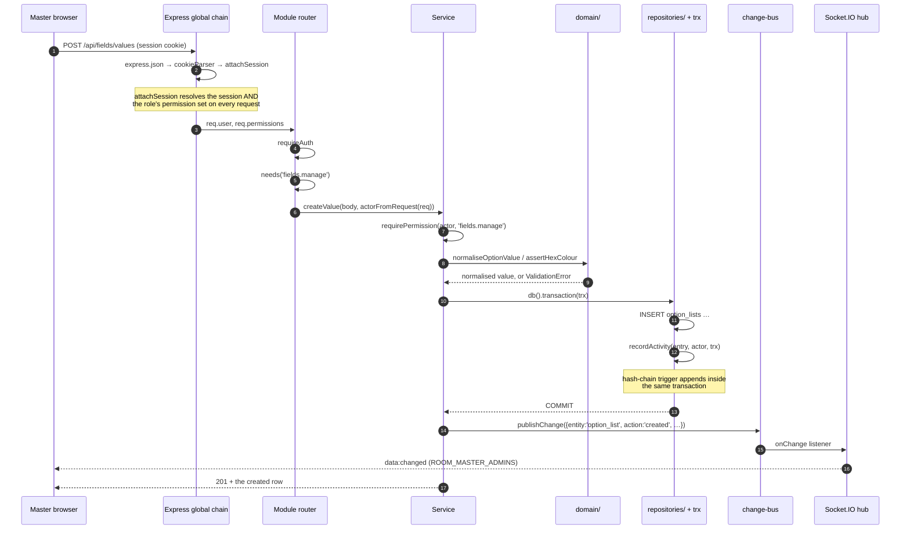
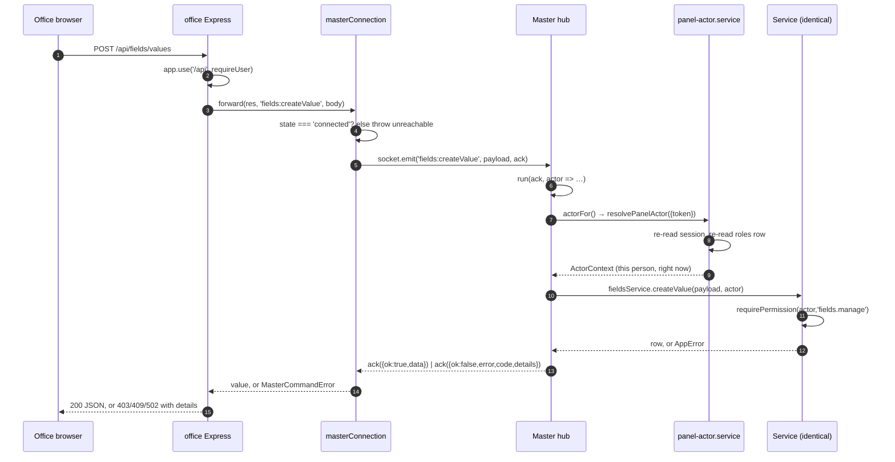
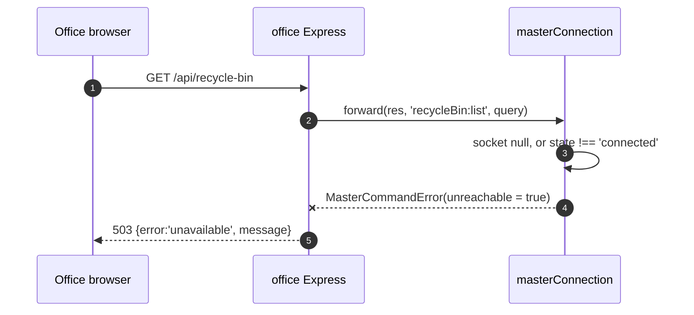
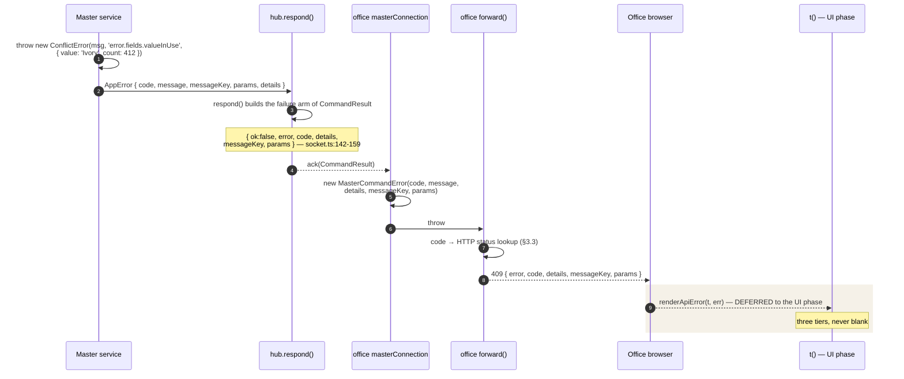
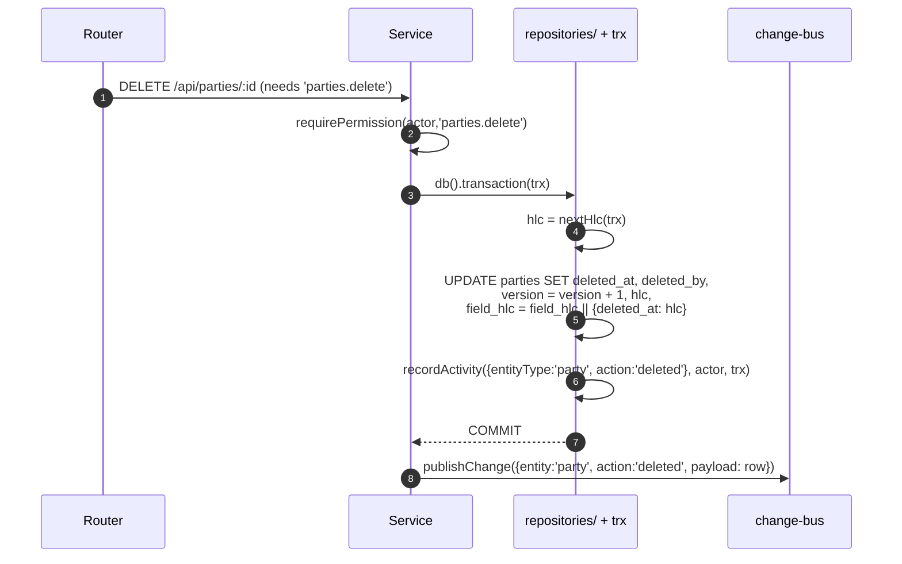
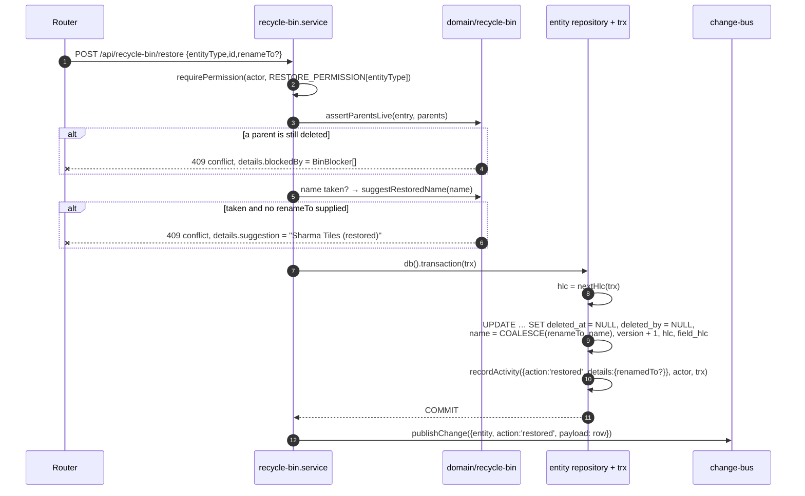
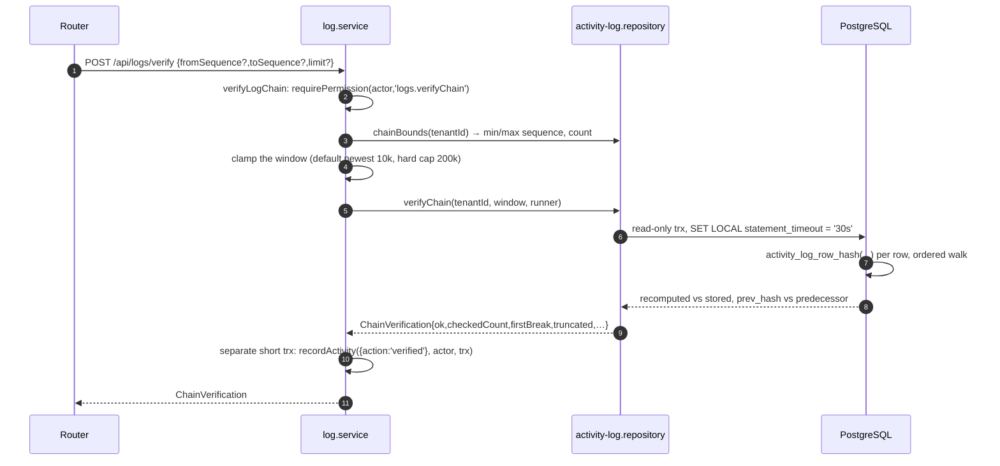
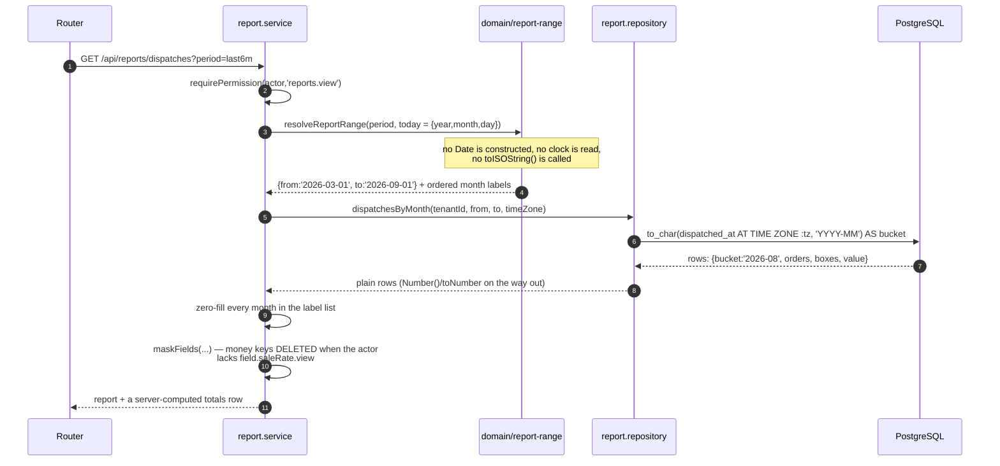
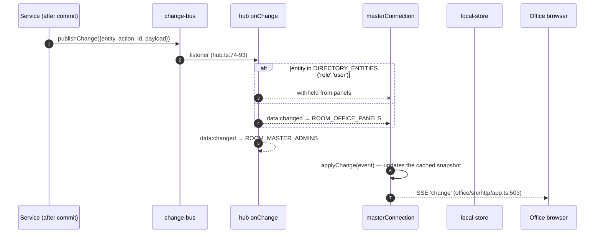
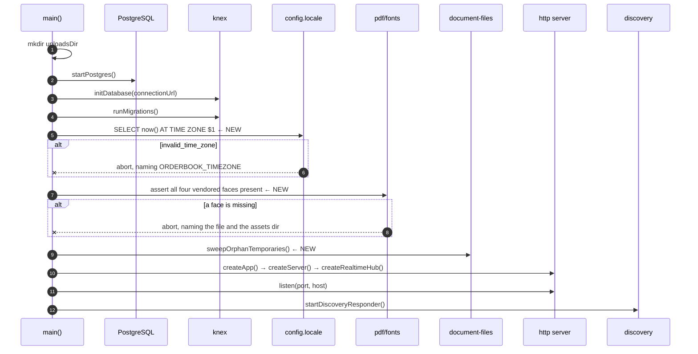

# 06 — Runtime workflows

What the system *does*, in order, once these six modules exist. The other documents in this set
define contracts — endpoints, schema, permission keys. This one defines **sequence**: which layer
runs before which, what is inside the transaction and what is outside it, what each hop does when
the hop before it failed, and what an Office Panel sees when the Master is not there.

It is written against `docs/BACKEND_MODULES.md`, which is the canonical plan; where this document
appears to disagree with it, that plan wins and this document is wrong. Every claim about code that
exists today carries a `path:line` reference, verified by reading the file.

**Scope reminder.** Everything here is backend. The browser appears in these diagrams only as the
thing that makes a request and receives a response; no screen is specified in this batch. The **only**
web files in scope are the typed API client wrappers `master/web/src/api.ts` and
`office/web/src/api.ts` — `02-FILE-STRUCTURE.md` owns that boundary and `05-EXISTING-CODE-CHANGES.md`
§0 restates it for existing code. Everything under `{master,office}/web/src/i18n/`, plus
`LocalePicker.tsx`, `Untranslated.tsx`, `main.tsx`, `format.ts`, `styles.css`, `PermissionGrid.tsx`
and `AccessScreen.tsx`, is **deferred to the UI phase**. `shared/src/i18n/` is in scope and is proven
end-to-end from `shared/tests/` with no web file involved — see §5.0, where the deferred half of the
token flow is drawn as a dashed hop rather than left implicit.

**Stage numbers.** Where a flow below says "Stage *n*", it means `11-BUILD-SEQUENCE.md`'s **Stage
0–8**, which is the set's only stage numbering: 0 = the socket-ack `details` prerequisite, 1 = i18n
foundation, 2 = Recycle Bin, 3 = Fields, 4 = Logs, 5 = Reports, 6 = PDF Designer, 7 = the permission
grant migration, 8 = Office Dashboard.

---

## 1. The four shapes every flow is built from

| Shape | Where it runs | What it may do |
|---|---|---|
| **Transport** | `http/`, `realtime/` | Parse, delegate, serialise. No aggregation, no policy. |
| **Service** | `services/` | Check permission, orchestrate, own the transaction boundary. |
| **Domain** | `domain/` | Pure rules. No I/O, no framework import, no Knex. |
| **Repository** | `repositories/` | All SQL. Knex types never leave this layer. |

The transaction boundary lives in the service (`db().transaction(…)`), and repositories receive the
opaque `TransactionContext` token from `repositories/transaction.ts`. This is decision 12 in
`HANDOFF.md`, and every flow below obeys it.

Two sentences that recur, and are load-bearing every time:

- **The audit entry is written inside the same transaction as the change it describes** —
  **`recordActivity(entry, actor, trx)`** (`master/src/repositories/activity-log.repository.ts:51-64`).
  The three-argument form is the one every flow below is written against; the signature change lands
  in **Stage 1**, before the first new module, and is specified in `05-EXISTING-CODE-CHANGES.md` §3.1.
  `recordDetachedActivity` (`:76-93`) is only for recording a *failed* operation that has no
  transaction to belong to; it swallows failure into a warning and **no new module may use it**.
- **`publishChange` runs after commit, never inside it** (`master/src/services/role.service.ts:107`,
  outside the transaction that closes at `:102`). Publishing inside the transaction would announce a
  change that a later rollback un-does.

---

## 2. The generic request lifecycle on the Master

The example is a Fields write, but the shape is identical for every write endpoint the six modules
add.



### 2.1 Hop by hop

1. **Global chain.** `express.json` → `cookieParser` → `attachSession`
   (`master/src/http/app.ts:23-25`). `attachSession` resolves the session and then re-reads the
   role's permission set on *every* request (`require-auth.ts:25-48`). That per-request re-read is
   what makes a revoked permission take effect on the next call rather than after a timeout — no
   flow in this batch may cache it.

2. **Router mount.** Each new module gets its own router, mounted beside the existing prefixed
   mounts (`app.ts:36-40`) and above the bare `/api` mount at `app.ts:41`, which `dataRoutes` owns.
   Every new router copies `access.routes.ts`, not `data.routes.ts`: `router.use(requireAuth)`
   (`access.routes.ts:25`), a local `const needs = requirePermissionMiddleware` (`:35`), one
   `asyncHandler` per route, and `actorFromRequest(req)` for identity. `data.routes.ts` mounts no
   permission middleware at all and is the wrong template.

3. **`requireAuth`** rejects with `UnauthorizedError` (401) when no session resolved
   (`require-auth.ts:50-56`).

4. **`needs(<key>)`** rejects with `ForbiddenError` (403, `code: 'forbidden'`, `details.permission`)
   (`require-auth.ts:65-73`, `lib/errors.ts:49-53`). This is the **first** of two gates and exists
   so a doomed request never opens a transaction. It is not the only gate, and on the Office path it
   does not run at all (§3).

5. **`actorFromRequest(req)`** builds the `ActorContext` from the session — tenant from the signed-in
   user, never from the request body (`require-auth.ts:81-92`).

6. **Service.** `requirePermission(actor, key)` is the first statement in the body
   (`master/src/domain/actor.ts:46`). This is the gate that actually protects the operation, because
   it is the one both transports share.

7. **Domain assertions.** Pure functions that either return a normalised value or throw an
   `AppError` carrying structured `details`. Nothing has been written yet at this point, so a
   refusal here costs nothing.

8. **Transaction.** `db().transaction(async (trx) => …)`. Inside it: the row write, then
   `recordActivity(entry, actor, trx)` — the three-argument form, from Stage 1 onward (§5.3). The
   `activity_log` chain trigger takes a per-tenant advisory lock,
   so audited writes for one company serialise — accepted deliberately at this product's scale
   (`activity-log.repository.ts:19-25`).

9. **Commit.** If anything inside the transaction throws, the row change *and* the audit entry roll
   back together. There is no state in which the trail has a hole for a change that happened, or an
   entry for a change that did not.

10. **`publishChange`** (`master/src/services/change-bus.ts:19-21`), then the response. The hub's
    subscription (`hub.ts:74-93`) fans the event out to `ROOM_MASTER_ADMINS` always, and to
    `ROOM_OFFICE_PANELS` unless the entity is in `DIRECTORY_ENTITIES` (`hub.ts:114`).

### 2.2 Read requests

Reads are the same chain minus the transaction: `needs(<view key>)` → service
`requirePermission` → repository → **mask on the way out**. Redaction uses `maskFields`
(`shared/src/domain/permissions.ts:300-312`), which **deletes** the key. A redacted field is
`undefined` — absent from the JSON — never `null` and never `0`. The Office Panel already renders a
hidden rate as `—` and would render a confident `₹0.00` if we sent a zero.

Two reads in this batch write anyway, and both are deliberate:

- `POST /api/logs/verify` records that a verification ran.
- `POST /api/documents/render` writes a file, an export row and an activity entry.

Both are POST for exactly that reason.

### 2.3 Where each failure lands

| Failure | Thrown by | HTTP | Body |
|---|---|---|---|
| No session | `requireAuth` | 401 | `{error:'unauthorized'}` |
| Missing permission | `needs()` or `requirePermission` | 403 | `{error:'forbidden', details:{permission}}` |
| Bad input | domain `assert*` | 400 | `{error:'validation_error', details:{field,…}}` |
| Duplicate name | `assertNameAvailable` (`domain/access.ts:160-169`) | 409 | `{error:'conflict', details:{field,value}}` |
| Stale save | `assertVersionMatches` (`domain/access.ts:183-192`) | 409 | `{error:'conflict', details:{storedVersion,diff}}` |
| Unknown id | `NotFoundError` | 404 | `{error:'not_found'}` |
| Another tenant's id | `TenantViolationError` | 403 + error log | `{error:'tenant_violation'}` |

`errorHandler` serialises all of these including `details`
(`master/src/http/middleware/error-handler.ts:28-32`). That is already fixed; no module re-does it.

---

## 3. The same operation, originating on an Office Panel

Nothing about the Master half changes. The panel is a different *transport* onto the same service.



Every socket command in this batch is namespaced by module with 04's verbs —
`fields:createValue`, `fields:catalogue`, `fields:values`, `fields:usage`, `fields:definitions`,
`fields:stages`, and so on for all 17 Fields commands. **The prefix is `fields:`, plural.**
`04-API-CONTRACT.md` §9.3 is the sole authority for the 46 event names; where any other document
writes `field:listValues` or another singular/verb variant, it is wrong.

### 3.1 The panel presents a token, never an identity

`resolvePanelActor` (`master/src/services/panel-actor.service.ts:53-102`) takes the Master-issued
session token the panel is holding, re-resolves the session, checks the tenant matches, and re-reads
the role's permission set. A modified panel gains nothing by lying, because it has nothing to lie
*with* — it can only hand back something the Master previously gave it. If the token no longer
resolves, the actor falls back to the panel's own seeded office-tier role (`:85-101`) and the hub
clears the stored token and pushes `session:rejected` (`hub.ts:426-434`).

**The actor is resolved per command, not per connection** (`hub.ts:167`, `:204-206`). A socket
outlives sign-ins, sign-outs and role edits; caching the actor at connect time is precisely how a
revoked permission survives until the next reconnect. Every new command added to
`registerCommands()` uses the existing `run(ack, actor => …)` shape and therefore inherits this for
free. A command wired anywhere else does not.

### 3.2 The route-level gate does not exist on this path

`requirePermissionMiddleware` is Express middleware. The socket path never touches Express on the
Master, so on an Office command the **service's `requirePermission` is the only permission check
that runs**. This is the single most important consequence of the two-transport design for this
batch: a module that checks permission only in its router is wide open to every paired panel.

### 3.3 The ack, and why it must carry `details`

`respond()` (`hub.ts:391-406`) today sets `code` only for `ForbiddenError` and never sends `details`
at all. `CommandResult<T>`'s `{ok:false}` arm has `code?` and `missingPermission?` and nothing else
(`shared/src/protocol/socket.ts:142-159`). So a Recycle Bin `blockedBy` list, a rename `suggestion`,
or `assertVersionMatches`'s `storedVersion` arrives on an Office Panel as a bare English string.

This is **Stage 0** in `11-BUILD-SEQUENCE.md` — built first, before any module. It is four edits:

| File | Change |
|---|---|
| `shared/src/protocol/socket.ts:142-159` | add `details?: Record<string, unknown>` to the `{ok:false}` arm |
| `master/src/realtime/hub.ts:391-406` | set `code` and `details` for any `AppError`, not only `ForbiddenError` |
| `office/src/realtime/master-connection.ts:48-60` | carry `details` on `MasterCommandError` |
| `office/src/http/app.ts:438-462` | pass `details` through in `forward()` |

**One thing Stage 0 does not name, flagged rather than assumed.** `forward()` maps
`code === 'forbidden'` to 403 and *everything else* to 502 (`office/src/http/app.ts:454`). A 409
conflict — the Recycle Bin's name collision, a stale template save — therefore reaches the Office
browser as a 502, which reads as "the Master is broken" rather than "you need to choose a name". The
codes are already stable and already on the wire once `respond()` sets them, so the mapping is a
lookup: `forbidden`→403, `conflict`→409, `validation_error`→400, `not_found`→404, unknown→502. This
is a handful of lines on top of the ~15 Stage 0 budgets. **Open question 1 in §9.**

### 3.4 The Office server never decides authority

`office/src/http/app.ts:133` gates everything below it on a signed-in person (`requireUser`,
`:417-423`), and the offline write path checks `MUTATION_PERMISSIONS` against the session's cached
set (`:335-342`). Neither is a security boundary — the panel's API is loopback-only and the Master
re-checks everything. They exist so a refusal arrives now rather than a shift later. No module in
this batch may treat an Office-side check as the enforcement point.

---

## 4. The offline path

**Every module in this batch fails hard when the Master is unreachable. Nothing is queued.** The one
exception is i18n, which needs nothing from the Master: both catalogues are compiled into the panel's
bundle before it ever contacts one.



### 4.1 Hop by hop when the Master is not there

| Hop | Behaviour |
|---|---|
| Browser → Office Express | Unchanged. The panel's own server is up; this is not a network call. |
| `requireUser` | Still passes — the session is local (`user-session.service.ts:68`). Offline does not sign anybody out. |
| `forward()` | Calls `masterConnection.command`, which throws before emitting anything (`master-connection.ts:234-236`). |
| `MasterCommandError` | `unreachable: true`, `code: undefined`. The absence of a code *is* the signal. |
| `forward()` catch | `error.unreachable` → 503 `{error:'unavailable'}` (`office/src/http/app.ts:443-445`). |
| Browser | Renders "this needs the Master Panel", in those words. Not a generic failure. |

There is a second unreachable case: the Master accepted the emit and never answered. The 15-second
timeout rejects with `unreachable: true` as well (`master-connection.ts:239-245`). Both are silence.

### 4.2 Why the decision comes from the transport flag and never from the message

This is the rule `HANDOFF.md` lists under "Traps worth knowing", and it was a real defect. An earlier
version decided "refused" versus "not answered" by substring-matching English, so a Postgres
`canceling statement due to statement timeout` — *a message the Master sent*, meaning it was
reachable and refused us — classified as silence. Silence is the one case allowed to fall back to a
panel's local offline verifier (`user-session.service.ts:97`, `:129`), so the mistake turned the
panel into a way around a password change.

`MasterCommandError.unreachable` is set at exactly two places, both of them cases where no ack ever
arrived (`master-connection.ts:235`, `:242`), and is explicitly `false` in the ack handler
(`:256-258`) — *"The Master answered. Whatever it said, it was reachable."* No module may reintroduce
message inspection, and no module may add a third way for `unreachable` to become true.

### 4.3 Why none of this is queued

| Module | Why the outbox is the wrong answer |
|---|---|
| Recycle Bin — delete | No `*.delete` MutationKind exists, and adding one needs a merge rule for a delete racing an edit, which is decided nowhere in the product. |
| Recycle Bin — restore | A restore firing two hours later can collide with a name created since, and the rename decision needs a human looking at the answer. |
| Fields | `option_lists`, `custom_field_definitions`, `pipelines` and `pipeline_stages` carry no `version`/`hlc`/`field_hlc`, so no field-level merge exists for them. Two panels editing the colour list offline would resolve last-writer-wins on a whole row, with no `sync_conflicts` entry to review. |
| Logs, Reports | Reads. A queued read is a contradiction. |
| PDF render | A queued render emits a legally-shaped quotation hours later against a lead whose lines have since changed. |
| Dashboard | Cached, not queued — see §5.6. |

Each forward-only Office route carries a comment saying why, in the voice of the existing
stock-is-online-only comment at `office/src/http/app.ts:270-271`. A future reader must find the
reason at the route, not in a document.

### 4.4 What still works offline

The read side that already worked. `SyncSnapshot` carries `optionLists`, `customFields` and
`pipelines` (`shared/src/protocol/socket.ts:198-224`), so pickers, custom-field forms and the Kanban
columns render offline exactly as today. Because a colour's hex now rides on the `option_lists` rows
already in that snapshot, colour chips work offline for free with no snapshot growth.

---

## 5. Flow per module

### 5.0 i18n — the path a message token travels

Put first because every other flow in §5 refuses things, and this is what a refusal *is* once the
i18n layer exists. There is no module here and no endpoint: i18n is a **shape imposed on every other
flow**, which is why it is Stage 1 and why nothing else can be built cleanly before it.

The founding constraint is one sentence: **the server never renders a user-facing sentence.** Locale
is a per-machine setting and is never synced, so one Master serving three panels and its own browser
has no single recipient locale to render for. It has no honest choice but to name the message and let
each renderer render it.



Read the hops as one rule each:

| Hop | The rule |
|---|---|
| **Service throw** | Every `AppError` carries a `messageKey` and its `params`. `message` stays on the envelope, in English, and is **derived from the English catalogue** rather than typed at the throw site — that is what keeps the token and the English from drifting |
| **`respond()`** | `hub.ts:391-406` copies `code`, `details`, `messageKey` and `params` onto the ack for **any** `AppError`, not only `ForbiddenError`. This is the Stage 0 prerequisite |
| **`CommandResult`** | `shared/src/protocol/socket.ts:142-159` — the `{ok:false}` arm is where the fields must be declared, or none of the hops after it can carry them |
| **`MasterCommandError`** | `office/src/realtime/master-connection.ts:48-60` carries them through the Office server without inspecting them. The Office never re-words a Master message |
| **`forward()`** | `office/src/http/app.ts:438-462` passes them to the browser and maps `code` to a status. It invents exactly one code of its own, `unavailable`, for the case the Master never saw |
| **Browser `t()`** | Renders. **Not in this batch** — see below |

**The three-tier client fallback**, which is the part that must never be lost in the hand-off:

| Tier | Renders | When it fires |
|---|---|---|
| **1** | `t(err.messageKey, err.params)` — the precise token the thrower named, in the reader's language | Normal. This is the case that exists for |
| **2** | `t('error.' + err.code)` — the coarse token for the stable error code | The throw site had no finer token. Only reachable at all if `messageKey` ends up optional |
| **3** | `err.message` — the server's English, printed as-is | An unrecognised code from a Master newer than this browser bundle |

Tier 3 is the reason `message` stays on the wire at all. Deleting it as redundant would make the one
case the fallback exists for render **blank**. English on a Hindi screen is bad; nothing on a Hindi
screen is worse, because the person cannot even report what they saw.

**Where this batch stops, stated plainly.** The dashed hop is real: after this batch every error on
both transports carries a token and both catalogues exist and are total — and **no browser calls
`t()`**, because `{master,office}/web/src/i18n/` is deferred to the UI phase — see the scope
reminder at the head of this document. The
server half is nonetheless verified end to end without a single web file: `shared/src/i18n/` is in
scope, and `shared/tests/` proves the catalogues are total, that interpolation is correct, and that
`AppError.message` equals `t('en', messageKey, params)` for every subclass — which is the assertion
that makes the English fallback incapable of drifting from the token. See `09-I18N.md` for the layer
and `10-TESTING.md` for the register. The deferral costs rendering, not confidence.

**The Master's own path is the same minus two hops.** `errorHandler`
(`master/src/http/middleware/error-handler.ts:28-32`) serialises the same fields onto the HTTP
response directly; the socket, `MasterCommandError` and `forward()` do not appear. Both transports
therefore hand the browser the same envelope, which is what lets one `renderApiError` serve both
browsers in the UI phase.

### 5.1 Fields — create, edit, remove, reorder

All four are the §2 lifecycle with `fields.manage` as the write key and `fields.view` as the read
key. `fields.manage` moves from `admin` to `management` (`permissions.ts:163`); lowering a ceiling
never strips a stored key, so no tier-repair migration is needed. **Fields reading is ungated by
tier (`fields.view`, no `MINIMUM_TIER`); Fields editing is management and above, on both panels.**

The rule the whole module hangs on: **a value's identity is the exact string it always was.**
`normaliseOptionValue` trims and deliberately does *not* case-fold, because a colour string is a
component of `stockKey()` (`master/src/domain/stock-key.ts`) and of two case-sensitive unique
indexes; folding would split or merge live stock rows.

| Operation | What happens | What is impossible by construction |
|---|---|---|
| **Create** | Insert an `option_lists` row: `list_key`, `value`, `label`, `hex?`, `sequence`. | — |
| **Edit** | Update `label`, `hex`, `is_active`, under a **mandatory `expectedVersion`**. Editing `value` is **refused**. | Silently orphaning every record that holds the old string. Two people saving the same value at once and one of them losing their edit without being told. |
| **Remove** | Sets `deleted_at` / `deleted_by`. The row stops being offered and appears in the Recycle Bin. | Touching a record. Every lead, order and stock row keeps its string and keeps rendering. |
| **Reorder** | Body carries the **complete ordered id list**, not a delta. `assertCompleteReorder` rejects anything that is not a permutation of the set's current live ids; `resequence` renumbers `1..N`. | Two people dragging at once silently corrupting the order — a non-permutation is a 400, not a merge. |

"Remove" is worth stating precisely because it is the module's most surprising behaviour and its best
one: removing *Ivory* from the colour list does not make the 400 boxes of Ivory in the ledger
disappear, become NULL, or fail to render. The screen keeps showing "Ivory" through the two-letter
ring fallback; it simply stops being offered on new lines. That is only true because the value is
the string, and it is why `PUT` refuses to change `value`.

After commit each write invalidates the per-tenant cache in
`master/src/repositories/custom-field.repository.ts`, then publishes using the **already-declared**
`ChangedEntity` values `'option_list' | 'custom_field' | 'pipeline'`
(`shared/src/protocol/socket.ts:163-179`), which nothing has ever emitted.

**Every Fields write is version-checked, and `expectedVersion` is mandatory.** `option_lists` and
`custom_field_definitions` both carry `version INTEGER NOT NULL DEFAULT 1`, and `PUT`s on values and
definitions refuse a stale save with 409 carrying `storedVersion` — the same shape
`assertVersionMatches` (`master/src/domain/access.ts:183-192`) already produces for roles and users.
Mandatory rather than optional for the reason optionality always fails here: an omitted
`expectedVersion` is indistinguishable from "I checked and I am current", so the one caller who
forgets it is the one who silently overwrites. `03-DATABASE.md` owns the column and
`04-API-CONTRACT.md` the request shape.

**Stage archive has one extra gate.** `POST /api/fields/stages/:id/archive` is refused with 409 while
any live lead or order sits in that stage, with `details` naming the count and a suggested target
stage. Reordering stages needs `idx_pipeline_stages_seq` dropped and re-added as a **deferrable table
constraint** — a unique *index* cannot be `DEFERRABLE`. `idx_pipeline_stages_one_default` is a
*partial* unique index and genuinely cannot become one, so default-swapping is clear-then-set,
ordered.

**Three existing reads are deliberately left alone.** `GET /api/pipelines`, `/api/option-lists` and
`/api/custom-fields` stay gated by `requireAuth` only. Routing them through a `fields.view` check
would make `buildSnapshot`'s `Promise.all` reject for anyone lacking the key
(`master/src/services/snapshot.service.ts:33-42`) — and a rejected `buildSnapshot` produces **no
snapshot at all**, swallowed into a log line (`hub.ts:172-177`). The new `/api/fields/*` surface is
separate.

### 5.2 Recycle Bin — delete, then restore

#### Delete



The `hlc` stamp is not optional and is not cosmetic. `leads`, `orders`, `parties` and `products` all
carry `version`/`hlc`/`field_hlc`, unlike roles and users. Mirroring `softDeleteRole` — bumping
`version` and nothing else — leaves a state the merge engine cannot interpret: a queued offline edit
whose `hlc` is later than the last stamped one wins on every field and quietly writes to a tombstone.
Stamping `hlc` and `field_hlc.deleted_at` puts the delete on the same clock as every other write.

**A delete can be refused, and the rule is per entity.** Each of the four routes has its own
blocking condition — a party with live leads or orders, a product with live line items or non-zero
on-hand/reserved stock, a lead that has already been converted, an order that has been dispatched.
Refusal is `ConflictError` 409 carrying `{ blockedBy: BinBlocker[] }` naming the blocking records, so
the caller is told *what* is in the way rather than *that* something is. The policy table is
`04-API-CONTRACT.md`'s and is not restated here. **It is a DELETE-side rule and has nothing to do
with `PARENT_LINKS`**, which is the upward-only RESTORE graph below — the two are easy to conflate
and they run at opposite ends of the flow.

What is deliberately **not** added: delete and restore `MutationKind`s. Deletes are Master-online-only,
matching the roles/users precedent. Propagation to panels goes through the existing
`publishChange`/`ChangedEntity` path (§6).

`DELETE /api/orders/:id` additionally releases the order's active stock reservations in the same
transaction, and publishes the affected stock levels after commit. This finally gives
`releaseForOrder` (`master/src/repositories/reservation.repository.ts:111`) a caller — it is dead
code today.

These four routes are the **first enforcement sites** for `leads.delete`, `orders.delete`,
`parties.delete` and `products.delete`, four keys that have sat in the frozen catalogue and in stored
role rows since `20260303`, rendered as grid cells, and gated nothing because no delete path existed.

#### Restore



Three things about this flow are decisions, not mechanics:

- **Restore reuses the entity's own delete key.** `RESTORE_PERMISSION[entityType]` maps party →
  `parties.delete`, role → `roles.delete`, user → `users.manage`, option-list value → `fields.manage`.
  No `recycleBin.restore` key is minted, so the Bin can never be a back door onto an entity you may
  not delete. There is no purge at all.

- **The parent hazard is checked before anything is written.** `PARENT_LINKS` declares the
  upward-only graph — lead → party, order → party, order → lead, user → role — and `assertParentsLive`
  throws `ConflictError` with `{blockedBy}` naming each dead parent. Restoring a lead whose party is
  still in the Bin would produce a row pointing at a tombstone.

- **Name collisions are expected, not exceptional.** A party deleted and recreated under the same
  name will happen. `suggestRestoredName` is deterministic — `Sharma Tiles` → `Sharma Tiles
  (restored)` → `(restored 2)` — so the UI's offer and the server's acceptance cannot disagree. The
  409 carries the suggestion in `details`, which is exactly why Stage 0 is a prerequisite: without it an
  Office user sees an English sentence and no suggestion.

**Listing.** `listBin` — behind `GET /api/recycle-bin` — checks `recycleBin.view`, then intersects
the requested entity types with the delete keys the actor actually holds, then narrows to `deleted_by = actor.userId`
unless the actor holds `recycleBin.viewAll` (management+). An actor whose intersection is empty gets
an **empty page, not a 403** — the "filter, do not refuse" pattern from `search.service.ts`. Branches
the caller may not see are omitted from the SQL entirely, which is simultaneously the permission
filter, the type filter and the optimisation.

One consequence worth stating plainly: a deletion made by an unattended Office Panel has
`deleted_by = NULL` and is therefore visible only to `recycleBin.viewAll` holders.

**Paging is keyset only.** The cursor is an opaque base64url of `(deletedAt, entityType, id)` on the
one codec in `master/src/domain/cursor.ts`. The `entityType` and `id` components exist because
`deleted_at` is transaction time and a batch delete stamps many rows identically — a one-part key
drops or repeats rows at a page boundary. The timestamp half is carried as the SQL-rendered
microsecond text and compared as `?::timestamptz`; it is **never** re-formatted through a JS `Date`,
which would truncate Postgres's microseconds to milliseconds and make the boundary ambiguous.

The roles/users Recycle Bin that already exists inside `AccessScreen.tsx` (`function RecycleBin`,
~line 963) is **subsumed**, not rewritten: those two entity types become two branches of the unified
feed and the existing `restoreRole`/`restoreUser` services are reused as-is.

### 5.3 Logs — list, paginate, verify

The three service functions this module exposes are `listBin`, `binCounts` and `restoreEntity`;
`02-FILE-STRUCTURE.md` owns the manifest and those are the names it uses.

**List.** `listLogs`, `logs.view` at both gates. Newest-first, keyset on `activity_log.id` (BIGSERIAL, monotonic,
unique — `docs/schema/04-activity-log.md` chose BIGSERIAL over UUID for exactly this):

```sql
-- Older
WHERE tenant_id = ? AND id < :cursor  ORDER BY id DESC LIMIT :n + 1
-- Newer
WHERE tenant_id = ? AND id > :cursor  ORDER BY id ASC  LIMIT :n + 1   -- reversed in the repository
```

The repository reverses the Newer page so the service always receives newest-first. The `n+1`th row
is what tells the UI whether to enable the button — there is no `COUNT`, no total and no page number
anywhere. The id round-trips as a **string**: node-postgres returns BIGINT as a string and `Number()`
loses precision. `decodeCursor` throws `ValidationError` on anything malformed rather than falling
back to "newest", because a silently-ignored cursor makes the Older button loop forever on page one.

`created_at` is not a usable cursor: it ties under `now()` and has no unique index. `sequence` is
weaker still — nullable at DDL level and not unique.

**Facets.** `listLogFacets`, behind `GET /api/logs/facets`, is `DISTINCT` over
`(actor_type, actor_id, actor_name)`, over
`entity_type` and over `action`, bounded by the same 90-day lookback as the list so it stays an index
range scan. `action` is free-form `TEXT` with no `CHECK` and no catalogue in code, so the values can
only be enumerated from the data.

**Verify chain.**



**Verification runs in SQL, and this is not a preference.** The digest covers `details::text` —
Postgres's own JSONB rendering — so Node cannot reproduce the bytes. The migration factors the inline
digest expression out of `activity_log_chain()` into a reusable `activity_log_row_hash(...)`.

Two layering points. The `SET LOCAL`, the transaction and the ordered walk all live in the
**repository**; a service opening `db().transaction()` to issue `SET LOCAL` itself would be Knex in a
service, the one thing decision 12 forbids. And the audit entry for the verification is written
**after** the scan in its own short transaction, not inside the read transaction — a 30-second
read holding the chain's advisory lock would block every audited write in the company.

**Export.** `exportLogs` behind `logs.export` — a separate route with its own guard, not a
`format=csv` flag, so the key gates a distinct code path. It reads through
`activity-log.repository.ts`'s **`streamForExport`**, batching 5,000 rows per fetch to a hard cap of
250,000; nothing is loaded whole into memory on the Master.

`streamForExport` is **not** `chainBounds`. `chainBounds` returns the tenant chain's
`(minSequence, maxSequence, count)` so `verifyLogChain` can clamp its window before walking anything;
`streamForExport` is the batched export reader. Both exist, they do different jobs, and the two names
are not interchangeable.

The four service functions are `listLogs`, `listLogFacets`, `verifyLogChain` and `exportLogs` —
again, `02-FILE-STRUCTURE.md`'s names. The Office path for the export is an open question, §9.

**One sequencing note, and it is the opposite of what an earlier draft of this document said.**
`recordActivity`'s signature becomes `recordActivity(entry, actor, trx)` **in Stage 1 — the
foundation — not here at Stage 4.** Ruled; `11-BUILD-SEQUENCE.md` owns the stage order and
`05-EXISTING-CODE-CHANGES.md` §3.1 owns the edit.

The reason is that the `actor` parameter is **harmless before the column exists**. Between Stage 1
and migration `20260307`, `recordActivity` accepts `actor` and simply does not persist it; nothing
about the hash chain changes, because `actor_name` sits outside the digest by design. So there is no
cost to taking it early — and there is a real cost to taking it late. Recycle Bin (Stage 2) and
Fields (Stage 3) between them add a good number of audited writes; landing the signature at Stage 4
means writing all of them against the old two-argument form and then sweeping two freshly-written
modules **plus** the 24 existing call sites in one pass. Written once against the final signature,
they are never swept at all. `20260307` adds `activity_log.actor_name` and starts persisting what the
parameter has been carrying since Stage 1.

Every flow in this document assumes the three-argument form. Neither form is
`recordDetachedActivity`, which remains forbidden in new modules.

### 5.4 Reports — range resolution and month bucketing

This is the single highest-risk flow in the batch, and the risk is entirely about dates.
`HANDOFF.md` records the shipped defect: `DATE` columns came back a day early anywhere east of UTC,
because `toISOString()` converts to UTC first. The owner's machine is IST.



**Where the timezone is applied, exhaustively:**

| Point | What happens |
|---|---|
| `config.locale.timeZone` | Read once from `ORDERBOOK_TIMEZONE`, default `'Asia/Kolkata'`. One key, one owner (§7). |
| `report.repository` | `AT TIME ZONE :tz` inside every bucket expression. The bucket label is produced by `to_char(...)` and returned as `'YYYY-MM'` **TEXT**. |
| `dashboard.repository` | `date_trunc('week', now() AT TIME ZONE :tz)` for "dispatched this week". |
| Everywhere else | Nowhere. |

**Where a `Date` is deliberately not constructed:**

| Point | Why not |
|---|---|
| `domain/report-range.ts` | Takes `today` as `{year, month, day}` components and returns `'YYYY-MM-DD'` strings, half-open `[from, to)`. It reads no clock, which is also what makes it fully unit-testable. |
| The month label list | Minted as strings by the same module, so a month with no rows is zero-filled rather than missing. A chart with gaps lies about the shape of the year. |
| The response | Buckets stay `'YYYY-MM'` TEXT and date filters stay `'YYYY-MM-DD'` TEXT all the way to the browser. No date-derived value ever becomes a JS `Date` that something downstream could `toISOString()`. |

`master/tests/report-range.test.ts` is a **pure** suite — it cannot silently skip the way a
`describe.skipIf` integration suite can — and it pins an order dispatched at 23:30 IST on the last of
the month landing in the right bucket. It is also the first test coverage `toIsoDate`
(`master/src/repositories/mappers.ts:79-90`) has ever had, despite being the fix for the shipped
defect.

**Redaction.** Money keys are deleted, not zeroed, and the totals row is computed **server-side over
the same filtered set** — a client must never sum masked buckets. `GET /api/reports/top-parties`
carries `orderedBy: 'value' | 'orderCount'`, because ordering a leaderboard by a key that is absent
from the payload gives the user a list they cannot make sense of.

**Top-parties anchors on `orders.dispatched_at`, not `created_at`.** Decided. The report answers
"dispatched value in the selected period" — goods that actually left the building — not "business
won", so an order taken in March and dispatched in May belongs to May. Anchoring on `created_at`
would let a party lead the board on orders that have not shipped. Undispatched orders are simply
outside every period. `03-DATABASE.md` owns the index that serves the range scan; confirm it is
`idx_orders_party` (or the index named there) before assuming this is free — a `dispatched_at` range
inside a `party_id` group is a different access path from the one `idx_orders_party` was created for.

`reports.view` and `reports.export` already exist in the catalogue with no `MINIMUM_TIER`, so they
already default to office tier and are already available to every user. This module is their **first
enforcement site anywhere in the codebase**.

### 5.5 PDF render

```mermaid
sequenceDiagram
    autonumber
    participant R as Router
    participant S as document-render.service
    participant SS as lead/order service
    participant D as domain/document-model
    participant PDF as pdf/renderer
    participant F as lib/document-files
    participant P as repositories + trx
    participant C as change-bus

    R->>S: POST /api/documents/render {subject, templateId}
    S->>S: requirePermission(actor,'documents.render')
    S->>S: requirePermission(actor, 'leads.view' | 'orders.view')
    S->>SS: getLead(id, actor) / getOrder(id, actor)
    SS-->>S: record ALREADY masked for this actor
    S->>S: ratesIncluded = template.showRates && canSeeRates(actor)
    S->>D: buildDocumentModel(record, template, identity, labels, ratesIncluded)
    Note over D: when ratesIncluded is false the rate and lineTotal<br/>COLUMNS are absent and the totals block is omitted
    D-->>S: pure DocumentModel
    S->>PDF: renderPdf(model) → Buffer
    PDF->>PDF: fonts registered once per process; splitByScript → body / devanagari / mono runs
    S->>F: write <storageKey>.pdf.tmp, fsync
    S->>P: db().transaction(trx)
    P->>P: INSERT document_exports (…, rates_included) RETURNING id
    P->>P: UPDATE document_exports SET superseded_by = :newId<br/>WHERE (tenant, subject, documentType) AND superseded_by IS NULL AND id <> :newId
    P->>P: recordActivity({entityType:'document_export', action:'rendered'}, actor, trx)
    P-->>S: COMMIT
    S->>F: rename .tmp → .pdf
    S->>C: publishChange({entity:'document_export', action:'created'})
    S-->>R: {exportId, fileName, byteSize, pageCount, ratesIncluded, downloadPath}
```

The ordering is the design. Seven points, each load-bearing:

0. **The insert and the supersede live in the same transaction, in that order.** `INSERT … RETURNING
   id` first, because the `UPDATE` needs the new row's id to stamp the old one — then the `UPDATE`
   closes out the previous export for this exact `(subject, documentType)`, unconditionally over the
   matched set rather than only "the newest one", so a chain an earlier render failed to close gets
   repaired rather than left with two open heads (`03-DATABASE.md` §5.3). A render that fails after
   the file write but before this transaction leaves the old export as the answer to "what did we
   send" — correct, since nothing new was ever recorded.

1. **Permission resolves twice and the second check is the record's own.** `documents.render` plus
   the subject's view key, so document access can never exceed record access. The real rate key is
   `field.saleRate.view`; `products.rate.view` does not exist in the catalogue.

2. **Masking happens before the model, not during the render.** The record is read through the same
   service the screens use, so it arrives already masked. `buildDocumentModel` then turns redaction
   into a *layout* fact: the rate and line-total **columns are absent from `model.columns`** and the
   totals block is omitted entirely. Nothing downstream has a rate to accidentally print, and
   `master/tests/document-model.test.ts` asserts absent, not zero and not null.

3. **The renderer contains no permission logic at all.** If a column is not in `model.columns` it is
   not drawn. That is the whole rule.

4. **The response is metadata, not bytes.** The browser then GETs the file, so a retry does not
   re-render.

5. **File first, then the transaction, then the rename.** The bytes are written to `.tmp` and fsynced
   before the transaction opens; the rename is the last act. A crash between the write and the commit
   leaves an orphan `.tmp` that `sweepOrphanTemporaries()` deletes at startup (§7) — never a committed
   export row pointing at a file that does not exist.

6. **The export row and the activity entry are one transaction.** `document_exports.rates_included`
   is the audit-grade fact that the copy sent to this customer carried no prices.

**Preview** runs the identical path with `persist: false` — no file, no export row, no activity
entry, `PREVIEW` watermark forced on — so a preview can never diverge from the real document.

**Devanagari is a hard requirement**, and it is the reason rendering is server-side with PDFKit +
fontkit and vendored SIL OFL faces rather than any library shipping WinAnsi encoding only. Party
names, addresses and terms in Hindi are otherwise unrenderable. `master/tests/document-fonts.test.ts`
is pure and runs fontkit's `layout()` against the vendored face directly: `हिन्दी` must produce fewer
glyphs than codepoints (conjunct formation), and in `कि` the i-matra must be positioned before its
consonant (reordering). A renderer that only maps codepoints in order fails both.

**Export history listing** filters rows whose subject kind the caller may not view rather than
refusing the request — a dispatch clerk with `orders.view` and no `leads.view` sees a coherent list,
not a 403. A request for another tenant's export id answers **404, not 403**, so the route cannot be
used to probe which ids exist.

### 5.6 Office Dashboard — online versus stale-offline

No new endpoint. The existing `DashboardSummary` / `dashboard.service` / `dashboard:changed` triple is
reused, extended with three figures, made **per-figure permission-gated** (absent, never `0`), and
carried into `SyncSnapshot.dashboard`.

`04-API-CONTRACT.md` §7.1 owns the type and the gate table; the two things that matter to *this*
flow are that **every** figure is optional and that the gating is uniform:

- `openConflictCount` and `pendingSyncCount` are gated on **`sync.resolveConflicts`** and are
  **optional**, exactly like the other eight. They are not an ungated pair. An operator who cannot
  resolve a conflict has no use for the count of them, and one exception in the middle of a
  per-figure rule is the precedent that ends the rule.
- `pipelineBreakdown`'s element is `{ stageId, stageName, sequence, colourHex, leadCount }` —
  `sequence` so the panel can render the board in board order offline without a second call.
- `asOf` is the only required member. It is what lets the offline branch below label a cached figure
  honestly instead of presenting it as current.

```mermaid
sequenceDiagram
    autonumber
    participant OB as Office browser
    participant OE as office Express
    participant LS as local-store
    participant MC as masterConnection
    participant HB as Master hub

    rect rgb(238,245,238)
    Note over OB,HB: Online
    HB-->>MC: sync:snapshot (dashboard computed for THIS actor)
    MC->>LS: setSnapshot(snapshot) → persisted
    OB->>OE: GET /api/snapshot
    OE->>LS: getView()
    OE->>OE: forCurrentUser(view) — re-mask for who is signed in NOW
    OE-->>OB: figures + asOf = snapshot.serverTime
    end

    rect rgb(248,242,236)
    Note over OB,HB: Offline
    OB->>OE: GET /api/snapshot
    OE->>LS: getView() — restored from disk if needed
    OE-->>OB: the SAME figures, with asOf and state:'disconnected'
    Note over OB: every card renders the cached number,<br/>honestly labelled stale; the sync card stays live<br/>because it is computed locally — for an actor<br/>who holds sync.resolveConflicts
    end
```

**Counting client-side from the snapshot was rejected for a concrete reason**: the snapshot is capped
at `SNAPSHOT_LIMIT = 500` (`master/src/services/snapshot.service.ts:30`) and excludes converted
leads, so client-side counts would be *silently wrong* at scale. Online the panel gets a correct
figure; offline it gets an honestly-labelled stale one. Those are the only two acceptable states.

Two structural notes. `dashboard.service` currently calls `db()('applied_mutations')` directly
(`dashboard.service.ts:51`) — the one standing violation of decision 12 in that file — and the new
`master/src/repositories/dashboard.repository.ts` absorbs it. And `dashboard:changed` is re-derived
**per socket** before it is emitted (`hub.ts:476-504` already does this for Master admins); a
permission-filtered summary must never be computed once and broadcast.

---

## 6. Change propagation



### 6.1 `'restored'` is a new `ChangeAction`, and it is an upsert

`ChangeAction` is `'created' | 'updated' | 'deleted'` today
(`shared/src/protocol/socket.ts:180`). The Recycle Bin adds `'restored'`.

A restore hands the panel a complete, live row, so the correct handling is exactly the same as
`'created'`: put the row into the cache. It is not `'updated'`, because the row may be absent from the
panel's cache entirely (it was removed on delete, or the panel has never seen it); an update-in-place
handler that silently no-ops on a missing row would leave a restored party invisible until the next
full snapshot. Modelling it as `'created'` would be a lie in the audit-adjacent event stream and in
anything that later branches on the action. So: **a distinct action, handled as an upsert.**

### 6.2 A verified gap this batch must close

`applyChange` (`office/src/realtime/master-connection.ts:353-383`) switches on `event.entity` and
**ignores `event.action` entirely**. Every branch upserts the payload. Today that is harmless,
because the only two `publishChange` calls with `action: 'deleted'` are in `role.service.ts:247` and
`user.service.ts:290` — both `DIRECTORY_ENTITIES`, both withheld from panels at `hub.ts:82-86`. **No
panel has ever received a `'deleted'` event.**

The Recycle Bin makes lead, order, party and product deletes the first ones. Left as-is, a delete
would *upsert the deleted row back into the panel's cache*. `applyChange` therefore has to branch on
the action:

| Action | Cache effect |
|---|---|
| `created`, `updated`, `restored` | Upsert the payload. |
| `deleted` | Remove the row by id (stock by the `(productId, colour)` pair). |
| unknown action | Ignore, as unknown entities already are — a newer Master may emit actions this panel does not know. |

This file is Office **server** code, not a screen, so it is inside this batch's scope.

One durability subtlety worth knowing. `masterConnection` and `local-store` hold the *same* snapshot
object (`master-connection.ts:149` assigns it, `:159` hands the same reference to
`localStore.setSnapshot`), so an applied change is visible to `/api/snapshot` immediately — but it is
only written to disk on the next full `sync:snapshot`. A panel restarted offline in between renders
the pre-delete row. It corrects itself on the next connect, and no write is at risk, but the module
must not claim the cache is durable between snapshots.

### 6.3 Which new entities fan out, and which do not

| Entity | Fans out to panels? | Why |
|---|---|---|
| `option_list`, `custom_field`, `pipeline` | **Yes** | Panels already hold this data in `SyncSnapshot`; a stale picker is the exact problem the event solves. All three are already declared in `ChangedEntity` (`socket.ts:163-179`) with nothing emitting them. |
| `lead`, `order`, `party`, `product` (`deleted`/`restored`) | **Yes** | The panel is caching those rows. |
| `document_export` | **No** — add to `DIRECTORY_ENTITIES` | An export names a lead or order the recipient may not be entitled to see. Panels refresh export history on demand. |
| `role`, `user` | **No** (unchanged) | Already withheld (`hub.ts:114`). |

---

## 7. Startup



The existing order is at `master/src/index.ts:27-57` and is already load-bearing: the database must
be up and migrated before anything serves a request, and discovery must not advertise this Master
until it can accept a pairing request. The three new steps slot in **after `runMigrations()`
(`index.ts:32`) and before `createApp()` (`:40`)**.

**Timezone validation.** `config.locale.timeZone` comes from `ORDERBOOK_TIMEZONE`, default
`'Asia/Kolkata'`. Nothing pins a timezone today — `buildKnexConfig` passes no `SET TIME ZONE`. It is
validated exactly once with `SELECT now() AT TIME ZONE $1`; if Postgres raises `invalid_time_zone`,
the Master aborts with a message naming the variable. Validating it here rather than on first use
means a typo in `.env` on the shop PC is a startup failure with a clear message, not a report that
silently buckets by UTC six weeks later. One key, `locale` rather than `reporting`, because it also
serves i18n date formatting.

**Font presence.** `master/src/pdf/fonts.ts` asserts all four vendored faces exist and registers them
with PDFKit once per process. Failing loudly beats silently substituting Helvetica, which renders
Devanagari as blank boxes — a defect nobody notices until a customer receives the quotation. The
faces live in `master/assets/fonts/`, **not** under `src/`: `tsc` does not copy non-TS files into
`dist`, so a font under `src/` typechecks and is then missing at runtime on the shop PC.

**Orphan sweep.** `sweepOrphanTemporaries()` deletes `.tmp` files left by a crash between a PDF write
and its commit (§5.5).

All three run before `listen()`, so a Master that starts is a Master that can serve every module.
None of them touches the network — this product never does.

---

## 8. Invariants every flow above depends on

A checklist for review. If a flow breaks one of these, the flow is wrong.

| # | Invariant | Where it is decided |
|---|---|---|
| 1 | Permission is checked in the service, because the socket path never reaches Express middleware | `domain/actor.ts:46`; `hub.ts:204-206` |
| 2 | The actor is resolved per command, never captured per connection | `hub.ts:167`; `panel-actor.service.ts:53` |
| 3 | The panel presents a token, never an identity | `panel-actor.service.ts:1-19` |
| 4 | The audit entry is inside the same transaction as the change, written by **`recordActivity(entry, actor, trx)`** — three arguments, from Stage 1 | `activity-log.repository.ts:51-64`; §5.3 |
| 5 | `publishChange` runs after commit | `role.service.ts:102-107` |
| 6 | A redacted field is absent — not null, not zero. A gated dashboard figure is `undefined`, including `openConflictCount`/`pendingSyncCount` | `permissions.ts:300-312`; §5.6 |
| 7 | Offline is decided from `MasterCommandError.unreachable`, never from a message | `master-connection.ts:235`, `:242`, `:256-258` |
| 8 | Office modules answer 503 `{error:'unavailable'}` offline, and queue nothing | `office/src/http/app.ts:443-445` |
| 9 | No date-derived value becomes a JS `Date`; buckets are `'YYYY-MM'` TEXT from SQL | `domain/report-range.ts`; `report.repository.ts` |
| 10 | Soft-deleting a syncable entity stamps `hlc` and `field_hlc.deleted_at` | §5.2 |
| 11 | Every cursor is opaque and keyset; no page numbers, no totals | `domain/cursor.ts` |
| 12 | A migration never imports a live shared constant | `HANDOFF.md`, traps |
| 13 | The server names a message; it never renders one. Every `AppError` carries `messageKey` + `params` and every hop passes them through untouched | §5.0 |

---

## 9. Open questions in these flows

Marked rather than answered.

1. **`forward()`'s status mapping.** Stage 0 fixes `details` on the ack but does not say how the Office
   server should map the Master's `code` to an HTTP status. Today everything except `forbidden`
   becomes 502 (`office/src/http/app.ts:454`), so a 409 name collision reaches the Office browser as
   a server error. Recommended: a small code→status lookup in `forward()`, added with the Stage 0 work.

2. **Large CSV and PDF payloads over the socket ack.** A 250,000-row export returns as one value in a
   single ack, buffered whole on both sides, through a 15-second timeout
   (`master-connection.ts:239-245`). Cap the Office-side export far lower, chunk it, or declare export
   Master-only. It needs a decision before the export endpoints ship. The workflows above are written
   assuming it is answered; they do not answer it.

3. **Mid-stream CSV failure semantics.** Related to 2 but a different question, and it applies to the
   **Master** path too, where there is no ack at all. `exportLogs` streams; a stream that dies at row
   180,000 of 250,000 has already sent a `200` and 180,000 valid rows. The client has a file that
   opens, parses, and is silently short. A truncation sentinel row, a trailing checksum, or an
   abort-the-response-body approach — none is chosen, and "the browser will notice" is not true.
   **Open, and this document is where it surfaces.**

4. **Should the Logs feed also surface `timeline_entries`?** The Logs screen reads `activity_log`,
   which is the hash-chained audit trail. `timeline_entries` is the human-facing per-lead history and
   is a different table with a different purpose and no chain. Folding it into one feed would give a
   reader one place to look; keeping them apart is what lets "this feed is tamper-evident" stay a true
   statement about the whole feed. **Open.** It is a flow question, so it is named here, but nothing
   in §5.3 assumes an answer either way.

Three flow-shaped questions listed elsewhere in the set are **now decided**, recorded so they are not
re-argued from a diagram above: deleting a converted lead is **refused** (§5.2, policy table in
`04-API-CONTRACT.md`); the Fields `PUT`s take a **mandatory `expectedVersion`** and refuse a stale
save with 409 (§5.1, `03-DATABASE.md` for the column); and the top-parties report anchors on
`orders.dispatched_at` (§5.4, `03-DATABASE.md`). `README.md` §8 and `11-BUILD-SEQUENCE.md` §2 carry
the full open-question register, including two that are not flow-shaped and so are not repeated here
— `QUIET_AFTER_DAYS = 30` needing the owner's real number, and the Devanagari font fallback.

Two things that appear in these flows and are **known-open, not in scope for this batch** — listed so
they are not mistaken for oversights: `applied_mutations` is still not atomic with the effect it
records; `panel:revoked` is defined and handled but never emitted; the audit trail's 14 best-effort
call sites across six existing services remain best-effort; the Office snapshot is re-masked for
whoever is signed in now but is still not filtered by *module*
(`forCurrentUser`, `office/src/http/app.ts:395-407`); and retention for `activity_log` and
`document_exports` is undesigned.
