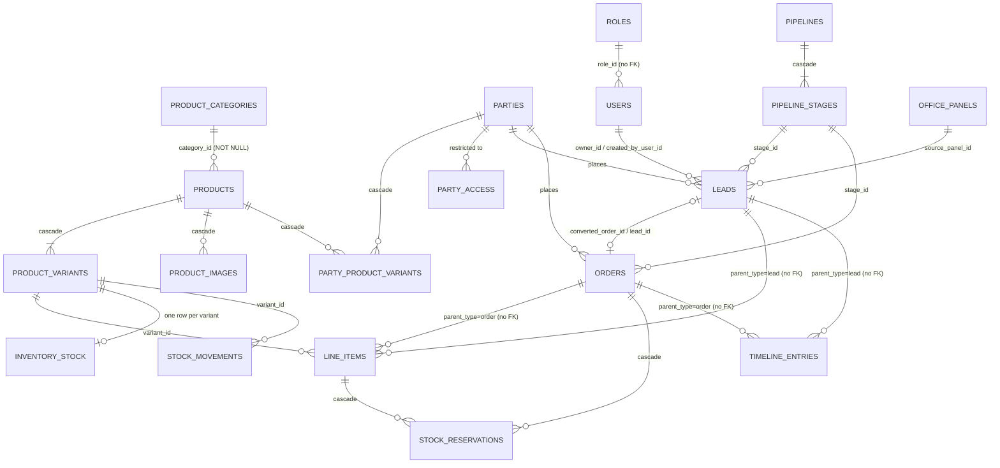

# Database Schema — Overview

This is the index for the OrderBook database design. Read this file first, then the
domain files in this folder. All schema lives **only on the Master Panel** — Office
Panels never have their own database (see `PROJECT_PLAN.md` §2).

**What these files describe.** The shape a database has after every registered
migration has run — checked on 2026-09-24 by running all 30 migrations
(`master/src/db/migrations/index.ts`, in registry order) against an empty
PostgreSQL 16 database and reading `pg_dump --schema-only`. The DDL blocks are that
shape written out by hand, with the real constraint and index names where they
matter; they are a description, not a script. Catalogue v2 (2026-09-29) added two
more, 32 in all: a no-op stub and `20260326000000_catalogue_brands_and_codes_port`,
whose columns and indexes are written into `02` and `03` from the migration and its
integration test (`master/tests/migration-catalogue-port.integration.test.ts`), not from
a fresh `pg_dump`. **The migrations are the record of
every step**; where a table changed, each file says briefly what it used to be and
which migration changed it. `docs/STRUCTURE.md` §6 carries the same facts as tables
(counts, the migration list, what each migration leaves behind).

The initial migration's header says these files are kept "character-comparable"
with its DDL. That stopped being true once later migrations reshaped the tables:
`20260101000000_initial_schema.ts` shows where things started, these files show
where they are now.

## Files in this folder

| File | Covers |
|---|---|
| `01-identity-and-network.md` | `master_config`, `users`, `office_panels` |
| `02-parties-and-products.md` | `parties`, `product_categories`, `products`, `product_variants`, `product_images` |
| `03-leads-orders-inventory.md` | `leads`, `orders`, `line_items`, `timeline_entries`, `party_product_variants`, `inventory_stock`, `stock_reservations`, `stock_movements` |
| `04-activity-log.md` | `activity_log` (the hash-chained audit trail) |
| `05-scaling-and-operations.md` | Why PostgreSQL, how it stays "zero-install" on a shop PC, and how it scales as data grows |
| `06-tenancy-permissions-and-sync.md` | `tenants`, `roles`, `party_access`, `settings`, `user_password_vault`, `pipelines`, `pipeline_stages`, `option_lists`, `custom_field_definitions`, `id_map`, `applied_mutations`, `sync_conflicts`, `id_sequences`, `master_clock`, and the search vectors |
| `07-integrations.md` | the public API and connector tables (`api_keys`, `api_key_scopes`, `api_connectors`, `api_connector_resources`, `api_connector_field_maps`, `api_connector_links`, `api_connector_runs`), and `ai_runs`, left behind by the removed assistant |

A migrated database has **41 base tables**: the 39 above plus Knex's own
`knex_migrations` and `knex_migrations_lock`. Besides the serial sequences it has one
sequence, `party_code_seq`, and one extension, `btree_gin`.

**Gone, and not described as live anywhere in this folder:** `lead_items` (replaced
by `line_items` in `20260302000000_lead_order_rebuild`), `role_permissions` (folded
into `roles.permissions` by `20260303000000_roles_and_users`),
`line_item_quantities` (dropped by `20260323000000_product_variants`), the PDF
Designer's `document_assets`, `document_templates` and `document_exports` (created by
`20260308000000_document_templates_and_exports`, dropped by
`20260322000000_drop_document_designer`), and the sequences `lead_number_seq` and
`product_code_seq`. Two intermediate table names survive only in constraint names: on a
fresh database `leads` has `leads_new_pkey` (and `leads_new_*_fkey`) and
`inventory_stock` has `inventory_stock_new_pkey`, from the tables `20260302` built and
then renamed.

## 1. Database Engine: PostgreSQL

Accessed through **Knex.js** (a SQL query builder) from the Master's Node.js
server, via the `pg` driver.

Why PostgreSQL over SQLite for this project:
- **Power at scale** — native `JSONB`, GIN indexes (full-text search here runs on
  them, see `06-tenancy-permissions-and-sync.md` §6), partial and expression indexes,
  table partitioning, window functions, and a real replication story if the business
  ever adds a second Master (another branch/factory) that needs to sync.
- **Accuracy** — full ACID transactions, strict type checking, and the most
  standards-compliant constraint/trigger support of the mainstream open-source
  databases — matches the "accurate" requirement directly. The schema leans on it:
  CHECK constraints, a deferrable unique constraint, and triggers that keep the audit
  trail append-only and hash-chained.
- **Efficiency at volume** — its query planner and indexing (B-tree, GIN, partial,
  expression indexes) stay fast as `leads`/`line_items`/`activity_log` grow into
  the millions of rows, well past where a simpler engine starts to strain.
- **No ceiling** — unlike a single-file embedded database, PostgreSQL has no
  built-in single-writer constraint and a clear path to read replicas or logical
  replication if usage patterns change later.

### Solving the "but shop PCs can't run a database service" problem

A normal PostgreSQL install usually means: download an installer, run it, configure
a system service, manage credentials — too much for a non-technical operator and a
bad fit for "must just work" offline software. The Master avoids that by running
**its own private PostgreSQL cluster as a child process**
(`master/src/db/postgres-server.ts`, `startPostgres()`):

- The PostgreSQL binaries come from the `@embedded-postgres/<platform>` npm packages
  (PostgreSQL 17) and are copied into the release under `vendor/postgres/` at build
  time, on a machine *with* internet — never fetched at runtime on the offline shop
  network. Run from source, the same packages under `node_modules/` are used; a
  system install of PostgreSQL 14–17 is the last fallback.
- On first launch the Master runs `initdb` into `<dataDir>/postgres/` with its own
  superuser `orderbook` and a random password kept in `<dataDir>/pg-superuser-password`
  (mode 0600), then starts the cluster bound to `127.0.0.1` on port 55432 and creates
  the `orderbook` database. Every later launch reuses the cluster, or adopts one that
  is already running.
- The operator never installs, configures, or even sees Postgres — from their
  perspective it behaves exactly like the "just a file" experience SQLite would
  have given, but it's a real, full-power Postgres underneath.
- `DATABASE_URL` bypasses all of this and connects to an existing server instead —
  used in development and for deployments that already run Postgres.

`<dataDir>` is `ORDERBOOK_DATA_DIR`, else `master/data` when run from source. Under
the Electron shell it is `<appData>/OrderBook/master` unless the operator moved it on
the first-run screen: the shell then reads the folder from the pointer file
`<appData>/OrderBook/master-location.json` and hands it to the server as
`ORDERBOOK_DATA_DIR` (`electron/shell.ts`), so on a relocated install the cluster,
uploads and backups are all under the chosen folder. Backups are in
`05-scaling-and-operations.md` §3.

## 2. Conventions Used Across Every Table

- **Primary keys** come in four shapes, chosen by who creates the row:
  - **Text ids** for the 12 `SYNCABLE_ENTITIES` in `shared/src/sync/ids.ts`, the
    record types the offline id scheme is built for: `leads` (`LD`), `orders` (`OD`),
    `line_items` (`LI`), `parties` (`PT`), `products` (`PR`), `product_categories`
    (`PC`), `product_variants` (`VR`), `party_product_variants` (`PV`),
    `timeline_entries` (`TL`), `stock_reservations` (`RS`), `roles` (`RL`), `users`
    (`US`). A panel mints a 15-character **temporary** id
    (`<6-char device code><9-digit counter>`); the Master assigns the 12-character
    **permanent** one (`<prefix><10 digits>`) and keeps the pair in `id_map` forever
    (`06-tenancy-permissions-and-sync.md` §5). Roles and users are on that list so the
    schema can take one minted offline, but they are **not yet creatable offline**:
    there is no `role.*` or `user.*` mutation kind, so both are created only through
    the Master's own API, always with a permanent id (`docs/ROLES_AND_USERS.md` §15.5).
  - **UUIDs** for rows only the Master creates: `tenants`, `office_panels`,
    `pipelines`, `pipeline_stages`, `option_lists`, `custom_field_definitions`,
    `product_images`, `inventory_stock` (generated in the application), and
    `party_access`, the `api_*` tables except runs, and `ai_runs` (database default
    `gen_random_uuid()`).
  - **`BIGSERIAL`** for append-only logs where row order itself is meaningful:
    `activity_log`, `stock_movements`, `sync_conflicts`, `api_connector_runs`.
  - **Composite or singleton keys** where the row is identified by what it is about:
    `id_map (tenant_id, temporary_id)`, `applied_mutations (tenant_id, mutation_id)`,
    `id_sequences (tenant_id, entity)`, `settings (tenant_id, key)`,
    `user_password_vault (tenant_id, user_id)`; `master_config` and `master_clock` are
    single rows held by `CHECK (id = 1)`.

  *History:* the initial schema gave every entity a UUID generated in the
  application. `20260302000000_lead_order_rebuild` (parties, categories, products,
  leads and the tables built with them) and `20260303000000_roles_and_users` (roles,
  users) moved the offline-creatable records to text ids, because an offline panel
  has to name a record before the Master has seen it (for roles and users: will have
  to, once their offline creation is built).
- **Tenancy**: every table carries `tenant_id UUID NOT NULL REFERENCES tenants(id)`
  except `tenants` itself, `master_config` (nullable), `master_clock` and
  `pipeline_stages` (scoped through `pipelines`). See
  `06-tenancy-permissions-and-sync.md` §1.
- **Timestamps**: `TIMESTAMPTZ NOT NULL DEFAULT now()` — Postgres's native
  timezone-aware timestamp type, indexed and sorted natively (no string-parsing
  cost, unlike storing ISO text).
- **No money.** The software carries no rates, amounts or totals, and no column holds
  a price. Weights (`weight_kg`, `total_weight_kg*`) and quantities are the only
  numeric business values, stored as `NUMERIC`, never floating point. *History:*
  prices and totals were stored as `INTEGER`/`BIGINT` in the smallest currency unit
  until `20260324000000_product_master_trim` dropped every one of them (2026-09-21).
- **Booleans**: native `BOOLEAN` type.
- **Soft delete**: `deleted_at` + `deleted_by` on `leads`, `orders`, `parties`,
  `products`, `roles`, `users`, `option_lists` and `custom_field_definitions` — the
  Recycle Bin, which has no table of its own. A deleted row keeps every reference to
  it valid, and the unique indexes on these tables are partial (`WHERE deleted_at IS
  NULL`) so a deleted row does not reserve its name or code. `product_variants` has
  `deleted_at` only, mirrored from its product. `is_active` is a different thing — a
  switch a person flips, not a deletion. Nothing ever purges the Bin.
- **Display codes**: only parties have one separate from their id — `party_code`
  (`P-0001`), drawn from `party_code_seq`. A lead's or order's permanent id *is* its
  docket number (`LD0000000042`), and a product variant's `code` is the business's
  own code, typed by staff. *History:* the initial schema also had `product_code` and
  `lead_number`, each with its own sequence; both are gone.
- **`JSONB`** holds data whose shape is the point: the values of admin-defined custom
  fields (`custom_fields` on leads, orders, parties and products), per-field sync
  clocks (`field_hlc`), a role's permission array, audit `details`, sealed secrets,
  stored mutation results, connector run errors. *History:* the initial schema also
  had a free-form `products.parameters` bag, GIN-indexed, for product attributes not
  yet decided; the trim dropped it, and no `JSONB` column is indexed today.
- **Foreign keys left out on purpose** (integrity is checked in the service layer):
  `users.role_id`, `office_panels.role_id`, `party_access.user_id`,
  `user_password_vault.user_id`, `api_keys.owner_user_id`,
  `api_connectors.run_as_user_id`, `api_connector_links.local_id`, `ai_runs.user_id`,
  and the polymorphic `line_items.parent_id` and `timeline_entries.parent_id` (over
  `parent_type` `lead`/`order`). Each file says why.

## 3. Entity-Relationship Diagram

The business core. Tenancy, the sync tables and the integration tables are left out
to keep it readable; their relationships are in `06` and `07`.

Full column-level detail for every box above is in the domain files listed in the
table at the top of this document.

## 4. Where Files Live

No file's bytes are stored in PostgreSQL, and no table records where the Master keeps
a file:

- **Product photos** — `product_images` holds metadata only (dimensions, checksum,
  blurhash, order, caption). The bytes live on disk at
  `<dataDir>/uploads/images/<tenantId>/<imageId>/<variant>.webp`, one file per variant
  (`master`, `large`, `thumb`, `micro`); the path is a function of the ids, so there
  is nothing to store.
- **Avatars** — `users.avatar_id` names a folder,
  `<dataDir>/uploads/images/<tenantId>/avatars/<avatarId>/` (variants `full`,
  `thumb`, `micro`).

Keeping bytes out of the database keeps it small, and lets the Master's Storage
screen (`PROJECT_PLAN.md` §5.4) report disk usage as the Postgres data directory plus
the uploads folder. *History:* the initial schema stored a relative
`product_images.file_path` under `data/uploads/products/<product_id>/`;
`20260307000000_product_images_pipeline` dropped it.
