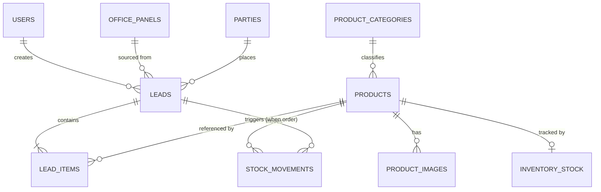

# Database Schema — Overview

This is the index for the OrderBook database design. Read this file first, then the
domain files in this folder. All schema lives **only on the Master Panel** — Office
Panels never have their own database (see `PROJECT_PLAN.md` §2).

## Files in this folder

| File | Covers |
|---|---|
| `01-identity-and-network.md` | `master_config`, `users`, `office_panels` |
| `02-parties-and-products.md` | `parties`, `product_categories`, `products`, `product_images` |
| `03-leads-orders-inventory.md` | `leads`, `lead_items`, `inventory_stock`, `stock_movements` |
| `04-activity-log.md` | `activity_log` (audit trail / live feed source) |
| `05-scaling-and-migration.md` | Why SQLite, growth limits, and the migration path to a bigger engine if ever needed |

## 1. Database Engine

**SQLite**, accessed through **Knex.js** (a SQL query builder, not a full ORM) so
the same table/query code can target a different engine later with only a config
change — see `05-scaling-and-migration.md` for exactly when and how that switch
would happen.

Why SQLite for v1:
- Single file on disk, zero background service to install/manage/crash on a shop
  PC — matches "runs locally, no internet, must just work."
- Our architecture already guarantees a **single writer** (only the Master process
  ever writes; Office Panels only send commands over Socket.IO). SQLite's
  single-writer model is a natural fit, not a limitation, here — there is no
  scenario in this design where two processes contend to write the file directly.
- Full ACID transactions, foreign keys, and indexes — same guarantees a "real"
  server database gives you.
- In WAL (Write-Ahead Logging) mode, reads never block writes, so the Master's own
  dashboard reads don't stall while a lead is being saved.

Concretely this means: `better-sqlite3` (Node binding) with `PRAGMA journal_mode =
WAL`, `PRAGMA foreign_keys = ON`, `PRAGMA busy_timeout = 5000`.

## 2. Conventions Used Across Every Table

- **Primary keys**: `TEXT` UUID v4 for any entity that is user-facing, referenced
  from multiple tables, or could ever need to be created outside a single
  auto-incrementing sequence (parties, products, leads, panels, users, etc.).
  `INTEGER PRIMARY KEY AUTOINCREMENT` only for pure append-only, purely-local logs
  where row order itself is meaningful (`activity_log`, `stock_movements`).
  Rationale: UUIDs generated in the app layer are portable across database engines
  and make future multi-master/replication scenarios possible without renumbering
  anything — plain incrementing integers don't survive that.
- **Timestamps**: `TEXT` storing ISO 8601 UTC (`2026-08-20T10:15:00.000Z`), not
  SQLite's `DATETIME`. Sorts correctly as a string, is human-readable in a DB
  browser, and is what every other database engine understands natively too.
- **Money**: stored as `INTEGER` in the smallest currency unit (e.g. paise, not
  rupees) — never `REAL`/float — to avoid rounding errors compounding over
  thousands of order lines.
- **Booleans**: `INTEGER` (`0`/`1`), SQLite has no native boolean type.
- **Soft state, not deletes**: rows that matter for history (parties, products,
  leads) use an `is_active` flag or a `status` column instead of `DELETE`, so
  historical orders never dangle a missing foreign key.
- **Human-friendly codes**: every entity staff talk about out loud (`party_code`,
  `product_code`, `lead_number`) gets a short sequential display code separate
  from its UUID primary key — UUIDs are for the system, codes are for people.
- **Flexible/ceramic-specific attributes**: modeled as a `parameters TEXT` column
  holding a JSON object, for fields that are still being finalized with the user
  (see Open Questions in `PROJECT_PLAN.md` §12) or that legitimately vary a lot
  between product types. Everything that's already well-known (code, name,
  category, size) gets a real typed column so it can be indexed and validated —
  JSON is the escape hatch, not the default.

## 3. Entity-Relationship Diagram

Full column-level detail for every box above is in the domain files listed in the
table at the top of this document.

## 4. Where Files Live

Only `product_images` reference actual files. The DB stores a relative path; the
bytes live on disk under `data/uploads/products/<product_id>/<filename>`, never as
a BLOB in SQLite — keeps the DB file small and lets the Master's "Storage" screen
(`PROJECT_PLAN.md` §5.4) report disk usage by just walking that folder.
