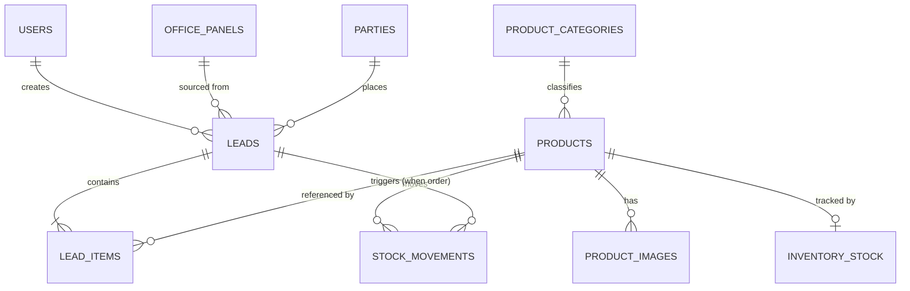

# Database Schema — Overview

This is the index for the OrderBook database design. Read this file first, then the
domain files in this folder. All schema lives **only on the Master Panel** — Office
Panels never have their own database (see `PROJECT_PLAN.md` §2).

## Files in this folder

| File | Covers |
|---|---|
| `01-identity-and-network.md` | `master_config`, `users`, `office_panels` |
| `02-parties-and-products.md` | `parties`, `product_categories`, `products`, `product_images` |
| `03-leads-orders-inventory.md` | `leads`, `orders`, `line_items`, `line_item_quantities`, `timeline_entries`, `party_product_variants`, `inventory_stock`, `stock_reservations`, `stock_movements` |
| `04-activity-log.md` | `activity_log` (audit trail / live feed source) |
| `05-scaling-and-operations.md` | Why PostgreSQL, how it stays "zero-install" on a shop PC, and how it scales as data grows |
| `06-tenancy-permissions-and-sync.md` | `tenants`, `roles`, `role_permissions`, `pipelines`, `pipeline_stages`, `option_lists`, `custom_field_definitions`, `id_map`, `applied_mutations`, `sync_conflicts`, `id_sequences`, `master_clock`, and the search vectors |

## 1. Database Engine: PostgreSQL

Accessed through **Knex.js** (a SQL query builder) from the Master's Node.js
server, via the `pg` driver.

Why PostgreSQL over SQLite for this project:
- **Power at scale** — native `JSONB` with GIN indexes (fast queries *into* the
  flexible ceramic product attributes, not just storage of them), table
  partitioning, window functions, and a real replication story if the business
  ever adds a second Master (another branch/factory) that needs to sync.
- **Accuracy** — full ACID transactions, strict type checking, and the most
  standards-compliant constraint/trigger support of the mainstream open-source
  databases — matches the "accurate" requirement directly.
- **Efficiency at volume** — its query planner and indexing (B-tree, GIN, partial,
  expression indexes) stay fast as `leads`/`lead_items`/`activity_log` grow into
  the millions of rows, well past where a simpler engine starts to strain.
- **No ceiling** — unlike a single-file embedded database, PostgreSQL has no
  built-in single-writer constraint and a clear path to read replicas or logical
  replication if usage patterns change later.

### Solving the "but shop PCs can't run a database service" problem

A normal PostgreSQL install usually means: download an installer, run it, configure
a system service, manage credentials — too much for a non-technical operator and a
bad fit for "must just work" offline software. This project avoids that entirely by
using **`embedded-postgres`** (a Node package that ships real PostgreSQL server
binaries and starts/stops a local instance as a child process of the Master
server):

- The Postgres binaries are bundled into the Master app at build time (downloaded
  once during packaging, on a machine *with* internet — never fetched at runtime on
  the offline shop network).
- When the Master app starts, it launches its own private Postgres instance bound
  to `localhost` on a fixed local port, pointed at a data directory under the app's
  install folder (e.g. `data/postgres/`).
- The operator never installs, configures, or even sees Postgres — from their
  perspective it behaves exactly like the "just a file" experience SQLite would
  have given, but it's a real, full-power Postgres underneath.
- The Master's own `data/` folder (Postgres data dir + `uploads/`) is exactly what
  gets backed up — see `05-scaling-and-operations.md`.

## 2. Conventions Used Across Every Table

- **Primary keys**: `UUID` (native Postgres type, generated in the application
  layer with the `uuid` npm package, not `gen_random_uuid()`) for any entity that
  is user-facing, referenced from multiple tables, or could ever need to be
  created outside a single sequence (parties, products, leads, panels, users,
  etc.). `BIGSERIAL` (auto-incrementing) only for pure append-only, purely-local
  logs where row order itself is meaningful (`activity_log`, `stock_movements`).
  Generating UUIDs in application code (rather than a DB default) means an Office
  Panel command can carry a pre-assigned ID end-to-end through the Socket.IO layer
  before the Master ever writes it, and keeps the ID scheme portable if data ever
  needs to move between databases.
- **Timestamps**: `TIMESTAMPTZ NOT NULL DEFAULT now()` — Postgres's native
  timezone-aware timestamp type, indexed and sorted natively (no string-parsing
  cost, unlike storing ISO text).
- **Money**: stored as `INTEGER` in the smallest currency unit (e.g. paise, not
  rupees) — never floating point — to avoid rounding errors compounding over
  thousands of order lines.
- **Booleans**: native `BOOLEAN` type.
- **Soft state, not deletes**: rows that matter for history (parties, products,
  leads) use an `is_active` flag or a `status` column instead of `DELETE`, so
  historical orders never dangle a missing foreign key.
- **Human-friendly codes**: every entity staff talk about out loud (`party_code`,
  `product_code`, `lead_number`) gets a short sequential display code separate
  from its UUID primary key — UUIDs are for the system, codes are for people.
- **Flexible/ceramic-specific attributes**: modeled as a `JSONB` column
  (`parameters`, `details`) for fields still being finalized with the user (see
  Open Questions in `PROJECT_PLAN.md` §12) or that legitimately vary a lot between
  product types. `JSONB` (not plain `JSON`/text) means these columns can still be
  indexed (GIN) and queried/filtered efficiently — this is the specific advantage
  Postgres gives over SQLite's `parameters`-as-text approach. Everything already
  well-known (code, name, category, size) still gets a real typed column —
  `JSONB` is the escape hatch for the undecided fields, not the default for
  everything.

## 3. Entity-Relationship Diagram

Full column-level detail for every box above is in the domain files listed in the
table at the top of this document.

## 4. Where Files Live

Only `product_images` reference actual files. The DB stores a relative path; the
bytes live on disk under `data/uploads/products/<product_id>/<filename>`, never as
a BLOB in Postgres — keeps the database small and lets the Master's "Storage"
screen (`PROJECT_PLAN.md` §5.4) report disk usage by summing the Postgres data
directory size and walking the uploads folder.
